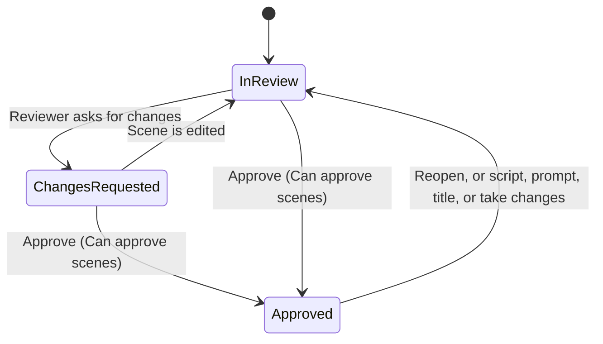

This guide covers the reviews that finish a
[Video Studio](/docs/apps/video-studio) project before export. Prepare the edit
first with [timeline editing](/docs/apps/video-studio-editing), and add titles
and graphic layers with [titles and graphics](/docs/apps/video-studio-graphics).

## Scene review

Use **Plan** to write a brief and organize storyboard scenes. Select a take for
each scene and approve it when ready.

- **Approval permission.** Approval uses a separate **Can approve scenes**
  permission and a revision check. Saving a project cannot grant scene approval.
- **Reopening.** Changing a scene's script, prompt, title, or selected takes
  reopens its review.
- **Status and notes.** Each unapproved scene has an **In review** or **Changes
  requested** status and a bounded review note for the next edit pass. Approved
  notes remain read-only until the scene is reopened.
- **Contact sheet.** The scene contact sheet shows the status, selected take,
  technical score, and a short note preview.

When scene approval is required, export waits until every scene has selected
media and approval, and every timeline asset must belong to an approved scene.

## Assemble a storyboard

1. For each scene, choose a take, its source in point, and a duration. Source
   ranges are bounded by the selected file's duration.
2. Optionally pair the visual take with narration or music layers. These keep
   their own source in points when you change the visual trim.
3. Choose **Assemble storyboard** to replace the timeline with those scenes in
   order and add timed scene titles.

Scene options:

- **Fit scene to this audio** uses the selected layer's remaining duration. If a
  video take is too short, choose a longer take or a still image before fitting.
- **Mute visual audio** silences the video's original sound while retaining
  added audio.
- Changing these settings reopens scene approval.

Assembly creates separate timeline tracks, where you can continue mixing and
editing. Existing captions are cleared so their old timing is not applied to
the new edit. Undo restores the previous edit, and saved revisions remain in
project history. When scene approval is required, every scene must be approved
before assembly.

## Production readiness

The **Production readiness** card in **Plan** mirrors the app's saved delivery
gates. Agents read the same gates from
`GET /api/video-studio/projects/{id}/readiness`.

The card reports the brief, scene plan, scene assets, creative approval,
timeline, and current delivery review separately.

- Direct timeline edits can skip storyboard stages. Projects with scenes or
  required approval keep those gates explicit.
- **Export gate ready** means the current project can be rendered.
- **Delivery ready** appears only after the current saved revision has a passing
  post-render review.
- When a timeline contains only still images without authored motion controls,
  readiness adds an optional **Motion quality** advisory, so you can review the
  delivery promise before publishing.

### Activity, preflight, and contact sheet

- **Production activity** sits beside the readiness card. It shows the brief,
  storyboard, takes, approval, and assembly stages alongside saved project
  revisions, generation outcomes, and export reviews, newest first. It is an
  app-owned run history; provider spend and settlement remain Gateway-owned.
- **Production preflight** combines the same gates with pipeline stage
  progress, pending or interrupted generation requests, logged decisions, and
  budget admission. Agents read the bounded snapshot from
  `GET /api/video-studio/projects/{id}/preflight` before starting the next
  production step.
- **Scene contact sheet** appears when scenes have visual takes. It loads
  bounded app-owned thumbnails and shows each scene's approval state before
  assembly.

The contact sheet also shows a bounded technical take score based on the saved
resolution, duration, and audio metadata. This is a review aid, not a claim
about creative quality or provider output. Required-approval projects keep
low-quality takes blocked until you choose a better take.

## Production recipes

See [media workflows](/docs/apps/video-studio-media-workflows) to prepare source
audio and footage before applying a recipe.

Open **Recipes** to compose imported media or a local template into an editable
timeline:

| Recipe | What it builds |
| --- | --- |
| **Animated explainer** | A 12-second local composition of vector cards and a title, without footage. Add optional audio to fit the composition to that source. The result remains ordinary editable project layers. |
| **Footage montage** | Selected images and videos in selection order, each shot bounded by its source duration, with short fades. An optional audio source replaces the clips' original sound. |
| **Cinematic montage** | The same editable source order, with every later shot crossfaded by a bounded timeline-second transition. A trailer-style cut without baking the result into a single file. |
| **Narrated slideshow** | Selected images spread across the full narration duration, with alternating slow zooms. |
| **Waveform video** | The complete audio source, a measured waveform, and an optional background image. |
| **Clip factory** | One video cut into bounded clips of the selected length, with a marker at each generated boundary. Audio remains optional. |
| **Multicam cut** | Two to four synchronized video sources alternated by the selected camera-cut length. The selected program audio (or the first camera's audio) goes on a separate track, scratch-camera audio is muted, and a marker is added for each camera change. |

Choose landscape, vertical, or square output and an optional title. Then:

1. Choose **Apply recipe**. It replaces and saves the timeline, titles, and
   captions. Undo restores the previous edit, and saved versions remain in
   project history.
2. Review the result.
3. Choose **Export video** to render it.

Required scene approvals also apply to recipe media. Animated explainer uses
only local composition. The other recipes use imported media and do not invoke
a paid generation provider.

## Export

When the edit is ready, export it from the **Exports** area. Formats, codecs,
publish presets, long-timeline exports, the delivery review, and handoff files
are covered in [export](/docs/apps/video-studio-export).

## Credits and provenance

Open **Credits** to review source attribution and rights for media used by the
current project, including bundled stickers. For each imported asset, the
report includes the saved provider, stable source identifier, source page,
attribution, and rights text.

**Download credits** writes a Markdown document suitable for a production
handoff. Generated media and local graphics get no invented source credits.
Provider billing stays in Gateway records.
