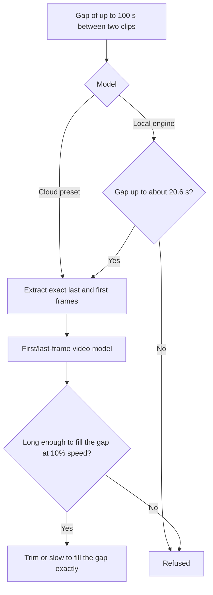
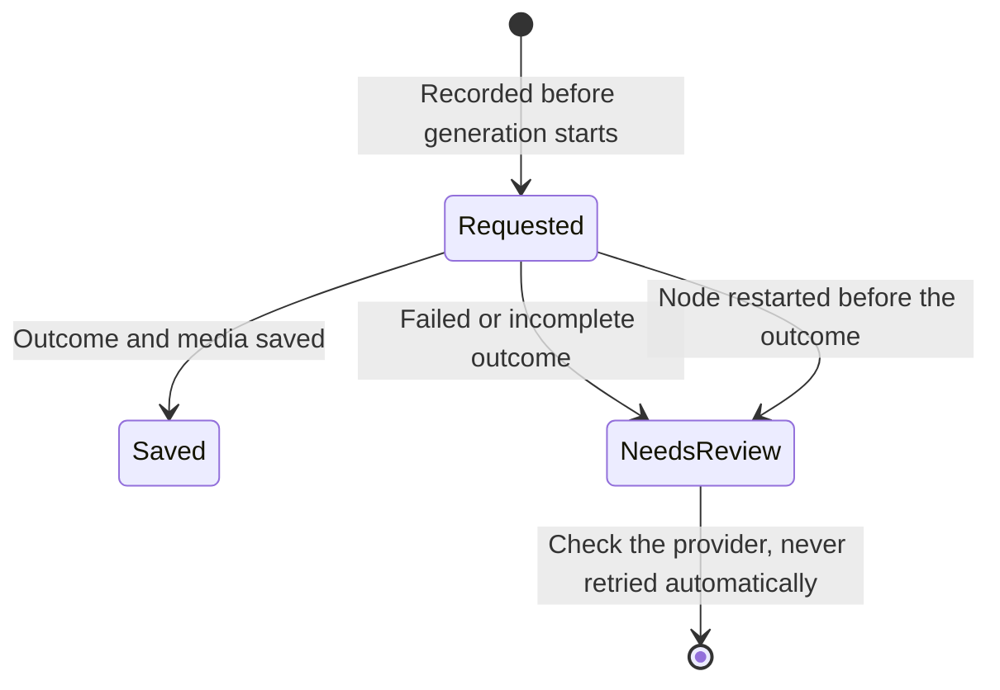

This guide covers generating media and drafting scenes inside a
[Video Studio](/docs/apps/video-studio) project. Provider availability and
charges depend on the services configured for the node. The
[timeline editing guide](/docs/apps/video-studio-editing) and
[transcripts and captions guide](/docs/apps/video-studio-transcription) cover
related steps.

## Generate images, video, and narration

The **Generate** panel uses Ryu's configured image, video, and narration
services. Describe a scene or provide the narrator's script, then generate and
review the result in your media library.

- Provider and model overrides are optional. Leaving the provider empty uses the
  node's local diffusion engine for images and video.
- For images, add up to four library images as references. PNG, JPEG, WebP, and
  GIF references are sent as they are, BMP is converted to PNG, and other formats
  are refused. The model must accept input images.

### Choose a model

**Model** lists the node's current model and each configured provider's
suggested models from Ryu's model catalog.

- **Discover models** asks providers that support discovery for their full
  list.
- **Node default** lets Ryu pick.
- **Custom…** lets you type a provider and model.

The catalog lists models, not what each one can make, so a model that cannot
produce the chosen media type is refused when you generate. If Ryu has not
granted Video Studio access to the catalog, the panel shows the provider and
model fields instead.

### Write the direction

In the direction, type `@` to mention a library image. Matching images appear as
buttons, and choosing one inserts a mention such as `@Hero-shot`. For image
generation, each mentioned image is sent as a reference, together with any you
pick below (four at most). The model reads the mentions as "reference image 1",
"reference image 2", and so on.

- **Enhance prompt** rewrites the direction or script with Ryu's language model
  for the chosen media type, keeping your mentions. **Undo enhance** restores
  what you wrote.
- **Save draft** keeps the prompt in this browser for this project, and
  **Drafts** reopens one.

### Check the estimate

Before you generate, the panel shows the project's planning estimate for one
request of the chosen type. When the project has a budget cap, it also shows how
much is left, and warns when the request would exceed the cap, which the project
also enforces. The estimate is the one you set under **Production budget**; the
provider's receipt in generation history is the actual charge.

## Edit and regenerate clips with AI

- **Edit with AI** on an image clip sends the clip's image, with your described
  change, to an image model that accepts input images. The edited still swaps
  in, keeping the clip's length, position, transform, and grade.
- **Edit frame as still** on a video clip inserts a two-second freeze at the
  playhead and then edits that frame.
- **Regenerate** repeats a generated clip's original request and swaps the new
  media in, keeping its slot (limited to the new media's length).

The project's generation cap is checked before anything changes. If the model
fails after a freeze is inserted, the freeze stays as an ordinary, undoable
still. Generation history shows the purpose of each request (AI edit, edited
frame, or regenerated) and its input images.

## Edit a video clip and cut out its subject

Cloud video models take reference media, so a few clip tools send part of a clip
to a model you choose:

- **AI edit → Video** sends the clip (up to 10 seconds from its in point, scaled
  to at most 720p) to a video-to-video model with your direction. The result is
  placed as a take over the start of the clip, at the clip's own speed, so it
  covers the same part of the source. **Edit frame as still** stays available
  for a single frame.
- **AI matte** asks a segmentation model for the subject of a still or of up to
  10 seconds of a clip, then removes the background on your node. **Keep
  background** removes the subject instead.

The matted copy has a transparent background (PNG for stills, ProRes 4444 for
clips), so you can place it over another background and keep using masks on it.
A matted clip also gets a transparent VP9 preview copy, so the preview shows the
same transparency as the export. If your node's FFmpeg cannot make one, the
status line says the preview cannot show it.

### Limits

Both clip tools place their take at the clip's speed.

- A clip with a speed ramp, or a speed below 25% or above 400%, is refused
  before anything is sent. Remove the ramp or change the speed first.
- If you edit the timeline while a model is working, so the clip has moved, been
  trimmed, or changed speed, the result is saved to your library but not placed.
  The status line says so.

### Model presets and field maps

Each tool has a **model** picker filled from presets. The model id and the input
field names come from the provider's documentation and are marked as presets,
because a provider can rename them.

You can change the provider, the model id, and the **Model fields** that map
Video Studio's inputs to the model's own fields: `$input_video`,
`$input_audio`, `$input_images.0`, `$input_images.1`, and `$duration_s`.

A local video model cannot edit video; Ryu says so instead of falling back to
text-to-video. Results are saved to your library and recorded in generation
history, and cloud providers may charge for them.

## Bridge a cut with an AI still

**Fill gap with AI** in the inspector of a video or image clip bridges it to the
next picture clip on its track:

1. Video Studio captures the outgoing clip's last frame and the incoming clip's
   first frame.
2. It asks an image model for an in-between still, with an optional direction.
3. It dissolves into the still, dissolves the next clip in over it, and adds a
   slow push-in.

With a gap, the still fills it and overlaps each neighbor by up to half a
second. At a cut, it adds a one-second bridge. No other clip moves. The captured
frames and the generated still are saved to the library, and the edit can be
undone.

The button is disabled, with the reason, when no image model or media permission
is available. The budget is checked before any frame is captured.

## Bridge a gap with generated motion

When the clips have a gap between them, choose **Generate motion** under
**Bridge** instead. At a cut, only the still bridge applies.

Video Studio sends the exact last frame the outgoing clip shows and the exact
first frame the incoming clip shows to a first/last-frame video model. It places
the returned clip so it fills the gap exactly: trimmed to the gap, or slowed when
it is shorter (down to 10% speed). Both sides get plain cuts, because the clip's
first and last frames already match.

- A returned clip too short to fill the gap even at 10% speed is refused.
- Generate motion is not offered for gaps longer than 100 seconds.
- If you trim or move either clip while the model is working, the clip is saved
  to your library but not placed, because its first and last frames no longer
  match.

### Use the local engine

To keep motion on your own machine, pick **Local engine** as the model. Video
Studio then sends both frames to the node's local video engine, with no cloud
model or field map.

- This needs a Wan first/last-frame model. Install Wan2.1 FLF2V 14B, or both
  halves of Wan2.2 I2V A14B, from the model catalog and select it as the local
  diffusion model.
- If the node has no such model, Ryu refuses the request and says why. Video
  Studio shows that reason and records the request as incomplete.
- Video Studio does not detect the installed model for you, so cloud presets
  stay the default choice.
- The local engine returns a clip of about 2 seconds (33 frames at 16 fps). With
  **Local engine**, Generate motion fills gaps up to about 20.6 seconds and
  refuses wider gaps before anything runs.

A local 14B model can take a long time, especially without a GPU. Ryu cancels a
local run after one hour and shows the timeout.

## Create music and sound effects

**Local soundtrack** composes an original score on your node, and the same area
makes procedural sound effects (see
[local soundtracks](/docs/apps/video-studio-audio#local-soundtracks)). These are
deterministic node-local audio, carry no provider receipt, and stay the default.

Set **Music source** or **Sound effect source** to **Generate (cloud model)** to
ask a music or sound-effect model instead.

- Video Studio sends your style, tempo, length, and description, or the sound
  you describe.
- It trims the result to the timeline length with a short fade and saves it to
  the library.
- The credits report lists generated media with the provider and model that
  made it.

When your host has no audio generation, the panel says so and the local score
remains available.

## Photoreal lip-sync and talking avatars

The Avatars panel's local vector avatar is the default. **Photoreal (cloud)**
sends real footage to a cloud model instead:

- **Lip-sync a video clip** re-times the speaker's mouth in a picture clip to a
  narration or text-to-speech clip, over the part where both play (up to 10
  seconds).
- **Talking avatar from a still** animates one photo or frame to speak the
  narration (up to 60 seconds).

Both clips must play at normal speed. You must confirm that the people shown
agreed to have their likeness and voice used this way. The confirmation is
recorded with the result and in the credits. The result is placed muted over
the picture clip, so the narration stays the audio.

## Set a production cap and review outcomes

In **Plan**, set a project production cap and planning estimates for image,
video, and narration requests. Video Studio checks the cap before admitting a
new generation, including pending and unsettled requests.

- A configured cap gates requests made through this app and its agent API. It
  cannot override another client's Gateway spend.
- Exact Gateway receipts replace planning estimates when the trusted provider
  row is available. See the
  [Gateway budget snapshot](/docs/apps/video-studio-agents#gateway-budget-snapshot)
  for how receipts are matched.

Requirements and fallbacks:

- Local generation requires a compatible model installed on that node.
- Unsupported explicit provider names return an error instead of using another
  engine.
- The app never substitutes a sample asset when a model fails.
- Cloud providers may charge for generation.

Local video generation uses the node's native queued diffusion job and waits for
the completed container before importing it. The returned WebM or MP4 keeps its
measured frame rate and dimensions. A failed, canceled, or timed-out job is
shown as an error and is never recorded as a saved asset. GPU-capable Wan/LTX
models are recommended because CPU video generation can take several minutes.

### Generation history

**Generation history** records the request before generation starts. It retains
the prompt, requested settings, project version, and saved media. Expand an
entry to review its details.

- Requests whose outcome was not saved remain marked for review, including after
  a node restart. They are never automatically retried.
- Each request also records the execution route and rationale you selected
  before starting it. These values are requested production context; Core and
  Gateway remain authoritative for the resolved provider, enforcement, and any
  charge.
- The history does not infer actual provider costs or which fallback model ran.

<Callout type="warn">
Check the provider before starting another request. A timeout or failed import
can occur after the provider has already completed or charged for the work.
</Callout>

## Choose narration settings

For narration, choose a voice, a language, and a speaking rate from 0.5× to 2×.

- **Voice** lists the voices of the speech engines installed on your Ryu node,
  grouped by engine and language (for example, "Kokoro · English (US)").
  Picking a voice also sets its language and engine.
- **Engine default** and **Voice default** use the node's default speech
  engine, voice, and language.
- Engines that are listed but not installed are named below the picker. Install
  them in Ryu's speech settings to add their voices.
- When the host does not list its speech engines, the voice and language are
  free-text fields instead.

**Script to video** uses the same voice picker. Generate the narration, review
it in the media library, then select it as the audio source for a narrated
slideshow or waveform recipe.

## Draft and review scenes

In **Plan**, write a brief and choose **Draft scenes with Ryu** to produce
editable scene directions and scripts. Drafting scenes does not generate their
media or approve them. Review the plan before producing its takes.

- Each scene has separate **Spoken script** and **Visual direction** fields.
  Editing either reopens its approval.
- You can continue editing while scenes are drafted. If the brief changes while
  a model is drafting, the late result is rejected and your current edit is
  kept.

The **Research sources** card keeps HTTPS citations with the project. Add a
title, URL, and note; each source records its retrieval time and can be removed
later. These are editorial citations, not a claim that Video Studio verified the
source or performed live web research.

To narrate, illustrate, and assemble a whole script in one pass, use
[script to video](/docs/apps/video-studio-assisted-editing#script-to-video).
