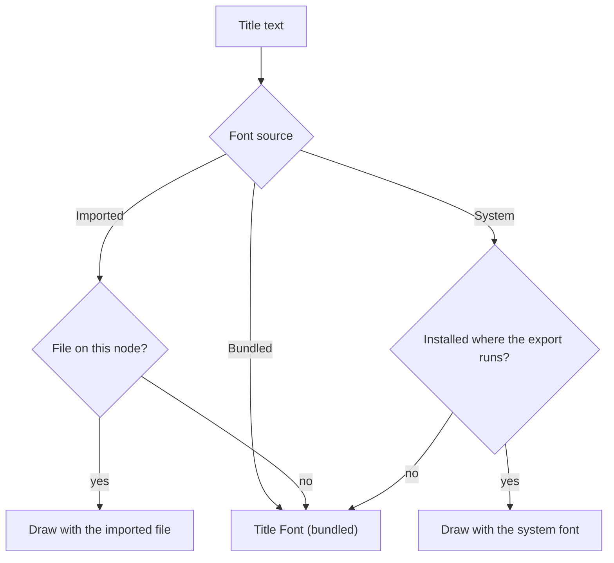

This guide covers the title and graphic layers you add to a
[Video Studio](/docs/apps/video-studio) project. Prepare the edit first with
[timeline editing](/docs/apps/video-studio-editing), then review the project
with [production review](/docs/apps/video-studio-finishing).

## Titles

Use **Titles** to add title cards or lower thirds. Set the text, position, size,
color, timing, and fades. Double-click a title in the preview to edit its text
in place, and drag it on its timeline lane to move or trim it.

### Style a title

- **Font** - 12 bundled open-license fonts (Inter, Roboto, Montserrat, Poppins,
  Oswald, Anton, Bebas Neue, Merriweather, Playfair Display, Lobster, Permanent
  Marker, and Source Code Pro) or the system sans.
- **Text** - weight, italic, underline, strikethrough, alignment, letter
  spacing, and line height.
- **Edges** - an outline and a hard or blurred shadow.
- **Box** - a square or rounded background box with its own opacity and padding.
- **Fill** - a solid color, or a left-to-right gradient from the title color to
  **Gradient end color**. Each letter takes its color along the gradient, in
  the preview and the export.
- **Text blur** - softens the whole text, outline included.

### Box padding and offset

With a **Box color** set, **Box padding** pads the box evenly. **Box horizontal
padding** and **Box vertical padding** override it for the left and right or
top and bottom edges. All three are fractions of the video height.

**Box offset X** and **Box offset Y** move the box away from the text for a
knocked-out or drop-block look; the text stays where it is. They are fractions
of the video width and height, from -0.1 to 0.1.

Keyframes on **Background padding** animate the even padding only, so a set
horizontal or vertical padding holds its value.

### Fonts

The font picker has three sources besides the bundled fonts. Imported and
system fonts work everywhere you style text: titles,
[caption styles](/docs/apps/video-studio-transcription#style-captions), and text
templates.

**Import a font.** Open **Style and motion** on a title and choose **Import
font…** under **Imported or system font**.

- TrueType (`.ttf`) and OpenType (`.otf`) files up to 24 MB are accepted, so
  large CJK families import too.
- Files over 1.4 MB upload in chunks, and the status line shows the progress.
- Web fonts (`.woff`, `.woff2`) and font collections (`.ttc`) are not supported.
- The font joins this node's font library under its own family name. The
  preview and the export both draw the title with that file.
- A font cannot be deleted while a title or caption style uses it.
- Imported fonts count toward the node's media storage allowance but not its
  media file limit. An export loads only the imported fonts its project uses.

**Online fonts.** This picker section searches the
[Fontsource](https://fontsource.org) catalog by family name.

- Only fonts under the SIL Open Font License 1.1, the Apache License 2.0, or
  the Ubuntu Font Licence 1.0 are listed.
- **Add** downloads one TrueType file (the regular weight of the font's default
  character subset, such as Latin), checks it like an imported file, and
  selects it.
- Each added font keeps its source and license. The **Credits** panel, the
  downloaded credits document, and the exported project package and archive
  list them for every project that uses the font.
- Video Studio contacts only the Fontsource catalog and its jsDelivr file host,
  and says why when either is unreachable.

**System fonts.** The picker lists the fonts installed on the computer running
Video Studio. The export asks for a system font by its family name, so it
renders only where that font is installed.

The title's **Font** stays as the fallback for an imported or system font that
is missing. Use an imported font when a project moves between computers,
because project archives carry imported fonts but not system fonts.

### Animation

- **In** - slide, pop, bounce, typewriter, word reveal, word highlight, blur,
  zoom, wave, **word slide** (each word rises into place in turn), or **word
  highlight block** (a box in the highlight color moves behind the word being
  read, and the text keeps its color).
- **Out** - an exit animation as the title leaves.
- **Loop** - pulse, wobble, float, or wave.

Titles also take rotation and keyframes.

### Title keyframes

Each title in the Titles area has a **Keyframes** field.

1. Pick a property and choose **Add keyframe at playhead** to record its
   current value.
2. Set each keyframe's value and easing (Linear, Ease in, Ease out, Ease in and
   out, or Hold), or remove it.

Titles animate position, scale, rotation, and opacity. They also animate text
size, letter spacing, line height, background padding, background corner
radius, text color, and background color. Colors blend smoothly between
keyframes. A title without a background color gets its box from its first
background color keyframe.

On the timeline, select a title and click the diamond at the end of its lane
item to open its keyframe lanes, one lane per animated property.

- Drag a diamond to retime it. It snaps to the title's edges, the playhead,
  markers, and its other keyframes.
- **Graph** drags values up and down, and **Curve** shapes the easing to the
  next keyframe.
- Arrow keys nudge the selected keyframe by a frame (Shift for 10), and Delete
  removes it.
- **Add** records the chosen property at the playhead.

In the export, text size, letter spacing, line height, text color, background
color, and the padding of a square-cornered box change on every frame, as in
the preview. The size, padding, and corner radius of a rounded box change in
small steps (about two frames apart on short titles, wider on long ones),
because the box is drawn as one shape.

### Text templates

The Titles area holds 23 original text templates in six categories: lower
thirds, title cards, callouts, quotes, calls to action, and social. Apply one
at the playhead and replace its text. You can pick an imported or system font
for all of its titles.

<Callout type="warn">
Exported titles use only the Regular and Bold faces of a font and are drawn
slightly smaller than in the preview. Rounded boxes are sized by estimate, and
very long per-letter animations move in groups of letters in the export. The
bundled fonts ship inside the Video Studio sidecar; if an install is missing
them, the title **Font** picker says so and exports use a system font instead.
</Callout>

### Speak a title

Narrate a title's text with Ryu's text-to-speech in one of two ways:

- choose **Text to speech** on the title in the Titles area, or
- right-click the title on its timeline lane and choose **Text to speech**.

Each line is read as a sentence, and a lower third's "Name · Role" separator is
read as a pause. The audio is saved to the media library and generation
history, then placed as a clip that starts with the title on the lowest free
audio track. If the title changed meanwhile, the narration stays in the library
for you to place by hand.

**Text to speech voice** in the Titles area sets the voice, language, and
speaking rate for both actions. It lists the voices of the speech engines
installed on your Ryu node, grouped by engine and language. Review the
pronunciation and timing after the clip is placed.

## Vector graphics

Open **Vector graphics** to add shape layers above the timeline: rectangle,
ellipse, triangle, line, polygon (3 to 12 sides), star (3 to 12 points with an
inner radius), heart, and arrow.

- Set a shape's timing, position, size, opacity, fill, stroke, stroke width,
  and entrance.
- Rectangles take a corner radius (0.5 makes a pill).
- Strokes sit inside, centered on, or outside the edge.
- Shapes rotate from -180° to 180° and take blend modes.

The same area holds **Stickers**, **Adjustments**, the canvas background, and
**Motion tracking** (see
[color, effects, and motion](/docs/apps/video-studio-color-and-effects) and
[assisted editing](/docs/apps/video-studio-assisted-editing#motion-tracking)).

### Shape keyframes

**Add keyframe at playhead** records the left, top, rotation, opacity, scale,
stroke width, corner radius, inner radius, fill color, or stroke color. Each
keyframe row sets its value and easing (Linear, Ease in, Ease out, Ease in and
out, or Hold). Scale grows or shrinks the shape around its center. Selected
shapes open the same keyframe lanes on the timeline as titles.

A shape whose size, stroke, corners, or colors are keyframed exports with one
drawing for every frame of its animation, however long it runs; frames that do
not change are stored once.

<Callout type="info">
A plain ellipse or triangle, with no stroke alignment, rotation, keyframes, or
blend mode, exports without its outline. Choose a stroke alignment to export
the outline.
</Callout>

### Shape masks

Each shape takes up to four **masks**, edited like clip masks. Every mask shape
except text is available, with position, size, rotation, feather, opacity,
invert, and an outline stroke.

- A shape's masks sit in its own box and turn, move, and scale with it.
- `x` and `y` run from -1 to 1 across the box, and the stroke width is a
  fraction of the box height.
- Masks hide everything outside the box, including an outside stroke.
- Masks do not animate.

## Stickers

**Stickers** searches 304 emoji, 210 country flags, and 30 original shapes by
name or keyword, filters by set, and offers eight animation presets. Flags with
very detailed coats of arms are not included.

A sticker is added as a 1024-pixel image in a **Stickers** library folder. It is
placed at the playhead on the lowest free track above the picture, at 35% scale
for four seconds. Adding it again reuses the image.

Agents can search the same library and place a sticker with a preset (see
[agent tools](/docs/apps/video-studio-agents#timeline-operations)). When the
editor cannot draw a sticker itself, Video Studio draws it on your node
instead, which needs an FFmpeg build with SVG support (librsvg).

Emoji are Twemoji graphics by Twitter, Inc and other contributors, licensed
under CC-BY 4.0; flags come from the flag-icons project under the MIT license.
Sticker credits appear in **Credits**, and published videos that use an emoji
sticker must keep its attribution.

## Avatars

Open **Avatars** to add a procedural 2.5D character layer. Set its timing,
position, size, depth, skin, outfit, and accent colors, then choose a neutral,
wave, or point pose. The character is built from local shape layers, so it
renders without a provider or external asset. Idle bob and slide entrances use
the same saved timing in the preview and FFmpeg export.

### Pose the rig

1. Choose a limb, head, or mouth property and set its value.
2. Choose **Add rig keyframe at playhead**.

Rig values interpolate between saved keyframes and use the same pose timing in
the preview and the export. Add a **Rotation limit** or **Translation limit**
for the selected joint and axis to keep keyed local poses inside a bounded
range. The same limits clamp the evaluated pose in preview and export. Saving a
second limit for the same joint and axis replaces the previous one.

### Lip-sync

**Lip-sync audio** animates the mouth from speech in an audible timeline clip
(following its trim and speed) or from library media.

- **Lip-sync sensitivity** (0.5 by default) and **Lip-sync smoothing** (0.4 by
  default) tune the motion.
- Transcript words widen vowels and close the mouth on m, b, and p.
- The result is ordinary mouth keyframes, so run it again after changing the
  audio.

This is vector-rig lip-sync; Video Studio does not produce photoreal talking
heads.

## 3D stage

Open **3D stage** to add local depth blocks. Each block renders with front, top,
and side faces through the local FFmpeg graph, without an external renderer.

- **Camera** - set the stage camera's offsets, zoom, orbit, and tilt.
- **Blocks** - set each block's center offsets, depth position, width, height,
  extrusion, timing, and color.
- **Motion** - float and orbit motions update the projected camera position in
  the preview and export.
- **Camera path** - add keyframes for x, y, zoom, orbit, or tilt at explicit
  timeline times. The same linear interpolation drives preview and export.

### Generate a local world

Enter a **World direction** and choose **Generate local world** to replace the
stage with a bounded local world layout. It holds terrain, water, mountains,
structures, a landmark, and a saved 12-second camera path. The result is
ordinary editable stage blocks and camera keyframes, saved with the project.
The generator makes only this fixed set of local stage elements, not arbitrary
3D assets.

### Import meshes

Open **Meshes** to import bounded Wavefront OBJ or glTF/GLB geometry. Video
Studio keeps validated triangle vertices and faces in the project, applies glTF
node transforms, projects the result through the saved stage camera, and
rasterizes the same geometry into the local export. Rotation, scale, position,
timing, and color remain editable.

- **Keyframes** - add mesh keyframes for position or Euler rotation to animate
  a short stage motion, with the same interpolation in preview and export.
- **glTF animation** - the first bounded glTF rotation and translation channels
  become mesh rotation and position keyframes.
- **Skins** - bounded linear glTF skin animations are baked into validated
  vertex poses for preview and export.
- **Embedded data** - embedded buffers and embedded PNG base-color textures are
  accepted.

<Callout type="warn">
Importing a file does not keep static glTF skin rig data, so joint, parent,
rig-keyframe, and joint-limit controls appear only on a saved mesh that already
carries rig data. External buffers, image URLs, and other unsupported animation
channels remain outside this importer.
</Callout>
