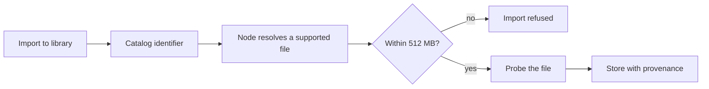
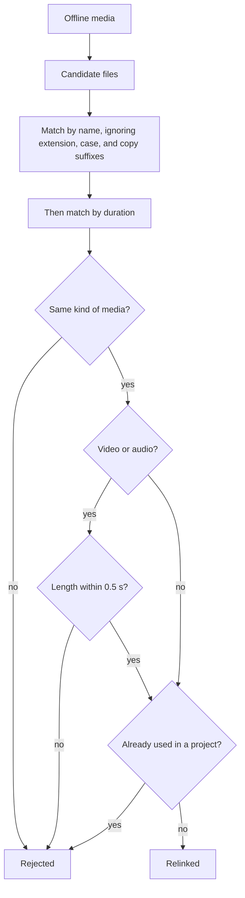

This guide covers preparing source media for a
[Video Studio](/docs/apps/video-studio) project before you edit it. Use
[timeline editing](/docs/apps/video-studio-editing) to place the prepared media.
Sound tools, such as cleanup, ducking, and waveform video, are in the
[audio guide](/docs/apps/video-studio-audio).

## Organize the library

- **Organize** on a library item renames it or moves it into a relative folder
  such as `B-roll/Sunset`. The **Media folder** filter beside search browses one
  folder.
- **Delete media** removes the app-owned file and thumbnail, and removes its
  clips from saved projects after checking their revisions.
- Deleting several items at once keeps media that a project still uses and
  names those projects.
- **Preview** (or **Preview and mark** on video and audio) shows a source before
  you add it.

Sorting, skimming, and marking a source range are described in the
[workspace guide](/docs/apps/video-studio-workspace#the-media-library).

## Analyze source footage

Choose **Analyze source** on an imported video or audio file to measure its
scene changes and audio envelope on your node. Analysis can be canceled, and
its results are kept with the library.

- Each detected video range can be added to the timeline as a clip. Review the
  suggested boundaries before you use them as cuts.
- **Add loudness markers** turns separated loudness peaks into timeline markers.
- **Remove detected silence** ripple-deletes the silent ranges of every matching
  audio clip.
- **Detect beats** measures a music source's tempo, beats, and bar starts (see
  [beats and cutting to music](/docs/apps/video-studio-assisted-editing#beats-and-cutting-to-music)).
  When no steady pulse is found, **Add estimated beat markers** offers a
  loudness estimate instead.

A project holds up to 500 markers.

## Find footage by look

Open **Find footage** and use **Find footage by look**.

1. Choose a video with a completed source analysis. Video Studio measures the
   dominant colors, brightness, framing, and motion of each shot. Similar
   neighboring cuts merge into one shot.
2. Describe a look, such as "dark blue motion", "low light", or "not dark".
3. Drag a result to the timeline, or choose **Add source range**.

The search understands synonyms (dim, navy, cyan, closeup), phrases ("dimly
lit", "well lit"), hyphenated words ("dark-blue"), and negation ("not dark",
"without blue"). Words it does not know are listed as **Not a visual term**.

<Callout type="info">
Labels are measured heuristics, not image recognition. A source can have up to
400 shots, sampled at up to 4 frames per second.
</Callout>

**Index shots in Space** adds the shot descriptions to a Space, so meaning
search finds them too.

### Describe shots with AI

**Describe shots with AI** adds what a vision model sees. Video Studio sends
one small keyframe per shot, a few at a time, to the model you name (or the
node default). It stores a one-sentence caption and short tags with each shot.

Words such as "dog on a beach" then find described shots, and they combine with
look words ("bright beach"). Shots without a description are still found by
their measured look. If the model cannot read images, Video Studio says so;
choose a vision model and try again.

## Find footage by meaning

1. In **Find footage**, choose a completed source transcript and a Space name.
2. Choose **Index transcript**. This copies transcript ranges into that Space;
   video and audio files stay in Video Studio.
3. Describe a moment in the search field and review the matching transcript
   ranges.
4. Choose **Add source range** to add one to the timeline.

The Space's access settings apply to the copied text, and Ryu Core performs
indexing and semantic search. Newly saved documents may take time to become
searchable.

After changing a source transcript, index it again. **Rebuild index** creates a
fresh projection and preserves documents edited outside Video Studio. Search
requires a Ryu host with Spaces access and does not fall back to cached results
when access is denied.

## Find open media

Open **Stock** to search open media catalogs. Each result shows its source
page, attribution, rights text, format, and size before anything is downloaded.

| Catalog | Needs a node API key |
| --- | --- |
| Archive.org | No |
| Wikimedia Commons | No |
| NASA Images and Video | No |
| Openverse images and audio | No |
| Unsplash images | Yes |
| Pexels, Pixabay, and Coverr | Yes |

Unsplash, Pexels, Pixabay, and Coverr require operator-provisioned API keys on
the node. Without a key, Stock reports that provider as unavailable.
Credentials stay on the node.

**Import to library** sends only the catalog identifier. The node does the rest:

<Callout type="warn">
Review the recorded rights and attribution before publishing. NASA media is
generally public domain in the United States, but check item metadata for
credited third-party material.
</Callout>

## Preview proxies

Video wider than 1920 pixels or above 30 Mb/s gets a hidden 960-pixel H.264
preview copy, made in the background after import.

- Turn on **Use proxies** in the preview toolbar to play from these copies.
- At **Half** or **Quarter** preview quality, Video Studio asks for lighter
  copies as needed.
- Proxies never appear in the library or on the timeline, and exports always
  use the original media.

Agents can create proxies, list them, sweep missing ones, and turn the
automatic import-time proxy off.

## Stabilize, interpolate, and enhance

The inspector's media tools make new library media from a video clip; the
original is never changed.

| Tool | What it does |
| --- | --- |
| **Stabilize** | Low, medium, or high, zooming 4%, 6%, or 8% on each edge. Uses FFmpeg's `vidstab` filters when available; otherwise a built-in tracker corrects camera shift but not rotation. Choose **Stabilize clip**. |
| **Convert frame rate** | Resamples a video to a new rate with **Optical flow** (needs FFmpeg's `minterpolate`) or **Frame blending**, keeping its length. |
| **Frame interpolation** | **Render smooth slow motion** renders smooth slow motion for a clip slower than 1×, keeping its speed and in and out points. |
| **Enhance** | Denoises, upscales with Lanczos, and sharpens, up to 8192 pixels on the long edge. It is not an AI upscaler. |
| **2× upscale** / **4× upscale** | Offered on visual library items. Plain Lanczos, up to 3840 pixels on the long edge. |

- Stabilizing, interpolation, and enhanced video are limited to 10-minute
  sources.
- Every derivative checks the library's storage limit.
- Leaving the default name reuses an earlier identical result; a custom name
  always creates new media.

## Color mattes and Lottie

**New color matte** creates a solid-color image (2 to 8192 pixels on a side,
the canvas size by default). It is placed as a five-second still that holds for
any length you trim it to.

**Import Lottie** renders a Lottie animation into a ProRes 4444 video with
transparency, plus a lighter VP9 copy for the preview when FFmpeg has VP9.

- Lottie `.json` files up to 5 MB are rendered at the project frame rate,
  scaled to fit 1920 pixels, and up to 600 frames.
- dotLottie (`.lottie`) files up to 20 MB are accepted too. Video Studio unpacks
  the first animation in the file, with its images, and renders it the same way.
- Embedded images are kept, text is drawn as shapes, and expressions do not
  run.
- You can cancel until encoding starts.

Lottie `.json` and `.lottie` files you drop on the window, or pick with
**Import media**, go through the same import.

## Offline media and relink

When a media file is missing or damaged, it shows as offline, and its timeline
clips get a hatched **Offline** badge. Exports are refused while any clip,
canvas background image, lip-sync audio, or nested sequence is offline, and the
message lists the files.

Choose **Relink offline media** in the Media tab to open the relink dialog.
Relink one file, or point it at a folder. Clips, captions, and analysis stay
attached. **Check for damaged files** scans the library again.

## Study a reference video

Open **Reference** and choose an analyzed video. **Build reference profile**
saves its measured pacing (duration, dimensions, shot count, average shot
length, audio, caption coverage) and a sampled visual style.

The generated brief describes the observed rhythm so you can adapt the
structure to an original production. It does not copy the source media,
transcript, or text. Three editable concepts (preserve the rhythm, slow the
reveal, or lead with a faster hook) can be copied into **Plan** with **Use
concept in Plan**.

## Related guides

- Transcription, timed captions, caption translation, dubbing, and the caption
  routes for agents are in
  [transcripts and captions](/docs/apps/video-studio-transcription).
- Generated images, video, and narration are in
  [media generation](/docs/apps/video-studio-generation).
