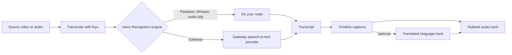

This guide covers turning speech in imported audio or video into transcripts
and timed captions in [Video Studio](/docs/apps/video-studio). Transcription and
translation use the services configured on the Ryu node, so review the words
and timing before export.

Related work is in the [timeline editing guide](/docs/apps/video-studio-editing)
and the [media generation guide](/docs/apps/video-studio-generation).

## Transcribe source media

1. In **Transcript**, choose a source video or audio file.
2. Optionally set its **Spoken language**: automatic detection or a specific
   language.
3. Choose **Transcribe with Ryu**.

Progress is saved in 20-second windows, so you can stop after the current
window and resume later. **Transcribe again** replaces an older transcript;
existing timeline captions stay until you apply the new one.

- **Language hint** - the language is sent to the engine as a hint and stored
  with the transcript. Engines that do not accept a hint ignore it.
- **Timing** - engine segment timestamps are kept when available. Video Studio
  never claims word timing the engine did not supply.

### Where the audio goes

In Desktop, **Transcribe with Ryu** uses the engine you choose in Ryu's Voice
Recognition settings, the same one chat voice input uses.

- With Parakeet, Whisper, or audio.cpp, the audio is transcribed on your node
  and stays there.
- With Gateway, your node sends the audio to the speech-to-text provider
  configured for your Gateway.

## Apply measured captions

When the engine supplies word timestamps, two actions place them on the
timeline, following each clip's trim and speed.

- **Apply word captions** places individually timed words.
- **Apply highlighted captions** groups the words into short lines and
  highlights the word being spoken.

Editing a line's text or timing, or translating it, removes its word timing.
Apply the measured captions again to restore it. MP4 exports keep highlighting;
SRT and WebVTT downloads contain line text and timing.

### Download subtitles

**Download subtitles** in the Captions tab writes the active caption track. Pick
the format in **Subtitle format**.

| Format | Contents |
| --- | --- |
| SRT | Line text and timing |
| WebVTT | Line text and timing |
| Plain text (TXT) | One caption per line in playback order, no timestamps; suits a transcript or show notes |

## Edit by transcript

**Timeline transcript** in the Transcript area shows the words of every
transcribed clip in playback order, with an optional track filter.

- Click a word to seek; the word being played is highlighted.
- Search with **Next** and **Previous** (or Enter and Shift+Enter).
- Shift-click, Cmd/Ctrl-click, or drag to select words, then press Delete to cut
  them. Clips, captions, and timed layers ripple on every sync-locked track.
- Clips with imported captions but no word timing show whole caption lines.

### Repeated phrases and retakes

**Repeated phrases and retakes** lists two kinds of suggestion:

- phrases of two to six words repeated straight away, with up to two fillers
  between, within ten seconds;
- sentences of three or more words that the next sentence restarts.

Each suggestion removes the earlier take, along with up to a second of pause
before the take you keep. **Remove all** and large selections work in batches
of 100 ranges.

## Style captions

**Caption style** in the Captions area offers 12 presets: Classic, Punch,
Karaoke, Boxed, Spotlight, Minimal, Broadcast, Glow, Reveal, Marker, Cinema, and
Headline. You can then set:

- **Font** - a bundled font, or an imported or installed system font under
  **Imported or system font**. A missing imported or system font falls back to
  the chosen bundled **Font**, as it does for
  [titles](/docs/apps/video-studio-graphics#fonts).
- **Text** - size, weight, and uppercase.
- **Colors** - text, highlight, outline, and box colors.
- **Edges and box** - outline and shadow size, and box opacity.
- **Layout** - horizontal and vertical position, and maximum lines.
- **Word animation** - none, highlight, pop, bounce, box, karaoke, or reveal.

**Apply style** saves it for the selected caption track. The preview and the
export match, and boxed reveal styles grow the box word by word. Once speakers
are detected, captions are tinted by speaker.

### Caption timing and filters

**Caption timing** regroups the captions. Choose **Rechunk captions** to apply.

- **Keep sentences**, **Short phrases** (with a maximum word and character
  count), or **One word at a time**.
- A minimum duration, and closing of small gaps.
- **Profanity** leaves words as spoken, masks them (`f***`), or removes them.
- **Also filter** adds your own words, remembered in this browser.

**Suggest emoji** asks Ryu's language model for emoji. Each one is added only
after you tick it.

## Import subtitle files

**Import captions** reads SRT, WebVTT, ASS, and SSA files. A file can hold up to
5000 captions.

- **Skip malformed cues and report them** imports what it can and lists each
  skipped cue with its line number.
- **Add to the existing captions** appends instead of replacing.

You can also import a source SRT or WebVTT file in **Transcript**. **Apply to
timeline captions** maps its cues onto every use of that source, following
trims and speed.

## Fix names and terms

Speech recognition often misspells names, brands, and jargon. **Fix names and
terms** in the Captions tab keeps a list of fixes for the project.

1. Type what the captions say in **Heard as** and the right spelling in
   **Correct spelling**.
2. Choose **Add fix**.

**Suggest fixes with Ryu** asks Ryu's language model for likely misheard proper
nouns and technical terms, using the project title and brief. Review the
suggestions and choose **Add suggestions** to keep them.

**Fix captions and transcripts** applies the list as one undoable step.

- It replaces every whole-word or whole-phrase match, ignoring case, in the
  source captions and in the saved transcripts of media on the timeline.
- Word timing is kept, so highlighted captions still follow the speech.
- **Also fix every caption language track** includes translated tracks.
- The list is saved with the project, so you can apply it again after a new
  transcription.

## Detect speakers

**Speakers** in the Transcript area labels caption words by speaker. Detection
needs timed captions, and word-level timing works best.

| Method | Use when |
| --- | --- |
| **Loudest mic** | Each speaker has their own microphone. Needs two or more audible sources, such as linked or multicam mics. |
| **Voice clustering** | One microphone with 2 to 6 speakers. |

- Captions take the speaker with the most word time.
- Clips get a colored stripe for their speaker. With clustering, a clip is
  tagged only when one speaker has at least 60% of its speech.
- Clips on locked tracks are not re-tagged.
- Rename, recolor, and merge speakers. Running detection again keeps their ids,
  colors, and names.

<Callout type="warn">
Detection reads up to two hours of source audio per run. It is a heuristic, not
true diarization, so review the labels.
</Callout>

## Translate a reviewed track

In **Captions**, select a target language and choose **Translate with Ryu**.
Translation uses the node's language model and keeps caption IDs and timing in
a separate language track. Malformed or incomplete responses leave the
original captions intact.

The **Caption track** selector switches between the source captions and each
translation. Playback, burned-in captions, subtitle downloads, dubbing, and
agent timeline reads all use the selected track. Review grammar and specialized
terms before exporting.

## Create narration from captions

Use **Dub this caption track** to create a spoken audio track through Ryu's
narration engine, with an optional language code, voice, and speaking rate.
**Dubbing voice** lists the voices of the speech engines installed on your Ryu
node, grouped by engine and language. Picking a voice fills in its language.

The caption timings stay unchanged. The saved WAV is added to the timeline for
review and can be trimmed or ducked. Long tracks must be split before dubbing.
To narrate a title instead, see
[Speak a title](/docs/apps/video-studio-graphics#speak-a-title).

## Agent routes

Agents edit captions without sending the whole project. All routes below sit
under `/api/video-studio/projects/{id}/` unless noted.

| Route | Purpose |
| --- | --- |
| `POST .../captions` | `append`, `replace`, or `remove` with the current `revision`; `trackId` is `null` for the source captions |
| `POST .../caption-style` | Caption style |
| `POST .../caption-rechunk` | Regrouping (alias `captions/rechunk`) |
| `POST .../caption-import` | Subtitle import (alias `captions/import`) |
| `POST .../caption-glossary` | Name fixes |
| `POST .../speakers/detect` | Speaker detection |
| `POST /api/video-studio/assets/{id}/transcript` | `language` sets the transcription hint |

The full list is in
[agent media and export](/docs/apps/video-studio-agents-media#captions-and-speakers).
