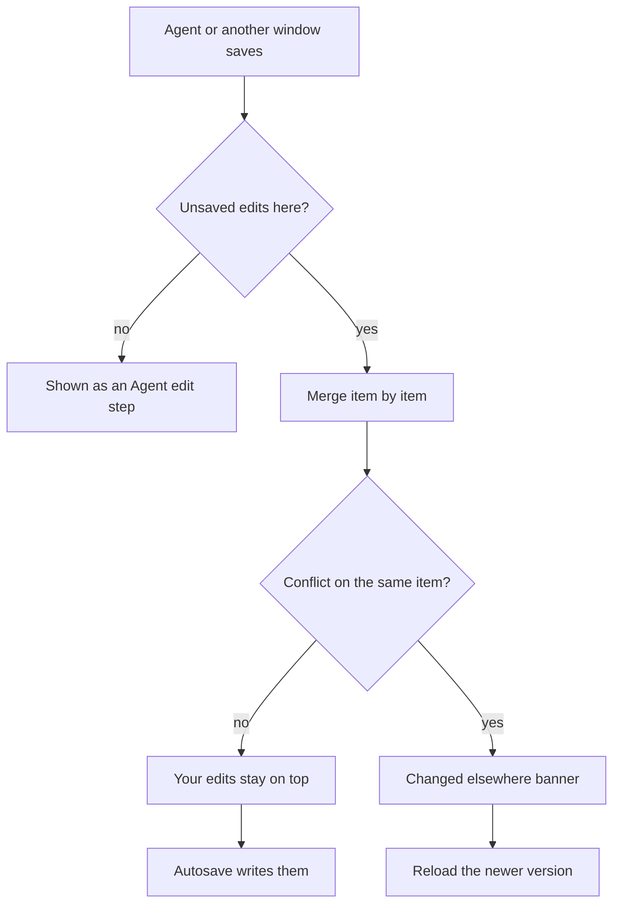

This guide covers the parts of Video Studio around the timeline: projects,
panels, the preview, saving, and the media library. Start with the
[Video Studio overview](/docs/apps/video-studio); the edits themselves are in
[timeline editing](/docs/apps/video-studio-editing), and every key is listed in
[keyboard shortcuts](/docs/apps/video-studio-shortcuts).

## Projects

Open **Projects** in the Media area for the project dashboard.

- Search by title, sort by last modified, date created, or title, and switch
  between a grid and a list.
- Each project shows a poster frame taken from its first visible content
  (hidden clips and tracks are skipped).
- Rename a project, read its details, or select several and delete them after a
  confirmation.

The strip under the toolbar shows up to eight recently opened projects for this
viewer. Choose one to switch to it; deleted projects drop out of the strip.

### Delete a project

Deleting a project removes it with its saved history, export records, exported
files, and posters. Media stays in the library. When the project was used as a
nested sequence elsewhere, that sequence clip becomes an ordinary video clip.

A delete is refused while the project is exporting or while another project
still nests it.

## Arrange the workspace

- **Resize** - drag the dividers between panels. The sizes are remembered for
  this viewer.
- **Layouts** - the layout menu offers **Edit**, **Color**, **Audio**, and
  **Review** presets. **Save current layout** stores your arrangement as **My
  layout**. A layout you have changed since choosing a preset shows as
  **Custom (unsaved)**.
- **Maximize** - press the backtick key or use the **Maximize** button in the
  workspace bar to maximize the focused panel. **Restore panels** brings the
  others back.
- **Phone width** - the panels stack in one column and the layout presets are
  hidden.

The first time you open the editor, a short tour points out the preview,
timeline, inspector, layouts, and shortcuts. Choose **Skip tour** or press
Escape to close it; **Take the tour** opens it again.

### Timeline colors

**Timeline colors** in the workspace bar sets the default fill for each kind of
timeline item: video, audio, and image clips, titles, captions, graphics,
avatars, and adjustment layers.

- Pick a swatch to change a kind's color, or **Reset all** to return every kind
  to its default.
- A clip with its own color tag keeps that tag.
- The colors are remembered for this viewer and do not change the project or an
  export.

## Language

Video Studio follows the language you choose for Ryu. Switching Ryu's language
updates the workspace without a reload.

| Translations | Languages |
| --- | --- |
| Official | Arabic, Chinese (Simplified), French, German, Hindi, Italian, Japanese, Korean, Portuguese (Brazil), Russian, and Spanish |
| Machine-drafted | Czech, Danish, Dutch, Finnish, Greek, Hebrew, Hungarian, Indonesian, Norwegian Bokmål, Polish, Romanian, Swedish, Thai, Traditional Chinese, Turkish, Ukrainian, and Vietnamese |

The translation covers the whole workspace:

- panel tabs and the overflow button that lists hidden tabs;
- every feature panel, such as Generate, Soundtrack, Multicam, Find footage,
  Sync, Tempo & Beat, Split edits, Cleanup, Highlights, Transcript, Titles,
  Avatar, dubbing, recipes, and production;
- the toolbar, the timeline and its clip menu, marker editing, and **Ask agent**;
- the library, the preview and source tabs, the inspector sections, and export
  settings;
- status messages, the tour, and the keyboard shortcuts dialog and printable
  reference.

Messages that include a value are translated too, such as "Imported 3
captions.", a marked range, or an error that names a clip or track. The value
itself is shown as it is. Your own project, clip, and media names stay as they
are, as do the names of codecs and file formats.

<Callout type="warn">
The machine-drafted translations cover the same strings and value-filled
messages as the official languages, with each language's own plural forms. They
have not yet been reviewed by native speakers, so some wording may read
unnaturally. They appear only when Ryu itself runs in that language, which needs
a Ryu language pack for it; without the pack Ryu cannot select the language, and
Video Studio stays in English.
</Callout>

## Save, autosave, and history

Video Studio saves your edits automatically two seconds after the last change
and when you switch away from the tab. **Save changes** and Cmd/Ctrl+S save
immediately, waiting for an autosave that is already in progress. The browser
warns before you leave with unsaved changes.

The toolbar shows the save status:

| Status | Meaning |
| --- | --- |
| **Saved** | Every edit is stored. |
| **Saving…** | An autosave or manual save is running. |
| **Unsaved** | Edits are waiting for autosave. |
| **Save failed** | The last save did not complete. Autosave retries after ten seconds. |
| **Changed elsewhere** | Another editor or an agent saved a newer version. Autosave pauses, and a banner offers to reload the newer version. |

### Changes from agents and other windows

Changes an agent (or another window) saves to the open project appear in the
editor within a few seconds, without a reload. Each one is added to your
history as an **Agent edit** step, so Cmd/Ctrl+Z reverts the agent's change
like any of your own edits, and redo brings it back.

If you have unsaved edits at the time, Video Studio merges the two. Clips,
tracks, titles, captions, markers, and the other timeline items are matched one
by one. A change to a different item, or to a different setting of the same
item, is combined with yours. Your edits stay unsaved on top of the newer
version, and autosave writes them a moment later.

The **Changed elsewhere** banner appears only for a real conflict, listing the
items and offering to reload the newer version. A conflict is one of these:

- Both sides changed the same setting of the same item.
- One side deleted an item the other edited.
- Both sides moved clips onto each other.

### History

Open **History** in the Exports area to see this session's edits, each with a
label and a time.

- Choose any step to return to it. Steps you undo stay available to redo until
  you make a new edit.
- The first entry reads **Opened**, or **Oldest kept step** once more than 100
  edits have been made.
- The same panel lists saved revisions, including those from earlier sessions.
  Restoring one is itself an undoable edit.

## The preview

The preview toolbar changes only how you watch the project; none of it affects
the saved project or an export.

| Control | What it does |
| --- | --- |
| **Zoom** | **Fit** shows the real fit percentage, or pick a level from 25% to 400%. When zoomed in, pan by dragging with the middle mouse button or by holding Space while you drag. |
| **Guides** | Overlays for framing (see below). Guides never appear in exports. |
| **Playback rate** | Plays the timeline from 0.25× to 10×. |
| **Quality** | **Full**, **Half**, or **Quarter** resolution. Lower quality makes heavy timelines play more smoothly. |
| **Use proxies** | Plays video from lighter preview copies when they exist (see [preview proxies](/docs/apps/video-studio-media-workflows#preview-proxies)). Exports always use the original media. |
| **Save frame** / **Copy frame** | Downloads the frame at the playhead as a PNG, or puts it on the clipboard (or explains when the browser cannot copy images). |
| **Fullscreen** | Fills the screen with the preview. |

### Guides

- **Safe areas** - action safe (90%) and title safe (80%).
- **Aspect guides** - 9:16, 4:5, 1:1, 1.85, and 2.39.
- **Composition** - rule of thirds and a center cross.
- **Vertical video** - generic interface zones, and three generic layouts
  (caption-heavy, right action rail, and bottom sheet) that approximate where
  short-form apps put their buttons and text.
- **Grid** and **Custom guide** - a grid, or your own margins and aspect box.
  While either is on, the menu shows **Custom aspect** (W:H, such as 2.35:1),
  **Side margins**, **Top and bottom margins**, **Grid columns**, and **Grid
  rows**. These are remembered on this device.

**Hide all guides** clears them, and your last set is remembered.

### Preview tabs

The preview has a fixed **Timeline** tab plus one tab for each library item you
open. Double-click a library tile, or choose **Open in viewer**, to open it in a
source tab. Opening a source tab pauses timeline playback.

A source tab plays the media in real time with its sound.

- Space plays or pauses, J and L shuttle backward and forward (press again for
  2×, 4×, and 8×), and K pauses. The position slider scrubs.
- **Mark in (I)** and **Mark out (O)** set the source range, the same range the
  library tile shows.
- **Add to timeline**, **Insert at playhead**, and **Drag to timeline** place
  only the marked part.

The arrow buttons before the tabs go back and forward through the tabs you
viewed. Close a tab with its × button or a middle click. Open tabs are
remembered for this viewer and project, and tabs for deleted media close.

### Edit on the canvas

Select a clip, title, or graphic and drag it in the preview to move it.

- **Scale** - corner handles scale evenly (hold Alt to scale from the center).
  Clips and graphics also have edge handles that stretch one axis; on a clip
  they set **Scale X** or **Scale Y**.
- **Rotate** - clips, titles, and graphics have a rotation knob above their box.
  Hold Shift to snap rotation to 15° steps.
- **Nudge** - arrow keys nudge the selection by one pixel, or ten with Shift.
- **Snap** - items snap to the canvas center and edges and to other items. Hold
  Cmd/Ctrl to skip snapping for one drag, or turn snapping off with N.

Each drag is one undo step. Dragging a property that already has keyframes
adds a keyframe at the playhead. Clips on locked tracks cannot be changed on the
canvas.

**Crop mode.** Press C with a clip's box focused, or Enter, to open crop mode. It
shows the whole source with the crop window over it.

1. Choose a free crop or a 16:9, 9:16, 1:1, 4:5, or 4:3 aspect. A fixed aspect
   leaves only the corner handles.
2. Choose **Done**. **Reset** removes the crop, and Escape leaves crop mode.

The kept area refits the canvas exactly as it will in the export. Crop mode
also ends when you select something else, the playhead leaves the clip, or its
track is locked.

**Title text.** Double-click a title, or press Enter on its box, to edit its
text in place. Enter commits, Shift+Enter adds a line, and Escape cancels.

**Trim previews.** During a slip, roll, or ripple drag, the preview shows two
source frames side by side with their source timecodes. A slip shows the first
and last frames; a roll or ripple shows the outgoing and incoming frames at the
edit point.

### Number fields

Many number fields accept arithmetic such as `1920/2-10` or `+0.1`, with `+`,
`-`, `*`, `/`, parentheses, and decimals. They include:

- the clip inspector;
- the Titles and Graphics panels (timing, position, size, fades, stroke width,
  and shape geometry);
- the title style controls (letter spacing, line height, outline, shadow, box,
  rotation, and animation durations);
- effect seeds, and title and graphic keyframe values.

Enter applies the value, Escape reverts it, and values are clamped to the
field's range. An expression that cannot be evaluated stays marked with its
reason, which screen readers announce, and reverts when you leave the field.

- **Scrub** - drag a field's label to change it one step per pixel. Hold Shift
  for finer steps or Alt for larger ones, and press Escape to cancel.
- **Step** - ArrowUp and ArrowDown nudge by one step with the same modifiers.
- **Unset fields** - a title style field or effect seed that shows a placeholder
  is unset. Scrubbing starts from the placeholder's default, and emptying the
  field returns it to the default.

## The media library

- **Sort** by date, name, type, duration, or frame size, in either direction,
  and show the library as a list or a grid. Both choices are remembered.
- **Select** several items with their checkboxes, a Shift range, or
  Cmd/Ctrl-click, then **Select all**, **Clear**, or **Delete selected**. Media
  that a project still uses is kept, and the message names those projects.
- **Skim** a video tile by moving the pointer across it.

**Preview and mark** lets you scrub a source and mark a range with I and O or
the buttons. That range is then used by **Add**, **Insert at playhead**,
source-analysis ranges, and dragging. Without a marked range the whole clip is
used. For real-time playback with sound, open the item in a
[preview tab](#preview-tabs); its marks are shared with the tile.

### Bring media in

Drag library media onto a timeline lane to overwrite what is there, or hold
Cmd/Ctrl while dropping to insert it and ripple later content.

- A ghost shows where the media will land and shades the clips, including
  linked audio, that it will cut.
- Drops snap to edit points unless you hold Shift.
- Dropping below the lanes picks a free track of the matching kind.
- Locked tracks refuse drops.

Media files dropped anywhere on the window are imported; unsupported files are
reported as skipped. With no text field focused, Cmd/Ctrl+V imports an image or
video from the system clipboard, or pastes copied clips when the clipboard holds
none. Imports run in chunks, and each file can be up to 2 GB.

The "Media imported" notice in the status line goes away on your next timeline
edit, such as adding the new media, or after six seconds.
