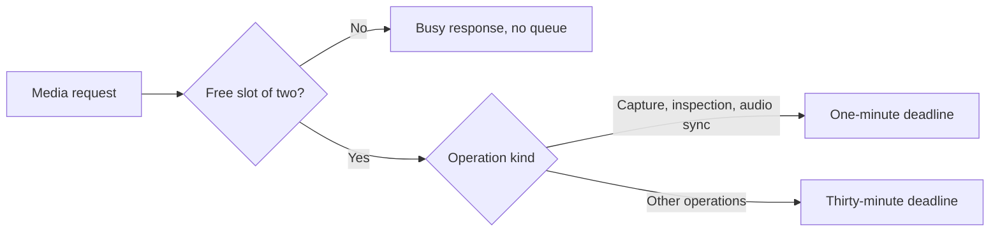

This page is part of the [Apps catalog](/docs/apps), [app manifest lifecycle](/docs/core/app-manifest-lifecycle), [Plugins vs Apps](/docs/extend/develop/extensions/plugins-vs-apps), [Marketplace](/docs/extend/develop/extensions/marketplace), [Gateway governance](/docs/gateway/governance) documentation path. In the same category, compare [Studio](/docs/apps/studio), [Slides](/docs/apps/slides), [Whiteboard](/docs/apps/whiteboard).

## What it does

Video Studio is a separate editing workspace. Use [Clips](/docs/apps/clips) to
capture recordings, then import your footage into Video Studio alongside music,
voice recordings, and still images.

It is a multi-track editor with the tools of a desktop editing app. Editing and
analysis run on your Ryu node; only the generation features call a model.

| Area | Tools |
|---|---|
| Editing | Razor, ripple, roll, slip, and slide edits, a clip clipboard, snapping, markers, nested sequences, templates |
| Motion and look | Keyframes with easing curves and a graph editor, blend modes, masks, keys, color wheels, curves, LUTs, an effects and transitions library, adjustment layers |
| Audio | A track mixer, audio cleanup and effects |
| Text | Styled captions and titles |
| Export | MP4 to ProRes 4444, WebM, GIF, audio, and image sequences |
| Analysis and assisted tools | Beat detection, voice-activity cleanup, speaker labels, transcript editing, shot search, automatic J-cuts and L-cuts, auto reframe, motion tracking, AutoCut, vertical shorts, script to video |

## Limits and requirements

| Item | Limit |
|---|---|
| Clips and tracks | Up to 5000 clips on 32 tracks per project |
| Titles and graphics | Up to 1000 titles and 1000 graphics per project |
| Project length | Up to two hours |
| Canvas | A custom canvas can be up to 8192 pixels on a side; aspect and quality presets stay within 3840 |
| Frame rates | 23.976, 24, 25, 29.97, 30, 48, 50, 59.94, 60, and 120. NTSC rates use exact 1000/1001 timebases in exports and handoff files |
| Clip speed | 0.1× to 100× |
| Imported file size | Up to 2 GB each |

The node needs FFmpeg and ffprobe. Some features need optional FFmpeg filters
or encoders. When one is missing, the matching control is disabled and names
what is missing.

| Feature | Needs |
|---|---|
| LUTs | `lut3d` |
| Voice isolation | `arnndn` |
| Background cutout | `backgroundkey` and `prores_ks` |
| Text masks | `drawtext` |
| Optical-flow interpolation | `minterpolate` |
| Exports that use these encoders | libvpx-vp9, libmp3lame, or 10-bit libx265 |

Asking an agent about the timeline and recording a voiceover each need an
optional permission that is granted separately from enabling the app.

## Media operations and concurrency

### Shared media slots

Exports, local upscales, nested timeline rendering, frame capture and inspection,
color inspection, and audio sync share two active media-operation slots.

- Busy requests start no work and enter no waiting queue.
- The thirty-minute deadline includes nested work and cleanup.
- Canceling an export or stopping the app cancels its active media work.

### Nested timelines

A nested-timeline operation uses one snapshot and reuses each completed source
revision. Separate sequence clips keep their own bindings.

- It supports up to 64 source projects, 512 distinct sequence bindings, and 10 GB
  of working data.
- The project duration and output-dimension limits above still apply.

### Frame capture and inspection

Frame capture and inspection seek directly to the requested time, including
nested timelines, and render a single composed frame. Separate clips keep their
own source times.

- Disconnecting from an inspection cancels its active work.
- Capture reserves media-library storage before rendering, and rejects a changed
  source timeline instead of saving a stale frame.
- Active textured meshes and animated rigs are sampled at the chosen frame time,
  including inside nested timelines.

### Audio sync

Audio sync compares the selected trims at the measured waveform's resolution and
runs in the background so editing stays responsive.

- A short trim from a long, coarsely measured recording may not contain enough
  samples. Use a longer shared sound or a manual offset.
- If the timeline changes during sync, reload before trying again. The newer edit
  is preserved.

### Soundtracks

Local soundtracks can be up to two hours long. Video Studio runs at most two
soundtrack operations at once across its connected clients, including generation,
import, and temporary-file cleanup.

Additional requests receive a busy response without starting work or entering a
waiting queue; try again after a soundtrack finishes. Background analysis keeps
its separate operation limit.

### Imports and analysis

- **Media analysis** limits probe metadata to 8 MB, including file-backed output.
  Oversized metadata is rejected before JSON parsing, and probe output files are
  removed after success or failure.
- **Stock imports** share media-operation admission and honor the media library's
  asset and storage limits before downloading. NASA metadata is read only from
  trusted HTTPS NASA hosts; redirects are rejected.
- **Mesh imports** limit expanded scene nodes, animation channels, and joint data.
  Mesh export runs in a background worker and honors export cancellation. If a
  mesh exceeds the supported rendering work or temporary-image limit, reduce its
  geometry, export resolution, or duration before retrying.

## Editing safeguards

- Deleting a linked clip checks every affected track, including an unselected
  partner's track. Unlock those tracks before deleting the linked group.
- Partial settings updates preserve an omitted export preset. Change that preset
  explicitly when switching between master, review, and social delivery.
- Production decisions are appended through the decision log. Ordinary project
  edits and undo preserve existing entries; the log cannot be rewritten or cleared
  through a project update.

## Scene review and approval

Undo and history restore recover editorial changes, not reviewer authority.

- Reopened or changed scenes stay unapproved when an older version is restored.
- An unchanged scene keeps its current approval. Restored scene content needs a
  fresh review before an approval-required export.
- Changing **Require scene approval** requires scene-approval permission. Ordinary
  editing and undo preserve that requirement and locked notes on approved scenes.
  Reopen review before changing those notes.
- An unavailable scene preview stops retrying automatically. Choose **Retry
  unavailable previews** to try it again.

Agents update the requirement through
`POST /api/video-studio/projects/{id}/approval-policy` with the current `revision`
and a boolean `requireApproval`. Imported production packages keep their review
requirement; imported approvals still need fresh review on the new project.

## Production readiness

The **Production readiness** card in **Plan** reports the brief, scene plan,
scene assets, creative approval, timeline, and delivery review separately.

- **Export gate ready** means the project can be rendered.
- **Delivery ready** appears only after the current saved revision passes a
  post-render review.

See [production review](/docs/apps/video-studio-finishing#production-readiness).

## Gateway budget snapshot

Generation history can show a read-only snapshot of the node's Gateway spend.
Video Studio never estimates a cost from that snapshot or attributes node-wide
spend to a project. See
[agent access](/docs/apps/video-studio-agents#gateway-budget-snapshot).

Exact receipts, matched by the generation request identifier, need the separate
administrative audit permission.

- An existing installation keeps its current approvals until a node administrator
  permits and approves that permission.
- Until then, generation budgets use conservative estimates instead of claiming
  confirmed costs. Ordinary usage summaries stay available.
- After approval, receipts can confirm actual costs.

The production activity ledger shows the newest 200 events. Project budget
admission also counts older generation requests that the visible history no
longer shows. Pending and unsettled requests stay counted against the cap.

## Bundled assets and licenses

| Asset | Source and license |
|---|---|
| Title fonts | Open-license fonts (SIL Open Font License or Apache 2.0) |
| RNNoise voice model | GregorR/rnnoise-models (BSD 3-Clause) |
| Emoji stickers | Twemoji (CC-BY 4.0, "Twemoji graphics by Twitter, Inc and other contributors") |
| Flag stickers | flag-icons (MIT) |
| Other stickers and templates | Original sticker shapes and templates |

## Data at rest

Video Studio encrypts its project records on disk with a key only this app
receives from Ryu.

| Encrypted | Not encrypted |
|---|---|
| Projects and their undo history (titles, scripts, captions, scene prompts) | The media library list (names, kinds, durations) |
| Transcripts and the app's transcript search indexes | Export jobs and timestamps |
| Generation requests and their prompts | Imported and generated media, imports in progress, and rendered exports |
| Media analyses | Cached project poster frames, imported fonts and LUTs, and shot analysis results (including shot descriptions used by media search) |

The unencrypted files are ordinary video, audio, and image files in the app's
private data folder, readable only by your account, because the video tools read
them directly.

- While an export, frame capture or transcription runs, its temporary work files,
  such as the caption file, are unencrypted copies. They are deleted when the job
  ends, and any left by a crash are deleted the next time the app starts.
- Records saved by an earlier version are encrypted the first time the updated app
  starts.
- If the app is updated before Ryu itself, new records stay unencrypted until Ryu
  delivers its key, and the app reports that it is waiting for a Ryu update.

## Video Studio guides

The guides follow a project from the first cut to delivery. The last two are references for agents.

- [Workspace and preview](/docs/apps/video-studio-workspace) covers projects, panel layouts, autosave and history, the preview toolbar, on-canvas editing, and the media library.
- [Build and edit a timeline](/docs/apps/video-studio-editing) covers placing, selecting, cutting, and trimming clips, tracks, markers, J-cuts and L-cuts, nested sequences, templates, and project settings.
- [Color, effects, and motion](/docs/apps/video-studio-color-and-effects) covers transform and framing, blend modes, masks, keys, color and LUTs, effects, adjustment layers, backgrounds, layouts, transitions, and keyframes.
- [Audio](/docs/apps/video-studio-audio) covers cleanup, audio effects, pan, speed and pitch, the mixer, ducking, soundtracks, sound effects, and voiceover recording.
- [Transcripts and captions](/docs/apps/video-studio-transcription) covers transcription, transcript editing, caption styles and timing, subtitle import, speakers, translation, and dubbing.
- [Assisted editing](/docs/apps/video-studio-assisted-editing) covers automatic J-cuts and L-cuts, beats, dead air, highlights, AutoCut, shorts, script to video, sync, multicam, auto reframe, and motion tracking.
- [Media workflows](/docs/apps/video-studio-media-workflows) covers analysis, shot and transcript search, stock media, proxies, derivatives, mattes, Lottie, and relinking.
- [Media generation](/docs/apps/video-studio-generation) covers generated and AI-edited media, gap fill, budgets, and scene drafts.
- [Titles and graphics](/docs/apps/video-studio-graphics) covers titles, title keyframes, spoken titles, shapes, stickers, avatars, and the 3D stage.
- [Production review](/docs/apps/video-studio-finishing) covers scene review, storyboard assembly, production readiness, recipes, and credits.
- [Export](/docs/apps/video-studio-export) covers formats, codecs, publish presets, long timelines, delivery review, and handoff files.
- [Keyboard shortcuts](/docs/apps/video-studio-shortcuts) covers the default keys and how to change them.
- [Agent access and APIs](/docs/apps/video-studio-agents) covers agent permissions, project and timeline routes, look and audio tools, generation records, and the Gateway budget boundary.
- [Agent media and export](/docs/apps/video-studio-agents-media) covers the agent routes for media import and search, captions, assisted edits, and export.

## What it exposes

### Companion surfaces

- **Video Studio** (html)

## Permissions

**Grants:** `app:http`, `media:generate`, `hook:side-model`, `media:transcribe`, `spaces:docs`, `usage:read`

| Level | Description | Implies |
|---|---|---|
| **Can view** | Read project timelines, imported media, and exported videos. |  |
| **Can edit** | Import media, edit projects and storyboards, and start or cancel video exports. | `video-studio.view` |
| **Can approve scenes** | Manage the scene approval requirement, and approve or reopen review of exact saved storyboard scenes and selected takes. | `video-studio.view` |

## UI it contributes

### Apps shelf

When enabled, this app appears as one icon tile in the desktop sidebar's Apps shelf. Use sidebar sections for the app's record lists; feature navigation stays inside the Companion.

## Engine requirement

Requires Ryu >=0.1.0.

## Sidecar

Runs an out-of-process sidecar: `video-studio`.
