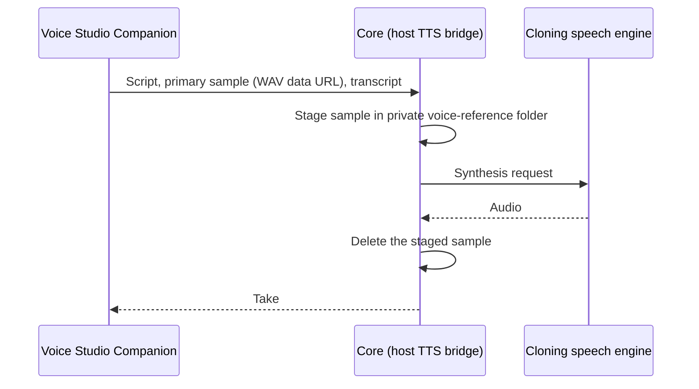

## What it does

Voice Studio gives you one place to write a script, choose an available text-to-speech engine, shape the take, and download the result. The Voice Library stores voice profiles on your Ryu node, History keeps your recent takes, and Stories turns a multi-speaker script into one rendered audio file. Studio, Voice Library, History, and Stories are available from the Ryu app sidebar.

The app uses Ryu's existing speech-to-text and voice-model catalog. What you can do with a take depends on the engine you choose: the Studio only shows controls that the selected engine reports it supports.

## Studio

Write or paste a script, pick a speech model and a voice, then choose **Generate**.

### Take settings

- **Speed** runs from 0.5× to 2×. Engines without their own speed control are time-stretched after synthesis so the pitch stays the same; the Studio tells you when that happens.
- **Seed** makes a take repeatable. Lock the seed to reuse it, reroll it, or type one. An unlocked take draws a new seed and shows it so you can lock it later. Only engines that report seed support receive it.
- **Advanced** holds the less common settings:
  - **Delivery** is a short instruction such as "calm and slow", shown only for engines that accept one.
  - **Loudness**: off, peak (-1 dBFS), podcast (-16 LUFS), or ACX-style audiobook levels.
  - **Effects**: start from a preset (broadcast, podcast, warm, bright, radio, telephone, robotic, deep, echo, cathedral) or build a chain of up to 12 effects from gain, high-pass, low-pass, compressor, reverb, echo, and pitch shift. Each value stays within its supported range.
  - **File format**: WAV, MP3, OGG, or FLAC. The download button names the format you received.
  - Loudness, effects, and file format appear only for engines whose speech runtime post-processes takes. Other engines return plain WAV, so the Studio hides these settings and does not send them.
  - **Crossfade** for long scripts, and **Reset** to return to the defaults.
- **Autoplay new takes** starts playing each finished take in the Studio player. Your browser can still block playback until you interact with the page; the player controls stay available.
- Speed, loudness, effects preset, format, crossfade, and autoplay are remembered for next time. The seed, delivery text, and a hand-built effects chain last for the current session.

### Script tools

- **Script tags**: type `[` or choose **Insert tag** to add a pause such as `[pause]`, `[pause 500ms]`, or `[pause 1.5s]`. Engines that support expressive tags, such as `[laugh]`, list them in the same menu; other tags are removed before speaking.
- **Pronunciation** lets you add words and the way they should be spoken, preview the script as it will be read, and import or export the list as JSON. History keeps the script as you wrote it.
- **Long scripts** up to 50,000 characters are split at sentence and paragraph boundaries, rendered part by part with progress, and joined into one WAV with a short crossfade. If a part fails, **Retry** reuses the parts that already finished. Long scripts are always saved as WAV.

### Queue and saved voices

- **Queue**: each take shows as queued, rendering, done, failed, or canceled, with Retry, Cancel, and Remove. Canceling a take that is already rendering stops after the current part. The queue keeps running when you switch views.
- **Voice design**: for engines that create a voice from a description, write the description and a preview line, preview it, then choose **Save as voice** to keep it in your library.
- **Save preset as voice** keeps the current engine voice and settings as a library profile. Selecting a saved profile applies its default model, language, and settings once.
- Each speech model shows its licence. Installing an engine whose licence does not allow commercial use asks you to acknowledge that first.

## Voice Library

- **Add a voice** by recording up to 15 seconds from your microphone or by uploading a clip. Recording appears only where the host provides microphone access; uploading always works.
- Each new sample is transcribed into an editable **Reference transcript** when speech-to-text is available. Engines that clone from a transcript use it; you can also type it yourself.
- Samples are cleaned up before saving: silence is trimmed from both ends, the level is capped, and the clip is kept between 2 and 15 seconds. The Library warns when a sample is clipped, very quiet, or has less than three seconds of speech.
- A voice can hold up to five samples. Add, remove, play, and choose the primary sample in the edit sheet, along with the name, description, language, tags, and default model, voice, speed, effects preset, and loudness.
- Search by name, description, tag, or kind, filter by tag or favorites, and mark favorites to keep them at the top. Cards show whether a voice is a clone, a preset voice, or a designed voice.
- **Export** downloads a `.ryu-voice.json` file with the samples embedded. **Import** shows the voice's name and the exporter's consent statement before saving. Ryu cannot verify another person's consent, so importing asks for your own confirmation.
- **Use in Studio** opens the voice in the Studio with its defaults applied.

## Voice samples and consent

1. Record or import a clear recording with one speaker.
2. Name the profile.
3. Confirm that you own the voice or have the speaker's permission to clone and use it.

The browser converts the sample to mono WAV before saving it in Voice Studio's per-app storage on the node.

- Any sample can be used to clone a voice, so adding a sample to any profile, including a preset or designed voice, asks for consent too.
- The exception is the sample that the voice designer saves from its own generated take, because it is not a recording of a person.
- You can remove a profile from the Voice Library. Deletion removes its samples from that app storage.

### Clone with a local engine

Choosing **Use in Studio** for a cloned voice selects a cloning-capable speech engine, preferring the voice's default and an installed engine. If no cloning engine is installed, Studio offers the local install step before generating with that profile.

To install one yourself, choose **Install local cloning engine** in Voice Library. This installs the optional Python runtime on the node after you grant **Can manage voices**.

- On Linux, the installer selects [Pocket TTS's CPU-only PyTorch wheels](https://github.com/kyutai-labs/pocket-tts#cpu-only-installation) instead of PyPI's default CUDA package set.
- Model weights download locally when you generate your first take.

### Where the cloning sample goes

When generating with a cloning-capable model, the Companion passes the primary sample, and its transcript when there is one, to Core through the host TTS bridge. Core accepts a bounded WAV data URL, stages the bytes under its private voice-reference directory for the synthesis request, and deletes the temporary file when the request ends.

The cloning sample is not sent to the Gateway by this path. Other selected TTS models receive the script through the normal voice route and may use the configured local or Gateway provider.

## History

History lists your recent takes with their full settings. A take is saved to History as soon as it finishes, even if you are on another view. Search by script, voice, engine, instruction, or language, or show favorites only.

- **Play** uses the saved audio when it is still stored. The 20 most recent takes keep their audio, favorites first; older takes keep their settings, and playing them renders the take again with the same seed. When the engine does not support seeds, the result may differ, and History says so.
- **Regenerate** renders the same script and settings with a new seed and adds it as a new take.
- **Download** in WAV, MP3, OGG, or FLAC. A take that is not stored in that format is rendered again with the same seed. Engines that return plain WAV download as WAV, and History says so.
- **Use script** opens the take in the Studio with its script, model, voice, language, and take settings.
- Favorite or delete a single take, or clear all history after confirming.

## Stories

Stories are multi-speaker scripts rendered into one audio file.

- Create, rename, duplicate, and delete stories. Changes save automatically.
- Each line has a speaker, text of up to 1,500 characters, a pause after it, a speed, and a delivery instruction when the speaker's engine accepts one. Insert, remove, and reorder lines with the buttons or with Alt+↑ and Alt+↓.
- A speaker can be any saved voice or any preset voice of an installed engine.
- **Audition** speaks one line. Lines keep a fixed seed, so the audition and the full story match, and lines you have not changed are not rendered again during the session.
- **Render story** speaks the remaining lines one at a time with progress, joins them with your crossfade and each line's pause, and lets you play or download the result as WAV. Cancel stops after the current line.
- **Loudness** for a story applies peak levels to the joined story, and podcast or audiobook levels to each line whose engine supports them.
- **Import script** accepts `Speaker: line` text. You confirm which voice plays each speaker before the lines are added.

## Engines and optional installs

Voice Studio works with whichever speech models your node offers. Kokoro, the default local engine, and the cloud engine through the Gateway need no extra setup. The other local engines in this table are optional installs on the node, offered from the Studio's engine list:

| Engine | Use | Licence |
|---|---|---|
| Kokoro 82M | Default local voices, native speed | Apache-2.0 |
| KittenTTS | Small local voices, native speed | Apache-2.0 |
| Pocket TTS | Local voice cloning | MIT code, CC-BY-4.0 weights |
| Chatterbox Multilingual | Voice cloning in 23 languages | MIT |
| Chatterbox Turbo | English voice cloning with expressive tags such as `[laugh]` | MIT |
| Qwen3-TTS | Voice cloning that uses the sample's transcript | Apache-2.0 |
| Qwen3-TTS CustomVoice | Preset speakers with delivery instructions | Apache-2.0 |
| Qwen3-TTS VoiceDesign | New voices from a written description | Apache-2.0 |

Chatterbox and Qwen3-TTS are large models and run best with a GPU.

- Install only one of those two families per node, because they depend on different versions of the same library. Studio refuses to install one family while the other is installed.
- Qwen3-TTS CustomVoice uses its 1.7B model by default, because the smaller 0.6B model ignores delivery instructions. When the 0.6B model is in use, the delivery field is hidden.

Seeds, delivery instructions, effects, loudness, file formats, pause tags, and the newer engines come from the node's local speech runtime. With a runtime version that does not report them, and with the cloud and built-in OuteTTS engines, the Studio, History, and Stories hide or skip the settings those engines do not report. Takes then come back as WAV.

Voice profiles, Stories, and generation history are node-local. Generated audio stays in the Studio player until you close or replace the take; download it to keep a copy.

This page is part of the [Apps catalog](/docs/apps), [app manifest lifecycle](/docs/core/app-manifest-lifecycle), [Plugins vs Apps](/docs/extend/develop/extensions/plugins-vs-apps), [Marketplace](/docs/extend/develop/extensions/marketplace), [Gateway governance](/docs/gateway/governance) documentation path. In the same category, compare [Subtitles](/docs/apps/subtitles), [Teleprompter](/docs/apps/teleprompter).

## Live voice calls

Live voice calls with an agent start from the chat composer, not from Voice Studio. The call
controls and transcript are described in [Live voice calls](/docs/surfaces/desktop/user-guide/chat-messages#live-voice-calls).

While a call connects, you hear a repeating telephone ring and see **Connecting…**. The ringing
stops when the call is accepted, canceled, or fails to connect. The duration counts from when the
call is accepted, excluding the connecting time.

Choose **End** in the composer to return to chat. Ryu adds a user message such as
**Call ended · 01:24**, with a call icon, to the conversation history. The summary saves with the
conversation and remains there when you reopen it. It does not ask the agent to generate a reply.

## What it exposes

### Companion surfaces

- **Voice Studio** (html)

## Permissions

Voice Studio requests the host's `files:download` grant so it can save generated audio and exported voices from its sandboxed Companion, `media:record` to record samples from your microphone, and `media:transcribe` to transcribe samples into reference text.

**Grants:** `files:download`, `media:generate`, `media:record`, `media:transcribe`, `storage:kv`, `voice:models:manage`

| Level | Description | Implies |
|---|---|---|
| **Can manage voices** | Install optional speech engines and models on this node. Engine setup downloads runtime dependencies and model weights use local disk. |  |
| **Can generate speech** | Use an available speech model to generate audio from the script and optional voice sample you provide. |  |

## UI it contributes

### Apps shelf

When enabled, this app appears as one icon tile in the desktop sidebar's Apps shelf. Use sidebar sections for the app's record lists; feature navigation stays inside the Companion.

## Engine requirement

Requires Ryu >=0.1.0.
