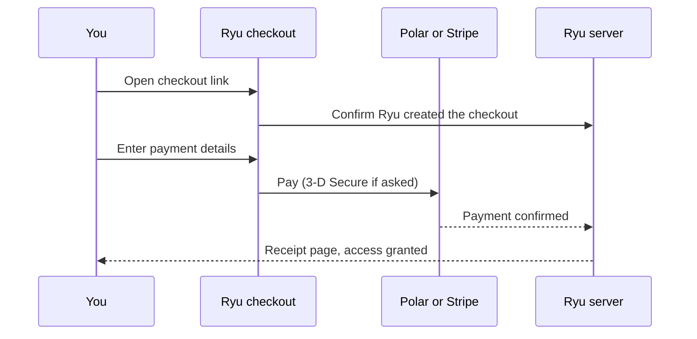

Every purchase in Ryu finishes on Ryu's own checkout at `/checkout`, whether you start it from
the web, the desktop app, the browser extension, or an agent tool.

- **On the web**, checkout opens in a window over the page you were on. Close it, or press
  Escape or Back, to return to that page.
- **From a direct link, the desktop app, or the extension**, checkout opens as a full page.

Both use the same type, colors, inputs, and light or dark theme as the rest of Ryu. Card fields
are rendered by Stripe and styled to match, so your card number goes directly to Stripe and never
reaches Ryu's servers.

## Who processes the payment

| Purchase | Checkout page | Payment processed by | Merchant of record |
| --- | --- | --- | --- |
| Plans, seats, lifetime licenses, credit top-ups, gifts, cloud servers | `/checkout/polar` | Polar (cards via Stripe) | Polar |
| Paid Marketplace apps, plugins, and other listings | `/checkout/marketplace` | Stripe | Ryu, or the publisher when the listing is sold directly by them |

Polar is Ryu's online reseller and merchant of record for Ryu's own products. The checkout page
names Polar next to the pay button, shows the charge authorization for one-time and recurring
purchases, and links to Polar's buyer terms. Polar handles order questions and returns for those
purchases.

## What the checkout page shows

- The product, price, and billing interval, with any seat count or free trial.
- Subtotal, discount, tax, and the total due today. Tax is calculated once you enter a
  billing country (and, where required, a postal code or state), and the total updates
  in place.
- Email, the name on the payment method, the billing address fields required for your
  country, and an optional business name and tax ID for business purchases.
- A discount code field when the purchase accepts one.
- Card and the other payment methods Stripe offers for your currency and country.

If your bank asks for 3-D Secure, the verification step opens over the page. After payment, Ryu
sends you to the receipt page. Plan access, credits, gifts, or Marketplace licenses appear as soon
as the payment clears.

A checkout link expires after a while so prices and taxes stay current. Opening an expired or
incomplete link shows that nothing was charged and lets you start again.

## Checkout link safety

The link to a checkout contains a one-time checkout secret in the part of the URL after `#`.
Browsers do not send that part to any server or include it when you follow a link, so it stays
out of server logs.

When the checkout page opens, it removes the secret from the address bar and keeps it only for
that browser tab. A reload still works, but the secret is not left in your history or recorded by
product analytics. Treat a checkout link like any other payment link and do not share it.

Before the page renders anything, Ryu confirms that the checkout was created by Ryu. A link
carrying another merchant's checkout is refused, so the page cannot be used to take payment for
someone else.

## Payment methods and invoices

On the web, payment methods and invoices are sections of the organization billing page
(**Organization Settings → Billing**), below the plan and credits.

- In an organization, owners and members with the Billing role see them. Other members see a
  note instead.
- **Billing** in the account menu and **Manage billing** in the desktop app open the same page.
- If the plan is billed to your personal account rather than an organization, they open a
  **Payment methods** page with the same sections. A line at the top names the account being
  billed.

The sections are:

- **Saved methods** lists your cards with their expiry date and marks the default used
  for renewals.
- **Add card** saves a new card, optionally as the default. Cards that need 3-D Secure
  are verified before they are saved.
- **Remove** deletes a saved card.
- **Invoices** lists every charge with a **PDF** button that opens the invoice.

Adding or removing a card asks you to confirm it's you first, the same way other billing
changes do.

Plan, seat, and cancellation changes are made from the plan card at the top of the
billing page; **Change plan** and **Cancel plan** open in a window over it. On the
personal **Payment methods** page, a **Plan** card links to the same steps. See
[Plan changes](/docs/billing/plan-changes).
