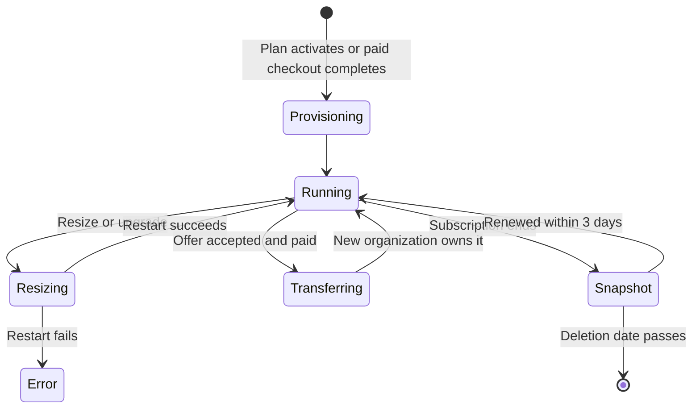
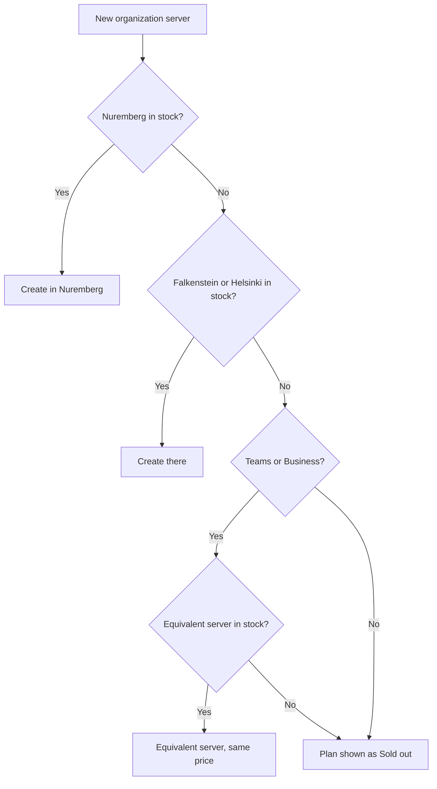
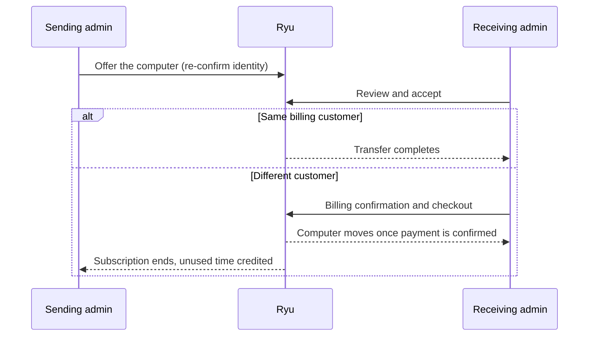

A cloud computer is an always-on Ryu server that an organization's plan includes or
that the organization buys as its own monthly subscription. This page covers the
cloud-computer plan boundary and lifecycle. Monthly prices and region pricing are on
[Metering Rates](/docs/billing/metering#cloud-computers).

## Included cloud computers by plan and region

| Plan | Default region | Singapore |
|---|---|---|
| Pro | One always-on Ryu server | Not available |
| Max | One always-on Ryu server | Not available |
| Teams | One always-on Ryu server | One, through a regional fallback size |
| Business | One always-on Ryu server | One, through a regional fallback size |
| Enterprise | Contracted | Contracted |

- Every plan that includes a cloud computer includes one always-on Ryu server at
  every seat count, and its price never depends on stock.
- Individual plans have no Singapore cloud computer, either included or paid. Teams
  and Business include one in Singapore through a regional fallback size.
- Disk size is set when a cloud computer is first provisioned and is not a per-plan
  promise. Resizing CPU and RAM keeps the original disk.

For what happens to an existing server when you move to a cheaper plan, see
[Your Ryu server when the plan changes](/docs/billing/plan-changes#your-ryu-server-when-the-plan-changes).

## Who can buy or upgrade

Business and Teams can buy additional cloud computers and upgrade their included
cloud computer. An active Enterprise agreement has the same computer change access,
including upgrades to an included computer provisioned for that organization.
Larger or dedicated capacity is scoped through Enterprise.

Pro and Max individual plans cannot buy or upgrade cloud computer capacity: they
keep their included individual computer in the default region only.

Included cloud-computer capacity is runtime capacity for the organization. It does
not own the seat quantity or workflow capacity.

- Enterprise access by itself does not declare a free computer quantity.
- Additional managed computers require a verified plan allowance or a paid
  cloud-instance subscription.
- A computer's existing **included** label does not grant extra capacity.

## Create a cloud computer

1. Open the organization's **Cloud computers** page and choose **Create cloud computer**.
2. Pick a region.
3. Choose **Managed by Ryu** or **Bring your own keys**.
4. Use the size slider or **Advanced selection** to choose exact specs.

A base server included with the organization's plan is provisioned directly. A paid
server continues to checkout and is provisioned after its subscription becomes
active. A billing identity check can appear before the create or checkout request.
If the server catalog cannot load, choose **Try again** to reload it.

### Managed by Ryu or your own keys

A cloud computer never holds Ryu's own provider keys in either mode.

| Mode | How model, image, and video requests run |
|---|---|
| **Managed by Ryu** | Through Ryu's hosted Gateway under the computer's own organization credential, so the provider keys stay on Ryu's side |
| **Bring your own keys** | With only the provider keys you add. Ryu records only the key-ownership mode; add provider keys on the server after it boots, never in the browser |

The optional **Managed computer** installs a separate Linux desktop.

## Which wallet a cloud computer uses

Cloud-computer inference uses the **active organization's wallet**. The cloud
computer is the execution path, not a separate billing account.

When a cloud computer connects, its organization binding tells the Gateway which
organization balance to check and debit, so every cloud computer in that
organization draws from the same wallet. BYOK provider balances stay with the
provider credentials configured on the server and are not Ryu credit balances.

In the desktop app, the organization wallet appears below the active cloud computer
in the sidebar.

- A subscription with an included pool shows a low-credit warning when 20% or less
  of that pool remains. The warning includes the next subscription reset when the
  cloud computer provides one.
- **Add credits** opens the Credits settings.
- Switching to a local or BYOK computer hides the managed-wallet warning.

## Backups

Every cloud computer, on every plan, has automated daily backups at no extra charge.

- The provider keeps the most recent seven daily backups.
- The server's details page shows **Backups: Enabled** once they are active.
- Servers created before backups were included are switched on automatically.

What happens to backups when a plan ends is in
[Cancelling](/docs/billing/plan-changes#cancelling).

## Cloud computer changes and downtime

A resize or replacement can briefly restart the computer, but it does not cross
organization data boundaries or change the contracted allowance.

Resizing keeps a cloud computer in its existing region. To move regions, create a
cloud computer in the destination region and migrate your data.

A resize or paid upgrade is refused when the existing computer has not been
provisioned or live infrastructure changes are disabled. The computer's recorded
size and region are preserved.

Live resize requests wait for the provider's shutdown, resize, and restart before
reporting completion.

- If resizing fails, the recorded size and price stay unchanged.
- If resizing succeeds but restarting fails, the cloud computer shows an error
  alongside its actual new size and price.
- A scheduled change is complete only after restart succeeds.
- Repeating the same size request does not clear an unresolved cloud-computer error.

## Adding capacity

Included cloud computers are a limited pool supplied by your active plan. Creating or
resizing computers does not increase your allowance.

- A paid add-on remains paid when resized to the same shape as an included computer.
- Once the included pool is full, another computer of that shape requires its own
  cloud-instance subscription covering its price.

Existing computers keep running during entitlement reconciliation. If a legacy paid
computer has no subscription binding, resizing pauses until Ryu matches it to your
active cloud-instance invoice and records that binding. You do not need a duplicate
checkout for a payment you already made.

A deferred resize checks the live subscription again when it runs. After
cancellation or an ownership change, submit a new request once the binding is
corrected.

## When a server is out of stock

- A new organization starts in Nuremberg. If a server can't be created there because
  it is out of stock, Ryu creates it in another European region (Falkenstein or
  Helsinki) instead.
- An organization that already has a server keeps that server's region.
- Teams and Business may get an equivalent server at the same price when the usual
  one is out of stock everywhere.

A plan is shown as **Sold out** only when no server it can use is available. New
checkouts and upgrades to it are then refused until stock returns.

- Plans whose servers you already have keep working normally.
- Restoring a server held only as a snapshot also needs available capacity.
- Plans without a cloud computer are never affected.

## Moving a cloud computer to another organization

An organization admin can offer a paid cloud computer to another organization. When
the receiving organization pays a separate subscription, the computer moves only
after that subscription is active. The sending organization's subscription then
ends, and its unused time is credited to its wallet.

- A computer included with a plan, or bought with reward points, cannot be moved.
- Scheduling a computer for removal withdraws any pending offer to move it. A
  computer that is being removed cannot be moved. If the receiving organization has
  already subscribed, that subscription is cancelled so it does not renew.
- Resizes the sending organization scheduled for the computer are cancelled when it
  moves. They never run under the receiving organization. A resize that is already
  running finishes first, and the move completes afterwards. A resize the sending
  organization had scheduled never blocks the receiving organization from
  scheduling its own.

### Who can start and accept a transfer

Only an owner or admin of the organization that currently owns the computer can
start a transfer, and Ryu asks them to confirm their identity again first. A custom
role that grants node management does not include transfer.

The offer stays tied to the person who made it. If they are no longer an owner or
admin of the sending organization when the receiver accepts or pays, Ryu withdraws
the offer and the computer stays where it is.

The receiving organization's admin reviews the computer before accepting.

- If both organizations bill to the same customer, acceptance completes the transfer
  and opens the destination's computer list.
- If the customer changes, accepting requires billing confirmation and starts a
  separate cloud computer subscription checkout. The computer remains with the
  sending organization until that payment is confirmed.

### Capacity and payment checks

An organization's capacity is additive: plan-included cloud computers plus each
active additional subscription. A transfer carries its subscription entitlement and
takes the lowest free destination slot.

- If that slot was consumed before payment completes, Ryu refuses the handover
  rather than leaving the computer without a subscription.
- The transfer checkout must use the computer's actual instance type and region.
  Ryu rechecks both when payment arrives.
- A changed computer waits for reconciliation instead of being attached to a
  cheaper-region subscription.

If the transfer can no longer complete by the time payment arrives, Ryu does not
move the computer and cancels the new subscription so it does not renew. Contact
support about the first charge. This happens when:

- the sender withdrew the offer;
- the person who offered it lost their owner or admin role;
- the offer was declined or expired;
- the computer is being removed; or
- the transfer already completed on another checkout.

The emails sent at each step are listed in
[Billing Notifications](/docs/billing/notifications).
