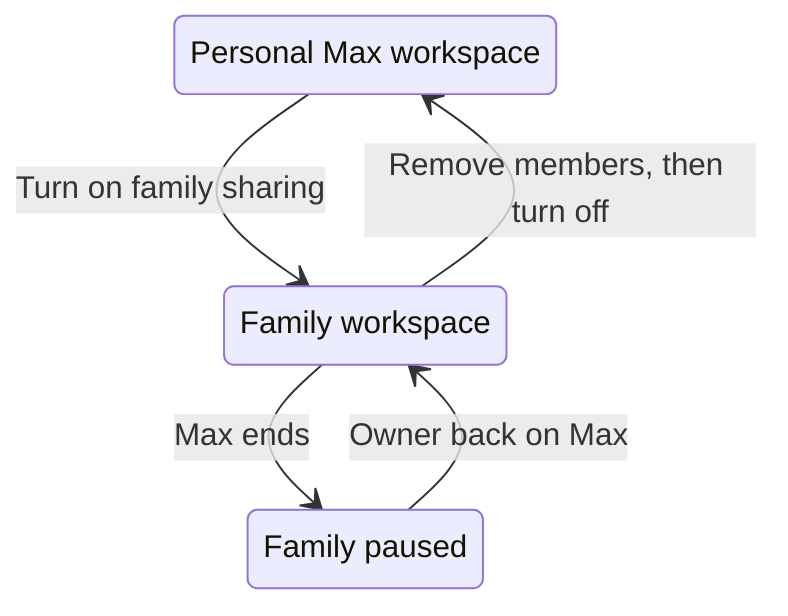

Ryu Max includes family sharing. As the Max subscriber, you can turn your personal
workspace into a **family workspace** and invite up to 5 other people, for 6 people
in total including you. Everyone in the family uses your Max plan and one shared
credit pool. There is no separate Family plan and nothing extra to buy.

<Callout type="warn">
Family sharing is rolling out gradually, so it may not be available on every Max
account yet. If you have Max and the **Family sharing** card does not appear on your
workspace's **Billing** page, it is not available for your account yet. Only the
family owner needs access to the rollout; the people you invite do not.
</Callout>

Families are for personal, household, and family use. To run a business, share
access with employees or contractors, or use organization features, choose Teams or
Business instead; see [Teams seats](/docs/billing/seats).

## Who can turn it on

You can turn on family sharing when all of these are true:

- your personal workspace has an active Ryu Max plan, including a gifted Max
  subscription (see [Gift cards, credits, and subscriptions](/docs/billing/gifts));
- family sharing is available for your account;
- the workspace is still your personal workspace, not one that has moved to Teams,
  and no Teams checkout for it is in progress;
- the workspace has no teams you added. The team created with every workspace does
  not count unless you gave it team settings, such as a firewall overlay, team
  secrets, feature overrides, or a connector catalog. A family workspace cannot
  manage teams, so remove them first;
- the workspace has no single sign-on providers or SCIM connections. They would
  keep signing people in and adding them to the workspace, so delete them first;
  and
- you are in fewer than 5 families and do not already own one.

Each person in the family needs their own Ryu account and must meet the minimum age
in the [Terms of Service](/docs/legal/terms#family-sharing), which is 13 or a
higher minimum set by local law. Ryu does not offer accounts for children under 13,
so they cannot join a family.

## Turn family sharing on

1. Open your personal workspace's **Billing** page.
2. In the **Family sharing** card, choose **Turn on family sharing**.
3. Review the list of what stops working in this workspace, such as its Vault
   entries, GitHub integrations, and registry grants, and choose **Turn on family
   sharing** again to confirm.
4. Confirm your identity when Ryu asks you to verify a recent sign-in.

The card then shows **On**, how many of the 6 places are used, and a link to manage
family members. Your workspace keeps its plan, credit pool, data, and history; it
becomes the family workspace rather than a copy of it.

Before you turn it on, review what changes for you:

- The organizers you appoint can see the workspace's existing usage and audit
  records, not only activity from after you turned sharing on.
- Anything you set up in the workspace's **Vault**, **Integrations**, or private
  registry stops working for your nodes and agents while sharing is on. It is kept,
  and it works again after you turn sharing off.
- The workspace's organization-only marketplaces and their items are hidden from
  everyone, you included, while sharing is on. They are kept, and they come back
  after you turn sharing off.
- The workspace cannot move to Teams or Business until you turn sharing off.

## Invite family members

1. Open the family workspace's **Members** page, or choose **Manage family members**
   on the **Family sharing** card.
2. Choose **Invite family** and enter the person's email address.
3. The person accepts the emailed invitation from their own Ryu account.

Any verified email address works, including Gmail, iCloud, and other personal
mailboxes. You need a verified email address to send an invitation, and the person
accepting must verify theirs. Pending invitations count toward the 6 places, so
cancel an invitation you no longer need to free its place.

Joining a family does not replace anyone's own account. Each member keeps their own
personal workspace and plan, and the family appears as an additional workspace they
can switch to.

## Roles

| Role | Who | What they can do |
| --- | --- | --- |
| Owner | The Max subscriber whose workspace became the family workspace | Everything an organizer can, plus billing, invoices, spending limits, and turning family sharing on or off |
| Organizer | Members the owner or another organizer appoints | Invite and remove members, appoint or remove organizers, and set policies and feature controls; view usage, limits, and the audit log |
| Member | Everyone else | Use the family workspace, its shared plan, and its credits; see who is in the family; see their own usage; leave the family |

The owner role cannot be given to anyone else, and ownership of a family cannot be
transferred. The owner cannot leave the family. Custom roles and the Billing role are
not available in a family workspace. Only the owner manages the family's billing; an
organizer can still buy and manage their own personal plan.

## Limits

- A family can have up to **6 people**, including the owner. Pending invitations count
  toward that limit.
- An account can belong to up to **5 families** at a time, counting a family it owns.
  For example, you might be in your immediate family and in a cousins' family.
- An account can **own only one** family: its own personal workspace.

The **Family sharing** card shows how many families you are in, such as "You're in 2
of 5 families." If someone is already in 5 families, they must leave one before they
can join yours.

## What organizers control and see

The owner and organizers can set policies and feature controls for the whole family
and for individual members. Plain members cannot change policies, including rules
that only affect themselves.

The owner can also set spending caps and per-member budgets from **Limits & budgets**;
organizers can view them. The [Organization console](/docs/billing/organization-console)
describes these pages.

| Who | What they can see |
| --- | --- |
| Everyone in the family | Each member's name, email address, and role |
| Owner and organizers | Usage metadata for the family workspace (models, providers, token counts, cost, and when usage happened) and configuration changes in the audit log |

Usage and audit views do not show the content of prompts, completions, or
conversations, and they do not show a member's own personal workspace.

Family bots and shared assistant nodes are an exception: messages sent to a family
bot, and conversations on a node shared with the family workspace, are processed by
that node and may be stored on it. See [Family workspaces](/docs/legal/privacy#family-workspaces)
in the privacy notice and [Family sharing](/docs/legal/terms#family-sharing) in
the Terms of Service for the full description.

Family policies and limits help a household set rules. They are not a substitute for
a parent or guardian's supervision.

## Family bots

A hosted channel bot on the family workspace is a **family bot**. While family
sharing is active, it can have one enabled channel user for each person who has
joined the family, up to 6.

- Pending invitations do not add places, so a family whose owner is the only member
  can still enable one channel user.
- When the bot is full, Ryu explains the family limit and, below 6 people, suggests
  inviting family members to enable more.
- A channel user that is linked to a Ryu account must belong to someone in the family.
- When someone leaves or is removed from the family, channel users linked to their
  account are turned off.

Grants are managed on the family workspace's **Bot access** page, as described in
[Hosted bot access](/docs/billing/organization-access#hosted-bot-access). The bot
itself works like any other [channel bot](/docs/gateway/channels).

Each member's own bot stays on their own personal workspace and plan. Because the
owner's personal workspace is the family workspace, the owner's own hosted bot is the
family bot.

## When Max ends

If the owner's Max plan ends, whether it is cancelled, expires, or a gifted Max
period runs out, the family is paused rather than removed:

- existing members stay in the family workspace, and its policies and limits keep
  applying;
- no one new can be invited, added, or accept an invitation;
- the plan's included credits stop renewing for the family; and
- family bots go back to the plan's own channel-user allowance. Channel users that
  are already enabled stay enabled, but no new ones can be enabled while the bot is
  over that allowance.

The **Family sharing** card explains that family sharing needs an active Ryu Max plan.
When the owner is back on Max, the family can admit people again. See
[Changing or cancelling your plan](/docs/billing/plan-changes) for how cancellation
works.

## Leave, remove, or turn off

- **Leave:** a member or organizer can leave a family at any time from the family
  workspace's **Members** page. Leaving does not close their account or personal
  workspace, and their place opens for someone else.
- **Remove:** the owner or an organizer can remove a member or cancel a pending
  invitation from the **Members** page.
- **Turn off:** the owner removes every other member and cancels every pending
  invitation, then chooses **Turn off family sharing** on the **Family sharing** card
  and confirms their identity. The workspace becomes the owner's personal workspace
  again.

A family workspace cannot be deleted while sharing is on. Turn family sharing off
first.

## Not available in family workspaces

A family workspace is not an organization plan. These features are not available
while family sharing is on:

- single sign-on, SCIM provisioning, IP allowlists, and SIEM export;
- custom roles, sub-teams, and team-level controls;
- admin keys, service accounts, the Admin API, and request logs;
- audit log export and primary-ownership transfer;
- the organization Vault, organization Integrations, the private registry, and
  organization-only marketplaces; and
- publisher verification and Enterprise entitlements.

You cannot set up or change these while sharing is on. Settings made before sharing
was turned on are not deleted. Policies, limits and budgets, feature controls,
members, usage, the audit log, and invoices stay available.

If you need organization features, use [Teams or Business](/docs/billing/seats). Ryu
refuses a Teams checkout for a family workspace until family sharing is turned off.

## Current limitations

- **Declined invitations.** If someone declines an invitation, that family cannot
  invite the same person again.
- **Leaving is not announced.** Any member can leave at any time, including a younger
  member, and organizers are not notified.
- **Personal workspaces stay separate.** Every member keeps a personal workspace that
  family policies and limits do not cover.
- **Fewer guardian tools.** Family workspaces offer policies, limits, and feature
  controls. Content moderation, time limits, and approval requests are not available
  yet.
- **Per-member rules on shared nodes.** A per-member rule applies on a node shared with
  the family only when the request identifies the member. A request made with a shared
  workspace credential gets the family-wide rules.
- **Telegram connect message.** When a family bot is full, the Telegram connect page
  shows a general hosted-channel allowance message instead of the family-specific
  one.
- **Account merges.** A merge is blocked when the two accounts together would be in
  more than 5 families, or when the account being folded in owns a family. See
  [Merging Two Accounts](/docs/billing/merging-accounts).
