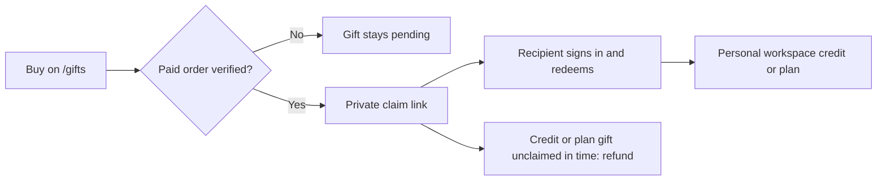

Ryu sells three separate gift products on the web at
[ryuhq.com/gifts](https://ryuhq.com/gifts):

- **Gift cards** load stored value into the recipient's personal Ryu wallet.
- **Credit gifts** add expiring Ryu Credits for supported managed features.
- **Subscription gifts** provide non-renewing Pro or Max access for a
  selected number of months.

You can reach **Gift Ryu** from the public [pricing page](https://ryuhq.com/pricing),
your signed-in dashboard, or the account menu. The `/gifts` page is the complete
purchase and redemption flow.

Gift purchases are available to active Pro and Max personal plans and to
separately issued private individual offers. Teams and Business organization billing
stays organization-owned and is not changed by a personal gift. The purchaser pays
once, and the gift is not active or shareable until payment has been confirmed.

## Buy a gift

1. Open **Gift Ryu** from the pricing page, dashboard, or account menu, or visit
   `/gifts` directly on the web.
2. Choose a gift type and amount, or choose a plan and duration for a
   subscription gift.
3. Optionally add the recipient's name, email address, and a message.
4. Choose **Continue to checkout**, review the total, then complete payment on
   [Ryu's checkout page](/docs/billing/checkout).
5. After payment clears, copy the private claim link from **Your gifts**, or let
   Ryu send it to the recipient email when email delivery is configured.

The recipient email is delivery information, not an ownership check. Anyone who
has the complete private claim link may be able to redeem it, so do not post the
link publicly. Ryu does not store the raw claim secret.

## What a gift costs

| Gift | What you pay |
|---|---|
| Gift card or credit gift | The face value plus the same [deposit fee](/docs/billing/top-ups#deposit-fees) your plan pays on a top-up. The recipient receives the full face value |
| Subscription gift | The selected plan's current monthly price multiplied by the chosen duration, with no deposit fee |

For example, a $15 gift card costs $20 at checkout because the $5 minimum fee
applies, and the recipient receives $15. The gift form shows the face value, the
fee, and the total before you leave for checkout.

Subscription gifts are one-time purchases. Annual subscription discounts do not
apply to a gift duration.

## Redemption rules

Open the link on the web, sign in to the personal account that should receive the
gift, review the details, and choose **Redeem**. A claim link can be used once.
The account selected at confirmation is the account that receives the value;
Ryu cannot promise to move a gift after it has been redeemed.

| Gift | Purchase range or choice | Claim window | After redemption |
| --- | --- | --- | --- |
| Gift card | $15 to $250 | Does not expire | Stored value has no cash value, cannot be transferred, and is used for eligible Ryu usage |
| Ryu Credits | $5 to $1,000 | 30 days after purchase | Credits expire 12 months after redemption and are spent before paid rollover balance |
| Subscription | Pro or Max for 1, 3, 6, or 12 months | 365 days after purchase | Full personal plan access for the selected duration; it does not renew |

Gift cards and credit gifts load the recipient's personal workspace, never the
currently selected team workspace. If the account has no personal workspace,
redemption is refused until one is available. Credits are still subject to the
plan and feature that uses them, and redeeming a credit gift does not start a
subscription. [Credits](/docs/billing/credits) covers how gift balance is spent.

### One personal subscription at a time

If the recipient already has an active personal subscription or an active gifted
subscription, Ryu refuses the subscription gift. It does not stack, downgrade, or
charge a second plan.

- A gift can be claimed after the existing personal subscription ends, while its
  claim window remains open.
- Organization and Enterprise access cannot be converted into a personal gift
  subscription; see [organization access](/docs/billing/organization-access).

## Expiry, refunds, and payment state

Ryu only activates a gift from a verified paid order. Returning from a hosted
checkout page is not proof of payment, so Ryu re-checks the provider order if the
signed payment notification has not arrived yet.

- A retry with the same checkout request is idempotent and cannot create a second
  gift or second charge.
- An unpaid checkout does not reserve another purchaser's order slot.
- Each paid provider order ID is unique, so repeated delivery of the same order
  cannot activate a second gift.
- A temporary checkout, email, or webhook delay does not make a gift claimable
  early. Check **Your gifts** again after the payment settles.

### Unclaimed gifts

An unclaimed credit or subscription gift expires after its claim window. Ryu
requests a refund of the full amount you were charged, including any deposit fee,
to the purchaser's original payment method. The gift stays unavailable while the
provider processes that refund. A gift card has no expiry after purchase.

Once any gift has been redeemed, its value cannot be transferred to another
account or exchanged for cash.

### Refunds and chargebacks

- **Before redemption**, a refunded or charged-back payment makes the gift
  unavailable.
- **After redemption**, Ryu reverses the full gifted value without taking paid
  top-ups. A recipient who already spent the gift may see a negative personal
  wallet until it is replenished.
- **Interrupted claims.** Ryu only reverses gift value that was actually added to
  the wallet. If a claim was interrupted before its credit was applied, a later
  refund leaves the wallet unchanged and the gift becomes unavailable.

<Callout type="warn">
  Never send a full claim link or payment credentials in a public support request.
</Callout>

## Common problems

- **Your gifts could not be loaded:** choose **Retry gifts** to reload the list.
  This does not start another checkout or create a purchase.
- **The gift is still pending:** the provider has not made a paid order visible
  yet. Reopen the receipt or try the link again later.
- **The link was already used:** the first confirmed redemption owns the gift;
  the same link cannot be moved to another account.
- **The recipient has a current subscription:** wait until that personal plan
  ends, then redeem before the gift's claim deadline. Team and Business members
  should use their organization billing instead.
- **The gift went to the wrong account:** contact support with the purchase
  receipt and approximate time. Do not include the full claim secret; recovery
  may be limited after redemption.
- **The email never arrived:** the purchaser can copy the link again from
  **Your gifts**. The recipient address does not reserve the gift.
