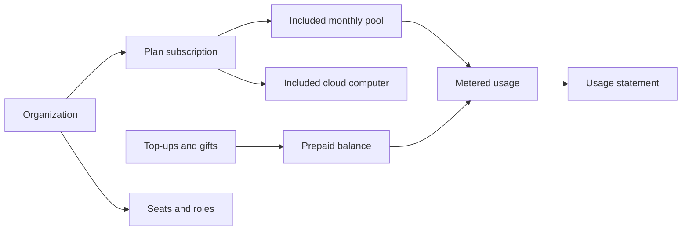

This realm explains what each Ryu plan includes, how prepaid credits and metering work, and how
an organization manages seats, members, and billing. It is for account owners, billing managers,
and builders who run managed work.

<Figure name="billing" />

Self-hosting stays free when you run the software and infrastructure yourself. The managed plans
add hosted AI, cloud computers, and shared organization controls. The full plan table is on
[Plans and Pricing](/docs/billing/plans), and the business overview is on the
[public pricing page](https://ryuhq.com/pricing).

## How the pieces fit

A plan belongs to a personal workspace or an organization. Its included pool and any prepaid
balance pay for metered usage, and every charge appears on the usage statement.

## Start here

<Cards>
  <DocCard href="/docs/billing/plans" />
  <DocCard href="/docs/billing/credits" />
  <DocCard href="/docs/billing/metering" />
  <DocCard href="/docs/billing/limits" />
  <DocCard href="/docs/billing/organization-console" />
</Cards>

## Plans and checkout

<Cards>
  <DocCard href="/docs/billing/trial-and-access" />
  <DocCard href="/docs/billing/checkout" />
  <DocCard href="/docs/billing/plan-changes" />
  <DocCard href="/docs/billing/pricing-changelog" />
</Cards>

## Included with plans

<Cards>
  <DocCard href="/docs/billing/cloud-computers" />
  <DocCard href="/docs/billing/hosted-agents" />
  <DocCard href="/docs/billing/agent-inboxes" />
  <DocCard href="/docs/billing/family-sharing" />
  <DocCard href="/docs/billing/powered-by-ryu" />
</Cards>

## Credits and top-ups

<Cards>
  <DocCard href="/docs/billing/top-ups" />
  <DocCard href="/docs/billing/gifts" />
  <DocCard href="/docs/billing/standalone-credits" />
</Cards>

## Usage, limits, and alerts

<Cards>
  <DocCard href="/docs/billing/sandbox-billing" />
  <DocCard href="/docs/billing/usage-analytics" />
  <DocCard href="/docs/billing/usage-limits" />
  <DocCard href="/docs/billing/usage-limits-api" />
  <DocCard href="/docs/billing/notifications" />
</Cards>

## Organizations and accounts

<Cards>
  <DocCard href="/docs/billing/organization-access" />
  <DocCard href="/docs/billing/organization-invitations" />
  <DocCard href="/docs/billing/organization-roles" />
  <DocCard href="/docs/billing/seats" />
  <DocCard href="/docs/billing/merging-accounts" />
</Cards>
