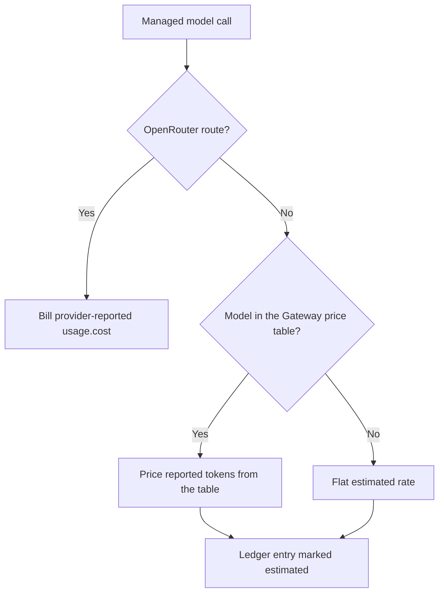
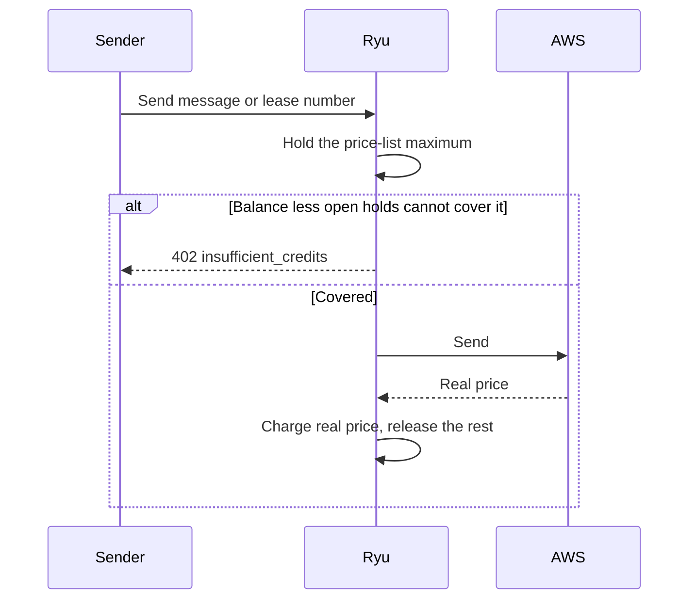

Every Ryu Cloud action is metered against one of the units below. Ryu sends the
server-measured event to Polar, which owns the provider-backed credit meter and
usage state. [Credits and AI Pools](/docs/billing/credits) covers credit
ownership, top-ups, access enforcement, and the organization view.

Free credit (promotional, referral, and challenge balances) is held on separate
Polar meters, not as labels on the shared meter.

- A request for a model marked Free draws first from the free-credit meter that
  expires soonest. The rest goes to the shared meter.
- Requests for other models never draw free credit.
- Retried meter events are idempotent, so a transient Polar error cannot lose or
  double a debit or grant.

<Callout type="info">
These rates apply to **Ryu Cloud** (managed inference). Running your own server with your own
provider keys bills you directly from that provider and Ryu meters nothing.
</Callout>

## Models

Model tokens are metered **at cost**. Ryu applies no per-token markup, and the platform's margin is
taken once at deposit instead (see [deposit fees](/docs/billing/top-ups#deposit-fees)).

### How the cost of a call is known

- **OpenRouter routes** bill the provider-reported `usage.cost`, which is what the upstream
  provider charged.
- **Other managed routes** (direct OpenAI, Anthropic, and the other provider adapters) do not
  report a cost. The Gateway prices their reported token counts from its configured per-model
  price table.
- A model missing from that table is priced at a flat estimated rate for input and output alike,
  which can be higher or lower than the provider's price for that model.

Any charge that is not the provider's reported cost is recorded as **estimated** on its credit
ledger entry, as is a charge whose token counts the provider did not report.

### Calls the Gateway makes for you

Model calls the Gateway makes while serving a request are metered the same way as your own model
calls. These include smart-routing classification, the LLM traffic inspector, inline evaluators,
and semantic-cache embeddings.

Each charge carries what it was for as its task label (for example `smart-routing` or
`inspector`). Embedding and rerank requests are labelled `embedding` and `rerank`.

### Interrupted requests

Work the provider has already accepted is billed even if your client stops waiting for it:

- **Streams** are charged when they end for any reason, including a client that disconnects
  mid-answer, for the prompt and the output generated so far.
  - If the provider sent no usage before the stream stopped, the output is estimated from the
    text that was streamed.
  - A client that disconnects before the first token arrives is charged for the prompt it sent,
    as an estimate, once the provider accepts the request. A request the provider refuses costs
    nothing.
- **Non-streaming calls** keep running after a client timeout or disconnect and are charged when
  the provider completes them. A call that runs tools stops after its current round instead, as
  described below.
- **Requests where Ryu runs the tools** (tool search and connected-app actions) call the model once
  per tool round, and every round is charged, not only the one that produced the answer. The
  response still reports the final round's own usage.
  - If the client disconnects during the rounds, streaming or not, the round the model is working
    on finishes and is charged, and no further tool runs.
  - A round still unanswered after 30 minutes is charged for its prompt only.
  - Rounds completed before a later round fails are charged on their own, even if a fallback
    provider then serves the request.

Metered streams always ask the provider for a final usage frame, even when the request sets
`stream_options.include_usage` to `false`. A client that did not ask for usage therefore receives
one extra usage-only chunk at the end of the stream.

### Provider billing policy

A provider configured with `[credits.provider_billing.<provider>] mode = "pass_through"` is
charged from its raw upstream cost. Providers without that entry inherit the Gateway's global
`markup_bps` setting.

The raw provider amount remains available for audit and reconciliation, while the charged amount
is what budgets, meter events, and usage statements use. This billing setting is separate from
[subscription credential passthrough](/docs/gateway/gateway-for-any-agent#subscription-preserving-passthrough-claude-code-codex).

### Model prices and promotions

Model prices vary per model and change when providers change theirs, so they are not reproduced
here. The model picker shows the current rate for each entry, and every charge appears on your
usage statement with the model that produced it.

For models routed through Ryu's managed OpenRouter path, the picker uses OpenRouter's current
transaction price. That price already includes an active provider promotion, so a temporary
discount appears as a lower input or output rate and flows through to the wallet debit, usage statement, and shared-budget accounting after
the provider billing policy is applied.

Daily rollups retain the raw transaction price for audit and reconciliation, and the price is
refreshed periodically because OpenRouter promotions can change. OpenRouter BYOK traffic remains
your provider account's spend and is not converted into Ryu managed credit usage.

What chat shows when either balance is exhausted is on
[When credits run out in chat](/docs/billing/credits#when-credits-run-out-in-chat).

### Budgets and reconciliation

- Per-agent budget caps use **USD**, represented on the wire as integer micro-USD
  (`1_000_000 = $1`), not tokens.
- Model inference, media generation, and paid Composio actions are separate budget categories.
  Each agent can choose which categories count.
- For OpenRouter responses, the inline `usage.cost` is the source used for the immediate charge.
  Generation metadata can be reconciled later using the stable external-user identity Ryu sends
  for the agent. A generation lookup reconciles history; it does not charge the same request a
  second time.
- Subscription ACP passthroughs and direct-egress agents do not produce an OpenRouter cost.
- Self-hosted and local models use configured estimates, because Ryu cannot measure the
  operator's electricity or GPU bill.

The WhatsApp channel is a delivery transport, not a model provider. A successful Meta
`POST /messages` response returns message identifiers rather than a billable fee, so Ryu does
not infer a WhatsApp, Twilio, or Sent charge from that response.

## Agent tool calls

Managed tool calls go to Treg first and to Composio only when Treg cannot serve the call
(connected user accounts, toolkit actions Treg does not list, and triggers).

| Unit | Rate |
|---|---|
| Treg endpoint call | The cost Treg reports for that endpoint, passed through |
| Composio tool execution with Ryu's managed OAuth apps | **$0.50 per 1,000 calls** |
| Composio tool execution with your own OAuth app or API credentials | **$0.30 per 1,000 calls** |

A **tool call** is one executed action against a connected integration, not a step of the model's
reasoning.

- A Treg call is billed at the endpoint's provider cost. When Treg reports no cost for a completed
  call, the Gateway's price for the endpoint (its catalog estimate, or an operator-set price) is
  charged instead. An endpoint with no known price is refused rather than run free.
- The Composio rates are Composio's, billed at cost and passed through. A call whose execution
  report does not say which credentials ran it is billed at the managed-app rate.
- A Composio execution is charged when Composio records it, even if the tool reports a failure.

Delivered trigger events, direct execution, add-ons, and premium tools are priced separately; see
[Composio usage](/docs/billing/credits#composio-usage-and-zero-data-retention).

## Web search

| Unit | Rate |
|---|---|
| Hosted search | The deployment's configured per-search price for the provider that served it |

Hosted web search is billed once per successful search, never per result or per
token. It appears as **Web search** in usage, separate from model usage, and
counts toward spending limits. Searches that use your own provider keys are not
billed by Ryu. Organization admins can turn hosted search off; see
[Web search and fetch](/docs/gateway/web-services#hosted-web-search).

## Image and video generation

Image and video use the provider's reported `usage.cost` when it is available. If the provider does
not report a cost, they are metered on the compute time the generation actually used; when neither is
available, Ryu uses the configured flat fallback estimate.

| Unit | Rate |
|---|---|
| Generation compute | **$0.000975 per second** ($3.51/hour) |

Time spent queued before a machine picks the job up is **not** billed. Only the run itself is.

The cost difference comes from the measured run time. A fast 2-second render and a slow 30-second
render are charged for what they use rather than averaged, so a short clip costs a fraction of a
long one.

<Callout type="info">
If a provider returns no cost or timing for a completed job, Ryu falls back to a flat per-call rate:
$0.00195 for an image, $0.0585 for a video. These are estimates of a typical render and only apply
when there is nothing measured to bill from.
</Callout>

## Speech

Speech has no per-second measurement available from the providers, so it is billed per call.
When the provider reports the request's actual cost, as OpenRouter does, that cost is billed
instead of the per-call rate.

| Unit | Rate |
|---|---|
| Audio (per synthesis) | **$0.000975** |
| Transcription (per request) | **$0.000975** |

## Sandbox compute

A sandbox is a real machine running your agent's code. Its compute is metered **per second, only
while it is running**. Storage above the free allowance is charged for as long as the sandbox
exists, so a stopped sandbox costs only its storage.

Ryu Box is priced per size rather than per resource:

| Size | Rate |
|---|---|
| `small` (2 vCPU, 4 GiB) | **$0.025** per hour |
| `default` (4 vCPU, 8 GiB) | **$0.04** per hour |
| `large` (8 vCPU, 16 GiB) | **$0.07** per hour |

- Each Box start has a **5-minute minimum**.
- Paid plans include **25 GiB** of Box storage per organization.
  Storage above it costs **$0.05** per GiB-month.
- Without a paid plan, or during a plan's free trial, Box storage is limited to **10 GiB**.

How Box minutes, minimums, storage, session Boxes, and credit exhaustion are settled is on
[Box and Sandbox Billing](/docs/billing/sandbox-billing).

Other sandbox backends are charged the sum of every resource the sandbox holds, per second:

| Resource | Rate |
|---|---|
| vCPU | **$0.0655** per vCPU-hour |
| Memory | **$0.0211** per GiB-hour |
| Storage (above the free allowance) | **$0.10** per GiB-month |
| Windows surcharge | **+$0.1114** per vCPU-hour |

The first **5 GiB** of sandbox storage is free; only usage above that is billed. These
per-resource rates do not apply to Ryu Box, which is priced per size as above.

### GPU sandboxes

| GPU | Rate |
|---|---|
| H200 | **$5.90** per GPU-hour |
| H100 | **$5.13** per GPU-hour |
| RTX PRO 6000 | **$3.94** per GPU-hour |
| RTX 5090 | **$1.68** per GPU-hour |
| RTX 4090 | **$1.29** per GPU-hour |

GPU time is charged in addition to the vCPU, memory and storage of the same sandbox.

## Ryu-hosted services

Ryu-hosted Notify, Passport, and Connect are charged from each service's own usage report and
settled hourly against the organization's credits. The included plan pool is spent first, except
for composed-tool maker fees, which draw only on top-up credit. Free allowances are per
organization per calendar month (UTC). A self-hosted service is never billed by Ryu.

| Service | Unit | Rate | Free each month |
|---|---|---|---|
| Notify | Events accepted by `POST /v1/events` and `POST /v1/topics/:topic` | **$0.10** per 1,000 events | 10,000 events |
| Passport | Time a stored connection or MCP OAuth credential exists | **$0.10** per connection-month (30 days) | 5 connection-months |
| Passport | Runtime fetches and logins that reach an upstream | **$0.10** per 1,000 fetches | 10,000 fetches |
| Connect | Each Composio execution called directly | The [Composio rates](/docs/billing/credits#composio-usage-and-zero-data-retention) | None |
| Connect | Each call of a toolkit Connect serves natively, called directly | **$0.40** per 1,000 calls, with no Composio add-ons | None |
| Connect | Each successful vendor call paid with Ryu's key (the [credential ladder](/docs/standalone/connect-api-relay#the-credential-ladder)'s last rung) | The endpoint's verified per-call price in Ryu's catalog, shown on the call; listed as **Connect vendor calls (Ryu key)** | None |
| Connect | Each completed run of a composed tool whose maker is another organization | The maker's fee (disclosed before the run, $0 to $100), listed as **Composed tool fees** | None, no free allowance, top-up credit only |
| Mail | Recipients sent beyond a paid plan's monthly allowance | **$1.00** per 1,000 recipients | The plan's allowance |
| Messaging | Each SMS, MMS, WhatsApp message, voice message, and 30-day phone number lease | The [AWS End User Messaging price](https://aws.amazon.com/end-user-messaging/pricing/), with no markup | None |

- A replayed Notify event with the same idempotency key counts once.
- A Connect call that Ryu Core already charged through the Gateway is not charged a second time.
- A native toolkit call that Ryu Core makes through Connect is charged by the Gateway as a
  Composio tool call (the Composio own-app rate plus project add-ons, under **Tool calls**), not at
  the native rate.
- Relay and vendor calls on your own keys are never charged.
- Notify, Passport, and Connect charges can take the balance below zero; low-balance alerts and
  automatic top-up apply as usual.

### Mail overage

Mail overage applies on paid plans only, and only while the organization has a positive balance.
Each recipient beyond the plan's monthly allowance is charged as the message is sent. Without a
positive balance, a send beyond the allowance is refused. The free baseline never overflows into
credits, and stored mail stays a hard cap. See [Agent Inboxes](/docs/billing/agent-inboxes).

### Messaging holds

Ryu Messaging is charged per message and per lease period, not hourly.

1. Before each send or lease, Ryu holds the most it can cost from AWS's published price list.
2. It refuses with `402 insufficient_credits` when the available balance, less other open holds,
   does not cover it.
3. Once AWS reports the real price, Ryu charges that price, never more than the hold, and releases
   the rest. A send that never reached AWS releases its hold with no charge.

A Messaging charge therefore never takes the balance below zero. A message with no final provider
price settles at the price-list estimate. While a hold is open, Settings → Billing shows the
amount held and the balance still available to spend beside your current balance. See
[Ryu Messaging](/docs/standalone/messaging#pricing).

## Cloud computers

A cloud computer is a monthly subscription rather than metered usage, so it does not draw on
credits. When a plan subscription activates, Ryu automatically provisions its included computer.

Plan checkout does not ask for a region. Where the included computer is placed, and what happens
when a server is out of stock, is on
[Cloud Computers](/docs/billing/cloud-computers#when-a-server-is-out-of-stock).

Additional cloud computers are separate monthly subscriptions. Before checkout, choose an
available size and region.

- The picker estimates the browser's round-trip latency to each region and shows it next to the
  region name. The estimate is for guidance and can vary with the network.
- Region affects latency and availability, not the monthly price. Each size is priced using the
  highest listed Hetzner rate across the available regions (currently Singapore), so that size
  costs the same in every region.
- **Advanced selection** lists available sizes with CPU, RAM, SSD, monthly price, and regional
  availability.

The picker recommends Linux cloud computers for running automations, hosting a game server,
creating and rendering 3D work, and building or hosting apps. The current hosted-computer catalog
offers Ubuntu Linux; Windows and macOS computers are not available in this flow.

Which plans can buy or upgrade cloud computers, and how transfers between organizations work,
is on [Cloud Computers](/docs/billing/cloud-computers#who-can-buy-or-upgrade).

## What is never billed

- **Local models** on your own machine or your own server
- **Queue time** before a generation job starts running
- **Compute on stopped sandboxes** (storage is billed while it exists; compute only while running)
- **Failed requests** that returned no result (work a provider accepted and completed is billed
  even when the client stopped waiting; see [Interrupted requests](#interrupted-requests))

## Seeing what you spent

Every charge is sent as a server-authoritative Polar event and appears in your
organization's usage statement with the model or resource that produced it, what
it was for, and when. Open it from **Settings → Billing → Usage** in the desktop
app, or from the Credits page in Console on the web.

The desktop statement loads one additional page at a time. Refreshing it replaces
outstanding page reads, and switching organizations resets the statement so an
older organization's response cannot populate the new view.
