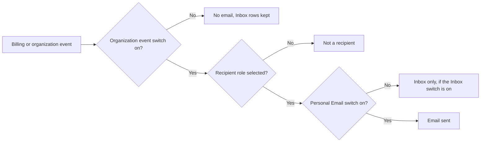

Ryu sends transactional billing email to the organization roles that an owner or a
notification manager selects when a payment or credit event completes. Each message links to the
organization Billing page with a plain, copyable link.

The same account-scoped events also appear in the website **Inbox**, with product announcements
and received organization invitations. Open **Inbox** from the portal header or the account menu.
The header bell shows an unread badge count.

## Website inbox

The inbox has three streams:

| Stream | What appears there |
|---|---|
| **Marketing** | Active product announcements published by Ryu administrators |
| **Transactional** | Billing, balance, subscription, budget, transfer, and organization workflow events for the personal account or shared organization |
| **Invitations** | Pending organization invitations received by the signed-in account |

Rows are stored server-side and scoped to the signed-in user. Provider retries and source
reconciliation use stable dedupe keys, so reopening the page does not create duplicate rows.

Marking a row or category read clears the unread badge and keeps announcement read state in sync
with the desktop surface. Invitation actions continue through the existing organization invitation
flow.

When there are no rows, the page shows **You're all caught up** and keeps the filter counts
visible.

The switches in **Organization → Notifications** do not remove the organization's transactional
events from the website inbox, so an owner can pause email and still review the account history in
Ryu. Both the organization policy and the recipient's personal switch must allow an email before
Ryu sends it; see [Organization controls](#organization-controls).

For authenticated API clients, the website inbox is available through the control-plane server:

| Method + path | Purpose |
|---|---|
| `GET /api/inbox` | List the caller’s rows and category counts |
| `GET /api/inbox/unread-count` | Read the portal badge counts |
| `POST /api/inbox/:id/read` | Mark one caller-owned row as read |
| `POST /api/inbox/read-all` | Mark all rows, or one `category`, as read |
| `GET /api/user/notifications` | Read the caller's Email/Inbox switches |
| `PUT /api/user/notifications` | Update the caller's Email/Inbox switches |

Organization workflow notifications are written by the server for the configured recipient roles
of each organization involved, so a transfer between two organizations resolves each side
independently. This applies to:

- cloud computer, credit, and Marketplace listing transfers;
- Agent Mail arrivals;
- organization-invitation lifecycle changes. A member invitation also keeps the invited person on
  the Better Auth invitation email flow.

## Personal delivery controls

Open **Account settings → Notifications** to choose Email and Inbox independently for each server
event: top-ups, low balance, budget caps, subscription changes, organization activity, invitations,
Agent Mail, and the usage recaps and reminders described below.

Account-verification, password-reset, two-factor, and sign-in challenge emails are security flows.
You cannot turn them off here.

Email delivery is idempotent. A provider retry uses the event's stable source key and the recipient
identity, so it cannot create a second email or a second Inbox row. If a provider is unavailable,
the billing event still completes and Ryu retries the delivery later.

## What you'll receive

| Moment | What the email tells you |
|---|---|
| Manual top-up succeeds | How much credit was added and what the charge was |
| Automatic top-up succeeds | That the configured balance pack was charged and added |
| Balance crosses the low-balance threshold | The current balance, threshold, and where to top up |
| Subscription starts | That the plan is active and included monthly credits are ready |
| Subscription renews | That the recurring payment completed and the next period is ready |
| Payment becomes past due | How to update the payment method, the grace-period action, and what can pause if payment is not recovered |
| Subscription is revoked | That managed plan features and included capacity are paused, with the path to restore access |
| Cloud computer renews within 3 days | The renewal date and amount, and the date the server and its data would be deleted if that payment fails |
| Cloud computer subscription ends | The deletion date, then a countdown reminder 3 days and 1 day before it, with the billing page to restore the subscription |
| A plan change will resize the organization's included Ryu server | That it will be resized to the server the new plan includes during its quiet hours, with a brief restart, that its data and disk are kept, and a link to the scheduled change |
| Cloud computer transfer starts, is accepted, completes, declines, is cancelled, or expires | The current hand-off state and the organization-specific page to review it |
| Credit transfer completes | The amount moved and the billing page for the organization side |
| Marketplace listing transfer is requested, approved/rejected, completed, cancelled, or expires | The listing transfer state and the Marketplace page for the organization side |
| Organization invitation is sent, accepted, declined, or cancelled | The invitation state and the members/invitations page for the relevant recipient |
| Organization invitation is still pending a day before it expires | One reminder to the invited person that the organization is waiting for them to join, with the expiry date and the accept or signup link |
| Paid Teams seats stay unassigned | A reminder to the organization's invitation recipients (owners and admins by default) with the number of seats no member or pending invitation holds, at most once a week and not within 3 days of buying or changing seats |

Low-balance notifications follow the recipients and threshold configured in organization Billing.
The other payment confirmations and subscription recovery notices go to the organization's
owners and admins.

## Usage recaps and reminders

Ryu also sends four account emails about how you use it. Each has its own switch under
**Account settings → Notifications → Usage & reminders**, and each email ends with a link to that
page. They go only to
admitted Ryu users with a verified email address: accounts still on the waitlist, guest sessions,
and suspended accounts never receive them.

| Email | When it is sent | Limits |
|---|---|---|
| **Monthly usage recap** | In the first week of a month, for the previous month | Only for a month with at least 10 minutes of agent working time |
| **Team usage recap** | In the first week of a month, to the organization roles selected for it (owners and admins by default) | Organizations with two or more members; members get their own personal recap instead |
| **Agents running while you're away** | You haven't used Ryu for 7 days, but your agents used at least $1 over the last 7 days | At most once every 30 days, and no more than three per quiet period |
| **Check-in reminders** | After 14 quiet days, then a final one after 45 | Never more than two per quiet period, and never for an account that has been quiet for more than 120 days |

The personal recap shows your agents' working time, an estimated time saved, sessions, and Ryu
spend, with your busiest agents and a comparison with the month before. **Time saved is an
estimate**: each hour your agents spent working counts as an hour you didn't have to spend
yourself. Ryu doesn't apply a larger multiplier.

Agents that were active on almost every day of the month (at least 80% of days) are listed under
**Running around the clock** with what they cost. A background agent left on by accident is then
visible at least once a month, even if you use Ryu every day. The away-from-Ryu notice lists the
agents that are still spending and projects the cost over a month.

**Using Ryu** means signing in, an active session, or using chat, Island, or inline predictions.
Agents running on their own don't count, so an always-on agent can't make a quiet account look
active. A check-in is never sent while your agents are still spending money; you get the spend
notice instead. Coming back starts a fresh quiet period.

To avoid a pile-up, Ryu sends one person at most one of these personal emails every three days. A
recap held back by that limit goes out later in the same week. Check-in reminders are promotional
email, so they also respect a marketing unsubscribe and include an unsubscribe link. Recaps and
spend notices describe your own account and follow only the switches above.

Organization managers can turn the team recap off for the whole organization, or change who
receives it, from **Organization → Notifications → Usage**.

## Organization controls

Organization owners and users with the Ryu `notifications.manage` permission can open
**Organization → Notifications** to control these transactional emails as a group.

- Every switch is on by default, including for existing organizations. A missing setting counts
  as on.
- Members can view the switches when the page is available, but only a manager can change them.

Each event also has a recipient-role policy. It can target a built-in Better Auth role
(`owner`, `admin`, `member`, or `viewer`) and any custom Ryu role assigned at organization scope.
Three checks decide whether a person gets an email:

1. The event switch is the organization-wide on/off control.
2. The role policy is the eligible roster.
3. The user's personal Email switch is the final opt-out.

Team-only custom-role assignments do not receive organization-wide mail unless the same person
also has an organization-scoped matching role.

For organization activity messages, a registered recipient's personal Email switch also applies
when the event names their email address. Turning Email off keeps the message in their Inbox when
their Inbox switch is enabled.

| Switch | What it covers |
|---|---|
| **Organization activity** | Cloud computer, credit, and Marketplace transfers; the notice that a plan change will resize an included Ryu server; invitation status confirmations |
| **Organization invitations** | The invitation email sent to the invited person, the reminder before a pending invitation expires, the unassigned-seat reminder, and the corresponding organization-side notifications |
| **Agent Mail messages** | New messages in organization-owned Agent Mail inboxes |

Turning a switch off pauses email only; server-side transactional Inbox rows remain available to
eligible recipients.

**Organization → Notifications** is separate from personal account preferences and from a
server's **Email & alerts** delivery settings. The low-balance switch controls whether the event can send; its threshold and
recipient list remain configured on **Organization Billing**.

## Organization invitations

Invitation email is account-aware:

- Someone who already has a Ryu account gets a direct invitation link and is asked to sign in
  before accepting.
- Someone new to Ryu gets a signup link that returns them to the invitation after account
  creation.

If an invitation is still pending a day before it expires, the invited person gets one reminder
with the same account-aware link. Resending an invitation gives it a new expiry, so its reminder
follows the resent invitation rather than the original. The invited person's personal Email
switch for organization invitations also applies to the reminder.

When an organization pays for more Teams seats than its members and pending invitations use,
the recipients configured for **Organization invitations** get a weekly reminder with the number
of unassigned seats and a link to invite teammates. The first reminder waits 3 days after seats
are bought or changed, and reminders stop once every seat is held or reserved.

## If a payment needs attention

Update the payment method from **Organization Billing** while the account is in its grace period.
Ryu waits for the payment provider to recover the subscription. If the provider marks it terminal,
managed runs and included plan capacity can pause.

A cloud computer is never deleted the moment a payment fails. When its subscription ends:

1. The server keeps running until the last paid day.
2. It is then switched off, its automated daily backups are deleted, and a snapshot of its disk
   is kept for **3 days**.
3. Renewing the subscription within that window restores the same server from the snapshot, with
   its data.
4. After the deletion date shown in the reminder, the snapshot is permanently deleted.

The delivery record suppresses duplicate provider callbacks, so a retried webhook does not
normally send the same billing email twice. Delivery retries also send the email provider a
stable key for the same delivery record. This prevents a second email when the provider accepted
the first request but saving the delivery record failed.

<Callout type="warn">
Retry protection depends on the email provider's idempotency retention window. It does not
guarantee permanent suppression or physical email delivery.
</Callout>

## Related

[Billing](/docs/billing), [Core notifications API](/docs/extend/develop/api-reference/core/notifications),
[standalone Notify](/docs/standalone/notify), and [channel controls](/docs/gateway/channel-controls).
