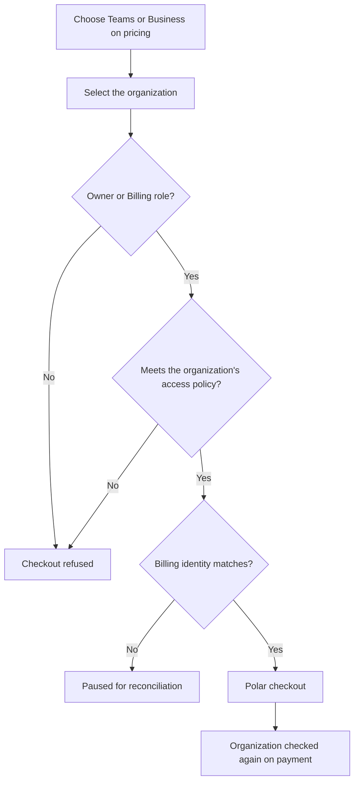
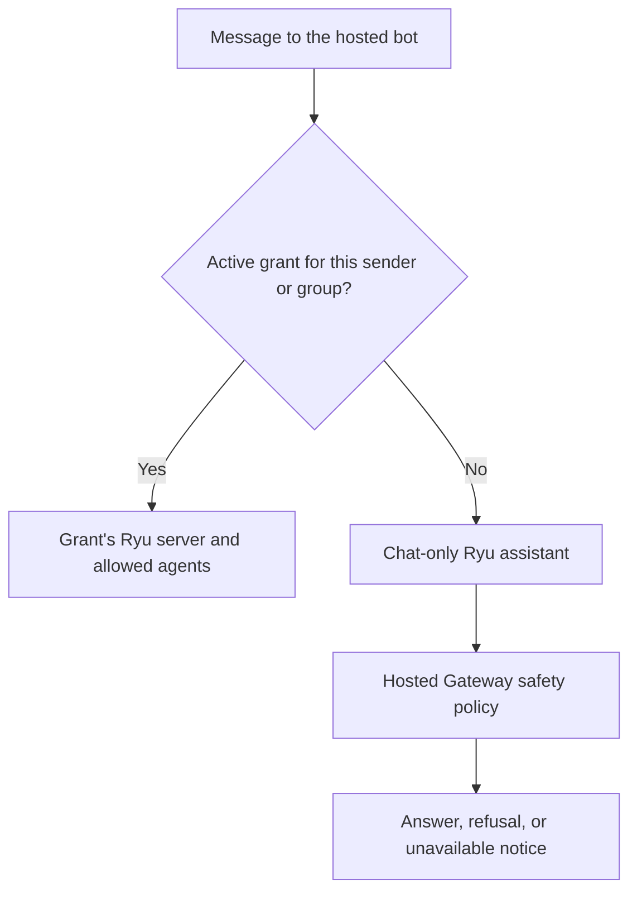

This reference is for organization owners and admins. It covers who can buy and manage an
organization plan, the personal and shared workspace boundaries, teams and projects, and hosted
bot access.

Member invitations are on [Organization Invitations](/docs/billing/organization-invitations), and
roles and API keys are on [Organization Roles and API Keys](/docs/billing/organization-roles).

## Paid access skips the waitlist

Completing a paid Teams or Business checkout approves the account when payment is confirmed.
Enterprise approvals are handled through the organization conversation and
contract.

## Choose the organization before checkout

When you choose Teams or Business on the public pricing page, Ryu asks you to select the
organization on the next page. Ryu sets that organization as active and uses it as the owner of
the checkout, seats, shared credits, and managed server. The selection is carried through
checkout and checked again when payment completes.

Only an organization owner or billing manager (the Billing role) can buy Teams or Business for
that organization. The local desktop license is separate from organization billing and does not
grant hosted agents or a shared organization wallet.

Billing is organization-scoped; it is not a collection of individual seat toggles.

- Before opening a shared checkout, Ryu resolves the organization's dedicated Polar team customer
  and passes its provider customer ID to the checkout.
- If the contact email is already attached to another provider customer, Ryu pauses the checkout
  and asks for billing-identity reconciliation instead of charging a personal account.
- Every checkout, including a managed-server purchase, applies the selected organization's
  access policy (IP allowlist, required two-factor authentication, and session age), even when a
  different organization is active.

### Switching organizations

Switching organizations clears the previous organization's billing drafts and loads the selected
organization's balances and permissions.

- A confirmation opened before the switch cannot save those previous settings to the newly
  selected organization. Wait for the selected organization to load, then review and confirm its
  changes.
- The plan badge also reloads for the selected account and organization. A cached plan from a
  different workspace does not determine its billing controls.
- Subscription and lifetime-license indicators wait for the current account to be verified,
  including after switching accounts or signing out.

### Separate billing identities

An organization has its own billing identity even when its payer also owns another organization
or a personal subscription. Sharing a billing email does not share authority to cancel plans,
change seats, or admit members.

If an older subscription has not been linked to its organization, contact support to reconcile
that existing purchase before trying another checkout. Ryu pauses management of a known legacy
purchase until that identity is verified.

## Personal workspaces and business email

Every account starts with a default one-person workspace.

| Account email | Workspace boundary | Who can join |
|---|---|---|
| Public mailbox (Gmail, Outlook, Live, Yahoo, Proton, and similar) | Personal | Nobody else: it cannot invite, add, or accept another member |
| Company domain | Teams | Still one member until the business email is verified and a paid Teams or Business subscription is active |

The one-member rule for personal workspaces is enforced by the server, so it also applies to
direct API calls and older invitation links. The automatically created personal workspace cannot
invite members.

### Shared organizations need a business email

Shared organizations are Teams boundaries. Creating one, joining one, and starting its Teams or
Business checkout require a verified business-domain email. Public mailbox domains are not
accepted.

The default company-domain workspace may exist while verification is pending, so the owner has a
home. Ryu then requires both the domain and Better Auth's `emailVerified` state for shared
membership, invitation acceptance, and checkout. This is an admission heuristic; Enterprise can
add stronger domain, SSO, or DNS verification requirements.

### Moving from a personal email

If the owner started with a personal email, do not create a second Ryu account.

1. Change and verify the email on the same account. The completed business-email change moves
   the same workspace into the Teams boundary.
2. Return to **Organizations → Billing** and buy Teams. Paid shared access activates after Polar
   confirms the subscription.

For a legacy personal workspace whose owner already has a company email, the paid webhook performs
that same conversion. The organization id, agents, workflows, wallet, and audit history remain
intact. No email change or checkout can add a second member to the personal boundary.

## View teams and projects

Open an organization to see its teams and projects together. Projects appear under their assigned
team; projects without a team appear in a separate list. **New team** creates a group for its
projects and members. **New project** creates an organization project and can optionally assign it to
a team; choose **No team** to leave it unassigned.

If the hierarchy fails to load, choose **Retry** to fetch the latest organization state. A failed
team or project creation keeps its form available for correction or retry. Canceling or closing the
form discards its unsaved name and team selection.

## Organize members into teams

Organization owners and admins can manage groups from **Organizations → Teams**: create or
rename a team, add or remove organization members, and delete a team. Members can view team
membership and choose their **Active team**. That selection is stored on the Better Auth session
and scopes team-aware organization requests.

The organization and team pages, Desktop workspace settings, Native organization screen, and
extension context menu all persist the active team on the Better Auth session. Team-aware
requests therefore use one server-owned context across all four clients.

Membership, team, and invitation requests follow the access policy of every organization they can
act on, including the active organization and the active team's organization. If your active
team belongs to an organization whose policy your session does not meet, team member lists stay
unavailable until you meet that policy or choose a different active team.

- If the teams or a team's member list fails to load, use **Reload teams** or **Retry loading
  members** to fetch the current state again.
- A failed membership or team change leaves the existing state visible so it can be retried.

### Organization lifecycle

Ryu uses Better Auth's native organization endpoints for create, list, update, delete,
active-organization selection, member roles, invitation creation, resend, acceptance, rejection,
cancellation, and leave. See the
[Better Auth organization plugin reference](https://better-auth.com/docs/plugins/organization)
for the endpoint, schema, access-control, and lifecycle-hook contract.

- An invitation can optionally name a Better Auth team. Leave **Team** at **No team** to add the
  invitee only to the organization, or choose a team to add the invitee there after acceptance.
- An organization with an active Teams or Business subscription must cancel that plan before it
  can be deleted.
- Leaving an organization removes only the caller's membership. It does not cancel the
  organization's subscription or reduce its billed seat quantity.

Personal managed subscriptions stay personal even when they include managed AI. Use the same
workspace's Teams or Business checkout when more than one person needs shared access, roles,
budgets, or an organization audit trail.

## Hosted bot access

Organization owners and admins can open **Organizations → Bot access** to grant the hosted Telegram,
Discord, or Slack bot access to one person, or to bind an entire group, server, or workspace to one
Ryu server.

### Individual grants

Individual grants can use a username, a platform user ID, or both. A user ID does not bypass
verification: each new grant remains pending until the intended account sends its one-time access
code from that identity. Share the code privately with the person or group administrator.

### Group grants

For a group grant, choose the platform's whole-group scope and enter its group, server, or
workspace ID. Every member, channel, and thread in that container routes through the same grant
and Ryu server.

- Allowed agent IDs can narrow which assistants are reachable. Leaving that field empty uses the
  configured default agent.
- A server URL is optional, but when supplied it must be a public HTTPS origin.
- Without a per-grant URL, the hosted bot needs an operator-configured shared cloud default to
  reach an assistant.

### People without a grant

People who message the hosted bot without a grant get a chat-only Ryu assistant instead. It has
no tools, only answers questions about Ryu, and is limited to a small number of messages per hour.

- Its replies run through Ryu's hosted Gateway, so Ryu's platform safety policy screens every
  message.
- The bot sends the Gateway a one-way hash of the platform and sender ID, never the raw ID.
- A message the policy blocks gets a short refusal. When the assistant cannot serve, the bot says
  it is temporarily unavailable and links to pricing.
- Onboarding commands such as `/start` and `/pricing` always reply with the onboarding message.

### Disable, revoke, and audit

Disable a grant to retain its configuration while stopping authentication, or revoke it to remove
the access entry. Grant management does not connect a Telegram, Discord, or Slack account on the
organization's behalf.

Creating, changing, and revoking a grant each adds an entry to the organization's **Audit log**
(and to SIEM export when it is configured).

- The entry names the admin who acted and the grant's platform, enabled state, and allowed agents
  and teams.
- A change also records the previous values, and a revocation keeps the scope the grant had.
- A change to the username, server URL, or note is recorded only as a changed field, along with
  whether a server URL is set.
- Sender IDs, usernames, phone numbers, server URLs, notes, and access codes are not written to
  the log.

### Errors and confirmations

- If the access list cannot load, choose **Retry** to fetch it again.
- A failed toggle, revoke, or code regeneration keeps the existing grant visible with an error so
  the action can be retried.
- **Revoke access** asks for confirmation; choose **Keep access** to cancel.
- If the browser blocks copying an access code, the code stays visible for manual copying.

<Callout type="info">
  Billing access, member invitations, and invitation acceptance are separate
  decisions. Buying organization access never silently adds a member.
</Callout>

Continue with [Organization Invitations](/docs/billing/organization-invitations), [Organization Roles and API Keys](/docs/billing/organization-roles), [Teams seats](/docs/billing/seats), [agent inboxes](/docs/billing/agent-inboxes), and [hosted agents](/docs/billing/hosted-agents).
