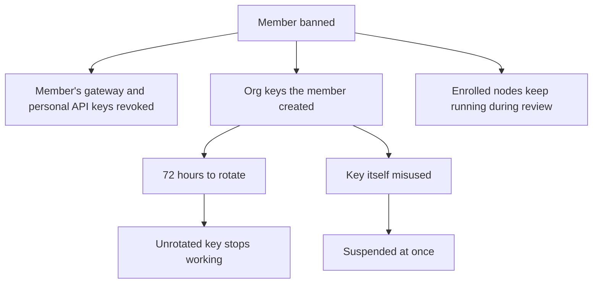

Console is Ryu on the web for your account and your organizations. Every organization has its own
section of Console at `/organizations/<organization id>`.

<Figure name="organizations" />

## Find your way around

Console uses the same layout as the desktop app's Settings: a grouped sidebar beside the page, with
a search box at the top.

- **Search** lists matching pages and individual settings, such as **Payment methods** or
  **Invoices** on the billing page. Choose a result to open it. Search only offers pages your role
  can open.
- **Resize** the sidebar by dragging the divider.
- **On a narrow screen**, the sidebar sits above the page in its own scrolling area.

The sidebar lists everything you can manage for that organization:

| Group | Pages |
|---|---|
| Monitor | Overview, Usage, Limits & budgets, Tag budgets, Logs |
| Organization | Projects, Members, Teams, Invitations, Notifications |
| Access | Service accounts, API keys, Admin keys, Gateway keys, Bot access, Security (SSO and SCIM) |
| Governance | Guardrail policies, Safety map, Policies, Vault, Data controls, Config, Audit log |
| Platform | Integrations, Connect keys, Features, Products, Marketplace & payouts |
| Nodes | Cloud computers, Fleet status, Rules, Stack templates, Managed content |
| Billing | Billing, Credit history |

**Tag budgets** and **Connect keys** appear only when Ryu Connect is available to the
organization. A family workspace does not show business pages: Logs, Teams, Service accounts,
Admin keys, Vault, Integrations, and Connect keys.

### What your role can see

The sidebar shows only the pages your role can use. For example, a member without audit or billing
access does not see **Limits & budgets** or the **Audit log**.

Hiding a page is a convenience: the server checks your permissions again on every request.

- Reading **Config**, the organization's **API keys**, or its firewall rules requires the Gateway
  configuration permission, the same permission that changing them requires. Owners and admins
  have it by default, and a custom role can grant it.
- **Guardrail policies** and **Safety map** also need the Gateway configuration permission.
- **Policies** stay readable to members because members can manage their own user-level policy.

### Active organization and older links

Opening an organization in Console also makes it your active organization, so the organization
switcher in the header matches the page you are viewing.

Earlier links such as `/organizations/members` or `/organizations/billing` still work. They open
the same page in your active organization in Console and keep any query parameters, including checkout returns.

The former seller settings address, `/settings/seller`, opens **Marketplace & payouts** for your
active organization. With no active organization it asks you to select one, and choosing one in the
organization switcher opens that organization's page.

## Overview

**Overview** summarizes every Gateway that reports to the organization:

- total requests, error rate, spend, and tokens;
- spend by Gateway;
- an eval leaderboard ranking providers by average score;
- shared budgets, marked **Near limit** at 80% of the cap and **Exhausted** once spend reaches it;
- the most recent requests.

Turn on **Errors only** to list only the failed requests; the rest of the page does not change.
**Refresh** reloads everything and shows when the data was last updated.

Members who can configure Gateways or manage billing see every Gateway in these totals. Other
members see only the Gateways they can reach: organization-wide Gateways, their teams' Gateways,
and their own personal Gateway. Another member's personal Gateway, or the Gateway of a team they
are not in, is left out.

If no Gateway has reported yet, the page says so. Members who can configure Gateways also see a
link to create a Gateway key.

## Projects

**Projects** shows the organization's teams with the projects that belong to each, followed by
projects without a team, with a count of each.

- Search narrows the list by team name, project name, or slug. A matching team keeps all of its
  projects.
- **New team** and **New project** create either one. A project can be assigned to a team when you
  create it.

## Usage

**Usage** charts cost and tokens over time and totals them in a table. Choose the last 24 hours,
7, 30, or 90 days, or a custom range of whole UTC days.

Owners and members with audit or billing access can group the table by member, API key, team,
model, provider, or project. Other members see only their own usage.

**Export CSV** downloads the same rows. An export holds at most 10,000 rows. When more matched,
the page warns that the file is incomplete, so narrow the range or choose a larger bucket.

If the organization's server does not report usage breakdowns yet, the page says so instead of
showing empty charts. Credit spend stays available under **Billing → Credit history**. The API
behind this page is on [Limits and Usage API](/docs/billing/usage-limits-api#usage--cost-api).

## Limits and budgets

**Limits & budgets** sets spend caps and rate limits at four levels:

- **Organization cap** - one cap on the whole organization.
- **Member default** - applies to every member who has no limit of their own.
- **Per member**, **per team**, and **per key** - limits for specific people, teams, or API and
  Gateway keys.

Each limit can set:

- an optional budget in US dollars ($0 blocks all charged spend);
- a window: daily, weekly, monthly, or lifetime, following UTC calendar days;
- what happens when the budget runs out: **Stop requests**, **Downgrade model** to a model you
  name, or **Notify only**;
- alert thresholds as percentages of the budget;
- optional requests-per-minute and tokens-per-minute limits, at least 1 per minute.

Leave a field empty for no limit. Every applicable limit is checked, not only the most specific
one: a request is blocked when any applicable **Stop requests** budget is used up. The full rules
are on [Spend Limits and Usage API](/docs/billing/usage-limits#how-limits-are-evaluated).

The **Current window** table shows spend so far against each cap, highest first, with a progress
bar. Shared budgets coordinated across Gateways appear below the editor.

- Members with audit access can view limits.
- Changing them needs the billing permission, and every change is written to the organization's
  audit log.
- If another admin saves limits while you are editing, your save is refused with a message asking
  you to reload, so one change cannot overwrite the other.

### Tag budgets

**Tag budgets** caps spend by the [builder tags](/docs/standalone/connect-api-tags) callers put on
Ryu Connect and Ryu Gateway calls in `x-ryu-tags`. Each budget names:

- a tag;
- a daily or monthly UTC window;
- a limit in US dollars;
- whether reaching it refuses tagged calls or only reports it.

The table shows each budget's spend in its current window, and you can export the last seven days
of spend per tag as CSV. Permissions match limits: audit access to view, the billing permission to
change, and a save is refused if someone else saved since you loaded the page.

## Billing

The **Billing** page is organization-scoped. Owners and billing managers manage the shared plan
and payment details. Members can still view the shared credit balance and usage.

You can also reach it from the organization switcher: choose **Organization settings**, then the
**Billing** tab. The page includes:

- the current plan, renewal status, upgrade action, and a link to view all plans;
- [payment methods and invoice history](/docs/billing/checkout#payment-methods-and-invoices),
  with PDF invoices;
- the shared credit balance, included monthly pool, rollover top-up balance, and credit usage;
- a link to Gift Ryu for personal gift cards, credit gifts, and non-renewing subscription gifts
  (see [Gift Cards, Credits, and Subscriptions](/docs/billing/gifts));
- manual credit top-ups, low-balance email alerts, and bounded automatic top-up settings.

### Billing safeguards

- Payment methods and invoice downloads open in the provider portal only after Ryu verifies that
  provider-side plan and seat editing is disabled.
- Plan changes, cancellation, and seat changes use Ryu's server-side billing routes, and Ryu keeps
  the organization role check on every billing action.
- Every card-funded action requires enrolled authenticator-based 2FA. Email-only confirmation is
  not accepted for billing.

### Live billing status

Organization billing-status subscriptions receive a fresh status message after an accepted payment.
Each refresh is addressed to the members of the organization that owns the payment, and it
preserves the member's applicable gift entitlement.

A subscription opens for the organization active in the account session and keeps that
organization while it stays open. If a member belongs to several organizations, a payment in
another organization does not change this subscription's organization.

### General settings

- Owners and admins can rename a shared organization and change its URL slug.
- An owner can delete the organization, after a fresh identity check. An admin or member can leave
  it.
- Personal workspaces can be renamed but keep their signup slug and do not show leave or delete
  actions.

Failed saves, leaves, or deletes keep the dialog open with an error so the action can be retried.

## Vault

**Vault** is the browser view of the organization [Secret Vault](/docs/security/secret-vault).

- **Secrets** lists organization and team secrets for one environment, with their folder, version,
  and status. **New secret** and **New version** write a value. **Versions** lists earlier versions
  and can roll back to one. **Delete** keeps the versions, so a deleted secret can be restored from
  **Show deleted**.
- **Values stay hidden.** **Reveal** appears only when you hold the `read` capability on that
  secret. It first asks you to confirm it's you, and one confirmation lasts 10 minutes. Revealing a
  value is recorded in the vault audit log, and **Hide** clears the value from the page. Members
  who can only use a secret never see its value.
- **Change requests.** In a protected environment, a write or delete from someone without `admin`
  becomes a change request. **Change requests** lists the requests you opened and those you can
  approve, with **Approve**, **Reject**, and **Cancel request**.
- **Policies** grants or denies capabilities on secret paths and binds policies to users, teams,
  roles, or machines. **Audit** lists vault activity without secret values. Both tabs need vault
  admin access.

## Gateway keys that serve your own users

If your application calls models through a gateway key on behalf of its own users, turn on
**Serves end users** for that key on **Gateway keys**.

- Requests on that key can name the person behind each request with the `x-ryu-end-user` header.
  That person, rather than the signed-in member, becomes the identity the request is attributed
  to.
- On every other key the header is recorded but never replaces the member, so a member cannot
  appear as a different person on each request.
- Keys are off by default. Changing the setting needs permission to manage nodes and a fresh
  confirmation code, and the **Audit log** records it.
- A node's paired credentials always change together.
- Gateway keys that belong to a service account do not have the switch yet.

See [End-user identity](/docs/gateway/managed-data-plane#end-user-identity) for the header format.

## Account standing and gateway keys

Ryu staff can act on accounts that break Ryu's usage policies. Each action is a person's decision,
with one exception described below. Owners and admins get a notice in their Inbox when an action
affects their organization.

### A member is banned

- Gateway keys and personal API keys the member owned are revoked. They stay revoked even if the
  ban is lifted later.
- Organization keys that member created keep working for 72 hours so you can rotate them: create a
  replacement on **Gateway keys**, move your traffic, then revoke the old key. After the deadline
  an unrotated key stops working.
- When the key itself was misused, it is suspended right away instead.
- Nodes the member enrolled for the organization keep running while Ryu reviews them, so a ban
  does not take your nodes offline.

### A gateway key is suspended

Requests with a suspended key are refused until Ryu lifts the suspension. Suspension is
reversible, unlike revoking, and you can create a replacement key at any time.

This is the one action Ryu takes automatically. When Ryu's screening blocks a child safety
violation on traffic that spends Ryu credentials, the key that sent it is suspended at once, and
only a person at Ryu can lift it. Traffic on your own provider accounts never triggers it, and
nobody is banned automatically.

### The organization is restricted or suspended

Ryu can limit an organization while it reviews activity on the account. Owners and admins are told
when that happens and again when access is restored.

The **Audit log** records each of these changes as a system action, without the staff member's
identity or the reason details.
