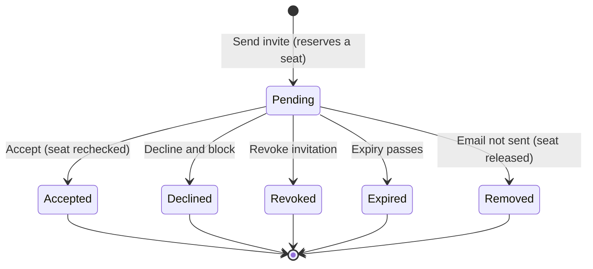

Organization owners and admins invite people by email address. This page is for owners and admins
who manage membership, and for anyone who receives an invitation. Seat billing is on
[Teams Seats](/docs/billing/seats).

## Invite members

1. Open **Members → Invite a member**.
2. Enter the email address of each person to invite.
3. Optionally assign a team, or choose **No team** to leave the invite unassigned.
4. Choose **Send invite**.

Invitees receive an accept-invitation link. People without an account receive a sign-up link that
returns them to the invitation.

### Email addresses and usernames

Invitations are sent by email address only. A pending invitation shows its address to the
organization, so Ryu does not invite someone from their username. A username matches only people
who are already members, and shows their public profile name and picture, not their email
address.

- Personal workspaces cannot look up or invite recipients.
- Recipient lookups follow the organization's access policy and are rate-limited per account. If
  you add many recipients in a short time, wait a few minutes before adding more.

### Seats and pending invitations

Each pending invitation reserves one organization seat. The Members page shows active members as
`active / capacity`, and the invite control is disabled when all effective seats are active or
reserved.

To free a seat before sending another invite, cancel a pending invitation, remove a member, or buy
more seats. Acceptance is checked again on the server, so an invitation cannot grant access after
the seat was used by someone else.

The Members page, and **Members** in the organization switcher, list only invitations that are
still pending:

- Accepted, declined, cancelled, and expired invitations are not shown, and older finished
  invitations never push a pending one off the list.
- Each list loads at most 2,000 pending invitations. Past that, a notice says that pending
  invitations beyond it are not shown.
- If the list cannot be loaded, the Members page and the dialog say so instead of showing none.

If the roster on **Organizations → Members** fails to load, choose **Retry loading members** after
the service recovers.

## When an invitation email is not sent

Invitation email shares a per-recipient limit with Ryu's other notification email: one email to
the same address per minute and 20 per UTC day.

When an invitation's email cannot be sent, Ryu removes the invitation and releases its seat. An
invitation accepted or cancelled while its email was still being sent keeps that outcome.

| Cause | What the Members page shows | What to do |
|---|---|---|
| The per-recipient limit refused the email | How long to wait: a minute, or the whole hours until the daily limit resets, for example **Please wait 60 seconds before sending it again.** | The recipient stays in the form. Choose **Send invite** again after the wait. |
| Another failure, such as an email service outage | That the email could not be sent and no invitation was created | Try again in a few minutes. |

### Resend failures

If **Resend** cannot send the email, the Members page shows the message next to that pending
invitation, with the wait when the limit refused it. The invitation stays pending with its original
expiry. **Resend** after the wait sends the email and renews the invitation.

### API responses

API clients of Better Auth's `invite-member` endpoint receive:

- HTTP 429 with a `Retry-After` header and the code `INVITATION_EMAIL_RATE_LIMITED` when the limit
  refused the email;
- HTTP 503 with `INVITATION_EMAIL_NOT_SENT` and no wait when the email could not be sent for
  another reason.

## Review, decline, and block

The user-menu **Invitations** page separates requests into **Received** and **Sent**.

- **Received** lists only invitations you can still accept. An expired invitation is not shown, and
  its count excludes it. Accept an invitation or choose **Decline and block**.
- **Sent** lists the active organization's invitations that are still pending, newest first, with
  the same filtering as the Members page. Resend a pending invitation, or choose **Revoke
  invitation** to prevent acceptance while keeping its audit history.

The **Sent** tab loads at most 2,000 pending invitations. Past that, its count ends in **+** and a
notice says that the pending invitations beyond it are not shown.

### Accept and revoke races

Accepting and revoking settle the same pending invitation exactly once:

- If the person accepts first, the revoke is refused with the invitation's accepted state and their
  membership stays. Remove the member separately if needed.
- If the revoke lands first, the acceptance fails and no membership is created.

### Cooldown and blocking

- For safety, the same organization cannot send another invitation to the same email address for
  24 hours.
- A decline is stronger than the cooldown. It blocks future invitations from that organization for
  that recipient.

## Invitation notifications

Invitation activity is transactional. The invited person receives the invitation or account
confirmation email. The organization's configured notification roles receive Inbox activity for
invitations sent, accepted, declined, or cancelled. See
[Billing notifications](/docs/billing/notifications#organization-controls) for recipients and
switches.

Continue with [Organization Access](/docs/billing/organization-access) and
[Organization Roles and API Keys](/docs/billing/organization-roles).
