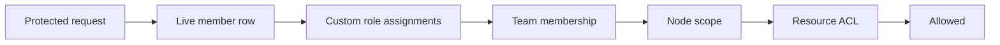

Organizations use built-in roles plus narrower custom Ryu roles, and every protected operation
checks the live membership, role, and resource ACL. This reference is for owners, admins, and
developers who manage roles or create organization keys. Membership and teams are on
[Organization Access](/docs/billing/organization-access).

## Roles

Organizations use built-in **Owner**, **Admin**, **Member**, and **Viewer** roles and can add
narrower custom Ryu roles. A custom role is a permission bundle assigned at the whole organization
or at one team.

Billing, notification management, node management, member management, and capability execution
are separate permissions. An organization can give a process operator access without giving them
spending authority.

### Two role systems

Ryu keeps two role systems separate:

| System | Owns |
|---|---|
| Better Auth | Organization membership, invitations, teams, and its own organization-management actions. Its dynamic-role support remains available for those actions. |
| Ryu | The capability catalog used by Core, Gateway, Agent Mail, Marketplace, and resource ACLs. |

A Better Auth role or custom Better Auth action never widens a Ryu capability by itself.

Ryu checks each of these on every protected operation.

### Creating and assigning Ryu roles

- To create or assign a Ryu role, a caller needs `roles.manage` and may only grant permissions they
  already hold. This prevents a role editor from minting a privilege ceiling above their own
  authority.
- A role assignment cannot target a team unless the target user is a member of that team.
- Deleting a role removes its assignments. Deleted role keys remain reserved, so a stale node ACL
  cannot unexpectedly reactivate when a later role uses the same key.
- When a Secret Vault policy is bound to a custom role, creating, deleting, assigning, or removing
  that role also requires vault policy administration (`admin` on `sys/policies`).

### Role audit entries

Each role change adds an entry to the organization's **Audit log**, and to SIEM export when it is
configured, naming the admin who acted:

| Action | Recorded |
|---|---|
| `role.create` | The role's key, name, and permissions |
| `role.update` | The name and permissions before and after |
| `role.delete` | The permissions it carried and how many assignments it removed |
| `role.assign` | The member, assignments added and removed, counts before and after, and the full assignment lists. Team-scoped assignments are written as `role@team:<team id>` after the organization-wide ones. |
| `member.role.update` | A member role change made with an Admin API key, with the previous and new role |
| `<action>.denied` | A refused (403) role change, for example `role.create.denied` |

Long values are packed rather than dropped:

- A long list is packed into comma-separated entries. If a list is still too long for one entry,
  the entry records how many items it left out (for example `addedOmitted`).
- A role key longer than 240 characters is shortened with a digest of the full key, so two long
  keys stay distinct.

## Identity checks and Desktop role editing

These actions ask the signed-in admin to verify their identity first:

- removing a member;
- changing a member's role;
- cancelling a pending invitation;
- inviting someone with more access than a member (owner, admin, or billing manager).

Inviting someone as a member does not.

### Desktop role editing

In Desktop, open **Gateway settings → Workspace** to:

- inspect the active organization's member roster and built-in roles;
- create and edit custom Ryu roles;
- assign those custom roles to members.

Custom role changes ask the signed-in user to verify their identity before the request is sent.
Desktop does not edit invitations, built-in member roles, or seat quantity there. **Manage
members** opens the organization page for those actions.

- If the organization, member, role, permission, team, or member-role list cannot be loaded, the
  setting shows a retry action instead of treating the failed read as an empty list.
- Role assignment controls stay unavailable until their saved assignments load.
- While a custom role is saving, its fields stay locked until the request succeeds or fails. A
  failed save keeps the draft open for retry.

## API keys

Viewing organization API-key metadata, creating a key, and revoking one all require the Gateway
configuration permission (`gateway.configure`). Owners and admins hold it by default, and a custom
role can grant it. Members and viewers without it cannot list the organization's keys, including
through the authentication API.

Custom roles can narrow those management actions without becoming a shortcut to Ryu's capability
scopes.

### Key scopes

API keys are separate from membership. When a member creates an organization key:

- Every requested `resource:action` scope must be covered by that member's own effective
  permissions in the organization. For example, `tools:exec` needs tool execution and
  `workflows:run` needs workflow runs.
- A request for a scope the creator does not hold is refused with `403` and names the scopes.
- Ryu also clamps the scopes to the caller's account role and returns the plaintext only once.
- The key stays owned by the organization, so removing its creator does not silently remove the
  integration.

Revoke or rotate the key from **Organizations → API keys** if the integration changes hands or the
secret may have leaked.

### What every request still checks

Ryu evaluates the key's scopes, organization membership, server ACLs, entitlements, budgets, and
Gateway policy on every protected request. A Better Auth role that can manage a key record does
not, by itself, grant access to chat, agents, files, or other Ryu resources.

## Node gateway keys

| Node | Who can use it |
|---|---|
| Personal | Owner only |
| Team | Team members, or holders of organization-level node management |
| Organization | Organization members |

- Issuing or revoking a team node's gateway key needs node management for the organization, or a
  role scoped to that team. An organization-level holder does not have to join the team first.
- A personal node and its gateway keys belong to one member and work only while that person is a
  member. Only that member can issue a personal node's enrollment token or gateway key; an
  administrator cannot create one in another member's name.
- A member with organization-level node management can see the name, owner, and status of other
  members' personal nodes and keys and revoke them, but cannot read or change their personal
  configuration.

### When a member leaves

When a member leaves or is removed, Ryu revokes, in that organization:

- the personal nodes and personal gateway keys issued for them;
- the organization-wide and team nodes and gateway keys that member enrolled.

Ryu stops accepting them even if the revocation has not finished. An organization or team node set
up on a departing administrator's machine must be re-enrolled by another member with node
management. Cloud-provisioned servers and service-account keys are not affected.

Continue with [Organization Access](/docs/billing/organization-access) and
[Organization Invitations](/docs/billing/organization-invitations).
