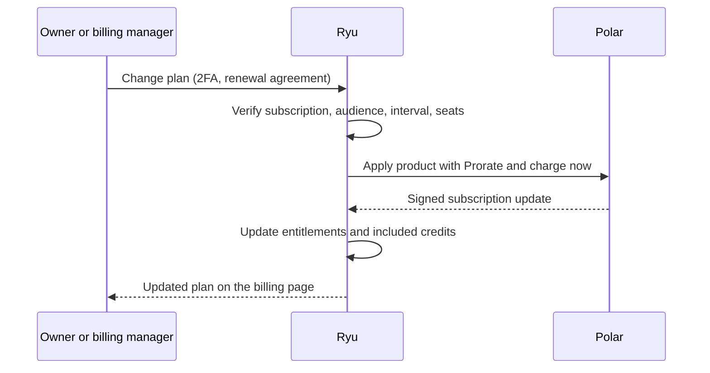
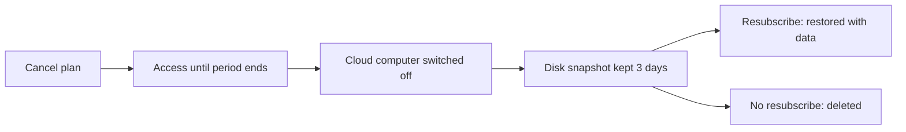

Owners and billing managers (the Billing role) change a recurring plan from **Organization →
Billing → Change plan**. This page covers how a change is reviewed and applied, and what happens to
credits and cloud computers. Prices are on [Plans and Pricing](/docs/billing/plans).

## How a plan change is applied

Ryu checks the change before it asks the billing provider, Polar, to apply it:

1. Ryu verifies the active subscription.
2. It keeps the change within the same audience and billing interval. Pro and Max are
   individual-plan changes; Teams and Business are organization-plan changes.
3. It checks organization members and pending seat claims.
4. It asks Polar to apply the catalog product with **Prorate and charge now**.
5. After Polar confirms the active subscription update, Ryu applies the matching current-period
   entitlement change.

A private plan offer, when issued, keeps its own server-validated price and included-credit
snapshot without changing the public contract for its parent plan. Enterprise changes happen
through a conversation.

### Proration

For an effective plan or seat change, Ryu asks Polar to use **Prorate and charge now**: the unused
difference is charged for an upgrade or credited for a downgrade in the same change.

Polar owns subscription and credit-meter state, and handles the money-side proration shown on your
invoices. Ryu projects signed provider events into effective entitlements and keeps runtime access
and included cloud-computer capacity aligned with them. At the next billing period, Polar starts the
new plan's credit grant; Ryu does not keep a second balance ledger.

### Where the steps open

On the web, **Change plan** and **Cancel plan** open in a window over the organization billing page
or the dashboard. Close it, or press Escape or Back, to return. Opening the link directly shows the
same step as a full page.

Each step says whose plan it is: your personal plan or the organization it belongs to. Billing
changes act on your active organization. If the window was opened for one organization and another
is now active (for example after switching in another tab), Ryu refuses the change, leaves both
plans as they were, and links to the right organization's billing page.

Payment methods and invoices are
[sections of the billing page](/docs/billing/checkout#payment-methods-and-invoices). Checkout and
credit top-ups finish on [Ryu's checkout page](/docs/billing/checkout), which only renders
checkouts Ryu created. Ryu verifies that provider-side plan and seat editing is disabled before
issuing a portal session.

## Reviewing an organization plan change

An organization owner or a member with billing management permission can open **Change plan** from
the organization billing page. Review the current and new plans and the proration summary before
continuing. **Cancel** leaves the current plan in place.

- While confirmation is pending, the dialog cannot be dismissed or submitted again.
- A failed request keeps the review and its error visible for another attempt.
- If the provider's renewal price changed before you confirmed, Ryu prices the change again. A
  different amount needs a fresh agreement.
- After a successful change, the window closes and the billing page shows the updated plan.

When you start a new organization plan from Ryu, the review step shows the **Current → New** plan,
the recurring amount, and the organization-level seat quantity before opening checkout. Polar
remains the source of truth for the final total and proration. After checkout, Ryu returns to a
receipt page that confirms the payment and the plan's next state.

## Renewal agreement

Recurring plan cards show the renewal amount and the monthly or yearly interval beside the purchase
button, with cancellation instructions and a link to the subscription terms. Select the
automatic-renewal agreement before you continue.

A fresh agreement is needed when:

- the price, seat count, or interval changes;
- a paid cloud-server purchase or compute add-on changes its cloud region, even when the price
  stays the same;
- you switch back to an earlier offer.

Organization checkout review needs an agreement before you continue with the displayed recurring
quote. Existing-plan changes fetch a renewal quote from the billing provider before you can agree
and confirm. Ryu checks that the quote still matches before it applies the change; if a price
cannot be confirmed, the change stays blocked.

One-time desktop licenses do not renew automatically. Paid cloud-server purchases and compute
add-ons show their own monthly renewal terms and agreement. The payment provider's checkout confirms
the final total, taxes, and subscription details before it charges you.

## 2FA confirmation

Ryu requires enrolled 2FA and the current authenticator-app code before:

- opening checkout;
- changing billed seats;
- opening the billing portal;
- buying or resizing a cloud computer.

It is a blocking dialog with no close button, Escape action, or outside-click dismissal, and the
server enforces it for every client. Email-only confirmation is not accepted for card-funded
billing actions.

## What changes with your plan

- **Included credits follow the effective change.** Polar records the meter credit grant and its
  proration state. Ryu never creates a second grant for a webhook retry, and a downgrade cannot
  return credits that were already spent. If a reduction exceeds the remaining included balance,
  the consumed difference offsets later included credit increases and renewals, so cycling between
  seat counts cannot refill spent credit.
- **Free credit stays separate.** A plan change only changes the shared plan meter; it does not
  merge or move free credit. Free credit keeps its own expiry and is still spent first on models
  marked Free until it runs out.
- **Top-up credits are never touched.** They roll over and survive plan changes and cancellation.
- **Upgrades never resize your included server.** See
  [Your Ryu server when the plan changes](#your-ryu-server-when-the-plan-changes).
- **Cloud computer purchases and upgrades are plan-gated.** See
  [Who can buy or upgrade](/docs/billing/cloud-computers#who-can-buy-or-upgrade).
- **Existing contracted pricing is preserved.** A later public price increase does not move an
  organization already on a recorded pricing version.
- **Cancelling stops future grants.** Credits already granted remain available until spent or
  expired under their normal rules.
- **Member seats are organization-level.** They are separate from cloud-computer size and from the
  number of workflows or agents the organization creates.

## Starting Teams or Business

Prices, seat minimums, and the pooled AI grant for each plan are on
[Plans and Pricing](/docs/billing/plans#teams). Both plans include an always-on Ryu server and
attach their included cloud computer and pooled wallet to the organization.

The public pricing page uses one seat selector for Teams and Business, described on
[Teams Seats](/docs/billing/seats). Checkout still validates the live organization member and
pending-invitation counts on the server.

If the first process needs more configuration, Ryu may scope a private founding proof arrangement
in conversation. Any price, duration, and workflow scope are written into the agreement.

### Upgrading the personal workspace

The automatically created personal workspace can be upgraded in place:

1. A consumer-mailbox owner changes and verifies the address on the same Ryu account. The completed
   change moves the workspace into the Teams boundary.
2. Every current member must have a verified business-domain email before checkout.
3. The paid conversion becomes active only after Polar confirms the subscription.

The conversion keeps the existing organization id, data, wallet, agents, workflows, and audit
history. Details are on [Personal workspace conversion](/docs/billing/seats#personal-workspace-conversion).

## Your Ryu server when the plan changes

Every plan that includes a cloud computer includes an always-on Ryu server, and the price is the
same whatever server stock looks like. A server you already have keeps its size when you renew,
change seats, or move to a higher plan. A future pending update does not change the computer
early.

When you move to a cheaper plan, Ryu may resize your server to the one the new plan includes, after
Polar confirms the new subscription state:

- The resize happens during the server's quiet hours (3:00 in the server's own time zone) with a
  brief restart.
- The organization gets an email first.
- Your data and disk are kept.
- A server that can't be resized that way keeps its size.
- If you change plans again before the quiet hours, Ryu checks again and cancels the resize when the
  new plan no longer needs it.

## Sold-out plans

A plan is shown as **Sold out** only when no server it can use is available. New checkouts and
upgrades to it are then refused until stock returns, while plans whose servers you already have keep
working. See
[When a server is out of stock](/docs/billing/cloud-computers#when-a-server-is-out-of-stock).

## Expanding capacity

When another person needs access, an owner or billing manager adds a seat in the organization
billing screen. The organization keeps its existing data, wallet, audit history, and pricing
version. Seat rules, pending-invitation reservations, and negotiated allowances are on
[Teams Seats](/docs/billing/seats#adding-and-removing-members).

Workflow capacity and cloud-computer size are managed separately from the seat meter. An
organization may choose Business when the larger pooled grant is worth the premium.

## Upgrading to Enterprise

Enterprise is the path for organizations with more than 50 active members or with requirements such
as dedicated capacity, custom deployment, SSO/SCIM, procurement terms, data-region controls, or named
onboarding.

The Enterprise agreement states the seat allowance, workflow capacity, credit pool, support level,
and cloud-computer arrangement. When the agreement includes a cloud computer, an owner or billing
manager can upgrade it through the same checkout flow used for Business and Teams.

## Cancelling

**Cancel plan** schedules cancellation at the end of the current billing period. You keep access
until then, and no refund is issued.

To confirm, tear the card's ticket stub:

- pull the stub down along the perforation;
- or tap the stub five times;
- or focus it and press the Down Arrow key five times.

A partial pull springs back when released and leaves the subscription unchanged; a complete tear
submits the cancellation. If the plan card is loading, use **Schedule cancellation** instead.
**Keep my plan** closes the confirmation without changing the subscription. A failed request keeps
the plan active and restores the confirmation for retry. After success, **Resume plan** becomes
available.

### What happens when you cancel

- Future included monthly grants stop.
- Included credits already granted remain spendable until their normal expiry.
- Top-up balance remains available and does not expire.
- An included cloud computer runs until the paid period ends. It is then switched off and kept as a
  disk snapshot for 3 days, with email reminders before it is deleted. Resubscribing within that
  window restores it with its data.
- The cloud computer's automated daily backups are kept until the paid period ends and are then
  permanently deleted. Only the snapshot remains through the 3-day window.

Cancellation never claws back credit you already hold.

## Related

[Billing](/docs/billing), [free-tier limits](/docs/billing/limits),
[pricing changelog](/docs/billing/pricing-changelog), and [credits](/docs/billing/credits).
