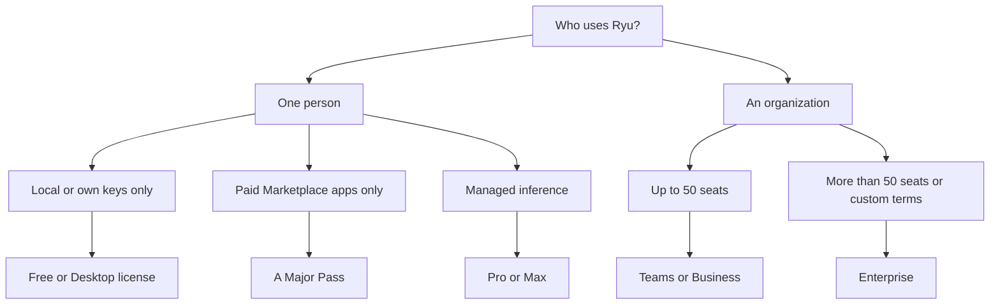

Ryu's plan catalog includes Pro and Max for individual work, plus Teams, Business, and Enterprise
for shared organization work. This page is the canonical list of plan prices, included AI pools,
and deposit fees.

For the business overview, see the [Pro overview](https://ryuhq.com/pro), the
[Teams overview](https://ryuhq.com/teams), and the current offers on the
[pricing page](https://ryuhq.com/pricing).

<Callout type="info">
  These are the enforced plan limits for Core and managed infrastructure. Marketplace
  prices and A Major Pass eligibility are shown by each catalog listing; signed package,
  permission, and server-lifecycle checks still apply to every install.
</Callout>

## Plans at a glance

| Plan | Price | Scope | Included AI pool | Marketplace apps | Deposit fee |
|---|---:|---|---:|---|---:|
| **Free** | $0 | Managed starter or self-hosted | None | Free items | **27%** base |
| **Desktop license** | **$129 launch / $200 list, one time** | Local desktop, individual | None | No | **27%** base |
| **A Major Pass** | **$20/month** or **$200/year** | One individual user | None | Supported paid Marketplace apps | **27%** base |
| **Pro** | **$49/mo or $490/year** | Individual, one user | **$14/mo** | Supported paid Marketplace apps | **26.5%** |
| **Max** | **$99/mo or $990/year** | Individual, one user | **$30/mo** | Supported paid Marketplace apps | **26%** |
| **Teams** | **$50/member seat/mo or $500/seat/year** | One organization, 5-seat minimum ($250 monthly floor) | **$50/mo for each started five-seat bundle ($50 at 5 billed seats, $100 at 6–10)** | Supported paid Marketplace apps | **26%** |
| **Business** | **$300/mo for 5 seats; +$50/seat** or **$3,000/year for 5 seats; +$500/seat** | One organization, 5-seat minimum | **$100/mo for 5–9 billed seats; +$100 at each completed five-seat bundle** | Supported paid Marketplace apps | **26%** |
| **Enterprise** | Custom | Organization contract | Contracted | Contracted terms | Contracted |

### What every managed plan includes

Managed Pro, Max, Teams, Business, and Enterprise subscriptions include full access to Ryu's
published product catalog. The product count on the pricing page follows that catalog.
Plan-specific seats, usage, hosting, and Marketplace terms still apply. A Major Pass, the desktop
license, and self-hosted deployments keep their separate scopes.

Related allowances live on their own pages:

- hosted mail by plan on [Agent Inboxes](/docs/billing/agent-inboxes#limits-by-plan);
- cloud-computer allowances on [Cloud Computers](/docs/billing/cloud-computers);
- standalone services, which have product-specific billing models rather than one shared
  subscription price: the [standalone pricing overview](/docs/standalone#standalone-pricing-and-access)
  says which services are available, and [Metering Rates](/docs/billing/metering) has every current
  rate, including the complete Box compute schedule.

### Marketplace pricing

Paid Marketplace items are priced by their publisher. Ryu currently applies a **20% pre-tax
commission**. Stripe processing and Connect fees are separate and vary with payment and account
pricing.

## Choosing a plan on the pricing page

Individual checkout is controlled by the same billing rollout used by the pricing page and may be
temporarily closed. When it is enabled:

- personal workspaces use personal checkout, and shared workspaces use the organization flow;
- the pricing page opens on the Individual plans and yearly billing; choose Teams & Enterprise for
  shared organization plans;
- if you need to sign in first, Ryu keeps your selected individual plan in the same browser tab and
  resumes checkout when sign-in finishes.

On the Self-Hosted audience switch, the page offers **Individual** and **Enterprise**. Individual
selects the $0 Free tier; Enterprise shows the open-source and commercial-license options.

### Billing period and comparison

- The **Monthly/Yearly** switch below the plan cards compares billing periods. Yearly cards show
  the annual charge divided by 12 as the **/mo** price, rounded to whole dollars, with the full
  amount billed per year underneath.
- Displayed prices animate to the selected amount and respect your reduced-motion preference.
- **Compare plans** lists the plans on the selected shelf side by side: price, included AI credits,
  deposit fee, the always-on server and Ryu Box capacity, Agent Inbox and storage allowances,
  integrations, team controls, and support.

The comparison columns match the cards shown, and organization prices and credits follow the seat
count you choose. On a narrow screen the table scrolls sideways while the feature names stay in
view.

When you choose Teams or Business, Ryu asks you to select the organization that owns the checkout;
see [Choose the organization before checkout](/docs/billing/organization-access#choose-the-organization-before-checkout).

## Free

The Self-Hosted → Individual offer is **$0**. Ryu charges no setup or monthly fee for this tier;
you choose and pay for your own infrastructure and model providers.

The free local and self-hosted baseline includes:

- local and bring-your-own-key chat, agents, tools, MCP, skills, and basic runs;
- Prompt Studio, evals, GraphRAG, the Companion overlay, and Gateway governance UI.

These local features require no desktop license. A self-hosted operator is not bound by Ryu's
managed-path starter caps. The signed-in managed free path is smaller; its caps are listed in
[Free-Tier Limits](/docs/billing/limits).

### Desktop license

The local desktop license is a separate local-first path. It does not include managed inference,
cloud computers, hosted agents, or a monthly AI pool. It keeps the free
[Agent Inboxes](/docs/billing/agent-inboxes) baseline. See
[Trial and Access Model](/docs/billing/trial-and-access) for how the license is checked.

## Individual plans

Pro and Max provide managed inference and a personal workspace for one person. A Major Pass
provides Marketplace app access only. Separately issued private individual offers, when available,
keep their own server-validated price and included-credit snapshot.

Individual plans do not include shared organization ownership, member roles, a shared wallet,
organization audit history, or the hosted business-automation allowance. If another person needs
their own login, shared agents, shared budgets, or a single organization bill, use Teams or
Business.

Sharing a personal login is not a team entitlement and does not create organization controls or an
audit trail. To share Max with your household, see [Family Sharing](/docs/billing/family-sharing).

### Availability

Individual plan availability is rollout-controlled. When the individual shelf is enabled, **Start
with Pro** and **Start with Max** use personal checkout and never create organization seats. If the
shelf is temporarily closed, that does not cancel or remove an existing A Major Pass, Pro, or Max
entitlement.

### Pro pricing versions

New Pro contracts use **$49/month or $490/year** with a $14 monthly pool. Existing Pro contracts
keep their recorded pricing version, price, and pool:

- a $49/$490 contract sold before 2026-10-20 keeps its $15 pool;
- a $39/$390 contract keeps its price.

## A Major Pass

A Major Pass is a **$20/month or $200/year recurring plan for one individual user**. The yearly
option includes two months free.

- **Includes** supported paid Marketplace apps from participating publishers.
- **Does not include** managed inference, cloud computers, hosted channel bots, or AI credits, and
  adds no hosted mail of its own.

### Included listings

Eligible catalog cards carry a ticket icon. Selecting it explains **Get this with A Major Pass or a
qualifying subscription plan**.

On the web Marketplace's **Browse** and **Bundles** cards, it says **Included with your plan** when
the account already has Marketplace access. The ticket follows the signed-in account and the
organization selected in the organization switcher. When you return from checkout or the payment
methods page, it changes as soon as Ryu confirms the new plan, without reloading the page.

Installing a paid app or plugin requires one of:

- a purchase;
- A Major Pass or a qualifying plan, for an included listing;
- a publisher share code.

Once installed, free and paid apps use the same update, enable, and execution path.

### When the pass is not on sale

A Major Pass is offered only while it is open for sale. When it is not, the pricing page omits its
card, catalog cards omit the ticket icon, the publish form omits the opt-in, and new A Major Pass
checkout is refused. Existing subscribers and qualifying plans keep their Marketplace app access,
and installs of included listings keep working.

### Publisher payouts

Publishers opt in per paid app after enabling Stripe Connect payouts. Ryu allocates a default **70%
publisher pool** from A Major Pass recurring periods using first-use signals and deterministic
price-tier weights.

- Managed Pro, Max, Teams, and Business plans include Marketplace access but do not fund that
  publisher pool.
- Transfers are idempotent and use the publisher's existing Connect account.
- A publisher can review pending totals, paid totals, failed transfers, and usage-signal counts in
  the Marketplace Sell tab.
- One-time and bounded-update Marketplace sales remain direct item transactions.

## Teams

Teams starts at **$250/month for five member seats**. Additional seats are **$50/month each**
through the 50-seat self-serve limit.

Annual billing is **$500 per seat/year**, with five seats required (**$2,500/year minimum**; two
months free). It is shown as **$208/month** at the minimum (the $208.33 monthly equivalent,
rounded).

A seat is a person who can access the organization's shared workspace. It is not a separate AI
wallet, server, or locked-to-one-person agent.

Teams includes:

- centralized team billing and organization settings;
- a team Marketplace for shared skills and plugins;
- shared usage analytics for the organization;
- **$50/month of managed AI credits for each started five-seat bundle**, pooled across the
  organization ($50 at five billed seats, $100 at six through ten);
- managed setup and one always-on Ryu server at every seat count, including in Singapore;
- organization-scoped access, spend controls, and audit history;
- the organization mailbox and agent addresses (see [Agent Inboxes](/docs/billing/agent-inboxes#limits-by-plan));
- 50 GB of space storage and no plan cap on concurrent background runs;
- 26% deposit fee on additional prepaid credits, with a $5 minimum.

The billed seat count is enforced against Better Auth organization members after any active
negotiated capacity allowance is applied. Larger organizations use Enterprise. Invite, acceptance,
upgrade, downgrade, and proration behavior is on [Teams Seats](/docs/billing/seats).

A private proof arrangement may be offered in conversation. It is not a public price or a
self-serve checkout option.

## Business

Business is the optional premium organization plan.

| | Monthly | Annual |
|---|---|---|
| Five human seats | **$300/month** | **$3,000/year** (ten monthly units) |
| Each additional seat | **$50/month** | $500/year |

The shared AI-credit pool is **$100/month at five through nine billed seats**, increasing by $100
at each completed five-seat bundle.

Business also includes an always-on Ryu server, 50 GB of space storage, organization-scoped access,
spend controls, audit history, and the same Agent Inbox and storage boundary as Teams. Its deposit
fee is **26%**, with a **$5 minimum**.

Business is available to any eligible organization, including one with fewer than 25 members; it is
a premium anchor, not a 25-member gate. A Business seat means the same thing as a Teams seat and
does not turn human seats into AI-automation limits.

## Enterprise

Enterprise is the conversation path for organizations that need more process capacity, dedicated
or self-hosted deployment, SSO/SCIM, custom data-region or retention requirements, procurement
terms, or named onboarding.

Contact us so the contract reflects the workflows, hours, data
boundaries, and support level you actually need. See
[Upgrading to Enterprise](/docs/billing/plan-changes#upgrading-to-enterprise).

## Credits and deposit fees

Polar owns the subscription, credit-meter, top-up, and usage state. Ryu reads the signed provider
state and enforces access before managed work.

- Included Teams and Business credits are **use-it-or-lose-it** each billing period.
- Credits you buy separately roll over and never expire.
- Model usage is metered at cost by default. Provider-level billing policies may explicitly keep a
  provider at raw cost or apply the Gateway's configured markup.
- The deposit fee is the visible platform fee for the default managed offer.

See [Credits and AI Pools](/docs/billing/credits) for the balance rules,
[Top-ups and Deposit Fees](/docs/billing/top-ups) for the fee schedule, and
[Where the deposit fee goes](/docs/billing/top-ups#where-the-deposit-fee-goes) for a line-by-line
breakdown of the OpenRouter, GST, and Polar costs it covers.

## Price versions and grandfathering

The price and included pool agreed at subscription time are recorded for that organization. If Ryu
raises the public price later, existing contracted organizations keep their contracted price and
included pool. New organizations see the new offer and any additional included credits that fund
it. See [Pricing Versions](/docs/billing/pricing-changelog).
