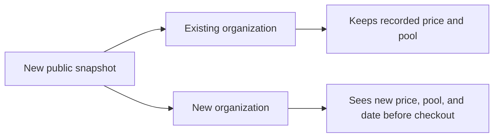

Ryu versions its pricing. The price and included credit pool agreed at checkout are recorded for
the organization. A later public change applies to new subscriptions; it does not reduce or
reprice an existing contracted organization.

## Current public snapshots

| | |
|---|---|
| **Teams snapshot** | v5 |
| **Business snapshot** | v2 |
| **Effective** | 2026-09-18 |
| **Enterprise** | Custom organization agreement |
| **Managed top-ups** | Pro 26.5%; Max, Teams, and Business 26%; $5 minimum. The schedule includes a 9% Singapore GST reserve on the upstream OpenRouter credit-purchase subtotal when that tax is not recoverable. |

The public recurring offer for organizations:

- **Teams** is $50/member seat/mo with a five-seat minimum ($250 floor), and $500/seat/year on
  annual billing. The shared pool is $50 at five billed seats plus $50 whenever the quantity
  crosses another five-seat bundle.
- **Business** is $300/month for five seats, then $50 per additional seat. The pooled grant is $100
  at five through nine seats plus $100 at each completed five-seat bundle, with one always-on Ryu
  server.

Pro and Max remain public on the Individual pricing shelf as fixed personal managed plans. Their
recorded price and pool versions continue to grandfather existing customers; they are separate
from the shared Teams and Business organization contract. Current prices for every plan are on
[Plans and Pricing](/docs/billing/plans).

## Recent changes

### Pro credit pool, mail, and storage (2026-10-20)

New Pro contracts include a **$14 monthly credit pool** (previously $15) at the unchanged
$49/month or $490/year price. Existing contracts keep the pool recorded with their pricing
version.

Mail and storage are now **5,000 emails/month, 10 GiB of stored mail, and 10 GB of Space storage**
(previously 10,000 emails, 20 GiB, and 20 GB). Allowances are not part of the recorded pricing
version, so the new limits apply to every Pro subscription, including existing ones.

- Nothing already stored is deleted. An account over the new stored-mail cap keeps its mail and can
  still read and delete it.
- Only new inbound mail, sends, and drafts are refused until the account is back under the cap.
- Sends past 5,000 still work as
  [overage](/docs/billing/agent-inboxes#sending-past-the-monthly-allowance).

### Ryu Box usage rates (2026-10-20)

Boxes are priced per size, per running hour, in whole minutes with a 5-minute minimum per start:

| Size | Rate per running hour |
|---|---:|
| Small | $0.025 |
| Default | $0.04 |
| Large | $0.07 |

- A resume on the same machine within the server hour already paid owes no new minimum.
- Saved workspaces and snapshots cost $0.05/GiB-month above the 25 GiB each paid organization
  includes.
- Without a paid plan, or during a free trial, storage is limited to 10 GiB, a stopped Box is kept
  14 days, and nothing is charged for storage.
- Stored Boxes and snapshots are deleted 30 days after an organization's credit runs out.
- Plans limit how many Boxes run at once: 1 without a paid plan or during a free trial, 2 on Pro, 4
  on Max, 10 on Teams, and 20 on Business.

This replaces $0.0655 per vCPU-hour plus $0.0211 per GiB-hour and $0.10/GiB-month on each size's
storage allowance. Usage rates are not pinned to a subscription: they apply to all Box usage after
the change. Billing details are on [Box and Sandbox Billing](/docs/billing/sandbox-billing).

### Included server (2026-10-19)

Every plan that includes a cloud computer includes one always-on Ryu server, at every seat count.
Prices, credit pools, and snapshot versions are unchanged, and server stock never changes the
price.

Servers created before then keep their size on renewals, seat changes, and upgrades. A move to a
cheaper plan may resize one, as described in
[Plan changes](/docs/billing/plan-changes#your-ryu-server-when-the-plan-changes).

## How future changes work

Pricing versions cover plan prices and included pools. Free-tier caps are listed on
[free-tier limits](/docs/billing/limits).

When a future snapshot changes pricing or the included pool:

- **Existing price stays pinned.** The amount agreed by an existing organization remains its
  contracted price.
- **Existing credits stay pinned.** The included pool that price was designed to fund remains
  attached to that organization.
- **New customers get the new package.** A higher public price can fund a larger included pool,
  more capacity, or more support for new organizations. The earlier cohort keeps its recorded
  package.
- **The change is explained before checkout.** The new price, pool, and effective date are visible
  before a new organization commits.

## Related

<Cards>
  <DocCard href="/docs/billing" />
  <DocCard href="/docs/billing/plan-changes" />
  <DocCard href="/docs/billing/credits" />
  <DocCard href="/docs/billing/limits" />
</Cards>
