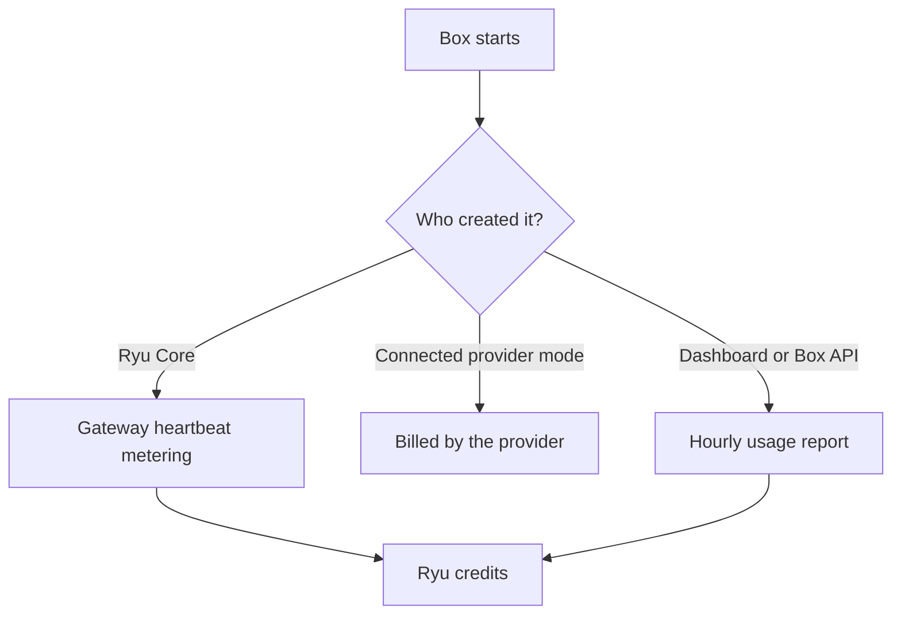

A sandbox is a real machine running your agent's code. This reference explains how its time and
storage turn into credit charges. The per-size and per-resource rates are on
[Metering Rates](/docs/billing/metering#sandbox-compute); the Box product itself is on
[Persistent Boxes](/docs/core/boxes) and [Ryu Box](/docs/standalone/box).

## Box minutes and storage

A Box is charged in whole minutes while it runs, rounded up.

- **5-minute minimum.** Each start (a create or a resume) is charged for at least five minutes. A
  resume on the same machine within the server hour already paid for owes no new minimum, only its
  minutes.
- **Storage** is the measured size of each Box's saved workspace and of its snapshots, at
  **$0.05** per GiB-month (30 days) above the Box storage your organization includes:
  **25 GiB** on a paid plan.
- **Without a paid plan**, or during a plan's free trial, storage is limited to **10 GiB** and
  nothing above it is sold or charged.

One allowance covers every Box of the organization, session Boxes included. Their storage above it
appears as **Box** in the credit ledger.

## How a Box is settled

Ryu Box has three settlement paths:

| Box | Billing authority | How it is charged |
|---|---|---|
| Created by Ryu Core on Ryu-owned capacity | Ryu wallet | Registers with the Gateway sandbox heartbeat. Charged at its size's rate, with the 5-minute minimum on its first heartbeat, until Core stops, parks, or destroys it or its time to live ends. |
| Connected provider mode | Provider subscription | Ryu does not debit the same machine time from the Ryu wallet. |
| Created from the Ryu dashboard or the Box API | Ryu wallet | Settled hourly, as described in [Dashboard and API Boxes](#dashboard-and-api-boxes). |

Connected provider mode is an explicit setting because it changes who owns the spend decision. See
[Persistent Boxes](/docs/core/boxes#connected-provider-mode).

## Box session compute

A conversation's session Box is the Box a cloud task, computer use, the browser, or a parallel
sub-agent runs on. It is one of the Core-created Boxes above. It appears in your credit ledger as
**Box session compute**, separate from the hourly **Box compute and storage** lines of dashboard
and API Boxes. It uses the same Box rates as every other Box.

- Each running session Box is metered every 10 seconds, at the size it was created with. A parked
  Box costs nothing for compute.
- The session's cost chip shows the cost of the current run and its running time, for example
  `$0.0123 · 18 min`, from the same metering that bills it.
- When your balance covers less than about 15 minutes of the Box's time, the session shows a
  low-credit warning.
- When credits or a spending budget run out, Ryu parks the Box within seconds and keeps its work.
  Top up and resume it to continue.
- A new session Box needs credit for at least its 5-minute minimum.
- Your plan limits how many Boxes run at once: 1 without a paid plan or during a free trial, 2 on
  Pro, 4 on Max, 10 on Teams, and 20 on Business.

## Dashboard and API Boxes

A Box created from the Ryu dashboard or directly through the Box API is settled hourly from the Box
service's usage report.

- Running time is charged at its size's rate, in whole minutes with the 5-minute minimum per start
  (none for a resume within the hour already paid). A short start is counted in the hour it began.
- Saved workspaces and snapshots above the included storage are charged for every hour they are
  stored, prorated over a 30-day month.
- Each hour is charged once, shortly after it ends, to the organization's credits: the included plan
  pool first, then gift balance, then top-up credit.

### When credit runs out

- Creating or resuming a Box from the Ryu dashboard or Ryu's organization API is refused with
  `402 insufficient_credits` while the organization has no plan pool left and no positive balance.
- New work sent directly to the Box service's own `/v1` API is refused the same way within about a
  minute.
- Ryu checks every few minutes and stops the organization's running Boxes, however they were
  started, once no plan pool is left and the balance is zero or below.

A stopped Box keeps its saved workspace. What happens to it next depends on the plan:

| Organization | Stored Boxes and snapshots |
|---|---|
| Active paid plan | Kept while the plan is active, including when the plan pool is spent before the next refill. Storage above the included amount keeps accruing until the Box is deleted or expires. |
| No paid plan | A stopped Box is deleted 14 days after it stopped. Stopped Boxes and snapshots are deleted 30 days after the organization's credit runs out. |

### Other sandbox backends

Box has no GPU or Windows option. The per-resource, Windows, and GPU rates on
[Metering Rates](/docs/billing/metering#sandbox-compute) apply to other sandbox backends.

## Spending caps

<Callout type="warn">
A sandbox bills for **wall-clock time while running**, not CPU time. An idle sandbox left open
still costs money. Set a per-run budget cap under **Settings → Billing → Sandbox spending** so a
looping agent cannot drain the wallet, and stop sandboxes you are not using.
</Callout>

- The cap is saved on the node selected in the desktop app and applies to sandboxed runs on that
  node. When you select another node, the field shows that node's own cap.
- A run that reaches its cap stays stopped. If the provider cannot delete the workspace on the
  first attempt, Ryu keeps retrying the deletion, refuses further commands in that sandbox, and
  does not charge it a new budget window.
