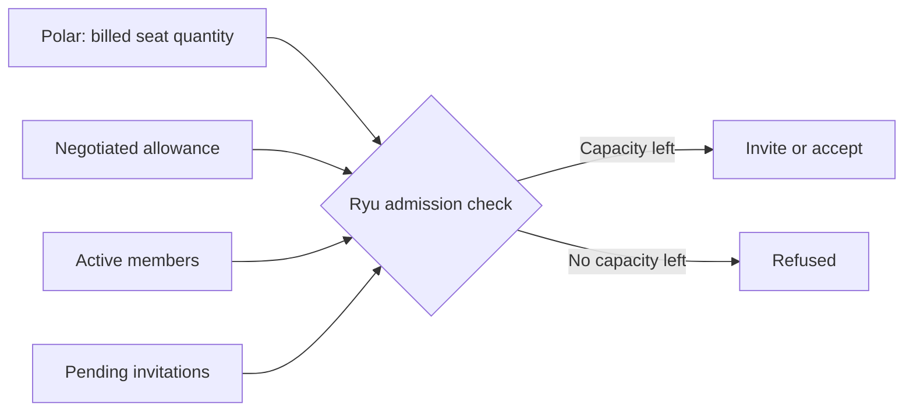

Teams and Business are billed per organization member seat, with a five-seat minimum and a
self-serve ceiling of **50 seats**. Larger organizations use Enterprise. The seat prices, annual
billing, and the shared AI-credit pool that grows with billed seats are on
[Plans and Pricing](/docs/billing/plans#teams).

## Who owns what

| Owner | Responsible for |
|---|---|
| Polar | The commercial seat contract: quantity, seat assignments, claim and revocation state, invoices, and proration |
| Ryu | Authentication, workspace membership (Better Auth organization members), and Ryu-specific roles and permissions |

Ryu synchronizes Polar's events into the organization billing view. The two are reconciled at
checkout, seat changes, invitation creation, and invitation acceptance.

## What a seat is

The seat is the person who can access the shared organization workspace. It is not a separate
credit wallet, cloud computer, workflow allowance, or one-to-one agent assignment. Credits remain
pooled so the organization can decide how to use its capacity.

A Business seat means the same thing as a Teams seat; it is not an AI-automation-user allowance.

### Choosing seats on the pricing page

The public pricing page has one seat selector for five to 50 human seats.

- Teams and Business show the selected total together.
- The selection is carried through sign-in and organization selection before checkout.
- Selecting 51 or more seats changes the cards to the Enterprise sales handoff.

The server still rechecks the live member and invitation counts before any organization checkout.

## Billed seats and negotiated capacity

Polar stores the **billed seat quantity** and uses it for the invoice and seat benefits. Ryu reads
that quantity for included-credit and cloud-computer sizing projections.

Ryu may also record a private, support-approved **negotiated seat allowance** for a specific
organization. For example, five billed seats plus five negotiated seats lets ten members use the
workspace while the organization still pays the five-seat $250/month floor.

Negotiated seats are capacity-only:

- They do not add another $50 credit bundle, change the cloud-computer band, or become a public
  discount.
- The allowance can have an expiry date and is checked by the server at invitation and acceptance
  time.
- The invoice remains five seats, the effective member capacity is ten, and the shared included
  pool remains $50/month, which keeps the offer auditable.

## Personal workspace conversion

The automatically created personal workspace has one member and no invitation path. To convert it
to Teams:

1. If the owner uses a consumer mailbox, change and verify the address on the same Ryu account.
   Creating a second account is not the normal upgrade path.
2. The completed company-email change moves the existing workspace into the Teams boundary.
3. Buy the five-seat minimum. The paid plan activates after Polar confirms payment.

A legacy personal workspace whose owner already has a company email is promoted by the same paid
webhook. Existing data and the organization wallet are not migrated or copied.

### Company email requirement

Teams requires every current and future member to use a verified company-domain email. Public
mailbox domains such as Gmail, Outlook, and Live are blocked at invitation, direct member addition,
invitation acceptance, and checkout.

From the billing screen, **Change email on this account** opens a form for the new address and its
confirmation. The addresses must match before Ryu sends verification messages to both inboxes.
Starting the request keeps you on the same account and workspace; return to billing after the new
address is verified to continue Teams setup.

## Who consumes a seat

- An active Better Auth organization member consumes one seat. Owners, admins, and members are all
  billable members.
- A pending invitation reserves one seat until it is accepted, rejected, cancelled, or expires.

Ryu holds a short-lived admission record while a membership change completes. It is not a second
billed-seat ledger. Failed claims expire automatically, and a browser count cannot authorize a
membership change by itself.

## Adding and removing members

An owner or billing manager must allocate enough billed seats before inviting or accepting more
members. Active members and pending invitation reservations both use the effective capacity. Ryu
subtracts any active negotiated allowance first, then checks the live member and reservation
collections; the number shown in the browser is not authoritative.

Removing a member releases the seat for reassignment. Ryu does not automatically reduce the Polar
quantity when a member leaves. The organization keeps the seat available until an owner or billing
manager chooses to lower the quantity, so a replacement invite is not interrupted.

The reconciled organization billing identity remains attached to the paid contract if the original
billing owner leaves. It does not move or cancel the subscription.

## Upgrades and downgrades

Seat changes go through the Ryu organization billing screen. The Desktop Teams billing summary shows
the current organization plan and monthly amount alongside billed seats and member capacity.

- Owners and billing managers can edit the billed quantity there.
- Reviewing a new Teams checkout shows its monthly amount and pooled credit allowance before
  checkout opens.

The server applies these rules:

- Increasing seats is checked against the 50-seat self-serve ceiling and sent to Polar with
  **Prorate and charge now**.
- Decreasing seats cannot go below five, or below the number of active members and pending
  invitation claims not covered by an active negotiated allowance.
- A request above 50 is rejected and routed to Enterprise, not clamped.
- A stale browser count cannot authorize a change; the server rechecks members, reservations, and
  the active Teams subscription.
- If Polar cannot be verified, the change fails closed and no membership change is authorized from
  that unknown state.

### What a seat change adjusts

With **Prorate and charge now**, Polar settles the unused seat difference in the same change. After
the effective subscription update, Ryu adjusts the current included credit pool by the
remaining-period seat difference.

- Teams grows when the billed quantity crosses another five-seat bundle; Business grows only at
  each completed five-seat bundle.
- Negotiated capacity does not increase the pool.
- A seat change does not resize the included cloud computer: every seat count includes the same
  always-on Ryu server.
- A pending future update does not change seats, credits, or cloud-computer capacity early.
- Top-up credits are not part of this adjustment and follow the wallet's normal rollover and refund
  rules.

## Payment and cancellation

Payment methods and hosted invoice details are handled through the Polar customer portal after Ryu
verifies that provider-side plan and seat editing is disabled. Plan cancellation and seat changes
stay in Ryu so member admission and proration rules are applied consistently. See
[Changing or Cancelling Your Plan](/docs/billing/plan-changes).

If the organization needs SSO/SCIM, dedicated or self-hosted deployment, custom terms, or more than
50 seats, use [Enterprise](/docs/billing/plans#enterprise).
