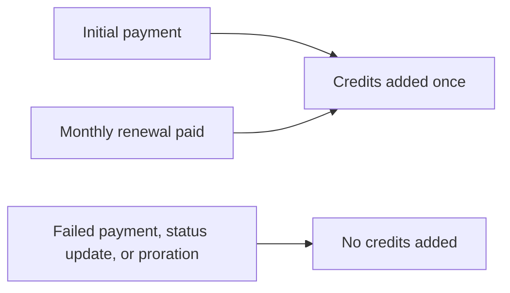

Standalone funding lets an organization pay for Gateway and eligible metered services without
buying a workspace subscription. Choose **Standalone services** on the pricing page.

<Callout type="warn">
The standalone funding shelf is behind the `billing.standalone_payg` rollout flag, which is off by
default. See [Rollout controls](#rollout-controls).
</Callout>

See [Credits and AI Pools](/docs/billing/credits) for the shared usage meter and
[Plan changes](/docs/billing/plan-changes) for workspace subscriptions.

## Funding options

| Funding | Wallet credits | Charge before tax |
|---|---:|---:|
| Pay as you go | $5 to $1,000 per top-up | Credits plus deposit fee |
| Prototype | $5 each month | $10 each month |
| Accelerate | $50 each month | $63.50 each month |

- The deposit fee is 27% of the credit amount, with a $5 minimum.
- The listed credit amount is what your wallet receives. The checkout charge includes the fee;
  applicable tax is separate.
- Monthly funding requires your agreement to the recurring charge before checkout.

Each funding card lists its credit amount, deposit fee, rollover, and service scope. Select a card
or its **Choose** button, then review the total below the cards before continuing. Whole-dollar
amounts display without decimal places; fees that include cents keep their exact amount.

## Where credits can be spent

Standalone credits pay for, when those services are available to your organization:

- Gateway, OpenRouter, Composio, Sandbox, and Treg metered usage;
- hosted Box, Notify, Passport, Ryu Messaging, and Mail overage charges.

Funding does not unlock a product that has a separate access requirement.

Credits do not include workspace seats, a managed server, or a workspace plan. They cannot pay
workspace subscription offsets or transfer to another wallet. Unused paid credits roll over,
including after a workspace plan pool resets.

## Monthly funding and cancellation

- A successful initial payment adds credits once.
- Each successful monthly renewal adds the same credit amount.
- Failed payments, subscription status updates, and prorations do not add credits.
- Replayed payment events cannot add credits twice.

### Cancel renewal

Signed-in organization owners and billing administrators can see the active funding subscription on
the standalone pricing shelf and cancel future renewals.

**Cancel renewal** first asks you to confirm. It names the credit tier, the date renewals stop, and
the organization (or personal workspace) whose wallet the funding fills. **Keep renewing** leaves it
unchanged, and a failed request shows the reason and changes nothing.

Cancellation takes effect at the end of the current period. Existing paid credits remain
available, and cancelling does not issue a refund. Refunds reverse credits from the standalone
bucket.

## Rollout controls

The shelf is controlled by the `billing.standalone_payg` rollout flag, which is off by default.

- When it is off, new monthly purchases are refused.
- Existing funding and cancellation keep working.
- Standalone monthly funding does not depend on which billing periods the workspace pricing page
  shows.
