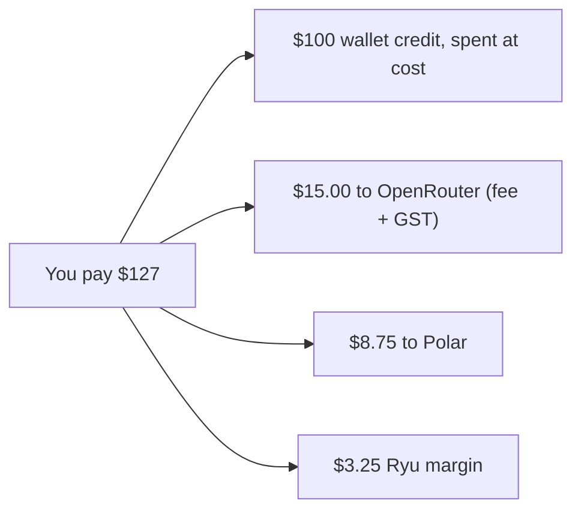

Prepaid credits are bought as top-ups, and each top-up carries a one-time deposit fee. This page is
the canonical reference for the fee schedule and for top-up, recharge, and credit-transfer
behavior. How the balance is spent is on [Credits and AI Pools](/docs/billing/credits).

## Deposit fees

The one-time deposit fee covers upstream credit purchase and payment handling. The fee is charged
**on top of** the amount deposited, and the full face value is credited to your wallet.

| Plan | Fee rate | Minimum |
|---|---:|---:|
| No managed plan | **27%** | **$5** |
| Pro | **26.5%** | **$5** |
| Max | **26%** | **$5** |
| Teams | **26%** | **$5** |
| Business | **26%** | **$5** |
| Enterprise | Contracted | Contracted |

- The fee is the greater of the percentage and the minimum.
- Separately issued private offers use the rate of their public counterpart: a private individual
  offer pays the Pro rate and a private organization offer pays the Teams rate.
- A negotiated seat allowance does not change the deposit-fee tier.
- From **September 18, 2026**, the economics reserve 9% Singapore GST on Ryu's OpenRouter
  credit-purchase subtotal when that upstream tax is not recoverable. This provider cost is
  included in the deposit-fee guard; any tax on your own checkout is itemized separately by the
  payment provider.

### Top-up amounts

Manual top-ups offer $100, $250, and $1,000 USD presets plus a custom face value from $5 to $1,000.
Presets are convenience amounts, not discounted credit bundles: the full face value goes to the
wallet and the plan-based fee is added.

| Top-up | Charge before checkout tax |
|---|---:|
| $5 face value, base rate | $10 |
| $100 preset, no plan | $127 |
| $100, Teams or Business | $126 |
| $250 preset, no plan | $317.50 |
| $1,000 preset, no plan (hits the $10 margin cap below) | $1,241.12 |

### Where the deposit fee goes

The deposit fee looks high next to a typical card fee because it is the **only** place Ryu charges
for managed inference. Model usage is debited at the provider-reported cost with no per-token
markup, so the costs of buying upstream credits and taking your payment are covered once, at
deposit.

Three external costs sit under every top-up:

- **OpenRouter funding fee** - 5.5% of the credits Ryu buys, with a $0.80 minimum. Managed models
  are served through OpenRouter credits that Ryu buys on your behalf.
- **Singapore GST** - 9% on that OpenRouter purchase (the credits plus OpenRouter's fee), from
  September 18, 2026. The schedule assumes this tax is not recoverable.
- **Polar payment processing** - up to 6.5% + $0.50 of the total you are charged. This is the
  highest listed card path, including the international-card surcharge; domestic cards cost less.

### What Ryu keeps

Ryu takes **no margin on usage**: every model request is debited at the provider-reported cost.
Ryu's only margin is whatever is left of the deposit fee after the three costs above.

- On a typical top-up that is about **2 to 3.5% of the credits you buy**.
- It is **capped at $10 per top-up**. Once the plan percentage would leave Ryu more than $10 (from
  about $280 of credits at 27%, or $373 at 26%), the fee stops growing and covers only the provider
  costs plus $10. Above that point every plan pays the same fee.
- Only very small top-ups differ. On a $5 top-up, $2.53 of the $5 minimum fee is left over, because
  the minimum is sized to cover fixed charges, not the amount you deposit.

Worked examples under the conservative assumptions above, rounded to the cent:

| Top-up | You pay | You get (wallet credit) | Paid to OpenRouter (fee + GST) | Paid to Polar | Ryu keeps | Ryu keeps, % of credits |
|---|---:|---:|---:|---:|---:|---:|
| $5 (minimum fee) | $10.00 | $5.00 | $1.32 | $1.15 | $2.53 | 50.6% |
| $100, 27% (no plan) | $127.00 | $100.00 | $15.00 | $8.75 | $3.25 | 3.3% |
| $100, 26% (Max, organizations) | $126.00 | $100.00 | $15.00 | $8.69 | $2.31 | 2.3% |
| $250, 27% (no plan) | $317.50 | $250.00 | $37.49 | $21.14 | $8.87 | 3.5% |
| $500, any plan (capped) | $626.17 | $500.00 | $74.98 | $41.20 | $9.99 | 2.0% |
| $1,000, any plan (capped) | $1,241.12 | $1,000.00 | $149.95 | $81.17 | $10.00 | 1.0% |

Read a row left to right. Of the $127 you pay for $100 of credits, $100 goes into your wallet and
is spent at cost. $15.00 buys those credits from OpenRouter (its $5.50 fee plus $9.50 GST reserve),
$8.75 covers Polar's card processing, and $3.25 is Ryu's margin.

These are worst-case costs, and the $10 cap is measured against them. With a domestic card, or if
the upstream GST becomes recoverable, Ryu's real costs are lower, so Ryu can keep somewhat more than
the table shows. The fee you are quoted does not change.

### How the schedule was set

- The rates are the smallest rounded schedule that does not lose money on any whole-cent top-up
  under these assumptions.
- The $5 minimum exists because OpenRouter's $0.80 minimum and Polar's $0.50 fixed charge stay the
  same no matter how small the top-up is.
- Promotional and provider-specific credits that Ryu grants (for example, credits on a campaign or
  a challenge prize) carry no deposit fee. They are funded from Ryu's own provider allocations, not
  from a card payment.

### Avoiding the fee

Any sales tax or VAT on your own checkout is separate: Polar calculates and itemizes it at
checkout. To avoid the deposit fee entirely, use a local model or connect your own provider key.
BYOK usage is billed by that provider and never touches the Ryu wallet.

## Auto-recharge and spend controls

Teams, Business, and Enterprise organizations can enable automatic top-up, set a monthly cap, and
configure low-balance alerts from **Organization settings → Billing**. The page shows the amount
charged this month and keeps the refill bounded by the monthly cap. Each agent run may also have a
per-run dollar budget cap.

Organization owners and billing managers (the Billing role) manage top-ups and auto-recharge;
admins do not. Polar records the credit movement; Ryu stores only the organization policy that
decides when an automatic refill may be requested. The balance is shared by the organization, not
split into individual seat wallets.

### Automatic top-up limits

- Automatic top-up uses a fixed, verified one-time payment product.
- A missing or zero monthly cap uses a bounded default of ten refill amounts. A configured cap
  cannot exceed one hundred refill amounts per calendar month.
- If the payment provider, product price, or accounting response cannot be verified, Ryu does not
  issue the credit, and managed provider calls pause until the state is reconciled.

Automatic top-up charges only the payment customer bound to the organization, and Ryu verifies that
binding again before each charge. If a saved setup points to a different or missing customer,
automatic top-up is disabled and must be configured again after the organization's billing
identity is reconciled. A shared payer email does not authorize another organization's card.

### Low-balance alerts

Low-balance email alerts are separate from automatic top-up.

1. Choose **No one (off)**, **Owners only**, or **Owners and admins**. A recipient change saves
   immediately.
2. Set the balance threshold in dollars. A threshold change saves when you leave the field.

Changes to automatic top-up and low-balance alerts are recorded in the organization activity log
with the member who made them and the previous and new settings.

## Moving credit and quest rewards

### Quest rewards

When a completed referral quest awards Ryu Credits, choose the organization wallet that receives
them. Your personal organization is selected by default; you can choose another organization from
the available list. **Not now** or closing the dialog leaves the reward unclaimed.

- While placement is pending, the organization selector and dialog actions are locked.
- If placement fails, the reward remains claimable, and reopening it keeps your chosen organization
  for another attempt.
- A successful claim refreshes the quest as claimed.
- Without an available organization, the claim cannot proceed.

### Move credits

In the desktop Credits page, **Move credits** lists the active account's transferable grants and
top-up balance.

- It leaves out any organization whose access policy (IP allowlist, required two-factor
  authentication, or session age) does not admit the current session. A transfer that names such
  an organization is refused.
- If the list cannot load, **Retry** reads it again.
- Verification errors and failed transfers keep your selected grants and amount so you can try
  again. A successful transfer refreshes the available balance.
- While verification or a transfer is pending, Move credits waits for that action to finish.

A completed transfer is recorded in the activity log of both organizations, naming the member who
moved the credit, the amounts, and the other organization. The transfer notification sent to owners
and admins names them too.

Retrying a transfer that already went through returns the same result but adds no second activity
entry or notification, because no credit moved again.
