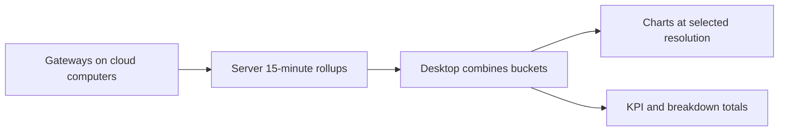

Usage analytics shows where credits and requests went, on the web and in the desktop app. Credits
and the included pool are explained on [Credits and AI Pools](/docs/billing/credits), per-unit
prices on [Metering Rates](/docs/billing/metering), and the Usage & Cost API on
[Limits and Usage API](/docs/billing/usage-limits-api#usage--cost-api).

## On the web

An organization member can open Billing → **Usage** to review the organization's credit ledger.

- Provider, model, and date edits remain drafts until **Apply**. **Reset** restores the unfiltered
  statement.
- When a new filter is applied, the previous summary clears until the matching results load.
- If a filtered read fails, the page keeps the filter values so you can apply them again after the
  service recovers.

## In the desktop app

Open **Settings → Usage** to see the credit ledger alongside usage analytics.

1. Choose a scope: **You**, **Organization**, or **This cloud computer**.
2. Narrow the view by date range, time resolution, provider, or model. The date range counts
   calendar days in your display time zone, so the **7 days** preset ends with today's date there.

The dashboard includes activity-over-time, consumption-source, provider, model, feature, and
activity-rhythm charts.

- In the activity-over-time card, switch between **Requests**, **Tokens**, **Errors**, and
  **Credit spend**, so the selected metric gets its own readable scale and tooltip.
- **Credit spend** counts only recorded credit debits.
- BYOK, local, and self-hosted activity remains visible for comparison but is shown as **Not
  billed** when Ryu has no managed-cost record for it.

### Cloud computer details

In the **This cloud computer** scope, two more cards can appear when the cloud computer's Gateway
reports the data:

- **Model calls by purpose** counts requests that Ryu makes in the background, such as context
  compaction, chat titles, suggestions, and plugin calls, next to your own chat and agent turns. It
  ranks request counts, not credit spend.
- **Prompt cache** shows prompt tokens read from and written to the provider's cache in each time
  bucket. When the providers report cache writes, the card also shows a reuse ratio: cache reads
  divided by reads plus writes. Some providers report cache reads but never writes, so the card
  shows only token volumes for them rather than a ratio that would always read 100%.

Older Gateways do not report these details, and the **You** and **Organization** scopes do not
include them, so the cards stay hidden there.

### Where the numbers come from

Organization and cloud-computer charts use complete, server-owned 15-minute rollups rather than
totals inferred from a capped raw-event page. The desktop combines those buckets into the selected
resolution. It compacts very long chart series for rendering without changing the KPI, source,
provider, model, or feature totals.

Organization results include organization-wide cloud computers plus the signed-in member's team and
personal cloud computers. Raw server audit and rollup reads remain owner-only.

## Forecasts

With **Forecast** on, the activity-over-time chart extends the selected metric with a dashed
projection and a shaded 80% range.

- The projection fits a straight trend to the last four weeks of completed buckets, or fewer when
  the range is shorter.
- Daily charts project the next 14 days. Other resolutions project 4 hours, 24 hours, 4 weeks, or 3
  months.
- The current, unfinished bucket is projected rather than fitted, so a partial day does not pull the
  trend down.
- Choose **By provider** to forecast each of the top providers separately. A table lists each
  provider's in-range total, projected total, and trend.

A forecast appears only when the selected range includes now and has enough recent activity. It
extends the recent trend and does not predict new workloads or price changes.

## Subscription account view

The same **Usage** page shows a live card for every ChatGPT, Claude, or GitHub Copilot subscription
account connected through Ryu on the selected cloud computer. Accounts stay grouped under their
provider. Each row shows:

- the plan, and whether it is selected for you or the shared Gateway;
- every provider-reported usage window and its reset time;
- any provider-reported balance or extra-usage meter.

This is a view of the provider's own limits, not an invoice. API-equivalent token cost is a
comparison metric; direct subscription traffic does not debit Ryu credits, and Ryu cannot infer the
provider's subscription bill from a percentage-used window.

If a provider does not expose a readable account window, the row says whether the account needs
reconnection, has no metered plan, is rate-limited, or is unavailable. Usage is read per saved
account without switching the account used for the next chat turn.

### Pace forecasts

When a provider reports both a window's length and its reset time, each window also shows a pace
forecast. Ryu extends the average use since the window started.

- The row shows when the account would run out at that pace, or how much headroom would remain at
  reset.
- A striped segment on the bar marks the headroom the current pace would use before the reset.
- Providers with several connected accounts also show pooled headroom now and at reset, plus how
  many accounts are on pace to hit a limit. The summary counts at-risk accounts across all
  providers.

The opt-in API-equivalent estimate adds a **Month-end** figure for the total, each provider, and
each account. It extends the month-to-date estimate at the same daily pace, so it reads low when
tracking started after the first of the month.
