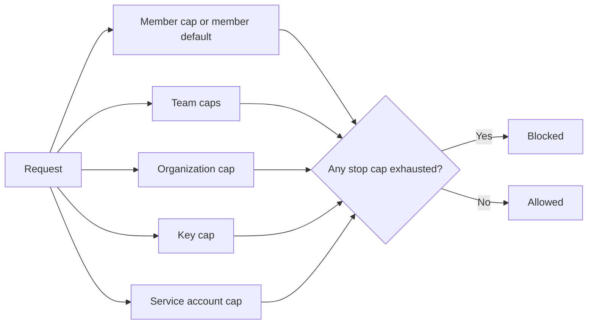
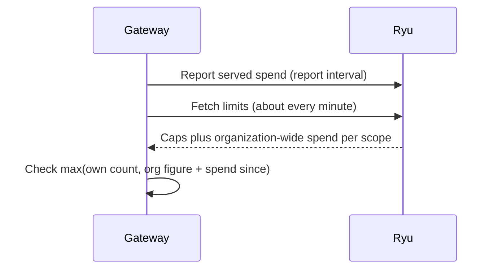

Organization owners can cap managed spend and request rates for the whole organization, for every
member, for individual members and teams, for individual keys, and for service accounts. Console and
the HTTP API report how much of each cap is used in its current window and break usage down by
member, key, team, model, provider, project, or service account.

<Figure name="budgets" />

## What limits count

Limits apply to billable Ryu-managed usage.

- Calls served with your own provider keys or local models still count requests and tokens in usage
  reports, with zero cost.
- Every cost figure, budget, and `spentMicroUsd` value is the charged amount debited from credits.
- Model tokens are metered at cost with no per-token markup
  ([Metering rates](/docs/billing/metering#models) explains how a call's cost is determined).
- Other categories, such as tool calls, media, and sandbox runtime, use their published rates from
  [Metering rates](/docs/billing/metering).

The platform margin is taken once, as the deposit fee on a top-up.

## How limits are evaluated

A limit (a **limit spec**) can be attached at six places:

| Scope | Applies to |
|---|---|
| `org` | All usage in the organization |
| `memberDefault` | Every member who has no explicit member entry |
| `members[userId]` | One member |
| `teams[teamId]` | Usage attributed to one team |
| `keys[keyId]` | One Gateway credential or organization API key (see [Per-key limits](#per-key-limits)) |
| `serviceAccounts[serviceAccountId]` | Every Gateway key of one service account (see [Service account limits](#service-account-limits)) |

Every applicable cap is checked for each request: the member cap (or the member default), the team
cap, the organization cap, the key cap, and the cap of the service account that owns the key. A
request is blocked when **any** applicable cap with the `stop` action is exhausted, so a generous
member cap never lifts an exhausted organization cap.



### Which caps apply on each node

Usage from a node counts against these caps, including workflows, apps, and agents the node runs in
the background. When a signed-in account makes the request, its own member and team caps apply as
well.

| Where the work runs | Caps that apply |
|---|---|
| Team node | Always that node's team. An organization admin operating a team node is checked against both the team's caps and their own. |
| Member's personal node | Always the owner's member cap and the teams they belong to, whichever account is signed in. |
| Organization-wide node, background work | Only the organization and key caps. |

An organization-wide node belongs to no member or team. Workflows, apps, and agents it runs in the
background send no signed-in account, even when a member started them. That member's own caps,
request-rate limit, and team caps do not apply to that work, and neither does their user layer of
the [organization policy](/docs/gateway/organization-policy).

<Callout type="warn">
A member whose user policy layer narrows approved models, providers, or regions can reach the wider
organization-level list through background work on an organization-wide node. When background work
must be covered, run it on a team node for that team's caps and policy layer, or on the member's
personal node for their own caps, team caps, and user layer.
</Callout>

### Limit spec fields

| Field | Type | Meaning |
|---|---|---|
| `budgetMicroUsd` | integer or `null` | Spend cap in micro-USD (1,000,000 = $1). `null` sets no spend cap. |
| `budgetWindow` | `daily`, `weekly`, `monthly`, `lifetime` | Calendar window in UTC. Weeks start on Monday; months on the 1st. |
| `budgetAction` | `stop`, `downgrade`, `notify` | What happens when the cap is reached. |
| `downgradeModel` | string or `null` | Model to route to after the cap is reached. Required for `downgrade`. |
| `alertThresholdsPct` | integer array | Percentages of the cap that notify owners and admins, for example `[50, 80, 100]`. |
| `rpm` | integer or `null` | Requests per minute. |
| `tpm` | integer or `null` | Tokens per minute. |

Omitted fields default to no spend cap, a `monthly` window, the `notify` action, no alert
thresholds, and no rate caps. On the hosted Gateway the
[plan rate ceiling](#plan-rate-ceilings-on-the-hosted-gateway) still applies. A `notify` cap without
explicit thresholds sends one alert when it is reached.

## Several Gateways

Caps are organization-wide, even when your traffic is spread across several Gateway processes or
nodes.

1. Each Gateway counts the spend it serves and reports usage to Ryu on its report interval.
2. When it fetches the organization's limits, it also receives the spend already reported for each
   capped scope in the current window.
3. It checks each cap against the larger of its own count and that organization-wide figure plus
   the spend it has served since.

A $100 monthly cap therefore allows about $100 across the whole fleet, not $100 per Gateway, and a
newly added Gateway starts from the organization's current spend rather than from zero.



### Spend overshoot

<Callout type="warn">
Fleet-wide spend enforcement is eventually consistent, not a single atomic counter.
</Callout>

A Gateway does not yet see spend that other Gateways served after their last report, or after it
last fetched the limits (at most about a minute). A cap can therefore be overshot by roughly the
spend the rest of the fleet serves in one report interval plus one minute.

- Shorten the report interval (`report_interval_secs`, see
  [Configuration and operations](/docs/gateway/configuration-operations)) to tighten this bound.
- If the organization-wide figure is unavailable, each Gateway enforces its own count alone until
  the next fetch.

### Large organizations

The organization-wide figures cover up to 5,000 members, teams, keys, and service accounts with
spend in their current window. Explicit member, team, key, and service account caps are filled
first, then members on the member default, each starting with the largest spender.

If more subjects have spend, the smallest spenders are left out, and the Gateway is told the largest
spend that was left out in each scope. It checks every unlisted member, team, key, or service account
against that amount plus the spend it has served since, because none of them can have spent more.

- A subject that was left out is never checked against its own count alone, but it can be blocked
  sooner than its actual spend requires.
- This also applies to a capped subject that has no spend yet, since the Gateway can't tell it apart
  from one that was left out.

### Rate caps across the fleet

Rate caps (`rpm` and `tpm`) are split across the fleet instead. Each Gateway names itself when it
fetches the organization's limits, and Ryu tells it how many Gateways fetched them in the last few
minutes. Each Gateway enforces its share of every rate cap: the cap divided by that number, rounded
down, and never less than 1.

A 60 RPM organization cap served by three Gateways allows 20 requests per minute on each, so the
fleet together cannot exceed 60. This has trade-offs:

- **Shares are equal, not proportional to load.** A Gateway that receives most of the traffic is
  throttled at its share while the others have unused room, so an unevenly loaded fleet throttles
  before it reaches the cap.
- **The count changes only on the next fetch** (at most about a minute). A newly added Gateway
  counts itself at once, but the others keep their larger shares until their next fetch. A Gateway
  that stops serving is still counted for a few minutes, which keeps the others' shares lower.
- **Each Gateway credential adds at most 4 live Gateways** to the count, so a key that reports many
  Gateway processes can't shrink the rest of the fleet's shares beyond that.
- **A share smaller than one request can't be enforced**, so a cap below the number of Gateways
  still allows 1 per Gateway.
- **A large request is admitted once.** A single request whose estimated tokens exceed a Gateway's
  whole `tpm` share is admitted once that share is unused. Its excess counts against the following
  minutes, so the requests after it wait until the share recovers.

If the count is unavailable, each Gateway enforces the full rate caps on its own traffic.

## Plan rate ceilings on the hosted Gateway

Many organizations share Ryu's hosted Gateway, so your plan also sets a ceiling on the
organization-wide `rpm` and `tpm` there.

- Organizations without a managed plan (the free baseline, a desktop license, or promotional and
  prepaid credit only) get the lowest ceiling. Per-seat plans scale with their seat count.
- The hosted Gateway enforces the smaller of the ceiling and your organization cap's rate, so a cap
  can lower the ceiling but not raise it.
- Ceilings follow the plan and its seat count; they aren't adjusted for individual organizations.
- The ceiling is split across Gateways like any rate cap.

The ceiling is not stored in your limits document. `GET` on the limits endpoint returns it as
`planRateCeiling` (`{ "rpm": 30, "tpm": 60000 }`, or `null` when the plan can't be read), and the
limits page shows it next to the organization cap. A Gateway that doesn't bill Ryu credits, such as
one you run yourself, applies only the caps you set.

## Spend alerts

When reported usage crosses one of a cap's alert thresholds, the organization's owners and admins
receive an inbox notification and an email.

- Each threshold is announced at most once per window.
- Alerts below 100% are spaced at least an hour apart; reaching a cap always notifies.
- Delivery follows the organization's budget-cap notification setting and recipient roles, and each
  recipient's own budget-cap delivery preferences (see [Notifications](/docs/billing/notifications)).

## Permissions

| Action | Required permission |
|---|---|
| Read limits, limit status, and organization-wide usage | `audit.view` or `billing.manage` |
| Change limits | `billing.manage` (owners by default) |
| Read your own usage | Any member |

Limit changes are recorded in the organization activity log. To read and change limits or pull
usage over HTTP, see [Limits and Usage API](/docs/billing/usage-limits-api).

## Service account limits

A [service account](/docs/security/organization-admin-controls#service-accounts) can hold Gateway
keys to call models through the hosted Gateway. A cap under `serviceAccounts[serviceAccountId]` is
shared by every Gateway key the account holds.

- Issuing a second key or rotating a key does not give the account a new budget. Spend from keys
  that have since been revoked still counts in the current window.
- The Gateway enforces the cap like any other scope, including `stop`, `downgrade`, `notify`, `rpm`,
  and `tpm`, and spend alerts name the account.
- Deleting a service account removes its cap.

In the console, **Limits & budgets → Per service account** sets these caps, and **Usage** can group
by **Service account**.

## Per-key limits

Organization API keys and personal API keys accept rate-limit fields at creation:

| Field | Meaning | Accepted range |
|---|---|---|
| `rateLimitEnabled` | Turn the key's request rate limit on or off | boolean |
| `rateLimitTimeWindow` | Rate-limit window in milliseconds | 1 second to 30 days |
| `rateLimitMax` | Requests allowed per window | 1 to 1,000,000 |
| `remaining` | Total requests the key may make, or `null` for unlimited | 0 to 1,000,000,000 |
| `refillAmount`, `refillInterval` | Restore `remaining` by this amount every interval (ms); set both or neither | interval of at least 1 minute |

Values outside a range are clamped to its nearest bound. Key listings include each key's `rateLimit`
settings.

An organization API key may also carry a spend cap. Send `budgetMicroUsd` (and optionally
`budgetWindow`, `budgetAction`, `downgradeModel`, `alertThresholdsPct`, `rpm`, `tpm`) when creating
it, and it is stored as that key's entry in the organization limits.

### How organization API key caps are enforced

An organization API key's entry is enforced by the Ryu API when it authenticates a request made with
that key, not by a Gateway:

- A `stop` spend cap refuses the request with `402` once the spend recorded for the key in the
  current window reaches the cap. `downgrade` and `notify` caps don't block these requests.
- `rpm` refuses the request with `429` after that many requests in the current minute. Each Ryu API
  server counts separately, so the combined ceiling is up to `rpm` per server. Use `rateLimitMax`
  and `rateLimitTimeWindow` for an exact ceiling that every server shares.
- `tpm` has no effect, because requests made with these keys don't serve model tokens.

If the limits can't be read, the request is refused with `503` instead of being let through without
its cap. Caps on Gateway credentials (`rgw_`) are enforced by the Gateway, as described above.

## Shared budgets

Shared budgets are named caps that several Gateways draw down together. Owners and admins manage
them with:

```http
GET    /api/aggregation/orgs/{orgId}/budgets
POST   /api/aggregation/orgs/{orgId}/budgets             { "name", "limitMicroUsd", "teamId"? }
PATCH  /api/aggregation/orgs/{orgId}/budgets/{budgetId}  { "name"?, "limitMicroUsd"?, "teamId"? }
DELETE /api/aggregation/orgs/{orgId}/budgets/{budgetId}
GET    /api/aggregation/orgs/{orgId}/budgets/{budgetId}/contributions
DELETE /api/aggregation/orgs/{orgId}/budgets/{budgetId}/contributions/{key}
```

A `teamId` must name a team in the organization, and budget names are unique within it. Changes are
recorded in the organization activity log.

### Which Gateways count toward a budget

Each gateway counts toward a shared budget only within its own scope:

- A gateway key scoped to a team counts toward that team's budgets only.
- An organization-wide or personal gateway key counts toward organization-wide budgets (no
  `teamId`) only. It cannot draw down a team's budget.
- A gateway keeps one figure per budget across key rotation, so rotating its key does not count its
  spend twice.
- Revoking a gateway key, revoking a node in Fleet (or letting its enrollment expire
  unacknowledged), or removing a Ryu-hosted server removes that gateway's figure from every shared
  budget. If the same node still has another active key, for example after a key rotation, its
  figure stays until that key is revoked too.
- Changing a budget's `teamId` resets its recorded consumption to zero, because figures recorded
  under the old scope no longer apply. Renaming a budget or changing its limit keeps the figures.

### Contributions

`GET .../contributions` lists each gateway's figure on a budget, with the node it belongs to (when it
can still be identified) and a `status` value.

| `status` | Meaning |
| --- | --- |
| `in_scope` | An active key of this node is inside the budget's scope. |
| `out_of_scope` | The node is active but outside the budget's team scope. |
| `revoked` | Every key of this node is revoked. |
| `unknown` | No key in the organization matches this figure. |

To clear one figure, for example an `unknown` one or one left over from before gateways were bound
to budget scope, owners and admins call `DELETE .../contributions/{key}` with the `key` from that
list. The budget's total is recomputed in the same update, and the reset is recorded in the
organization activity log with the amount that was removed.

## Tag budgets

A tag budget caps the spend of calls carrying one of your
[builder tags](/docs/standalone/connect-api-tags) (the `x-ryu-tags` header), on Ryu Gateway and Ryu
Connect together.

- The Gateway checks tag budgets with the limits above: a tagged request is checked against each
  budget for its tags as well as every other applicable cap.
- A reached **Refuse tagged calls** budget answers `402 budget_exceeded` with the `tag` scope in its
  policy alert.
- Untagged requests are never counted against a tag.

Budgets are managed with:

```http
GET /api/control-plane/orgs/{orgId}/tag-budgets
PUT /api/control-plane/orgs/{orgId}/tag-budgets   { "budgets": [...], "revision"? }
GET /api/control-plane/orgs/{orgId}/tag-spend?from=&to=[&format=csv]
```

Reading needs `audit.view` or `billing.manage`; writing needs `billing.manage` and is recorded in the
organization activity log.

## Related

<Cards>
  <Card title="Limits and Usage API" href="/docs/billing/usage-limits-api" description="Read and replace limits, check current-window status, and break down or export usage." />
</Cards>
