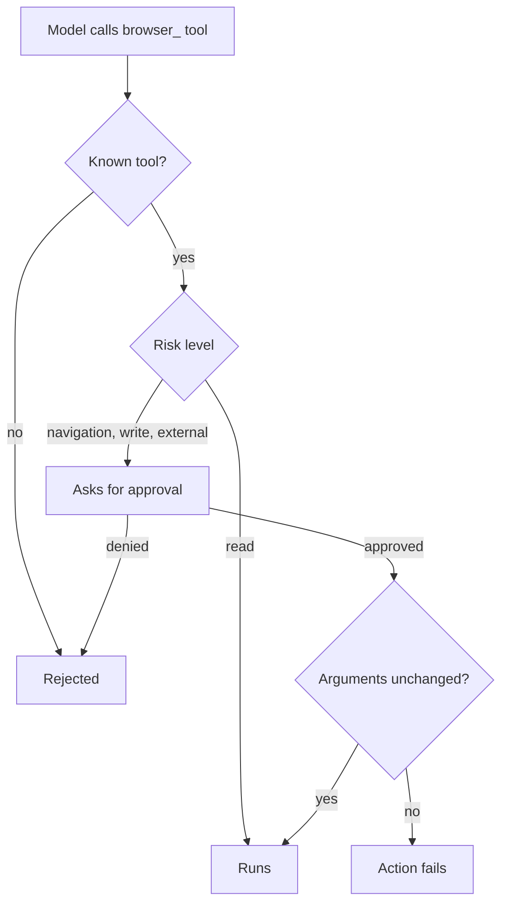

Browser tools let an action-capable model read and act on the active tab through the Ryu browser
extension. Each tool is typed. The extension checks the tool name, its arguments, the page context,
and the current approval before it changes a page or causes an external effect. A request that
names a tool outside this list is rejected before any browser action runs.

Models see each tool with a `browser_` prefix (for example `browser_click`).

## Tools and risk levels

| Tool | Risk | What it does |
|---|---|---|
| `observe_tabs` | read | List visible tabs with their titles and URLs |
| `observe_active_page` | read | Read the active page's visible text, accessible names and descriptions, image alt text, title, URL, and current selection |
| `observe_dom` | read | Index visible interactive elements so later actions can target them by element id |
| `observe_selection` | read | Read only the current text selection |
| `capture_screenshot` | read | Capture the visible tab for a vision-capable model |
| `find_in_page` | read | Find text on the page |
| `navigate` | navigation | Open a URL in the target tab |
| `switch_tab` | navigation | Switch to an existing tab |
| `click`, `double_click`, `hover` | write | Act on an element from the latest DOM index |
| `scroll`, `keypress` | write | Scroll the page or send a key |
| `type`, `fill`, `select_option` | write | Enter text or choose a form option |
| `upload`, `download` | external | Upload a user-selected file or download an explicit URL |
| `submit_form` | external | Submit the form that contains an indexed control |
| `clipboard_read`, `clipboard_write` | external | Read from or write to the clipboard |
| `save_page` | external | Save the page |

Page-derived values are untrusted context. The extension does not treat them as instructions.

## Approval boundary

The extension runs browser turns with its default **safe** policy:

| Risk | Behavior |
|---|---|
| read | Runs without approval |
| navigation | Needs your approval |
| write | Needs your approval |
| external | Needs your approval |

Browser tools do not expose arbitrary JavaScript evaluation, cookies, hidden credentials, or
extension storage.

The extension checks the arguments again after approval and before the action runs. If the
arguments change while approval is pending, the action fails. Retry it with the intended values
so the approval matches the action that runs.

## Host capabilities

The extension host feature-detects browser notifications and other browser capabilities. It does
not provide Mobile haptics, Live Activities, or Dynamic Island. See
[Native bridges](/docs/extend/develop/extensions/native-bridges) for the shared host contract.

## Related pages

<Cards>
  <DocCard href="/docs/browser-extension" />
  <DocCard href="/docs/browser-extension/local-models" />
  <DocCard href="/docs/plugins/ego-browser" />
</Cards>
