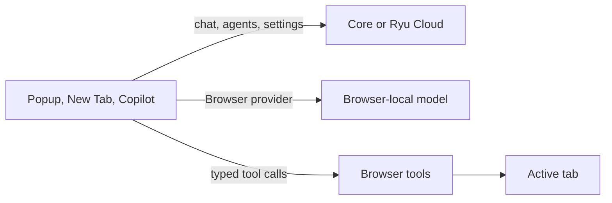

The Ryu browser extension puts Ryu in the browser toolbar, the New Tab page, and the page you are
reading. It is for people who want Ryu chat and agents next to their browsing. It uses the same
chat and agent controls as the other Ryu clients, and adds browser-local models and permissioned
browser tools.

<Figure name="browser-extension" />

## How it fits together

The extension hosts the shared Desktop shell, with a browser-native bridge for the capabilities a
tab can provide.

- Normal turns, agents, conversations, services, and settings go to Core or Ryu Cloud.
- A **Browser** model runs in the browser itself. See
  [Browser-Local Models](/docs/browser-extension/local-models).
- Page actions go through typed, permissioned [Browser Tools](/docs/browser-extension/browser-tools).
- A Marketplace package marked **Browser extension** can appear in the extension. It does not own
  the extension shell or receive Desktop-only native APIs.

<Callout type="warn">
Automatic page saving and the Island page-context bridge are off by default. Turn them on
explicitly if you want them.
</Callout>

## Use the extension

<Cards>
  <DocCard href="/docs/browser-extension/popup-and-new-tab" />
  <DocCard href="/docs/browser-extension/copilot" />
  <DocCard href="/docs/browser-extension/search" />
  <DocCard href="/docs/browser-extension/notifications" />
</Cards>

## Local AI and browser tools

<Cards>
  <DocCard href="/docs/browser-extension/local-models" />
  <DocCard href="/docs/browser-extension/browser-tools" />
</Cards>

## Accounts and connection

<Cards>
  <DocCard href="/docs/browser-extension/accounts" />
  <DocCard href="/docs/browser-extension/connection-and-updates" />
</Cards>

## Related surfaces

<Cards>
  <DocCard href="/docs/surfaces" />
  <DocCard href="/docs/mobile" />
  <DocCard href="/docs/apps/browser" />
</Cards>
