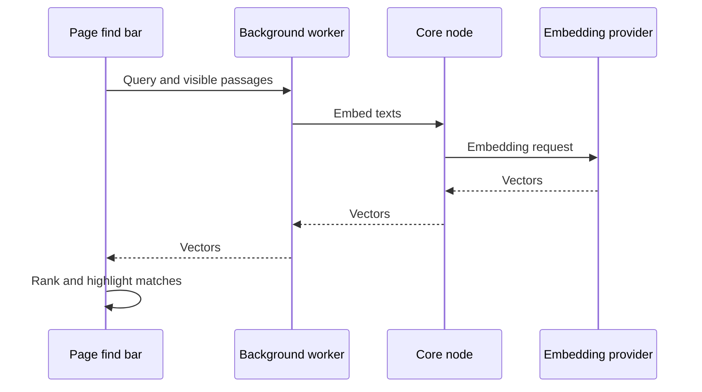

The extension has two kinds of search. Local search finds your conversations and bookmarks as you
type. Find by meaning searches the text of the page you are reading.

## Local search

The New Tab SmartBar and the `ryu` omnibox can show instant local matches for conversation titles
and, when browser bookmark access has already been granted, browser bookmarks. The local index uses
keyword and fuzzy matching so a small typo does not hide a useful result.

The index stores only searchable metadata such as titles, folders, tags, URLs, and timestamps.
Page bodies and embeddings remain out of the extension index. Core stays the source of truth for
conversations, Spaces, permissions, and semantic retrieval.

## Find by meaning on the current page

1. Choose **Find on page by meaning** in the extension popup, or press **Ctrl+Shift+F**
   (⌘+Shift+F on macOS). A compact find bar opens at the top of the page.
2. Describe the passage you want in your own words.
3. Press **Enter** and **Shift+Enter** to move through matches.

The bar shows the current result count and scrolls to highlight the strongest matching source
sentence. Search is separate from the [in-page Copilot](/docs/browser-extension/copilot) chat.

The extension embeds the query and a bounded set of visible page passages with the active Core
embedding model, then ranks them in the page. A passage can match even when it uses different
words from the query.

Page text and vectors stay in memory for that search and are not added to the extension's local
index or a Space. The feature needs a reachable Core node and an available embedding provider.

<Callout type="warn">
Core's configured embedding provider processes the query and the page passages. If that provider is
remote, the passage text is sent to it.
</Callout>

## Related pages

<Cards>
  <DocCard href="/docs/browser-extension/popup-and-new-tab" />
  <DocCard href="/docs/browser-extension/copilot" />
</Cards>
