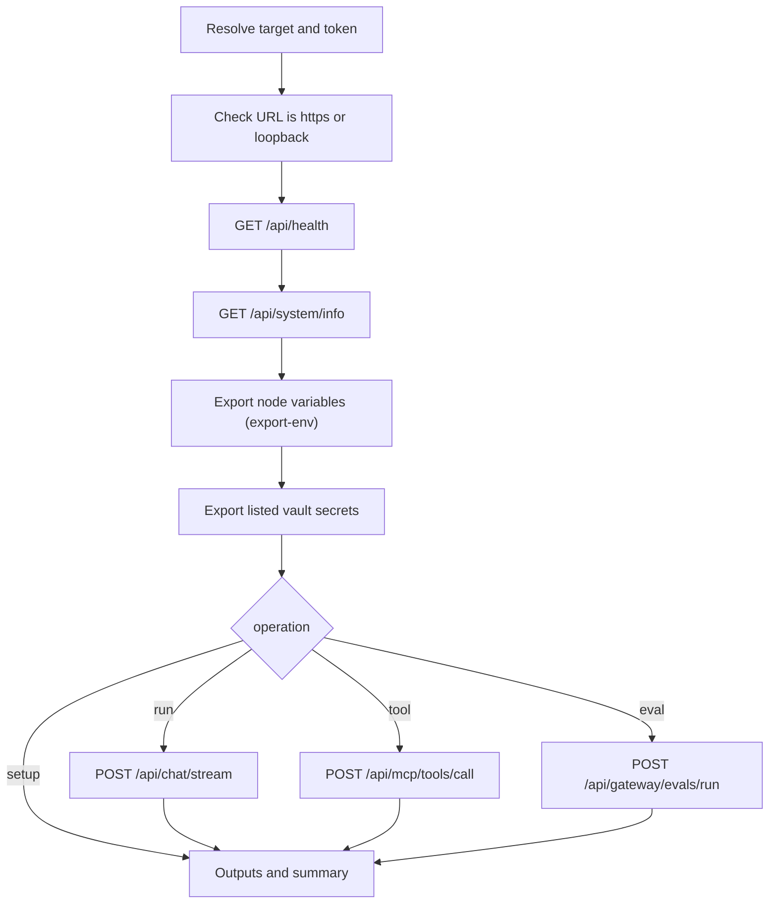

The Ryu for GitHub action (`amajorai/ryu`) connects a GitHub Actions workflow to a Ryu Core node.
It is for teams that want CI jobs to call Ryu agents, tools, vault secrets, or eval gates.

<Figure name="ci" />

Pick the job with the `operation` input:

| `operation` | What it does |
|---|---|
| `setup` (default) | Validate the node and export its connection variables |
| `run` | Run a saved agent, team, or workflow with a `prompt` |
| `tool` | Invoke one allowlisted tool directly |
| `eval` | Replay an eval dataset and fail the job below a score threshold |

Any operation can also export [Ryu Vault secrets](#export-ryu-vault-secrets) with the `secrets`
input.



## Node targeting

The action targets Core, not a Gateway-only URL. Provide the URL and bearer token as
repository or environment secrets:

```yaml
- uses: amajorai/ryu@v1
  with:
    target: self-hosted
    node-url: ${{ secrets.RYU_NODE_URL }}
    node-token: ${{ secrets.RYU_NODE_TOKEN }}
    operation: setup
```

For a managed node, use `target: managed` and the managed-node inputs:

```yaml
- uses: amajorai/ryu@v1
  with:
    target: managed
    managed-node-url: ${{ secrets.RYU_MANAGED_NODE_URL }}
    managed-node-token: ${{ secrets.RYU_MANAGED_NODE_TOKEN }}
    operation: setup
```

| `target` | Inputs | Environment fallback | Check |
|---|---|---|---|
| `auto` (default) | `node-url` pair if set, else `managed-node-url` pair | `RYU_CORE_URL` pair, else the managed pair | Health and system info only; accepts either node type |
| `self-hosted` | `node-url`, `node-token` | `RYU_CORE_URL`, `RYU_CORE_TOKEN` | Health and system info only |
| `managed` | `managed-node-url`, `managed-node-token` | `RYU_MANAGED_NODE_URL`, `RYU_MANAGED_NODE_TOKEN` | Fails unless `/api/system/info` reports `managed: true` |

The pairs stay coupled. A managed URL is never sent with a self-hosted token, and a self-hosted
URL is never sent with a managed token.

### URL rules

- The node URL must use `https://`.
- Plain `http://` is accepted only for a node on the runner itself at a literal loopback address
  (`127.0.0.0/8`, such as `http://127.0.0.1:<port>`, or `http://[::1]:<port>`).
- `localhost` and any other `http://` host are rejected before a token or vault credential is sent.
- The action does not follow HTTP redirects, so point it at the node's final URL.

### Health check and exported variables

Every operation checks `/api/health` and `/api/system/info` before it does anything else. A
`setup` step that only exports vault secrets and has no node token tolerates an unauthorized
`/api/system/info`, except with `target: managed`.

With `export-env: true` (the default), the action then exports `RYU_CORE_URL`, `RYU_CORE_TOKEN`,
`RYU_NODE_URL`, and `RYU_NODE_TOKEN` to later steps. The token is masked. Every operation also
sets these outputs.

| Output | Contents |
|---|---|
| `node-url` | Validated node URL |
| `node-managed` | `true` when the node reports `managed: true` |
| `node-version`, `node-channel` | Ryu version and release channel from `/api/health` |
| `health-json`, `node-info-json` | The validated `/api/health` and `/api/system/info` payloads |

## Run Ryu in a workflow

Run a saved agent:

```yaml
- uses: amajorai/ryu@v1
  id: ryu
  with:
    target: managed
    managed-node-url: ${{ secrets.RYU_MANAGED_NODE_URL }}
    managed-node-token: ${{ secrets.RYU_MANAGED_NODE_TOKEN }}
    operation: run
    agent: review-agent
    prompt: Review this change and return pass or fail with the key evidence.

- run: echo "${{ steps.ryu.outputs.response }}"
```

`prompt` is required. Use `team` or `workflow` instead of `agent`; set at most one of the three.
The action reads Core's streaming chat protocol and collects text, tool events, workflow events,
and the Core run id.

| Output | Contents |
|---|---|
| `response` | Assistant text |
| `result-json` | Normalized result as JSON |
| `conversation-id` | Conversation used (a UUID is generated when `conversation-id` is not set) |
| `run-id` | Core run id, when the stream reports one |
| `tool-calls` | Tool input and output events as JSON |

Set `response-file` to also write the text to a file in the runner workspace.

CI runs do not save conversations or use long-term memory by default. Set `persist: true` or
`enable-long-term: true` to turn them on. Two optional JSON inputs tune a run:

- `inference` - per-run inference overrides;
- `plugin-flags` - per-run Ryu plugin flags.

<Callout type="warn">
`cwd` and `worktree-isolation` work only when the Core process can access the selected
directory. A remote managed node cannot see the GitHub runner's checkout.
</Callout>

## Invoke a direct tool

```yaml
- uses: amajorai/ryu@v1
  id: tool
  with:
    target: self-hosted
    node-url: ${{ secrets.RYU_NODE_URL }}
    node-token: ${{ secrets.RYU_NODE_TOKEN }}
    operation: tool
    agent: release-agent
    tool: exa.search
    tool-arguments: '{"query":"Ryu GitHub Action"}'

- run: echo '${{ steps.tool.outputs.result-json }}'
```

`tool` and `agent` are required. Core checks the call against that agent's tool allowlist and
approval rules. A denied or failed call fails the workflow step. The optional `user-id` input sets
the Composio entity and audit user id for the call.

## Gate a pull request on evals

`operation: eval` replays a dataset from the checked-out repository through the node's
Gateway eval runner, compares the scores with `eval-threshold`, and fails the job when a
score falls below a threshold.

```yaml
- uses: actions/checkout@v4
- uses: amajorai/ryu@v1
  id: evals
  with:
    node-url: ${{ secrets.RYU_NODE_URL }}
    node-token: ${{ secrets.RYU_NODE_TOKEN }}
    operation: eval
    agent: support-agent
    eval-dataset: evals/support.jsonl
    eval-scorers: answer_relevance, toxicity
    eval-threshold: |
      0.8
      overall=0.7
    eval-junit-file: reports/ryu-eval.xml
```

| Input | Meaning |
|---|---|
| `eval-dataset` | JSON, JSONL, or CSV file. Rows need `prompt` (or `input`, `question`, `query`) and may set `expected`, `context`, `id`, `assertions`, and `evaluators`; extra CSV columns become `{{vars}}`. Omit it to use the Gateway's built-in dataset |
| `eval-model` | Model to evaluate; defaults to the Gateway's configured eval model |
| `eval-judge-model` | Judge model for model-graded assertions and evaluators |
| `eval-scorers` | Offline Gateway catalog evaluator ids, or the built-in metrics `overall`, `assertions`, `policy`, `substring`, `latency` |
| `eval-threshold` | A bare number applies to every scorer (or `overall` when none is listed); `scorer=n` sets one |
| `eval-junit-file` | Writes a JUnit XML report for test reporters |

How the gate reads scores:

- Negative-signal evaluators such as `toxicity` are inverted before comparison, so every threshold
  reads "at least this good".
- A scorer that never executed fails its threshold.

The step summary lists each threshold check and the failing case ids or truncated prompts. The
`eval-passed` output is `true` or `false`, and `eval-json` carries the full result with its `gate`.

The same datasets and thresholds work locally with
[`ryu-cli eval`](/docs/surfaces/cli/reference#eval-gates).

## Export Ryu Vault secrets

List values from the [secret vault](/docs/security/secret-vault) in `secrets`, one per line:
`NAME`, `/folder/NAME`, `ENV:NAME`, or `ENV:/folder/NAME`. The action logs in with a vault
[machine identity](/docs/security/secret-vault-engines), reads the values, masks each one, and
exports it as an environment variable for later steps. The short-lived vault token is revoked
once the values are read.

With GitHub OIDC there is no stored credential. Create a JWT machine identity whose bound claims
name your repository, then:

```yaml
permissions:
  id-token: write
  contents: read

steps:
  - uses: amajorai/ryu@v1
    with:
      node-url: ${{ secrets.RYU_NODE_URL }}
      vault-jwt-identity: github-deploy
      vault-jwt-audience: ryu
      secrets: |
        DATABASE_URL
        prod:/stripe/STRIPE_SECRET_KEY

  - run: ./deploy.sh # DATABASE_URL and STRIPE_SECRET_KEY are set and masked
```

With AppRole, pass `vault-role-id` and `vault-secret-id` together (keep the secret id in a GitHub
secret) instead of `vault-jwt-identity`. The action rejects a step that sets both methods.

Machine tokens read **Node** values that the identity's policies allow, so save values for CI with
`ryu-cli secrets set NAME --scope node`. A listed value the token cannot read fails the step before
anything is exported. The `vault-secrets` output lists the exported names, never values.

## Security and failure behavior

The action masks the node token before any request and never logs prompts, tool arguments, or
response text. The step summary (`write-summary`, on by default) contains node and operation
metadata, plus the threshold table and failing case names for `eval`.

The action fails the step on:

- health failures and authentication failures;
- malformed JSON;
- timeouts (`timeout-ms`, default 600000 per request);
- non-success HTTP responses and stream errors;
- denied tools.

The health check is tried twice. Chat and tool calls are not retried automatically.

## Related pages

<Cards>
  <DocCard href="/docs/security/secret-vault" />
  <DocCard href="/docs/extend/develop/sdk/hub" />
  <DocCard href="/docs/extend/develop/api-reference" />
</Cards>
