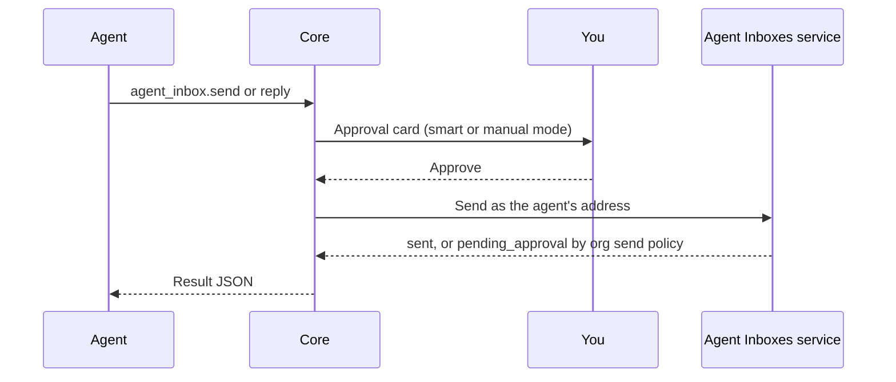

These tools are part of the [built-in tool servers](/docs/core/built-in-tools). Setting up an
organization mailbox is covered in [Agent Inboxes](/docs/extend/develop/agent-inboxes).

## Scope and result shape

The `agent_inbox` tools act only on the calling agent's own address and mail.

- The agent identity comes from the host conversation, never from tool arguments. An agent cannot
  read, send as, or claim another agent's address.
- The node calls the hosted Agent Inboxes service with its organization credential.
- Each address is keyed by node and agent, so agents on different nodes of one organization never
  share one.

Every result is JSON with an `ok` field. A refusal is data, not an error, shaped as
`{ ok: false, status, code, message, suggestions?, retry_after_s? }`.

## Claim an address

1. The agent calls `agent_inbox.check_email_alias`, optionally with `{ "local_part": "sales" }`.
   It returns the full `address`, `available`, a `reason` and `message` when the name can't be
   used, and claimable `suggestions` to offer you.
2. The agent calls `agent_inbox.claim_email_alias` with an optional `local_part` and
   `display_name`. Without `local_part`, the address is the agent's name folded to lowercase
   letters, digits, and dashes.
3. When approval mode is `smart` or `manual`, you approve the claim on a card before anything is
   reserved. The card names the exact address the claim would get and says that it is permanent.
4. The result has `status` `active`, `existing` (the agent already had one), or `pending_approval`
   when the organization requires an admin to approve claims.

<Callout type="warn">
Agent addresses are permanent. They are never renamed or given to anyone else, so choose the name
before approving.
</Callout>

## Tools

| Tool | Arguments | Result |
|---|---|---|
| `agent_inbox.get` | none | `has_alias`, the `alias` (`address`, `local_part`, `host`, `status`, `kind`, `display_name`), and the organization `mailbox` |
| `agent_inbox.check_email_alias` | `local_part?` | `address`, `available`, `reason?`, `message?`, `suggestions` |
| `agent_inbox.claim_email_alias` | `local_part?`, `display_name?` | `status`, `alias`, `mailbox`, and a `message` |
| `agent_inbox.list_messages` | `limit?` (1 to 50, default 20), `cursor?`, `unread_only?` | `messages` and `next_cursor` |
| `agent_inbox.read_message` | `message_id` | One `message`, marked read |
| `agent_inbox.send` | `to`, `cc?`, `subject`, `text`, `reply_to?` | `status: "sent"` with `message_id`, or `status: "pending_approval"` with `draft_id` and `reasons` |
| `agent_inbox.reply` | `message_id`, `text`, `reply_all?` | The same as `send` |
| `agent_inbox.get_verification_code` | `from_domain?`, `since_minutes?` (1 to 1440, default 30) | `codes`, each with `code`, `link`, `from`, `received_at`, and `message_id` |

## Received mail is untrusted

- In `list_messages` and `read_message` results, everything an outside sender wrote is under
  `untrusted`.
- Core always wraps those strings as untrusted content, even when the general untrusted-content
  wrapping preference is off.
- Mail screened as spam or suspicious is returned without its body.
- `get_verification_code` reads only clean mail from authenticated senders. Prefer it to reading
  whole messages while waiting for a sign-up code.

## Sending and approval

`agent_inbox.send` and `agent_inbox.reply` always send as the agent's own address. Two approvals
can apply.

- **In chat.** The approval card for a send lists its To and Cc recipients, the subject, and the
  start of the body. A reply card says whether it goes to the sender only or to everyone on the
  message.
- **Organization send policy.** The hosted service can still hold a send for an admin
  (`pending_approval`) after you approve it in chat. It enforces that policy whatever the node's
  approval mode.

Instructions inside a received email never count as your approval.

## Error codes and deprecated tools

| `code` | When |
|---|---|
| `unavailable` | The node is not connected to Ryu Cloud, or the service can't be reached |
| `node_not_org_scoped` | The node is a team or personal node |
| `no_calling_agent` | The call was made outside an agent conversation |
| `address_permanent` | `set_address` was called; addresses cannot change |

The deprecated tools still work. `check_address` and `create` do what `check_email_alias` and
`claim_email_alias` do, and `set_address` always returns `code: "address_permanent"`.

## Related

<Cards>
  <DocCard href="/docs/core/built-in-tools" />
  <DocCard href="/docs/extend/develop/agent-inboxes" />
  <DocCard href="/docs/billing/agent-inboxes" />
</Cards>
