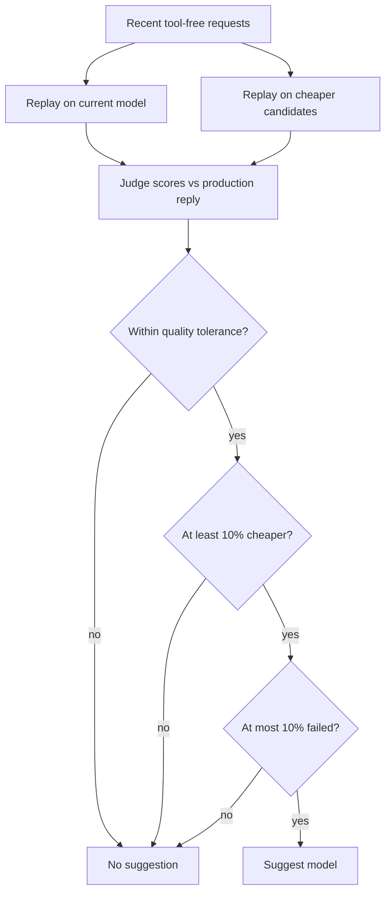

The agent optimizer reads an agent's recent sessions and suggests cheaper settings that keep its
quality. It runs in Core and appears in the agent editor under **Activity → Optimizations**.
Nothing changes until you apply a suggestion.

## What it checks

### Cheaper model

Ryu picks up to 20 recent requests the agent answered without calling tools. It replays them
through the Gateway eval runner on the agent's current model and a few cheaper ones.

One fixed judge, the current model, scores every answer against the reply the agent gave in
production. The current model's own replay is the quality baseline, so every model is judged under
the same conditions. A cheaper model is suggested only when:

- its judged quality is within 5 points of the current model's (the default `qualityTolerance`),
- its replay cost is at least 10% lower, and
- no more than 10% of its replays failed.



Which candidates are compared:

- When you do not name models, Ryu tries up to three cheaper models the Gateway can route to,
  closest in price first, using list prices from the model catalog.
- If the agent uses tools, models known not to support tool calls are skipped.
- Agents that run on an external engine (such as Claude Code or Codex over ACP) are not compared,
  because the Gateway cannot replay their model.

### Fewer tools

Every tool an agent is allowed to call adds its description to each request. Ryu counts
tool calls across the agent's recent sessions and suggests removing allowed tools it never called.
This suggestion is based on usage, not a replay, and is labeled that way. Agents allowed every tool
are skipped because there is no finite list to narrow.

## Requirements and cost

An agent needs at least 10 sessions before it can be analyzed, and at least 5 replayable requests
before the model comparison runs. Ryu reads up to its 50 most recent sessions.

The replay is a normal metered Gateway call: each request costs one provider call per model plus
one judge call. It is charged to the agent's budget and recorded in the Gateway audit like any
other eval run. Running an analysis requires permission to edit the agent.

## Applying and undoing

Applying a suggestion updates the agent through the same path as saving it in the editor. The
change appears in the agent's **Versions** history and can be restored from there.

- A suggestion is refused if its model or tools no longer match the proposed change (for example,
  you switched models by hand). Run a new analysis instead.
- Each new analysis replaces older open suggestions of the same kind.

### Conflicting saves

If another save changes the agent while a suggestion is being applied, applying returns a conflict
and preserves the newer configuration. The suggestion remains open and is not marked applied.

Refresh the agent, review the current settings, and run a new analysis before applying a
replacement suggestion.

### Retry recording a suggestion

If the configuration is saved but the suggestion's acknowledgement cannot be recorded, the error
says the agent was updated. Desktop reloads the saved agent and shows **Retry recording
suggestion**.

- The retry finishes recording the earlier change without applying it again, and keeps any newer
  edits you saved in the meantime.
- Repeating a completed apply returns its acknowledgement without adding another configuration
  change or version-history entry.
- The retry action stays available after another analysis, after you reopen Optimizations, and
  after a failed retry, even when a newer analysis replaced the original suggestion.
- It requires permission to edit the agent.

## API

| Method | Path | Purpose |
| --- | --- | --- |
| `GET` | `/api/agents/{id}/optimizations` | Readiness, suggestions, and the latest analysis |
| `POST` | `/api/agents/{id}/optimizations/analyze` | Run an analysis; changes nothing |
| `POST` | `/api/agents/{id}/optimizations/{rec_id}/apply` | Apply one open suggestion |
| `POST` | `/api/agents/{id}/optimizations/{rec_id}/dismiss` | Decline one open suggestion |

Response fields worth knowing:

| Field | Returned by | Meaning |
|---|---|---|
| `recommendations` | `GET` | The analysis history |
| `recoveryRecommendations` | `GET` | Outstanding acknowledgements the caller may finish, kept separate from `recommendations` |
| `historyUnavailable` | `GET` | `true` when history is temporarily unavailable; recovery recommendations can still be read and retried |
| `agent`, `appliedAgent` | `apply` | The current agent and the earlier applied snapshot, so later edits stay distinguishable from the recorded optimization |

The analyze body is optional:

```json
{
  "candidateModels": ["gpt-4o-mini"],
  "qualityTolerance": 0.05
}
```

`candidateModels` limits the comparison to the models you name (up to four). `qualityTolerance` is
how far below the current model's judged quality, from 0 to 0.5, a candidate may score.

## Related

[Observability](/docs/core/observability), [Gateway evals](/docs/gateway/evals),
and [agents](/docs/surfaces/desktop/user-guide/agents).
