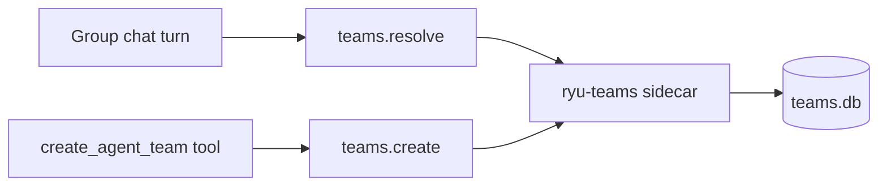
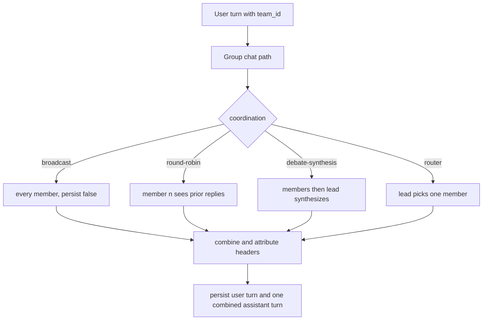

A group is a persisted, ordered list of agent ids plus a coordination strategy. You address it as
one unit: an `@group-name` mention in chat, or the `team_id` field on a chat request. One user turn
fans out to every member, and Core merges their replies into one attributed answer.

A group is not an agent. The `@ryu/teams` app stores the group records. Core's chat path interprets
the strategy and runs the members; the Gateway is not involved in group dispatch.

To create a group and mention it in Desktop, see [Groups (user guide)](/docs/surfaces/desktop/user-guide/teams).

<Figure name="agent-teams" />

## Group store

The `@ryu/teams` app runs a `ryu-teams` sidecar. It owns a SQLite store at
`plugin-data/@ryu+teams/teams.db` inside the Ryu data directory (the app's own data folder). The
sidecar handles persistence and typed records only.

A `TeamRecord` has these fields.

| Field | Type | Notes |
|---|---|---|
| `id` | `string` | Server-assigned, `team_<uuid>`. |
| `name` | `string` | Display name. |
| `description` | `string?` | Optional. |
| `members` | `string[]` | Ordered agent ids. Order is meaningful for `round-robin` (turn order) and is the default lead source for `debate-synthesis`. |
| `coordination` | enum | One of `broadcast`, `round-robin`, `debate-synthesis`, `router`. Stored kebab-case; an unknown or legacy value parses back to `broadcast` so a bad row never breaks listing. |
| `lead_agent_id` | `string?` | The synthesizer for `debate-synthesis` and the classifier for `router`. Falls back to the first member when unset. |
| `created_at` / `updated_at` | `string?` | RFC 3339. |

## Routes

The `ryu-teams` sidecar serves these routes through the app's `public_mount` (`/api/teams`).
Besides CRUD, two member endpoints add or remove one agent; the Groups Companion UI uses them.

| Method | Path | Permission | Purpose |
|---|---|---|---|
| `GET` | `/api/teams` | `teams.view` | List groups |
| `POST` | `/api/teams` | `teams.manage` | Create a group |
| `POST` | `/api/teams/resolve` | `teams.view` | Look up one group by id |
| `GET` | `/api/teams/:id` | `teams.view` | Read one group |
| `PATCH` | `/api/teams/:id` | `teams.manage` | Partial update |
| `DELETE` | `/api/teams/:id` | `teams.manage` | Delete a group |
| `POST` | `/api/teams/:id/members` | `teams.manage` | Add one member |
| `DELETE` | `/api/teams/:id/members/:agent_id` | `teams.manage` | Remove one member |

`POST /api/teams/resolve` takes `{ "id": "<team id>" }` and returns the same shape as
`GET /api/teams/:id`, which is `{ "team": TeamRecord }`, or `404` for an unknown id.

`PATCH /api/teams/:id` is a partial update. Absent fields are left unchanged.

- `lead_agent_id` is tri-state. Send a value to set it, `null` to clear it, or omit it to leave it
  unchanged.
- `members` replaces the full ordered list. Use the member endpoints when you only want to add or
  remove one agent.

### Capabilities

The app's manifest `provides` two capabilities.

- `teams.resolve` - the resolve route.
- `teams.create` - `POST /api/teams`.

Group chat and the agent builder's `create_agent_team` tool reach groups only through these
capabilities, so any enabled app that provides them can serve groups. When no enabled app provides
them, a group chat turn ends with an error that says so.

## Coordination strategies

The strategy is a per-group enum that you can change at any time. The group chat path and its
non-streaming channel sibling dispatch all four strategies, and share the same member-run primitive.

| Strategy | Stored value | What happens |
|---|---|---|
| Broadcast | `broadcast` | Every member answers the same prompt independently. No member sees another's reply. The default. |
| Round-robin | `round-robin` | Members answer in member order. Each member after the first sees the prior members' replies, folded into its prompt. |
| Debate synthesis | `debate-synthesis` | Every member answers independently (round one), then the lead agent reads all replies and produces one merged answer. |
| Router | `router` | The lead classifies the user message, picks the single best-suited member by id, and only that member answers. |

`messages_with_preamble` injects the cross-member context (the round-robin transcript, the debate
brief, the router instruction) by prepending it to the last user message. ACP agents forward only
the last user message, so this reaches every engine, ACP and OpenAI-compatible alike, without
threading history.

For `router`, the lead is invoked with no `conversation_id`, because the routing decision is a side
query. It is asked to reply with only the chosen member's id. If the reply does not match any
member, dispatch falls back to the first member.

## Dispatch and persistence

When a chat request carries a non-empty `team_id`, the handler routes to the group chat path instead of the single-agent path.

Each member's reply is produced through the standard chat path with `persist: false`, so members
never write to history themselves. Core then persists exactly two turns.

1. The user message, once, attributed to the user.
2. One combined assistant turn, attributed to the group id.

A later reload of the conversation renders the same merged content that streamed.

How the merged output reads:

- Each member block starts with a bold `**Name**` markdown header.
- `debate-synthesis` and `router` add a qualifier such as `(synthesis)` or `(routed)`.
- An empty member reply renders as `_(no response)_`, and an errored member as `_(error: ...)_`.
  One member failing never aborts the whole group turn.

Group members run with auto-recall off. One user message fanned out to N members would otherwise
trigger N redundant retrievals on the same query. See
[Search and recall](/docs/surfaces/desktop/user-guide/search-and-recall) for where recall is wired
(the single-agent chat handler).

<Callout type="info">
A group turn invokes each member through the standard chat path, so a member's own engine, tools, skills, and Gateway routing all apply. Member replies need a running engine or Gateway.
</Callout>

## Related

<Cards>
  <DocCard href="/docs/surfaces/desktop/user-guide/teams" />
  <DocCard href="/docs/core/conversations-sessions" />
  <DocCard href="/docs/core/delegation" />
  <DocCard href="/docs/gateway/channels" />
</Cards>
