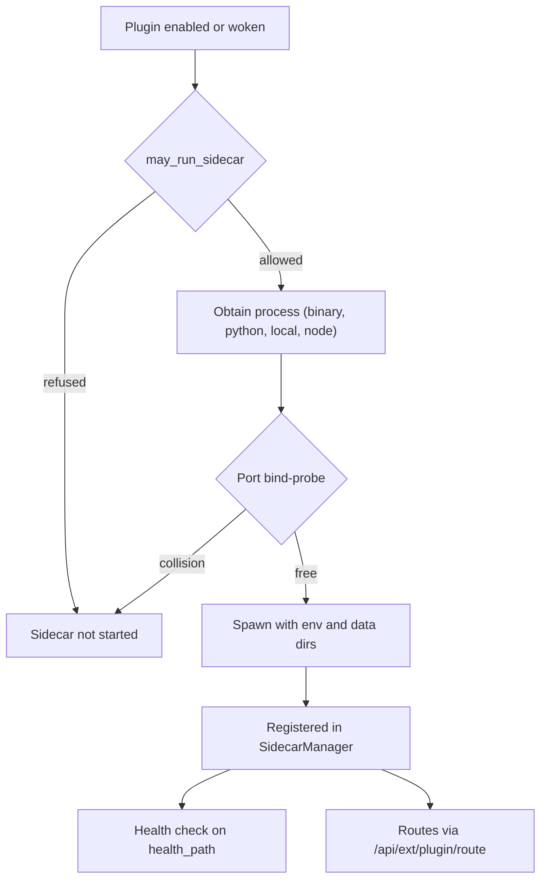
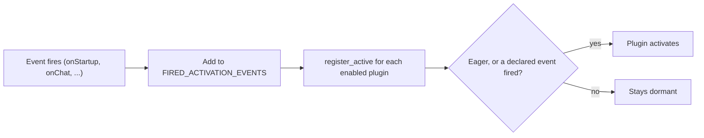

A manifest can ship its own long-running process and choose when Core wakes it. For the manifest
file and the install, enable, update, and uninstall operations, see
[App Manifest and Lifecycle](/docs/core/app-manifest-lifecycle).

## Manifest-declared managed sidecars

A manifest can declare `sidecars[]`. Each entry is a long-running child process that Core owns end
to end: it downloads or provisions the process, spawns it, health-checks it, and stops it.

This is the **app to sidecar bridge**. A capability sidecar (Ghost, Shadow, an Audio engine) can be
a fully manifest-defined app instead of hardcoded Rust, and a third-party app can ship its own
process. Infrastructure sidecars (llama.cpp, the Gateway, embeddings) stay part of Core and cannot
be declared here.

- The type is `SidecarSpec` in `crates/core/kernel-contracts/src/schema.rs`.
- The generic driver is `ManifestSidecar` in `apps/core/src/sidecar/manifest_sidecar.rs`.
- The manifest field is documented in
  [Bundle Runnables with manifest.json](/docs/extend/develop/extensions/managed-sidecar).



### Spec fields

| Field | Meaning |
|---|---|
| `name` | Unique within the plugin |
| `process` | How Core obtains the program (see the next table) |
| `port` | The port the sidecar serves on |
| `health_path` | Health-check path, default `/health` |

### Process kinds

| `process.kind` | How Core runs it |
|---|---|
| `binary` | Downloads the executable or a `tar.gz`/`tar.bz2`/`zip` archive, then spawns it with the declared `args` and `env` |
| `python` | Reuses the external-runtime provisioner (venv, pip, assets), then spawns `python -m <entry>` |
| `local` | Spawns `command`, or the program its `command_env` override names |
| `node` | Runs the plugin's JavaScript backend under `bun` (preferred) or `node` through Core's embedded bootstrap |

The shared `DownloadCenter` handles each `binary` download, as follows.

- It streams to a `.part` file, resumes, and verifies SHA-256.
- It lands in a version-namespaced `bin/<version>/` folder inside the plugin's package folder
  (`~/.ryu/plugins/<dir>/bin/<version>/`).
- An archive is extracted as a whole tree, so sibling libraries stay together. The program is then
  made executable.

A `node` sidecar loads the declared `entry` module and calls its exported `activate(context)`. The
entry bundle rides in the manifest's `backend_code` payload and is checked against
`backend_sha256` at spawn. This kind is gated by the experimental plugin runtime setting (see
[Plugin Runtime](/docs/extend/develop/extensions/plugin-runtime)).

### Local release assets and bundles

For a first-party app, a release build installs the matching release asset for a `local` sidecar on
first enable or wake:

- By default it installs `<command>-<os>-<arch>` (`.exe` on Windows), verified against its sibling
  `.sha256`.
- On a platform listed in `bundles`, it installs `<command>-<os>-<arch>.tar.gz` instead, verified
  against its `.sha256`.
- Extraction refuses entries that leave the bundle root, links that resolve outside it, and special
  files. Symlinks and executable bits are kept.
- The install is swapped into place atomically. Core then spawns the declared `entrypoint` inside
  the bundle.

A `local` bundle is for programs that cannot ship as one executable file, such as a macOS `.app`.
Platforms not listed in `bundles` keep the single-file asset:

```json
"process": {
  "kind": "local",
  "command": "my-app",
  "bundles": {
    "macos-aarch64": { "format": "tar.gz", "entrypoint": "My App.app/Contents/MacOS/My App" }
  }
}
```

`format` must be `tar.gz`, and `entrypoint` must be a relative path inside the archive with no `..`
segments. Core downloads the bundle itself, so macOS sets no quarantine attribute on it. The
executables inside still need a valid code signature, and an ad-hoc signature is enough on Apple
silicon.

### Download integrity

- The URL must be `https`. The SSRF egress check screens it at download time.
- Without a `sha256`, an artifact that is already present is trusted (idempotent skip).
- With a `sha256`, a mismatch re-fetches (fail closed).

### The `sidecar:process` grant

Downloading and spawning an arbitrary process is a broader surface than manifest metadata, so
`may_run_sidecar` (`manifest_sidecar.rs`) fails closed:

- A Core-tier plugin is auto-allowed.
- A Community-tier plugin must hold the Gateway-approved `sidecar:process` grant. Core reads it from
  the plugin's *approved* grants (after Gateway validation), never from its declared, unvalidated
  `permission_grants`.
- For the `python` kind, this one grant also stands in for `runtime:external`, because binary
  execution is the broader surface.

See [App Trust Tiers](/docs/core/app-trust-tiers) for the tiers.

### Managed lifecycle

Once permitted, the sidecar is registered in the live `SidecarManager` under the namespaced key
`<plugin_id>/<name>`. It then gets the same lifecycle as a built-in: health monitor, resource
sampler, `/api/sidecar/status`, and graceful stop.

Each spawn also decides the sidecar's OS isolation. It is off by default, or `audit`/`enforce` when
the node turns on the
[sidecar OS sandbox](/docs/security/plugin-isolation#optional-os-sandbox-for-sidecars) or the
manifest's optional `sidecars[].sandbox.mode` asks for it.

Each `/api/sidecar/status` row for an app sidecar carries a `sandbox` object recorded at its last
start, with `mode`, `backend`, `enforced`, `fs_restricted`, and a `detail` when Core fell back.

<Callout type="warn">
Manifest sidecars are **not** in the `SidecarManager` startup order, so nothing restarts them on
its own after a Core restart. `reconcile_plugin_sidecars` is the required boot step: it re-registers
and starts every enabled plugin's declared sidecar.

Core runs it at boot right after the `onStartup` activation pass
(`apps/core/src/boot/state_wiring.rs`). A manifest sidecar is always optional (`is_required` is
false), so a plugin process that fails to start never aborts Core boot.
</Callout>

### Ports

Before spawning, the manager claims the declared `port` with a `TcpListener` bind-probe. The probe
rejects a collision with a built-in (for example llama.cpp on 8080) or another plugin.

- A collision is *refused*, not reallocated. The sidecar does not start, and the port stays with
  whoever holds it.
- There is no port registry in v1, so the plugin author must choose a free port.
- Core profile-shifts the port, so it is not always the number in the manifest. The spawned process
  learns the real port through `port_env`.

[Pick a Sidecar Port](/docs/extend/develop/extensions/sidecar-ports) lists the safe ranges and
explains `port_env`.

### Environment and data folder

Every sidecar receives the data-folder layout in its environment:

| Variable | Value |
|---|---|
| `RYU_DIR` | The data folder |
| `RYU_PLUGIN_DATA_DIR` | `<data folder>/plugin-data/<dir>`, created before the spawn and deleted by the **App files** uninstall option |
| `RYU_MODELS_DIR` | The shared models folder |
| `HF_HOME`, `TORCH_HOME` | Defaults under `models/` |

A `local` or `python` sidecar's declared `env` may use the `${RYU_DIR}`, `${RYU_PLUGIN_DATA_DIR}`,
`${RYU_MODELS_DIR}`, and `${RYU_PLUGIN_DIR}` tokens. `${RYU_RUNTIME_DIR}` is for Python only. See
[Where a sidecar keeps its data](/docs/extend/develop/extensions/managed-sidecar#where-a-sidecar-keeps-its-data).

### Routes through the ext-proxy

A sidecar's routes are proxied through the ext-proxy at `/api/ext/<plugin>/<route>`. For an
**interactive** route (a live stream the panel drives, like the Virtual Desktop), a sidecar can
declare a WebSocket route served at `/api/ext/ws/<plugin>/<route>`. See
[Sidecar WebSocket routes](/docs/extend/develop/extensions/sidecar-websocket-routes).

The ext-proxy answers 404 in two cases where the sidecar would otherwise receive a different path
from the one Core matched:

- a path that contains an encoded tab, line feed, or carriage return;
- an HTTP request with no query string whose path ends in a space or control character.

## Activation events

A plugin can declare `activation_events` to be woken lazily instead of eagerly. An **empty** list
means eager activation: every existing manifest keeps activating on enable, so this is back-compatible.

| Token | Meaning |
|---|---|
| `*` | Always active (eager) |
| `onStartup` | Fired once at boot, after `ServerState` exists |
| `onChat` | Fired once, on the first chat turn through the HTTP chat entry |
| `onCommand:<id>` | Fired by the Desktop command palette through `POST /api/plugins/activation-event` |
| `onRoute` | Fired the first time a lazy sidecar is woken by an inbound ext-proxy request |
| `onCapabilityCall` | Fired the first time a lazy provider sidecar is woken by a capability-broker call |
| `onRunnable:<id>` | Accepted and gated; nothing fires it yet |

When an event fires, `fire_activation_event` (`apps/core/src/server/mod.rs`) does two things:

1. It records the event in a process-global, monotonic set (`FIRED_ACTIVATION_EVENTS` in
   `apps/core/src/runnable/mod.rs`). Events only accumulate during a process lifetime.
2. It runs every installed and enabled plugin through `RunnableRegistry::register_active` against
   the new snapshot.

Eager plugins activate unconditionally. A gated plugin activates only once one of its declared
events has fired. The driver is idempotent and best-effort: a per-runnable failure is logged, never
fatal.



<Callout type="warn">
`onChat` does not fire for turns that start outside the HTTP chat entry, such as the voice loop.
`onRunnable:<id>` is validated and gated, but nothing fires it yet. Do not rely on it to activate a
plugin.
</Callout>

## Sidecar credential references

A sidecar can declare `env:NAME` values in its process environment. At sidecar start, Core resolves
each name within the plugin's allowed credential namespace:

1. from the Core process environment;
2. then from that plugin's encrypted node secret store.

Missing or unauthorized references are omitted. Ordinary values and supported path placeholders
behave as usual. Core applies its reserved runtime authentication values afterwards. The child does
not inherit Core's ambient credential environment.

After you edit credentials in plugin settings, disable and re-enable the plugin. This restarts its
sidecar with the new values. Provider credentials belong to the process that calls the provider, and
HTTP tools cannot send them over plaintext connections.

## Related

<Cards>
  <DocCard href="/docs/core/app-manifest-lifecycle" />
  <DocCard href="/docs/extend/develop/extensions/managed-sidecar" />
  <DocCard href="/docs/extend/develop/extensions/sidecar-ports" />
  <DocCard href="/docs/security/plugin-isolation" />
</Cards>
