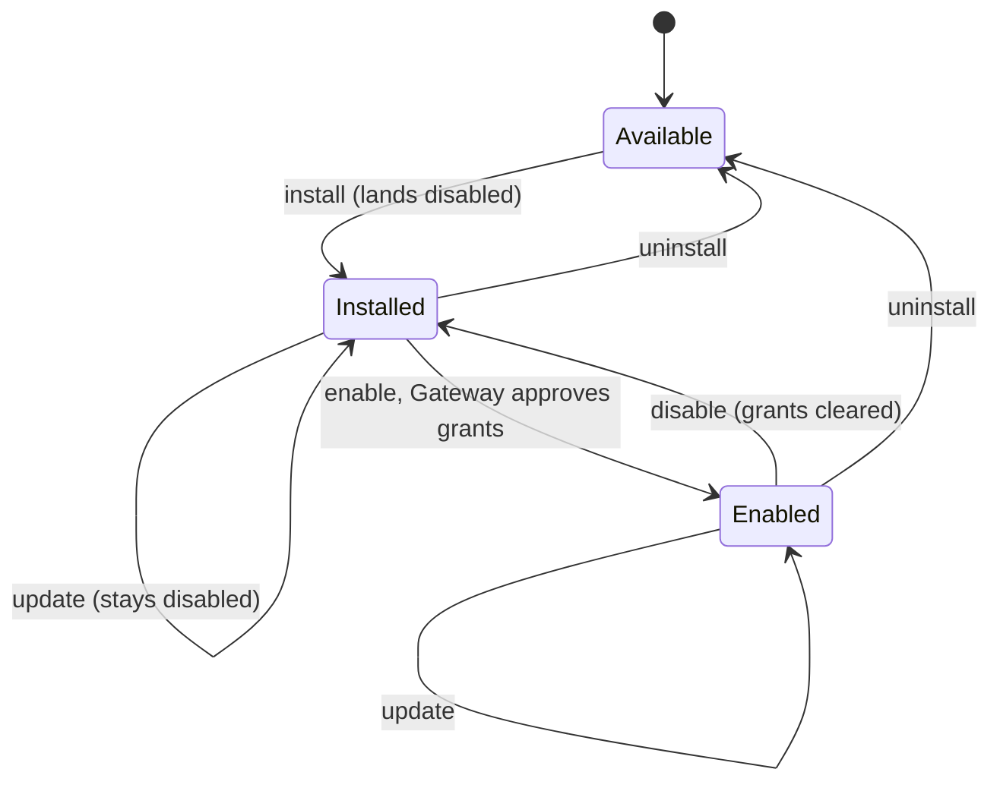

A Ryu **plugin** is a bundle described by a `manifest.json` manifest. The manifest names the
[Runnables](/docs/start-here/architecture/runnable-model) the plugin ships, the permission grants it
needs, and an optional Companion surface.

- **Core owns the lifecycle** (what runs): load, validate, install, enable, disable, update.
- **The Gateway owns enforcement** (what is allowed): grant validation and signing. See
  [Governance](/docs/gateway/governance).

The full manifest field schema is in [Plugin API](/docs/extend/develop/sdk/plugin-api). The source is
`apps/core/src/plugin_manifest/` (manifest type, loader, per-kind schema) and `apps/core/src/plugins/`
(lifecycle operations, system registry).

Only system functionality is inseparable from Core. Ordinary first-party apps and plugins are
official marketplace packages. Core records the marketplace signature and publisher verification at
install time, and the package installs, updates, and uninstalls like any other plugin.

## The manifest file

The canonical file name is `manifest.json`. The legacy `plugin.json` and `ryu.json` names are still
read so older plugins keep loading (`MANIFEST_FILE_NAMES` in
`apps/core/src/plugin_manifest/mod.rs`). A `plugin.json` that is an Agent Plugins spec file, not a
native manifest, is skipped.

The runtime loader (`PluginManifestLoader::load_runtime`) loads system manifests and installed
package manifests from a directory resolved in the order below. The catalog may keep a separate
official index for discovery, but Core does not runtime-load ordinary marketplace packages from it.

| Order | Source | Notes |
|---|---|---|
| 1 | `RYU_PLUGINS_DIR` | Explicit override, if set |
| 2 | `RYU_APPS_DIR` | Legacy env var, still honoured |
| 3 | `~/.ryu/plugins` | Default |

Each plugin lives in its own subdirectory holding a `manifest.json` (preferred) or a legacy
manifest file. A manifest that fails to parse is skipped with a warning; the rest keep loading.

A manifest carries the fields below. The serde shapes are owned by the SDK schema reference
([Plugin API](/docs/extend/develop/sdk/plugin-api)); this table is orientation only.

| Field | Required | Purpose |
|---|---|---|
| `id` | yes | Unique id. Scoped ids (`@ryu/<app>`) are the convention; flat ids such as `data-grid-explorer` and legacy dotted ids such as `com.example.my-app` still load. The on-disk directory name flattens a scoped id (`@ryu/meetings` -> `@ryu+meetings`) |
| `name` | yes | Display name in the store and launcher |
| `version` | yes | Semver string |
| `runnables` | yes | The bundled Runnables, each with a `kind` and per-kind `config` |
| `permission_grants` | no | Grants the plugin declares it needs (declarations only here; the Gateway enforces) |
| `companion` | no | An in-desktop overlay or sidebar panel surface |
| `contributes` | no | VS Code-style contribution points, referenced by runnable id |
| `activation_events` | no | Lazy-wake events (empty list means eager) |
| `engines` | no | `engines.ryu` semver requirement the running Core must satisfy |
| `runtime` | no | A declarative external runtime (e.g. a Python venv + pip deps + assets) |
| `sidecars` | no | Managed child processes Core downloads, spawns, and health-checks (see [Managed sidecars](/docs/core/app-managed-sidecars#manifest-declared-managed-sidecars)) |

The Companion UI is the working surface, not a product landing page. Put the app's explanation,
screenshots, and discovery copy in its Marketplace listing. When a user opens an enabled app, its
Companion UI should open on its task surface; an empty state can explain the first action when the
app has no records yet.

## Per-kind Runnable validation

Every `RunnableEntry` carries a `kind` discriminant and an optional typed `config`. The loader runs
`validate_runnable` on each entry and rejects the whole manifest if any entry fails its per-kind
contract. The function lives in `crates/core/kernel-contracts/src/schema.rs` and is re-exported by
`apps/core/src/plugin_manifest/schema.rs`.

There is no `_ =>` fallback arm, so every one of the eight
[`RunnableKind`](/docs/start-here/architecture/runnable-model) variants is checked explicitly.

| Kind | Config required | Required fields |
|---|---|---|
| `agent` | no | All fields default (`system_prompt`, `model`, `tools`, `identity_mode`); `account_access` is refused |
| `workflow` | yes | `entry` (non-empty) |
| `tool` | yes | `slug` (non-empty) |
| `skill` | yes | `skill_id` (non-empty) |
| `companion` | yes | `label` (non-empty) |
| `channel` | yes | `platform` (non-empty) |
| `engine` | yes | `engine_type` (non-empty) |
| `policy` | yes | `policy_type` (non-empty) and `definition` |

A missing required config, an empty required string, or a config blob that does not parse as the
expected shape all produce a descriptive error that names the runnable id and kind.

HTTP tool Runnables can set `config.caller_agent_query` to an ASCII query-parameter name. Core then
appends the verified calling Agent id to the tool URL for each invocation. The sidecar can use that
identity to select an Agent-scoped session without trusting a model-supplied argument.

A manifest cannot take ownership of a query parameter that is already present in its URL. Core
rejects the call instead of overwriting it.

## Loader validation rules

Beyond per-kind config, the loader (`parse_and_validate`) enforces these manifest-level rules. A
violation rejects that manifest only; the others continue loading.

| Rule | Behavior |
|---|---|
| Id format | A flat id, or a scoped `@scope/name` id with exactly one `/`. See [Plugin id rules](#plugin-id-rules) |
| Semver | `version` must parse as semver; otherwise rejected |
| Duplicate id | Across system and installed manifests, the first occurrence with an id wins; later duplicates are rejected |
| `engines.ryu` pin | When present, it must parse as a semver requirement and the running Core version (`CARGO_PKG_VERSION`) must satisfy it; otherwise rejected |
| `contributes` cross-validation | Every runnable id referenced in `contributes` must resolve to an entry in `runnables` (declare-by-id); a typo is caught at load |

### Plugin id rules

The id reaches filesystem paths, so `validate_plugin_id` (`crates/core/kernel-contracts/src/manifest.rs`)
blocks path traversal. A flat id, and each half of a scoped id:

- uses only ASCII letters, digits, `.`, `-`, and `_`;
- contains no `..`;
- has no leading or trailing `.`, and no leading `-`.

The whole id is at most 128 bytes. `core` is reserved for Core-originated kernel events.

## Lifecycle operations

The lifecycle operations live in `apps/core/src/plugins/lifecycle.rs` and are backed by the
SQLite `PluginStore`. Each maps to an HTTP handler in `apps/core/src/server/mod.rs`.

| Operation | Behavior |
|---|---|
| `install_app` | Creates a `PluginRecord` with `enabled = false`. Re-validates semver. Fails if already installed |
| `enable_app` | Validates the manifest's declared grants via the Gateway, then flips `enabled = true` and records the approved grants. Fails closed |
| `disable_app` | Flips `enabled = false` and clears approved grants |
| `uninstall_app` | Applies the same disable/dependent checks, then removes the target lifecycle record and its owned scheduler jobs |
| `update_app` | Compares semver. Refuses a downgrade (new < installed) unless `force = true`. A same-version update is a no-op. Does not re-enable a disabled plugin |



### Install and enable

Install always lands disabled. Enabling is the gated step:

- Core calls the Gateway's `/v1/grants/validate` for every grant the manifest declares and stores
  the result. Core applies no inline policy of its own.
- If the Gateway denies a grant, the plugin stays disabled.
- If the Gateway is unreachable, the enable fails closed.
- Enabling with an empty grant list always succeeds, because there is nothing to validate.

<Callout type="info">
If enabling a plugin fails because the Gateway is unavailable, restore the configured Gateway
connection and retry. An unavailable policy service does not approve the requested grants.
</Callout>

There is no `preinstalled` manifest field and no "installed but disabled" seed category. A fresh
store receives lifecycle records only for `CORE_PREINSTALLED`, and those records are seeded enabled.
Every other package is available in the Store without a record until the user installs it. An
explicit install can still land disabled while the user reviews its grants.

### Updates and bundles

Uploaded self-contained bundles go through the same loader normalization as the compiled manifest
registry before an enabled app is reactivated. Core resolves legacy dependency aliases, hydrated
`code_file` bodies, and the manifest's trust digest once. An update therefore cannot move a
first-party sidecar to the Community grant path or leave its managed process unregistered.

### What an update does to app agents

The result depends on how the update is applied:

| Update path | Effect on app agents |
|---|---|
| Uploaded bundle update, or an update your organization's fleet applies | Deactivates the old version and activates the new one. Keeps every agent the new version still declares, with the user's settings on it (such as its account limit). Refreshes the manifest-owned fields (name, prompt, tools, model), and clears a prompt or model the new version no longer sets. Removes only agents the new version drops |
| Store update or rollback | Does not reactivate the app. Keeps every existing agent as it is, including one the new version no longer declares. An agent the new version adds is created the next time Ryu starts or the app is enabled |

Disabling an app removes its agents. Enabling it again recreates them from the manifest, with its
`identity_mode` and no account limit.

### Identity mode on update

On every update path, Core reconciles the new version's `identity_mode` and never forces it. Core
applies it only when all of these are true:

- it narrows the agent (`managed`, then `mixed`, then `individual`);
- the user never changed the mode;
- the agent is not locked.

Anything else, including any widening, is kept as a pending request:

- `GET /api/agents/:id` returns it as `app_identity.pending_mode`, next to `app_identity.app_mode`
  (the mode the app last set).
- Saving the agent with `identity_mode` set to the pending mode accepts it.
  `"dismiss_pending_identity_mode": true` in the same `PUT` body keeps the current mode.
- The CLI shows the request (`ryu-cli agents show`) and can dismiss it
  (`ryu-cli agents identity <id> dismiss`).
- The desktop app shows it in the agent editor's identity section with **Accept** and
  **Keep current**. The mobile app does not show it yet.

The Store update, bundle update, and rollback responses list affected agents in `agent_identity`,
each with a `status` of `narrowed` or `pending`. A fleet update has no caller to answer, so it only
logs them.

### Routes

`/api/plugins*` is canonical. `/api/apps*` is a deprecated alias for the same handlers, kept so
older clients keep working.

```text
GET  /api/plugins                 list loaded manifests (system + user-installed)
GET  /api/plugins/catalog         browse installable plugins from the remote registry
POST /api/plugins/install         install by fetching manifest.json from a URL
POST /api/plugins/install-bundle  install from a local self-contained bundle
POST /api/plugins/reload          re-scan system manifests + the plugins dir (no restart)
POST /api/plugins/:id/install     record as installed (disabled)
POST /api/plugins/:id/enable      validate grants via Gateway, then enable
POST /api/plugins/:id/disable     disable + clear approved grants
POST /api/plugins/:id/update      update to a new manifest version
POST /api/plugins/:id/rollback    restore the version the last update replaced
POST /api/plugins/:id/uninstall   uninstall (see Uninstall and app data)
GET  /api/plugins/:id/uninstall-data  list optional data the app owns
```

### Dry-run lifecycle plans

Lifecycle operations that can change a node expose the same validation as a read-only plan.

- Plans never write the plugin store, activate or deactivate a runtime, remove scheduler jobs, or
  delete a plugin directory.
- Plans may still read the loaded manifest set and call the Gateway's grant-validation seam, because
  those checks are needed for an accurate result.

| Operation | How to ask for a plan |
|---|---|
| Install, enable, update | `dryRun: true` in the request body |
| Disable, uninstall | `dryRun=true` in the query string |
| `ryu-cli` | `ryu-cli add\|enable\|disable\|uninstall <id> --dry-run`, plus `--json` for automation |

The response is marked `dryRun: true` and uses the `wouldEnable`, `wouldDisable`, `wouldRemove`, or
`installedDependencies` fields. The requested state is not persisted.

- An enable plan resolves the dependency closure and validates each plugin's own declared grants.
- A disable or uninstall plan reports the reverse-topological blast radius. It applies the same
  mandatory, required, protected-plugin, and dependent checks as the live operation.

### Uninstall and app data

Uninstalling always removes:

- the package and its runtime contributions;
- approved grants and bundled skills;
- owned sidecar binaries;
- the app's **saved secrets** (its encrypted credentials). A credential does not outlive the app
  that was trusted with it.

The app's key-value storage is **kept** by default, so reinstalling the app finds its saved data
again. To delete it too, check **Also delete this app's saved data** in the Desktop confirmation,
or send `{ "delete_storage": true }` in the `POST /api/plugins/:id/uninstall` body.

`GET /api/plugins/:id/uninstall-data` lists the other optional data the app owns: settings,
shortcuts, scheduled automations, connected accounts, Spaces, and app-declared data categories.
Name the rows to delete in the body's `cleanup` array.

- The app purges its own declared categories, so Core asks the app to delete them **before** it
  stops the app.
- If a purge or any other optional cleanup fails, the uninstall still completes. The response lists
  the failure in `cleanup_errors`.
- A refused uninstall (protected plugin, enabled dependents) deletes nothing.

## Trust tiers, sidecars, and activation

- [App Trust Tiers and System Manifests](/docs/core/app-trust-tiers) covers the two-tier registry,
  the pre-installed and default tool apps, and which manifests are built-in or system.
- [App Managed Sidecars and Activation](/docs/core/app-managed-sidecars) covers manifest-declared
  sidecars, activation events, and sidecar credential references.

## Related

<Cards>
  <DocCard href="/docs/core/app-trust-tiers" />
  <DocCard href="/docs/core/app-managed-sidecars" />
  <DocCard href="/docs/start-here/architecture/runnable-model" />
  <DocCard href="/docs/extend/develop/sdk/plugin-api" />
  <DocCard href="/docs/gateway/governance" />
  <DocCard href="/docs/surfaces/desktop/user-guide/store" />
</Cards>
