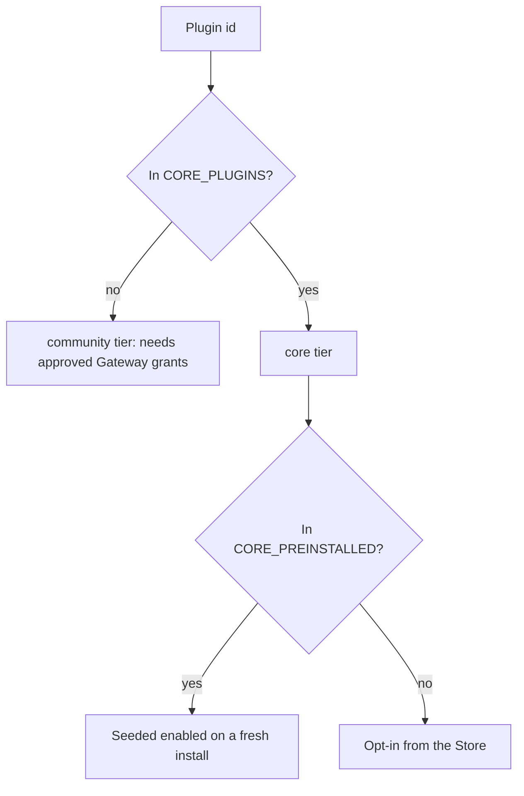

A plugin's trust tier, its fresh-install seeding, and whether Core can remove it are all decided by
constants in Core, never by the manifest. For the manifest file and the install, enable, update, and
uninstall operations, see [App Manifest and Lifecycle](/docs/core/app-manifest-lifecycle).

## Two-tier registry

A plugin's trust tier is **derived from membership** in a constant, never asserted by a manifest
field, so a plugin cannot promote itself. The lists live in `apps/core/src/plugins/builtins.rs`.

| Tier | Meaning |
|---|---|
| `core` | A reviewed capability tier listed in `CORE_PLUGINS`. It may be marketplace-installed; the tier does not mean the package is embedded in Core |
| `community` | Everything else, including ordinary installed packages. It requires the relevant approved Gateway grants |

### Pre-installed plugins

A subset of Core plugins is seeded enabled on a fresh install (`CORE_PREINSTALLED` in
`apps/core/src/plugins/builtins.rs`). The constant holds the full list. Examples:

- the local engine (`@ryu/engines`) and the durable workflow engine (`@ryu/durable`);
- the four default tool apps (`@ryu/ghost`, `@ryu/shadow`, `@ryu/spider`, `@ryu/agentbrowser`; see
  [Default tool apps](#default-tool-apps-auto-seed));
- the chat turn-hook plugins (`@ryu/goal`, `@ryu/proof`, `@ryu/double-check`);
- the pre-turn prompt improver (`@ryu/auto-expand`).

Ids are the scoped manifest `id` (for example `@ryu/engines`). The seed runs at startup
(`seed_preinstalled` in `apps/core/src/plugins/seed.rs`) and respects user choice. It acts only when
there is no prior record for that plugin, so a later disable survives a restart.

The opt-in Core plugins (`@ryu/firewall`, `@ryu/routing`, `@ryu/sandbox`, `@ryu/predict`) are
Core-tier but excluded from the pre-installed set, because they change Gateway, sandbox, or capture
behaviour.

## Default tool apps auto-seed

Ghost, Shadow, Spider, and Agent Browser are the default tool apps. Their manifest ids are in
`CORE_PLUGINS` and `CORE_PREINSTALLED` (`apps/core/src/plugins/builtins.rs`).

- The compiled system manifests are available from Core immediately.
- Ordinary official packages are fetched from the signed marketplace package, then installed and
  enabled automatically on a fresh install.

| App | Tool | Cross-platform | Reaches the web |
|---|---|---|---|
| `ghost` | Desktop automation (29 tools) | yes (Win/mac/Linux) | no |
| `shadow` | Screen and audio capture + semantic memory | yes (Win/mac/Linux) | no |
| `spider` | Web crawler (a `command` tool that runs the local `spider` CLI) | yes | yes |
| `agentbrowser` | Web browsing (npx-launched MCP server) | yes | yes |

The seeded record is a **governance shell**. Enabling it makes each app a governed app that you can
disable, while the tool process still runs through its own sidecar, MCP, or command lifecycle.

- Ghost and Agent Browser declare `runnables: []`. Their tools come from their own MCP provider
  (Ghost through Core's MCP registry, Agent Browser as an npx MCP server), so the record never
  double-lists them.
- Shadow declares `http` tool runnables that reach the Shadow sidecar through Core.
- Spider declares a `command` tool runnable that shells out to a user-installed `spider` CLI. It has
  no Core-managed sidecar.

Ghost, Shadow, Agent Browser, and Browser are the compiled **system** manifests. Spider is Core-tier
and pre-installed, but remains an installable marketplace package.

<Callout type="warn">
The run path is the sidecar or MCP provider, not the plugin record. The auto-seeded record makes the
app show as installed, but it does not download the tool binary by itself.

Ghost and Shadow are cross-platform and **sidecar-managed**. They are installed with
`POST /api/setup/:name/install` and run with `POST /api/sidecar/:name/start|stop`, not through the
`PluginStore` install and enable path. When the sidecar is not installed or running, Desktop shows
an unavailable state.
</Callout>

## Built-in and system manifests

**Built-in** and **System** answer different questions:

| Label | Meaning |
|---|---|
| **Built-in** | The manifest bytes are in the production Core distribution (`BUILTIN_MANIFESTS`), so Core can validate and project the package without downloading its manifest. It does not mean the package is seeded or enabled |
| **System** | Core refuses to uninstall the plugin. It is required for Core, a sidecar-backed system component, or part of the `CORE_PREINSTALLED` seed (which would re-add a removed record on the next boot) |

The Store and the installed list derive the System label from that same uninstall rule. A System
plugin never offers **Remove**, and every plugin that cannot be removed reads System. A package may
be built-in without being system, and a system package may still arrive through the signed
marketplace install path.

The rest of the official catalog is not compiled into Core: its signed package is downloaded from
the Ryu Marketplace when installed.

| Manifest source (marketplace paths are in `amajorai/ryu-marketplace`) | What it declares |
|---|---|
| `plugins/plugins/ghost/manifest.json` | Ghost desktop-automation MCP tool |
| `plugins/plugins/shadow/manifest.json` | Shadow screen and audio capture + semantic memory |
| `plugins/plugins/agentbrowser/manifest.json` | Agent Browser MCP tool |
| `apps-store/browser/manifest.json` | Chromium sidecar surface (`@ryu/browser` app) |

Official marketplace packages such as Spider, Exa, policies, engines, and app companions use the
same manifest validation and lifecycle after installation, but their manifest and code files live
under the installed package directory rather than inside the Core binary.

## Related

<Cards>
  <DocCard href="/docs/core/app-manifest-lifecycle" />
  <DocCard href="/docs/core/app-managed-sidecars" />
  <DocCard href="/docs/gateway/governance" />
  <DocCard href="/docs/surfaces/desktop/user-guide/store" />
</Cards>
