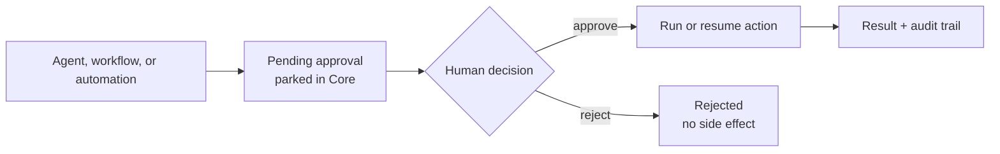

The approvals engine (`apps/core/src/approvals/`) is one queue of pending actions that wait for a
human decision. Agents, workflows, and automations configured to require approval raise them. The
source runs up to the decision point, parks the action, and notifies you. On approve, Core runs or
resumes the action.

<Callout type="info">
This is distinct from [Command approval](/docs/security/command-approval), which is the Gateway's
shell-command scanner (`RYU_EXEC_APPROVAL_MODE`) that classifies a single command as allow / deny /
approval-required before Core executes it. The approvals engine is the general inbox that any
source parks a whole action into. The two share the `off` / `smart` / `manual` vocabulary but are
separate systems with separate settings.
</Callout>

## The decision loop

The inbox turns a proposed action into a reviewable state. Approve resumes or dispatches the action;
reject closes the request without running it.

<SurfacePreview surface="governance" />

## Request kinds

`ApprovalKind` (`apps/core/src/approvals/mod.rs`, serde `snake_case`) tags what is waiting and drives
the inbox icon + grouping.

| `kind` | Raised by |
|---|---|
| `tool_call` | An agent's gated tool call (see [gating](#the-tool-dispatch-gate)) |
| `workflow_gate` | A [workflow](/docs/core/workflows) suspended at an `Awakeable` human-in-the-loop gate |
| `scheduled_run` | A [scheduled](/docs/core/scheduler) automation flagged `require_approval` before each run |
| `trigger_run` | An externally-triggered run (Composio / webhook) flagged for approval |
| `skill_synthesis` | A [skill](/docs/core/skills-catalog) the continual-learning loop distilled from a conversation, awaiting your OK before it joins the active library |
| `heal_fix` | A fix the self-healing loop proposed for a failed run, or a terminal "attempts exhausted" review notice |

## Resolution styles

An `ApprovalRequest` optionally carries a `PendingAction` describing exactly what executes on approve;
the inbox shows it read-only. A request resolves in one of four ways:

- **Deferred re-dispatch** (`scheduled_run`, `trigger_run`) - the firing site returns immediately (it
  never holds a scheduler permit); the decide-handler runs the action on approve. Actions:
  `ScheduledJob`, `TriggerWorkflow`, `TriggerAgent`.
- **Suspend / resume** (`workflow_gate`) - the run is already suspended to `AwaitingInput`; approve
  resumes it (`WorkflowResume`), reject fails it so it does not hang.
- **Deferred materialize / re-run** (`skill_synthesis`, `heal_fix`) - the payload rides in the action
  (`ActivateSkill` carries the full `SKILL.md`; `HealRerun` / `HealWorkflowRerun` carry the corrected
  prompt or run id), so a rejected suggestion never touches disk or re-runs anything.
- **Tool call** (`tool_call`) - `ToolCall` captures the full re-dispatch context and runs on approve
  through the registry's no-gate entry so it executes exactly once and never re-raises an approval.

Each arm of `execute_action` proxies the same engine the source already uses, so an approved run is
identical to the autonomous run it replaced. A `ToolCall` records its output (a bounded 4000-char
preview) back onto the row; other kinds record only success or an error.

Tool-call requests also carry an optional `question` alongside `summary`. The question is the
first-person intent shown above the explanation in approval cards (for example,
``Can I run `gmail.send_email` now?``); the summary remains the plain-language description of what will happen.
Desktop, remote mobile, and offline native confirmations use this same question-plus-summary shape.
The question explains the proposed action but never grants permission by itself.

## The decision

`ApprovalStatus` is `pending` / `approved` / `rejected` / `expired` / `cancelled`. Only a `pending`
request ever transitions.

The main guarantee is a **single-winner atomic compare-and-set**. `decide` fast-paths anything
already decided, then calls `ApprovalStore::try_transition`, whose SQL carries a
`WHERE id = ?1 AND status = 'pending'` guard (`apps/core/src/approvals/store.rs`). Exactly one of N
concurrent deciders sees the row change; the rest see `false` and run no side effects. This closes the
read-check-then-write window where a double-click (or a phone and a desktop deciding at once) could
double-execute the action.

The status is flipped **durably before** the action runs, and the action runs in a spawned background
task. So the decide call returns immediately, and a crash mid-execute fails safe: the row is left
`approved` with its action lost, never double-run. `cancel` and the periodic `sweep_expired`
(auto-rejecting past `expires_at`) use the same CAS, so a cancel or expiry racing an approve can never
both act. A rejected or expired `workflow_gate` fails its suspended run so it does not hang.
The same periodic sweep deletes decided requests 90 days after their decision; pending requests are
never deleted.

Creating a request also dedups: `request_deduped` is a no-op when a `pending` request already exists
for the same `source_ref` (`has_pending_for_source`), so a scheduled job cannot pile up a fresh
approval on every tick. A new request also sends a best-effort Expo push notification (using the
[monitors](/docs/core/website-monitoring) push tokens), so a phone learns about a pending decision.

The push shows the request's title only on a device whose signed-in member could open the inbox on
that node. On an unbound node that is any signed-in member. On a personal node it is the owner. On an
organization or team node it is a member whose role grants `approvals.view`. Every other device,
including one registered without signing in, gets "A request is waiting for a decision" and the
request id. It gets the same message when the node can't reach the control plane to check.

## The tool-dispatch gate

`tool_call` approvals are raised at the gated MCP tool-dispatch chokepoint. Before it runs the tool,
`McpRegistry::call_tool_with_identity` calls `approvals::gate_tool_call`
(`apps/core/src/approvals/mod.rs`). If the policy gates the tool, the call is **not** executed - an
error is returned (every plane treats a tool error as not-done, so a gated call never looks like a
completed side effect), the action is queued in the inbox, and the engine runs the tool on approve. It is **fail-closed**: if the approval cannot even be persisted, the tool still does not
run.

Inside a [programmatic tool calling](/docs/core/programmatic-tool-calling) program, the gate also
holds any call that can send data off the machine (web and browser tools, desktop input, writes
through Ryu's own API, delegation, outbound channels, external MCP tools) once the same program has
read private data such as conversation history, memory, or a connected account. The held call is
queued here with its full arguments, so you can see where the data would go, and an earlier "Allow
for this chat" does not skip it. With no approval inbox running, the call is refused instead.

### Policy: the approval mode

Agent configuration always requires an operator decision, including when the global mode
is **off**. Interactive agents, managed Pi callbacks, and network tool clients use the same
persisted Approvals inbox. A tool result reports that the change is pending; the stored
change runs only after approval. Model arguments and cached session choices cannot approve it.

A Ryu Challenges submission (`challenges.submit`) is also confirmed on every call, including
when the global mode is **off**, because it sends a project entry under your own Ryu account.
If the approval inbox is unavailable, the submission is refused rather than sent unconfirmed.

Agent-builder configuration is unavailable on managed or shared organization nodes while
the tool's ownership boundary remains unsupported. On supported personal nodes, HTTP calls
also require edit access to the exact agent being changed. Approval replay rechecks the node
boundary, so an earlier personal-node approval cannot enable configuration after the node
becomes managed or shared.

The gate reads the global **approval mode** (`apps/core/src/approvals/policy.rs`), stored under the
`approval-mode` preference and exposed at `GET/PUT /api/approvals/mode`.

| `mode` | Behavior |
|---|---|
| `off` | Gates no ordinary actions; mandatory operator-review actions still require approval |
| `smart` | Gates mandatory operator-review actions and tool calls whose action segment matches a curated risky-verb list (`send`, `delete`, `pay`, `deploy`, `email`, `merge`, …) |
| `manual` | Gates every tool call |

`smart` classification (`classify_risk`) matches against the tool id's action segment (the part after
the last `.`), and excludes broad read verbs (`get` / `list` / `search` / `read`) so it
does not gate ordinary reads. `composio.` tools are skipped here because they own their own
connection-required flow.

Changes an agent makes to Ryu itself always ask, in every mode, including `off`. This covers every mutating
Self-API call (`ryu_api.*`, for example Gateway routing, budgets and guardrails, a model's launch
settings, or a preference) and switching the user's interface (`workspace.switch_interface`).
Mutating app API calls (`ryu_ext.*`) write an app's own data, so they are gated unless the mode is
explicitly `off`. When the agent runs in an interactive chat, these ask in that chat
instead of the inbox: the user picks **Allow once**, **Allow for this chat**, or **Deny**, and an
allowed call runs immediately. The gate still checks the organization tool policy first, so an
in-chat allow never overrides an administrator's denial. Without an interactive chat (routines,
network MCP clients, programmatic tool calls) the call is queued here as before.

Spaces mutations are included in the risky set: `create_space`, `rename_space`, `create_page`,
`create_file`, `attach_space`, and `detach_space` wait for approval in `smart` mode. Listing and
searching Spaces remain read operations. The agent-plane authorization check still runs before the
approval is queued, so an unresolved or non-owner agent cannot use approval as a way around Space
ownership.

<Callout type="warn">
The policy is designed as three layers OR'd together. Layer A - a per-agent `approval_tools` list on
the agent record - is fed into the dispatch gate, so a listed tool queues for approval before it can
run. An agent with the **Approval required** safety profile also adds non-read-only tool calls to
that per-agent gate. A program's call that would send data out after reading private data is held
the same way, as an agent-level gate, and still requires approval when the approval mode is **off**.
This composes with Layer B's global `approval-mode`; either policy can require approval. Layer C is
the organization tool-policy consult.

On an organization-bound node it runs before Layers A and B: a
tool the organization denies, or one outside a non-empty organization allowlist, is refused and never
queued, so a local approval cannot override it. Layer C is deny-only. It never adds an approval gate,
and it does nothing on a node that is not bound to an organization
(`apps/core/src/approvals/policy.rs`, `apps/core/src/approvals/mod.rs`).
</Callout>

## Storage

The `ApprovalStore` (`apps/core/src/approvals/store.rs`) persists to SQLite at `db/approvals.db` in the Ryu data directory.
One `approvals` table holds the full `ApprovalRequest` as embedded JSON, plus denormalized `status`
and `source_ref` columns (indexed) so status filters and pending-by-source dedup do not scan JSON. A
Tokio broadcast channel fans `Created` / `Decided` events out to SSE subscribers (the desktop inbox +
the island chip).

## Routes

All routes are under `/api/approvals` (`apps/core/src/server/approvals_api.rs`).

| Method + path | Purpose |
|---|---|
| `GET /api/approvals?status=pending` | List requests, newest first; optional status filter. Every pending request is returned, plus the 200 most recent decided ones. A storage failure returns an error status, not an empty list |
| `GET /api/approvals/:id` | One request |
| `POST /api/approvals/:id/approve` | Approve (runs its action in the background); optional `note` |
| `POST /api/approvals/:id/reject` | Reject (fails a suspended workflow gate); optional `note` |
| `GET /api/approvals/mode` | Read the global approval mode |
| `PUT /api/approvals/mode` | Set the global approval mode (`off` / `smart` / `manual`) |
| `GET /api/approvals/events` | SSE feed of approval events (created / decided) |

Every route requires a signed-in caller with the matching approvals permission: `approvals.view` to
read requests, the mode, and the event feeds, and `approvals.decide` to approve, reject, or change the
mode. On an organization or team node, owners and admins hold both through their built-in role. A
custom role can grant either one to another member. On a personal node only its owner passes.

Approval events are also
delivered on the `approvals` channel of the unified `GET /api/events/all` stream, which includes that channel
only for a caller with `approvals.view`. Both streams close when the session token they connected with
expires, and re-check `approvals.view` about every 30 seconds. The re-check stops events within about 30
seconds when a custom role that granted `approvals.view` is revoked. A built-in role change or a removal
from the organization takes effect when the token expires. To receive events again, reconnect with a current token.

A permission that comes from a built-in role is checked on the node, so a control-plane outage does not
affect it. When `approvals.view` comes from a custom role and the node cannot reach the control plane to
check it, the check is refused, not passed. `GET /api/approvals/events` answers
`503 Service Unavailable`, so retry it later. On `GET /api/events/all` the other channels keep streaming
without approval events, and the node retries the check in the background (after 1 second, then backing off
to every 30 seconds). Once the control plane answers, the node closes the stream so the client reconnects
with its current token, refetches what it missed, and is checked again. Approval events are never sent before
a check passes.

The activity feed records every approval event with its title and summary. Those rows go only to a
caller who passes the same `approvals.view` check. On `GET /api/events/all` the `activity` channel
leaves them out unless the connect-time check passed; an outage counts as a refusal. `GET /api/activity`
and its stream leave them out for a caller without the permission, including a request that carries
only the node token.

## Related

<Cards>
  <DocCard href="/docs/security/command-approval" />
  <DocCard href="/docs/core/workflows" />
  <DocCard href="/docs/core/scheduler" />
</Cards>
