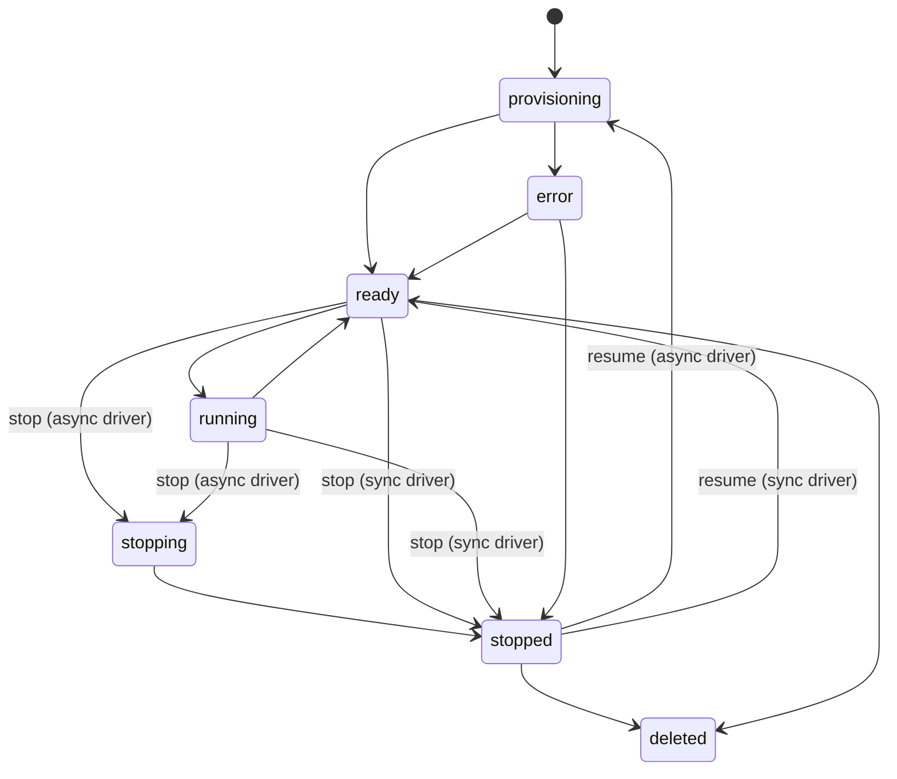
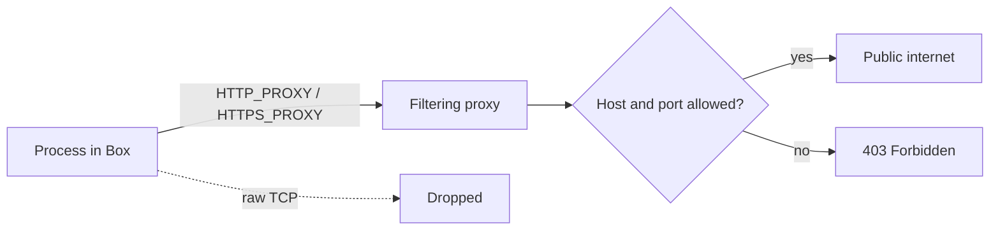

Local mode runs the Box service with the Docker driver, or the development-only filesystem driver.
For the two modes and how Core uses Boxes, see [Persistent Boxes](/docs/core/boxes).

## Lifecycle

The local service keeps a smaller, provider-neutral lifecycle:

| State | Meaning |
| --- | --- |
| `provisioning` | The driver is creating or restoring the workspace. |
| `ready` | Commands, prompts, and interactive work may start. |
| `running` | At least one foreground command is using the Box. Up to 16 run at once. |
| `stopping` | The workspace is being saved before its machine is released. |
| `stopped` | The driver stopped the workspace while its disk remains. |
| `error` | Provisioning or execution failed and needs recovery. |
| `deleted` | The driver resource was destroyed; the audit row remains. |



Any state except `deleted` can also move to `deleted`, and every state except `deleted` and `error`
can move to `error` (`assertTransition` in `apps/box/src/contracts.ts`).

### TTLs and processes

Local create and fork requests require an `Idempotency-Key`. Every local Box has a TTL of 24 hours
unless the request sets one, and at most 7 days. TTL deadlines:

- are measured from creation;
- keep running while a Box is stopped;
- are restored after a service restart;
- destroy the local resource at expiry.

Commands use an argv array internally, keep `cwd` inside the workspace, and retain the most recent
1 MiB of output per process. Stop, resume, delete, and expiry first end every process the service
started in the Box.

### Running time and restarts

Running time starts when the Box's machine is up, so repository clones and setup commands count.
Placing a machine and restoring saved state do not count.

If the service restarts while a Box is `stopping` or `provisioning`, it finishes that work on
startup:

| Interrupted work | Result |
|---|---|
| Stop | The Box is saved and stopped |
| Resume | The Box returns to `stopped` with its saved state |
| Create | The Box moves to `error` |

### Drivers

| Driver | Use | Requirement |
|---|---|---|
| Filesystem | Development and contract tests only. Runs host processes | Disabled unless `RYU_BOX_ALLOW_UNSAFE_LOCAL=true`, and refused when `NODE_ENV=production` |
| Docker | Local Boxes | A **rootless Docker daemon**, or a sandbox runtime |

The Docker driver refuses a rootful daemon, because a Docker socket backed by a rootful daemon is
equivalent to host-root access. The one exception is a sandbox runtime: set
`RYU_BOX_DOCKER_RUNTIME=runsc` (gVisor) or a Kata Containers runtime such as `kata-runtime` to run
each Box under a user-space kernel or a lightweight VM.

<Callout type="warn">
Do not expose a host socket to an untrusted service. Use a rootless daemon or a sandbox runtime, or
use the connected provider path for untrusted agent work.
</Callout>

## Routes and features

Every route below is under `/v1/boxes/{id}` unless it starts with `/v1/` and uses the tenant
bearer key. The [`@ryuhq/client`](https://www.npmjs.com/package/@ryuhq/client) package, version
0.4.0 or later, wraps all of them with `createBoxClient({ apiKey, baseUrl })`. Earlier releases do
not include the Box client.

## Create with setup, a repository, and secrets

```json
{
  "name": "web",
  "image": "ubuntu:24.04",
  "network": "allowlist",
  "allowedHosts": ["github.com", "*.githubusercontent.com", "registry.npmjs.org"],
  "repo": { "url": "https://github.com/acme/web", "branch": "main", "tokenSecret": "GITHUB_TOKEN" },
  "setup": ["apt-get update && apt-get install -y nodejs npm", "cd /workspace/web && npm ci"],
  "secrets": ["GITHUB_TOKEN", "ANTHROPIC_API_KEY"],
  "env": { "NODE_ENV": "development" }
}
```

When `repo` or `setup` is present, create returns `202` with status `provisioning`. The service then:

1. clones the repository into `/workspace/<name>`;
2. runs each setup command as root;
3. marks the Box `ready`, or `error` with the failing command's output.

A repository token is sent through Git's environment, so it never lands in `.git/config`. `snapshot`
boots from a saved snapshot instead of `image`.

Store secrets once per tenant with `PUT /v1/secrets/{NAME}` and `{ "value": "..." }`.

- Secrets are encrypted at rest and never returned.
- A secret reaches a Box only when the Box lists it in `secrets`. Commands see it as an environment
  variable.
- A Box service without secrets encryption configured answers the secrets routes with
  `503 secrets_unavailable`.

## Network

| `network` | Outbound access |
| --- | --- |
| `none` | No network interface besides loopback. Previews, terminals, and tunnels still work. |
| `allowlist` | Only HTTPS and plain HTTP to `allowedHosts`, through a filtering proxy. Private and link-local addresses are refused. |
| `egress` | HTTP and HTTPS to any public hostname, through the same filtering proxy. IP literals and names that resolve to private, loopback, or link-local addresses (including cloud metadata), or to the Docker host's own addresses, are refused. |

A fork keeps its source Box's network policy.



### Proxy rules

- The proxy opens HTTPS tunnels (`CONNECT`) only to port 443. An allowed host cannot be reached over
  SSH, SMTP, or a database port through it.
- Plain HTTP requests may use port 80 or any port above 1024, such as a development server on 8080.
  Other ports get `403 Forbidden`.
- The proxy refuses the Docker host's own public addresses, so a Box cannot reach host services
  through a hostname that resolves to the host.

When the Box service runs directly on the host, the proxy finds the host's addresses on its network
interfaces. When the service runs in a container, it sees only private addresses. In that case set
`RYU_BOX_EGRESS_DENY_CIDRS` to the host's public addresses (comma-separated addresses or CIDR
blocks). The service logs a warning at startup when it knows none.

### Docker networks and raw egress

Every networked Box sits on a Docker network of its own, so Boxes cannot reach one another, and its
only way out is its proxy. The Box sets `HTTP_PROXY` and `HTTPS_PROXY`, which package managers,
`git`, `curl`, and most SDKs honor. Raw TCP connections, such as SSH remotes or external databases,
do not leave the Box.

An operator whose host firewall already blocks private and link-local destinations for Box networks
can set `RYU_BOX_DOCKER_RAW_EGRESS=true`. This gives `egress` Boxes direct outbound access on their
own bridge instead.

<Callout type="warn">
Without such a firewall, raw egress can reach the Docker host and cloud metadata.
</Callout>

Each networked Box uses one Docker network, so size the daemon's address pools for the number of
networked Boxes you run.

## Commands and processes

`POST /commands` takes `command`, `args`, `cwd`, `env`, `stdin`, `timeoutSecs`, and `user`
(`box`, the default unprivileged user, or `root`).

| Mode | Response |
|---|---|
| Default | Waits and returns `stdout`, `stderr`, and `exitCode` |
| `"stream": true` | Server-Sent Events (`process`, `stdout`, `stderr`, `exit`) as output arrives. Disconnecting stops the command |
| `"background": true` | `202` and a process id at once |

| Route | Purpose |
|---|---|
| `GET /processes` | List processes |
| `GET /processes/{pid}/logs?after=N&follow=true` | Replay output after sequence `N` and follow until exit |
| `POST /processes/{pid}/stdin` | Write input |
| `POST /processes/{pid}/kill` | Stop one process |
| `POST /interrupt` | Stop all processes |
| `GET /events?follow=true` | Stream the Box's event log |

## Files

| Route | Purpose |
| --- | --- |
| `GET /files?path=` | List a directory |
| `GET` or `PUT /files/content?path=` | Read or write one file, up to 64 MiB |
| `POST /files/directories` | Create a directory |
| `DELETE /files?path=` | Remove a file or directory |
| `GET` or `PUT /files/archive?path=` | Download a directory as tar, or extract a tar into it |

Relative paths resolve under `/workspace`.

## Previews

`POST /previews` with `{ "port": 3000, "visibility": "public" }` returns a URL that proxies HTTP
and WebSocket traffic, including dev-server hot reload, to that port inside the Box. Private
previews require the tenant bearer key.

| Variable | Effect |
|---|---|
| `RYU_BOX_PUBLIC_URL` | Makes returned URLs absolute |
| `RYU_BOX_PREVIEW_DOMAIN` | With a wildcard DNS record, serves each preview at `https://<token>.<domain>/`, which suits apps that expect to run at the root path |

### Preview origins

When a preview domain is set, each preview runs only on its own host. A `/preview/<token>/` URL on
the service origin redirects there.

Without a preview domain, previews are served by path from the service origin, where every preview
shares one browser origin. Use that only for a single tenant or for development.

<Callout type="warn">
A service that hosts several tenants should use a preview domain on a separate registrable domain,
not a subdomain of the domain that holds your sign-in cookies.
</Callout>

### Cookies and headers

- A preview never forwards platform cookies to the workload, and the workload cannot set them.
- Cookies the workload sets lose any `Domain` attribute, so they stay on the preview host. In path
  mode, their `Path` is placed under the preview's path.
- The workload's `Service-Worker-Allowed` and `Clear-Site-Data` response headers are dropped. It
  cannot widen a service worker past its preview, or clear cookies and storage it does not own.
- Response bodies stream to the browser as the workload sends them.
- A WebSocket message larger than 16 MiB closes the socket with code `1009`.

### Preview limits

Preview limits are fixed. A tenant's limits count across all of its Boxes.

| Limit | Value |
|---|---|
| Concurrent requests per Box | 32 |
| Concurrent requests per tenant | 96 |
| WebSockets per Box | 16 |
| WebSockets per tenant | 32 |
| Idle timeout | 10 minutes |

A request past the limit waits up to 30 seconds for a free slot, so a dev server that loads many
modules at once still works. A request that gets no slot, or a WebSocket past the limit, gets
`429 quota_exceeded`.

A preview response is cancelled when the workload sends nothing for the idle timeout while the
browser waits. One that never starts gets `504 upstream_timeout`. Long-lived streams such as
Server-Sent Events should send a heartbeat.

## Terminal, tunnels, and SSH

`POST /access-tokens` with `{ "scope": "terminal" }` or `{ "scope": "tunnel", "port": 5432 }`
returns a WebSocket URL that is valid for two minutes.

- A terminal socket carries keystrokes and output as binary frames, and accepts
  `{ "type": "resize", "cols": 120, "rows": 40 }`.
- A tunnel socket is a raw TCP stream to the port.
- The `desktop` scope is different. Its token is single-use, lasts 30 seconds, is bound to the
  viewer's origin, and travels as a WebSocket subprotocol rather than in the URL. See
  [Box API](/docs/standalone/box-api#desktop).

### SSH

`POST /ssh` with `{ "publicKey": "ssh-ed25519 ..." }` installs OpenSSH if needed, starts an
unprivileged `sshd` inside the Box, and returns a `proxyCommand` for your SSH config.

The command runs `npx -y -p @ryuhq/client@^0.4.0 box-tunnel <id> 2222`. It reads `RYU_BOX_URL` and
`RYU_BOX_API_KEY` from your environment, and needs Node 22 or newer (or Bun) for its WebSocket.
`box-tunnel` ships in `@ryuhq/client` 0.4.0 and later:

```text
Host web-box
  User ryu
  ProxyCommand npx -y -p @ryuhq/client@^0.4.0 box-tunnel bx_123 2222
```

Any WebSocket client that pipes stdin and stdout can stand in for `box-tunnel`. The tunnel is a
binary WebSocket at `/v1/boxes/<id>/tunnel?port=2222` that accepts the tenant bearer key in the
`Authorization` header.

Editors with remote SSH support, such as VS Code and Cursor, can attach through the same host
entry.

## Snapshots and forks

| Route | Purpose |
|---|---|
| `POST /snapshots` | Save the Box's filesystem, with an optional `name` |
| `GET /v1/snapshots` | List snapshots |
| `DELETE /v1/snapshots/{id-or-name}` | Remove a snapshot |
| `POST /fork` | Copy a running or stopped Box into a new one |

A tenant can keep up to 20 snapshots. Past that, `POST /snapshots` returns `429 quota_exceeded`
until one is deleted. Create a Box with `"snapshot": "<id-or-name>"` to restore it.

## Managed agent prompts

`POST /prompt` with `{ "provider": "claude", "text": "...", "execution": "managed" }` installs the
provider's CLI if needed and runs the prompt inside the Box as the unprivileged user. Without
`execution`, the prompt is queued for an external worker to claim.

- Supported providers are `claude` (also accepted as `claude-code`), `codex`, `opencode`, and
  `cursor`.
- Credentials come from the Box's secrets or the run's `env`, for example `ANTHROPIC_API_KEY`. The
  Box therefore needs `egress`, or an allowlist that includes the provider's API.
- The run's `processId` streams its output.

A managed prompt also accepts these optional fields. A worker prompt that sends them returns
`400 invalid_request`.

| Field | Rule |
| --- | --- |
| `cwd` | Working directory relative to `/workspace`, at most 256 characters, with no leading `/` or `\` and no `..` segment. Defaults to the cloned repository folder, or `/workspace` when the Box has no repository. |
| `env` | Variables for the agent process only, validated like `/commands` env (at most 64 entries, reserved names rejected, values up to 32 KiB). They stay in memory for that run. They are never written to storage, events, logs, or responses. |
| `timeoutSeconds` | Hard limit on the agent process, from 60 to 14400. The default is 14400. |

Every prompt run response includes `status` (`queued`, `running`, `completed`, or `failed`),
`exitCode`, `summary` (at most 4000 characters), `completedAt`, and `reason`. For a managed run,
every `env` value that appears in the agent's output is replaced with `[redacted]` before the
summary is stored or sent.

The `reason` field explains a failure that the agent did not report itself:

| `reason` | Cause |
| --- | --- |
| `canceled` | The run was canceled, or the Box was interrupted. |
| `box_destroyed` | The Box was deleted or expired while the run was active. |
| `service_restarted` | The Box service restarted while the run was active. |
| `timeout` | The agent process passed `timeoutSeconds`. |

`GET /prompts/{runId}` returns one run, or `404 not_found`. `POST /prompts/{runId}/cancel` fails an
active managed run with reason `canceled` and stops its process.

- Canceling a finished run returns it unchanged.
- Canceling a worker run that has not finished returns `409 conflict`.
- Deleting a Box ends a running managed prompt before its processes stop.

## Usage

`GET /v1/usage?from=&to=` returns running seconds and resource-unit seconds per Box, measured per
second. Metering pauses while a Box is stopped and ends when it is deleted. Ryu-hosted Boxes are
settled hourly from this report; a self-hosted local service only reports it.

## Related

<Cards>
  <DocCard href="/docs/core/boxes" />
  <DocCard href="/docs/standalone/box-api" />
  <DocCard href="/docs/standalone/box-lifecycle" />
</Cards>
