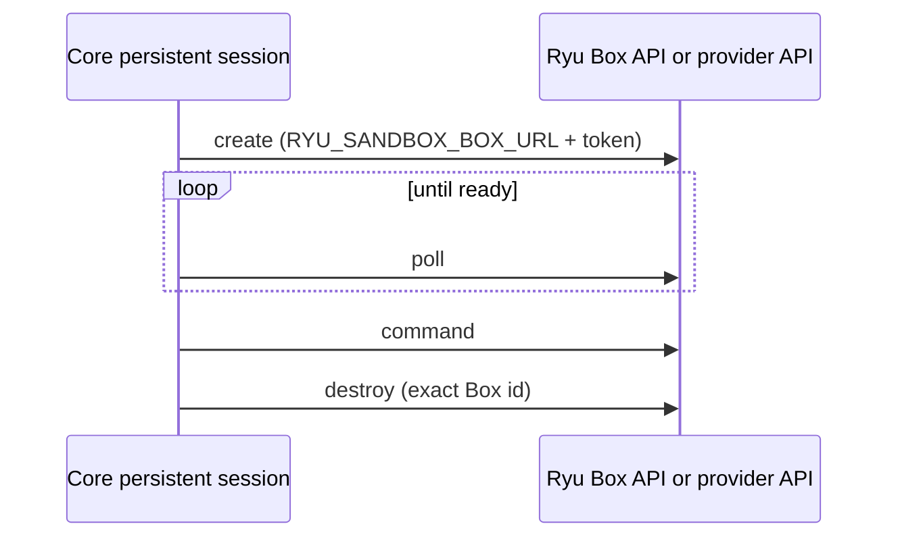
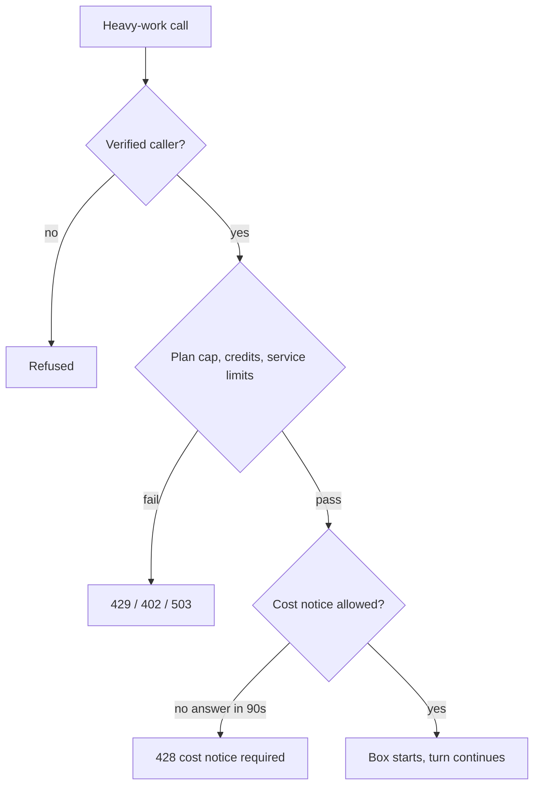

## What a Box is

A Box is a persistent Linux workspace for agent work, previews, and long-running development
tasks. Its filesystem survives commands, stop/resume cycles, and forks. Ryu owns the tenant
boundary and API entry point. A local driver or a connected provider owns the machine, and a
provider credential stays server-side.

<Figure name="sandbox" />

The Ryu Box API covers lifecycle, prompts, events, commands, files, artifacts, desktop streaming,
interrupts, SSH access, snapshots, deletion, account and limits, environments, repositories,
secrets, and webhooks.

## Modes

| Mode | Provider | API coverage |
| --- | --- | --- |
| `local` | Docker, or the explicitly unsafe development filesystem | Lifecycle, setup and repository clone, commands, files, previews, terminal, tunnels, SSH, snapshots, fork, secrets, network allowlists, managed agent prompts, usage, and TTL |
| `subscription_passthrough` | A configured workspace provider subscription | The complete provider `/v1` API, forwarded without a local resource model |

Billing differs by mode:

- **`local`** records per-second running time (paused while a Box is stopped) and how long each
  Box exists. A Box that Core creates is charged through Ryu's sandbox metering. A Ryu-hosted
  dashboard or API Box is settled hourly from that usage report against the organization's credits.
- **`subscription_passthrough`** needs `RYU_SANDBOX_BOX_SUBSCRIPTION_PASSTHROUGH=true` for Core.
  Ryu does not debit that machine time again.

### Isolation and desktop

The local mode health response reports its feature list and the isolation the runtime provides:
`container`, `gvisor`, or `microvm`, and `vm` on Ryu-hosted Box. A Ryu-hosted Box usually has its
own virtual machine. One placed on a shared overflow host reports `gvisor` in its own `placement`,
and still has its own container, screen, and gVisor sandbox.

Local mode runs a per-Box virtual desktop and browser for Boxes created with `"desktop": true`, and
streams it through the `desktop` access-token scope (see
[Box API](/docs/standalone/box-api#desktop)). It does not provide provider account, environment, or
webhook semantics. Connected provider mode forwards those.

## Connected provider mode

Run the Ryu Box service in front of a configured provider API:

```sh
RYU_BOX_API_TOKEN=ryu-box-client-secret \
RYU_BOX_UPSTREAM_URL=https://provider.example/box/v1 \
RYU_BOX_UPSTREAM_API_KEY=provider-subscription-key \
bun run apps/box/src/index.ts
```

For more than one Ryu tenant, use one provider subscription key per tenant:

```sh
RYU_BOX_API_TOKENS='{"acme":"ryu-acme-secret","beta":"ryu-beta-secret"}' \
RYU_BOX_UPSTREAM_URL=https://provider.example/box/v1 \
RYU_BOX_UPSTREAM_API_KEYS='{"acme":"provider-acme-key","beta":"provider-beta-key"}' \
bun run apps/box/src/index.ts
```

### What the proxy does

- The incoming Ryu bearer authenticates the tenant. The service replaces it with the tenant's
  provider subscription bearer.
- Cookies, incoming credentials, host headers, and request bodies are not written to SQLite or logs.
- File and artifact bodies stay streaming and opaque, with a bounded declared request size.
- It forwards the complete API-key-automatable `/v1` surface (`GET`, `POST`, `PUT`, `PATCH`,
  `DELETE`), including snapshot-download and token-bearing desktop responses. It preserves provider
  HTTP status, envelopes, binary bodies, safe response headers, and newly added provider routes.
- It preserves the `Idempotency-Key` of create and fork, and the delete confirmation header.
- Interactive-only operations, such as changing data-retention policy from a browser session, keep
  the provider's refusal. Ryu does not impersonate a browser session.

The provider API stays authoritative for creation, readiness, billing, snapshots, deletion, and
account limits.

### Tenant bindings

A shared provider account must not be presented as several unrelated tenants. Account-wide routes
such as `/me`, `/limits`, `/repos`, `/secrets`, and API-key management would otherwise cross the
tenant boundary.

With more than one tenant key, Ryu verifies every binding together through the provider `/me`
identity before it forwards anything. It refuses every tenant whose key resolves to the same
account as another tenant's key, with `409 upstream_account_conflict`. The outcome depends on
configuration only, not on which tenant calls first. The service refuses to start when `RYU_BOX_UPSTREAM_URL` is set without a
provider key.

### Timeouts

Provider responses must start within 30 seconds, or within 61 minutes for
`POST /v1/boxes/{id}/commands`, which may wait for a long command. A late provider gets
`504 upstream_timeout`, but the request may still be running there, so retry only idempotent calls.

## Ryu Core integration

Core stays provider-neutral. It uses the generic persistent workspace contract and an HTTP API that
implements the Ryu Box contract:



Configure the selected Box endpoint with:

```sh
RYU_PERSISTENT_SANDBOX_BACKEND=box
RYU_SANDBOX_BOX_URL=http://127.0.0.1:8090/v1
RYU_SANDBOX_BOX_TOKEN=ryu-box-client-secret
```

When the token represents a provider subscription rather than Ryu-owned metered capacity, also
set:

```sh
RYU_SANDBOX_BOX_SUBSCRIPTION_PASSTHROUGH=true
```

That flag is honored only when the endpoint's `/health` response confirms
`mode: "subscription_passthrough"`. A local Box service or a direct provider endpoint fails closed
to normal Ryu metering. The flag does not remove the provider's own subscription limits or stop
timer. Leave it off when Ryu owns the Box capacity and should enforce Ryu budgets through Gateway.

On a Ryu-managed node, Core gets its Box service address and credential from Ryu at runtime.
`RYU_SANDBOX_BOX_URL` and `RYU_SANDBOX_BOX_TOKEN` are only needed on a self-hosted node.

### What Core sends

- Core sends `type` and `size`, `ttlSeconds`, `noEnv`, `desktop`, `labels`, and `timeoutSeconds`
  using the public contract. It does not import provider account, repository, secret, webhook, or
  desktop types.
- Core leaves `ttlSeconds` empty, so a Box on a local Ryu Box service gets the 24-hour default and
  is deleted when that time ends. Core reads the reported time to live, stops metering the Box then,
  and removes it from its live sandboxes. Destroy it sooner when the work is done.
- Core bills each Box at the size it was created with: `small` 2 vCPU / 4 GiB, `default` 4 vCPU /
  8 GiB, `large` 8 vCPU / 16 GiB. Cloud tasks and session Boxes use `small` unless
  `RYU_SANDBOX_BOX_SIZE` names another size. Core refuses a create whose `spec` names another shape.

### Cloud tasks

Core also uses Box for cloud tasks whose environment selects the **Fresh cloud box** backend. It
creates one disposable Box per chat, with a TTL of the session length plus five minutes, and removes
it when the task ends.

A node without `RYU_SANDBOX_BOX_TOKEN` rejects these tasks with
`503 cloud_environment_backend_unavailable` instead of using another backend. See
[Cloud environments](/docs/surfaces/desktop/user-guide/cloud-environments#run-on-a-fresh-ryu-box).

### Session Boxes

Each conversation can have one **session Box**: a Box with its own virtual desktop and browser,
created the first time the conversation needs heavy work (a cloud task, the first `computer.*` or
`browser.*` call, or a parallel worker thread). A conversation with a cloud task Box uses that Box
and never creates a second one.

The model, tools, and memory stay on the node. The Box does the hands-on work: commands, files, the
screen, and the browser. In such a conversation, `computer.*` and `browser.*` run on the Box screen,
and tools that drive the node's own display (Shadow computer use, Ghost, the local browser) are not
offered. Calling one is refused.



#### Who can start a Box

A Box starts only for a verified caller: the signed-in person whose chat turn needs it, or a
personal node's local owner.

- A run that does not come from the conversation's chat (scheduled, automation, agent-to-agent,
  voice, plugin, or bot) cannot start a Box. Neither can a call on an organization's node with no
  conversation owner. On a node that puts computer use on Boxes, such computer and browser calls
  are refused rather than run on the node's desktop.
- On a personal node, the local owner's calls without a conversation keep the node's desktop.
- An owner can keep conversations on the node by setting the `session-box-computer-target`
  preference to `node` (default `auto`). The machine-verb schemas refuse any argument that names a
  Box, URL, or session.

#### Admission

Before creating a Box, Core checks:

| Check | Refusal |
|---|---|
| The plan's cap on running Boxes: 1 without a paid plan or during a free trial, 2 on Plus and Pro, 4 on Max, 10 on Teams Lite and Teams, 20 on Business | `429 session_box_limit_reached` |
| Credit balance of at least the 5-minute minimum every Box start is charged, at the Gateway's rate | `402 session_box_insufficient_credits` |
| The Gateway can name the rate | `503 session_box_rate_unavailable` |
| The Box service's own limits (rare) | `503 session_box_capacity` with `Retry-After` |

#### One-time cost notice

The first time a session Box would start for an owner, after the cap and credit checks pass, Core
holds the call and asks:

- The conversation's status carries a `costNotice` with the Box `size`, the hourly rate
  `ratePerHourMicroUsd` (read live from the Gateway), `minimumSecondsPerStart` (300, so each start or
  resume is billed at least 5 minutes), and `waiting` while a call is held. Desktop and web chats
  show it.
- The owner allows it with `POST …/cost-notice`, echoing the shown rate. The held call then starts
  the Box. A rate that changed answers `409 session_box_rate_changed` with the new rate.
- A call nobody answers within about 90 seconds gets `428 session_box_cost_notice_required`, whose
  body names the size, rate, and minimum. The agent is told to ask.
- Unwatched runs such as routines can never answer in time, so the owner can allow the cost ahead
  of any conversation with `POST /api/session-boxes/cost-notice` (in the desktop app, the node's
  device settings under **Computer use in conversations**).

Core remembers the answer per owner. Later Boxes start without asking, and a parked Box always
resumes without asking.

#### Worker threads, idle, and metering

- **Worker threads.** Each worker thread a coordinator starts with the `threads.*` tools gets a
  child Box addressed as `<conversationId>#sub:<n>`. Children count against the same plan cap. At
  the cap, a child shares its parent's Box instead of failing. Parallel `delegate.fanout` tasks are
  read-only and get no Box.
- **Idle.** A Box with no tool call, running work, or viewer for `session-box-idle-secs` (default
  600; `session.boxIdleSecs` in `node-config.json` or `RYU_SESSION_BOX_IDLE_SECS` on the node) is
  parked. The next call resumes it, files intact.
- **Run limit.** A session Box parks after four hours of running. `POST …/extend` (the **Extend**
  action in the Box screen tab) lengthens that.
- **End.** Deleting the conversation deletes its Box and every child Box. A Core restart parks
  Boxes instead of deleting them.
- **Credits.** Core meters a running Box every 10 seconds through the Gateway. When credits or a
  budget run out, Core parks it within seconds and records why (`balance`, `budget`, or
  `accounting`). If Core stops metering a Box, the Box service parks it within about two minutes.
- **AI calls from the Box.** Agents in the Box reach models through your organization's Gateway
  with a short-lived key scoped to that conversation and Box. The key sits in a private in-memory
  file in the Box, is refreshed while the Box runs, and expires within 20 minutes of a park.

#### Session Box routes

The routes are owner-scoped: another caller's Box answers `403`, and a conversation without a Box
(and no cost notice waiting) answers `404`.

| Method | Path | Purpose |
| --- | --- | --- |
| `GET` | `/api/session-boxes/{conversationId}` | State, placement, screen, running time, cost so far, rate, credit warning, stop reason, children, plan cap, and any waiting `costNotice` |
| `POST` | `/api/session-boxes/{conversationId}/screen` | A screen grant for `{viewOnly?, origin?}`; asking for a parked Box's screen resumes it |
| `GET` | `/api/session-boxes/{conversationId}/screen/ws` | The screen relay for self-hosted nodes, opened with a one-use `session-box` WebSocket ticket |
| `POST` | `/api/session-boxes/{conversationId}/stop` | Park the Box |
| `POST` | `/api/session-boxes/{conversationId}/resume` | Resume a parked Box |
| `POST` | `/api/session-boxes/{conversationId}/extend` | Extend a session Box's lifetime by `seconds` (60 to 14400; default 3600) |
| `POST` | `/api/session-boxes/{conversationId}/cost-notice` | Allow session Boxes once, with `{ratePerHourMicroUsd}` set to the hourly rate the notice showed. A held call goes on |
| `GET` | `/api/session-boxes/cost-notice` | Whether the caller has allowed session Boxes, with the size, live hourly rate and per-start minimum |
| `POST` | `/api/session-boxes/cost-notice` | Allow session Boxes ahead of any conversation, with `{ratePerHourMicroUsd}` |

A screen grant has one of two modes:

- **`direct`** on a Ryu-managed node. The grant holds an absolute `wss://` URL on the Ryu Box
  service and the WebSocket subprotocols that carry a single-use token, so the screen never streams
  through the node.
- **`relay`** on a self-hosted node whose Box service has no public address. Take a WebSocket
  ticket for the route `session-box` and the grant's `path`, then open that path on Core with
  `?ticket=`. A hosted node refuses the relay with `409 stream_direct_only`.

`GET /api/cloud-tasks/{conversationId}` also reports a cloud task's Box and the plan cap in its
optional `box` and `caps` fields, in the same shape.

## Organization management

For a hosted organization, the Ryu dashboard's **Products** view creates and manages its Box
workspaces: resource list, size, network choice, expiry, and lifecycle actions. **New Box** offers
Small, Default, or Large size; No network or Allow egress; and an expiry of 1 hour, 24 hours (the
default), or 7 days. Cancel discards the unsaved form values.

Every Box expires: an API Box without an expiry gets the 24-hour default, and none lives past
7 days. Expiry counts from creation, keeps counting while stopped, and deletes the Box and its disk.

- Organization-wide listing and lifecycle management require `nodes.manage` (owners, admins, and
  delegated node managers). Ordinary membership and an enabled Box feature do not grant access to
  peer workspaces.
- The service bearer stays on the server-side control-plane bridge. It is never sent to the browser
  or shared between organizations.
- Ryu-hosted Box is on for every organization by default. Dashboard Boxes are settled hourly
  against the organization's credits: compute while running, storage while they exist.
- **New Box** and resume are refused with `402 insufficient_credits` when the organization has no
  plan pool left and no positive balance. Running Boxes are stopped when credits run out. Rates
  and settlement order are on [Ryu Box pricing](/docs/standalone/box#ryu-capacity-pricing).
- The standalone Box home `GET /` redirects people to the organization dashboard. API calls under
  `/v1` behave normally, so agents and backends can keep using the API directly.

For a shared event stream, the [Box to Notify example](/docs/standalone/notify-streams#compose-with-box-and-mail)
publishes the Box id and status to Ryu Notify with a separate bearer key. It sends no driver
references, command output, preview URLs, or provider credentials. Box stays the source of truth for
its lifecycle and event history.

Local driver lifecycle, TTLs, driver safety rules, and every local `/v1/boxes` route are on
[Local Box Mode](/docs/core/boxes-local-mode).

## Security and ownership

- Keep the Box service behind TLS and a Ryu-authenticated network boundary.
- Use one Ryu bearer and one provider subscription binding per tenant.
- Default network access to off and allowlist local Docker images.
- Treat SSH, artifact, snapshot, private preview, and access-token URLs as secrets. Do not log or
  persist them. A Box desktop has no VNC port; its stream needs a single-use, origin-bound token.
- Commands run as an unprivileged user by default. `user: "root"` is root inside the Box only:
  Boxes drop every capability except the small set package managers need, and set
  `no-new-privileges`.
- Keep model and provider credentials in the worker's secret mechanism. Do not put long-lived
  credentials in prompt or command bodies.
- Stop or delete Boxes according to the retention policy. Stopping is not permanent deletion in
  connected provider mode.

### Disk allowances

Each size has a storage allowance: small 40 GiB, default 80 GiB, large 100 GiB.

- Local Docker mode enforces it only with `RYU_BOX_DOCKER_STORAGE_QUOTA=true`. That needs a storage
  driver with per-container quotas, such as overlay2 on XFS mounted with `pquota`. Docker refuses
  to create Boxes otherwise.
- Without a quota or the disk watchdog, a Box's disk use is not capped. Keep the Docker data root on
  its own filesystem, separate from `RYU_BOX_DATA_DIR`.

Where quotas are not available, `RYU_BOX_DISK_WATCHDOG=true` checks each Box's disk every five
minutes and stops a Box over its allowance.

1. The tenant can resume it to delete files during one cleanup window, one interval from the first
   resume. `lastError` shows the reason and the deadline. Stopping and resuming does not extend it.
2. A Box still over when the window ends is stopped at the next check, and resume then answers
   `429 quota_exceeded`. Delete it to free the space.
3. While it is over, fork and snapshot also answer `429 quota_exceeded`.

The watchdog is off by default, because each check reads every Box's disk, and a Box can still
write past its allowance between checks. On the hosted VM fleet, it also covers Boxes on shared
overflow hosts, where one Box could fill the host's disk. Dedicated VM Boxes are not measured.

<Cards>
  <DocCard href="/docs/core/boxes-local-mode" />
  <DocCard href="/docs/core/sandbox" />
  <DocCard href="/docs/billing/metering" />
  <DocCard href="/docs/security/sandboxing-isolation" />
  <DocCard href="/docs/security/credential-scrubbing" />
</Cards>
