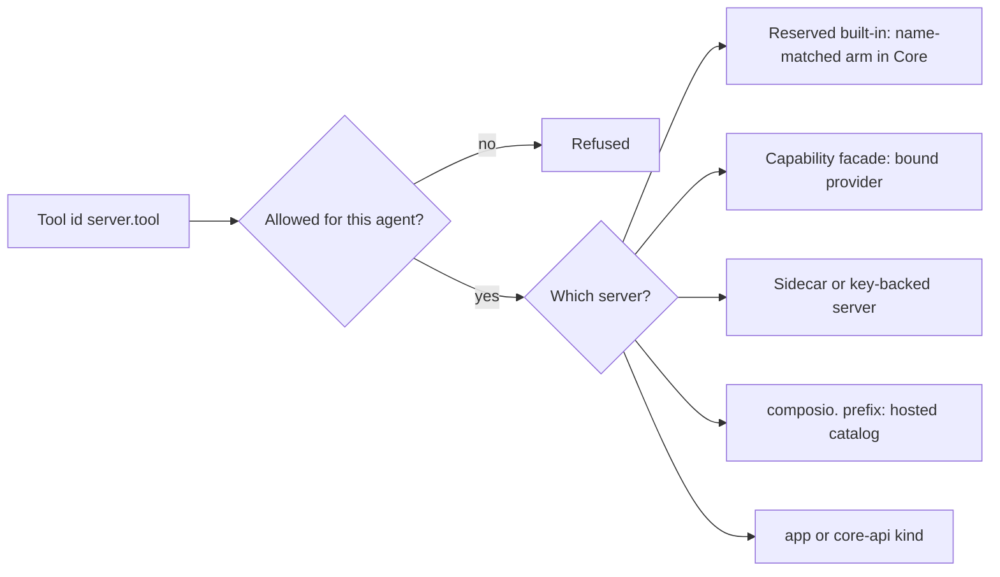

Core ships **built-in tool servers** that need no registration. Each tool has a fully-qualified id
such as `<server>.<tool>` or `spider.crawl`. The id is also the allowlist key: you grant it, test
it, and call it with that id.

<Figure name="tools" />

See [MCP registry](/docs/core/mcp-registry) for server registration and the per-agent allowlist,
and [Unified tool catalog](/docs/core/unified-tool-catalog) for search and execution governance.



## Reserved built-in servers

These are Core-tier reserved providers. They are compiled in, their names are reserved, and Core
dispatches them by a name-matched arm. Most are always listed; a few are listed only when their
gate passes (noted in the row).

| Server | Tools | What it does |
|---|---|---|
| `web_fetch` | `web_fetch.get` | Authenticated web fetch over HTTPS. Uses the user's [Passport](/docs/standalone/passport) connection for the URL's host server-side (acts as the user; the credential never reaches the model) |
| `usage` | `usage.current`, `usage.query`, `usage.providers` | Read normalized subscription windows and prepaid API balances for the active or a specific saved account, list supported usage readers and their saved accounts, and inspect reset timestamps. Credentials and account names remain inside Core |
| `search_conversations` | `search_conversations.search` | Semantic search over the user's past chat messages. Backed by the message index; see [Search and recall](/docs/surfaces/desktop/user-guide/search-and-recall) |
| `threads` | `create_thread`, `list_threads`, `read_thread`, `send_message_to_thread`, `wait_for_thread`, `set_thread_title`, `set_thread_pinned`, `set_thread_archived`, `fork_thread` | Inspect active Runnable sessions and shared workspaces, message worker threads, and wait for a thread or session run. Worktree isolation defaults off and is configurable in Settings. See [Coordinator threads](/docs/core/coordinator-threads) |
| `delegate` | `delegate.fanout` | Fan out independent subtasks to sub-agents that run in parallel in a clean context, returning all results in one call. Ephemeral; for durable workers use `threads`. See [Delegation](/docs/core/delegation) |
| `agent_control` | `agent_control.set_active_target` | Select the active agent target for a governed operation; the host still applies identity and approval checks |
| `orchestrator` | `orchestrator.discover_agents` | List the agents available to delegate to (id, name, description) so an orchestrator can find the right specialist before handing it a subtask via `delegate.fanout` |
| `skills` | `skills.search`, `skills.load`, `skills.author` | Discover, load, and (opt-in) author Agent Skills on demand. Progressive disclosure: search is always on, author is gated. See [Skills catalog](/docs/core/skills-catalog) |
| `sandbox` | `sandbox_create`, `sandbox_destroy`, `sandbox_exec`, `sandbox_run` | Run a selected execution backend with default-deny capabilities. The server name is retained for compatibility; see [Execution backends](/docs/core/sandbox) |
| `notify` | `notify.desktop` | Show a native desktop notification |
| `channel` | `channel.send` | Post a message to a Slack/Discord incoming-webhook URL |
| `agent_inbox` | `agent_inbox.get`, `agent_inbox.check_email_alias`, `agent_inbox.claim_email_alias`, `agent_inbox.list_messages`, `agent_inbox.read_message`, `agent_inbox.send`, `agent_inbox.reply`, `agent_inbox.get_verification_code` (plus deprecated `check_address`, `create`, `set_address`) | Claim the calling agent's permanent email address on its organization's [Agent Inboxes](/docs/extend/develop/agent-inboxes) mailbox, then read and send its own mail. Claiming, sending, and replying are human-approved when approval mode is `smart` or `manual`. Needs an organization-scoped node connected to Ryu Cloud |
| `ui` | `ui.render`, `ui.get_state` | `render` draws a rich interactive UI inline in the chat from a JSON render spec, using the app's own components, including charts, KPI tiles, and live calculators. `get_state` reads what the user has done with those widgets in the current conversation |
| `workspace` | `workspace.open_tab`, `workspace.open_panel`, `workspace.open_browser`, `workspace.switch_interface` | Ask the connected Desktop shell to open a safe first-party page in a normal tab or the current chat's workspace panel, load an HTTP(S) URL in the embedded Browser panel, or switch the [interface](/docs/surfaces/desktop/interfaces) after you confirm it |
| `routines` | `routines.list`, `routines.create`, `routines.update`, `routines.delete`, `routines.run_now` | Inspect and manage durable agent schedules, choose a persistent existing chat or a new chat per firing, and run a saved routine now |
| `consent` | `consent.connect_app`, `consent.install_plugin` | Ask the user, with a card in the chat, to connect an app account or install a plugin. Client-rendered: Core validates the request and tells the agent to wait. The user's choice arrives as their next message. See [Consent requests](/docs/core/generative-ui-tools#consent-requests) |
| `tasks` | `tasks.suggest` | Offer the user one separate follow-up task as a **Suggested task** card above the composer. Optional and rarely used. Nothing starts until the user clicks **Start**. See [Suggested next task](/docs/core/generative-ui-tools#suggested-next-task) |
| `artifact` | `artifact.create`, `artifact.render` | `create` saves a generated file into a Space (default the Artifacts space); `render` draws an artifact card (code file, page, diagram, Space doc, database) inline in the chat with Open / Open-in-tab affordances. Pages, SVGs, and diagrams render at their natural height |
| `marketplace` | `marketplace.search`, `marketplace.describe` | Read-only search of the public Marketplace catalog across listing kinds. Installs nothing; listing text is publisher-authored and marked `untrusted_content: true`. To install a plugin, the agent offers it with `consent.install_plugin` |
| `challenges` | `challenges.list`, `challenges.get`, `challenges.submit` | List, read, and submit to [Ryu Challenges](/docs/programs/challenges) with the signed-in account. Every `submit` call waits for the user's approval |
| `spaces` | `list_spaces`, `list_documents`, `search`, `create_space`, `rename_space`, `create_page`, `create_file`, `attach_space`, `detach_space` | Read and manage the Spaces available to the calling agent. Reads are owner/visibility scoped; creating, uploading, renaming, attaching, and detaching are human-approved mutations when approval mode is `smart` or `manual` |
| `working_memory` | `working_memory.update_working_memory` | Update the calling agent's working-memory scratchpad. The owner and document come from the host conversation; the model supplies only the new content or merge patch |
| `device` | `device.<device_key>__<capability>` | One tool per capability a paired Ryu hardware device registers. Listed only on a personal node with the Hardware app (`@ryu/hardware`) enabled and the device connected over a secure session |
| `cloud` | `cloud.exec`, `cloud.read_file`, `cloud.write_file`, `cloud.list_files` | Closed coding tools for a server-bound cloud conversation, scoped to that conversation's isolated cloud workspace |
| `treg` | `treg.describe`, `treg.call` | Read a Treg endpoint from its public catalog and call it through the Gateway's managed connection layer. Off by default; set `features.tregAgentTools` to `true` in the node's `node-config.json` to list and dispatch them |

`web_fetch.get` accepts an HTTPS URL. An authenticated request uses a connection only when its
canonical URL host exactly matches that connection; malformed URLs cannot select a connection.

### Provider usage results

| Tool | Arguments | Returns |
|---|---|---|
| `usage.current` | None | Usage for the provider and model currently selected in Ryu |
| `usage.query` | `{ "provider": "...", "model": "...", "account_id": "..." }`; `model` and `account_id` are optional | Usage for that provider, model, and account |
| `usage.providers` | None | Provider IDs with a current Core usage adapter, each with its saved accounts |

For `usage.query`, use the provider id from Ryu's provider catalog, or an ACP id such as
`acp:claude` to inspect the agent's own CLI subscription.

`usage.providers` lists each provider's saved accounts by opaque `accountId`, with `active`, `kind`,
and `needsReauth`. It reports `capabilities.accountUsage` when each saved account can report its
own usage.

#### Reading one saved account

When you sign in to the same provider with several accounts, pass an `accountId` from
`usage.providers` as `account_id` to read exactly that account. Without `account_id`, the
provider's active account is read. The result's `usage.accountId` always names the account that
was actually read, and `requested.account_id` echoes what you asked for.

- An `account_id` that is not a saved account of that provider returns `available: false` with
  `reason: "account_not_found"`. Ryu never falls back to a different account.
- An `account_id` on an ACP CLI login such as `acp:claude` returns `reason: "unsupported"`,
  because those logins are not saved accounts.
- Accounts that need you to sign in again return `reason: "token_expired"` without contacting the
  provider.

Per-account usage covers Claude Pro/Max, ChatGPT, OpenAI Codex, and GitHub Copilot, plus saved
API keys for providers with a readable prepaid balance. ChatGPT plan, Kiro, Kimi, Radius, Ant
Ling, and CLI logins report no per-account usage.

Account names, which are often email addresses, are never returned to the agent. Readings are
cached briefly, so repeated calls within a few minutes return the same reading with
`cached: true` and its `observedAt` time.

#### Result shape

The result keeps account-wide windows and matching model-scoped windows separate.

- Each window contains `usedPercent`, `remainingPercent`, `window` (for example `5h` or `7d`),
  `windowSeconds`, and `resetsAt` as an RFC 3339 UTC timestamp.
- Providers that expose prepaid API balances return those in `meters.values`.
- Every selectable window and meter value has a stable `targetId` for reset monitors and other
  cross-check consumers.
- A missing or unsupported provider returns `available: false` with a `reason`, not a guessed zero.

```json
{
  "requested": {
    "provider": "claude-pro-max",
    "model": "claude-sonnet-4",
    "account_id": null
  },
  "usage": {
    "providerId": "claude-pro-max",
    "accountId": "acct_…",
    "accountLabel": null,
    "available": true,
    "cached": false,
    "windows": [
      {
        "label": "Session",
        "window": "5h",
        "usedPercent": 42.5,
        "remainingPercent": 57.5,
        "resetsAt": "2026-09-17T05:00:00Z"
      }
    ]
  }
}
```

The tool call remains subject to the agent's normal fully-qualified allowlist and Gateway
governance. Core resolves credentials server-side and never returns them to the agent.

## Generative UI and chat cards

The behaviour of `ui.render`, `consent`, `tasks`, and the other tools that render cards in the chat is on
[Generative UI Tools](/docs/core/generative-ui-tools).

## Swappable capability facades

Each [swappable layer](/docs/core/swappable-layers) reserves a server name. The tool **names stay
the same**, and the layer picker selects which provider serves them. A verb is listed only when its
capability resolves over the enabled providers and the bound provider declares that verb.

| Server | Tools | What the verbs do |
|---|---|---|
| `web` | `web.search`, `web.extract`, `web.crawl` | Search, extract, and crawl |
| `browser` | `browser.navigate`, `browser.snapshot`, `browser.tabs`, `browser.context`, `browser.click`, `browser.click_at`, `browser.hover`, `browser.drag`, `browser.type`, `browser.key`, `browser.scroll`, `browser.screenshot`, `browser.annotate`, `browser.clear_annotations` | Drive a real browser (local Chromium or a cloud browser provider) |
| `computer` | `computer.capture`, `computer.click`, `computer.type`, `computer.key`, `computer.scroll`, `computer.focus_app` | Screen perception and input control through the selected desktop-control provider |
| `memory` | `memory.search`, `memory.store`, `memory.context`, `memory.sync`, `memory.forget` | Durable fact memory. The built-in store is always available; `context` and `sync` are opt-in bridges |
| `decision` | `decision.predict`, `decision.predict_multimodal` | Ask a typed decision model a choice, score, or boolean question. See [Decision Models](/docs/core/decision-models) |
| `verify` | `verify.claim`, `verify.scopes` | Check a claim against a source of truth and return a verdict, and list the sources it can check |

<Callout type="info">
  The facade verbs are provider-neutral because a declarative provider tool cannot branch between
  routes, so the contract keeps one stable verb per capability. `browser.tabs` and
  `browser.navigate` are how you learn a `tab_id` to re-point. Other browser verbs accept an
  optional `tab_id` (omit it for the active tab) but never invent one.
</Callout>

### Provider slots and availability

Each facade is a provider slot: the agent sees stable capability verbs, and a provider supplies the
implementation. The host-owned slots are `web.search`, `web.extract`, `web.crawl`,
`browser.control`, `computer.control`, `memory`, `decision.typed`, and `verify.claim`. Other
provider types remain ordinary plugin or app contributions.

Ryu keeps three states separate:

| State | Meaning |
|---|---|
| Implemented | Core owns the stable facade contract and can dispatch a verb when a provider is bound. |
| Discoverable | A manifest or catalog entry advertises a provider or backend family, but it is not necessarily enabled or runnable on this node. |
| Provider slot | A generic capability seam that a plugin may implement; it is not a promise that a remote service, sidecar, credential, or device is present. |

The capability catalog reports enabled providers, installable-but-disabled providers, the current
bound provider, and whether a provider serves verbs or a brokered route.

A discoverable row does not grant access. An available provider does not bypass its manifest
permissions, the agent allowlist, the approval mode, or external service requirements.

## Sidecar- and key-backed built-ins

These are real config-file servers (or plugin-declared servers) that degrade gracefully when their
backend is absent:

| Server | Tools | Backend / availability |
|---|---|---|
| `ghost` | 29 `ghost.*` tools (`ghost.ghost_click`, `ghost.ghost_type`, `ghost.ghost_hotkey`, `ghost.ghost_scroll`, `ghost.ghost_focus`, `ghost.ghost_annotate`, `ghost.ghost_run`, `ghost.ghost_read`, `ghost.ghost_screenshot`, …) | Desktop automation: screen perception and input control. Managed by the installed `ghost` sidecar and backed by the [`@ryu/ghost`](/docs/plugins/ghost) plugin |
| `shadow` | `shadow.search`, `shadow.semantic_search`, `shadow.timeline`, `shadow.recent_context`, `shadow.computer_use` | Search captured context and run a bounded task through Shadow's selected computer-use planner after a user request. Routed through the authenticated Shadow sidecar bridge and declared by the [`shadow`](/docs/plugins/shadow) plugin |
| `spider` | `spider.crawl` | Web crawling / scraping. Shells out to the `spider` binary; degrades gracefully when not installed |
| `exa` | `exa.search`, `exa.free_search`, `exa.find_similar` | Neural web search. Requires the provider's configured credentials; degrades gracefully when unavailable |
| `composio` | `composio.<slug>` | Hosted catalog of third-party actions. Searchable, never listed; dispatched by the `composio.` id prefix. See [Unified tool catalog](/docs/core/unified-tool-catalog) |

<Callout type="warn">
  Ghost and Shadow are cross-platform and many built-ins are opt-in or require a sidecar/key. A
  server that fails to start is logged and skipped, so one unavailable built-in never hides the rest.
</Callout>

### Agent inbox access

The `agent_inbox` tools act only on the calling agent's own address. Their behaviour and error codes are on
[Agent Inbox Tools](/docs/core/agent-inbox-tools).

### Spaces access

The Spaces provider derives the target agent and user from the host conversation, so an agent cannot
choose another agent id to mutate.

- It can list and search only Spaces it can read.
- It can create pages or files only in a Space it owns.
- A shared or system Space can be an artifact destination when the operation explicitly allows it,
  but an agent cannot rename it.

`search` and `list_documents` take an optional `space_id`. Without one, they read the Spaces
attached to the calling agent (set in the agent's access settings), skipping any the caller can no
longer read:

| Attached Spaces | Result |
|---|---|
| None | The agent must pass `space_id` |
| One | The same shape as an explicit call |
| Several | `list_documents` returns one listing per Space; `search` returns the closest matches across them, each tagged with its `space_id` |

This lets an agent search the knowledge it was given without `list_spaces`, which lists every Space
the caller can read.

## App and core-api tools

Two further `kind`s join the built-ins in the catalog without being reserved servers:

| Server segment | Source | Notes |
|---|---|---|
| `app` | A plugin tool exposed as a Runnable | The synthetic `app` server segment; declarative app tools (http, inline JS, alias) land here, while `command` tools get their own kind |
| `core-api` | A Core HTTP endpoint exposed as an agent-drivable tool | Derived from Core's own OpenAPI document, so an agent can drive Ryu itself |

## Allowlisting by id

Because the id is `<server>.<tool>`, an allowlist entry of `exa` grants every Exa tool, while
`exa.search` grants just one.

Two paths match the fully-qualified id only, with no bare-name or server fallback: Composio
(`composio.<slug>`) and `app.`-namespaced app tools. This stops a broad server-name entry from
reaching a tool the author did not intend. See
[MCP registry](/docs/core/mcp-registry#the-per-agent-allowlist).

## Related

<Cards>
  <DocCard href="/docs/core/mcp-registry" />
  <DocCard href="/docs/core/unified-tool-catalog" />
  <DocCard href="/docs/surfaces/desktop/user-guide/tools-and-connections" />
  <DocCard href="/docs/gateway/tools" />
  <DocCard href="/docs/core/programmatic-tool-calling" />
</Cards>
