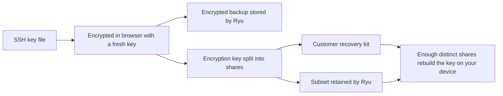
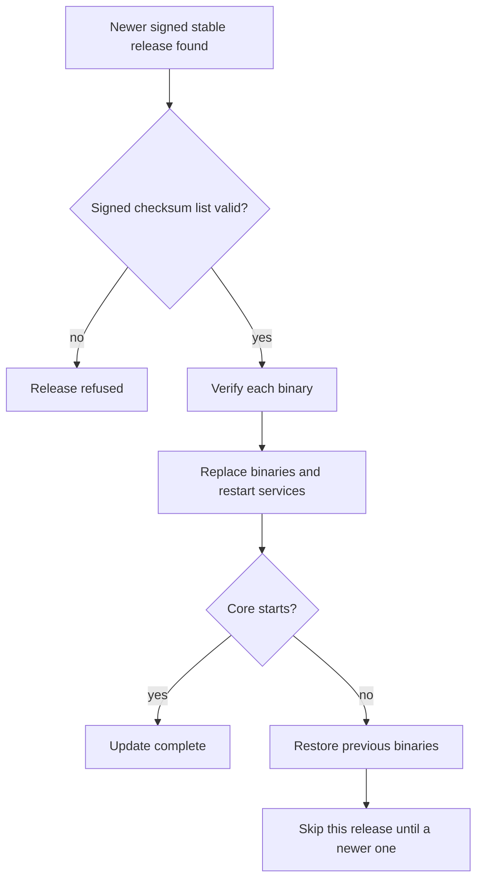

This page covers access to managed cloud computers in a [Fleet](/docs/core/managed-fleet) organization.

## SSH keys

New managed cloud computers wait for SSH setup before provisioning. Every setup creates a fresh
random key for that cloud computer. SSH keys are never derived from Ryu's master encryption key.

1. Open the cloud computer details in your organization.
2. Optionally set a passphrase to protect the key file. Your SSH client may ask for it when
   connecting. Ryu never receives or resets it.
3. Choose **Generate SSH key**. The key is generated in your browser.
4. Download the private key and confirm that you saved it.

Ryu receives only the public key and installs it for the cloud computer's root account.

To connect, use your downloaded file and the cloud computer's public IP address. On macOS or Linux,
restrict the file permissions with `chmod 600` before using it with `ssh -i`.

<Callout type="warn">
When handing a cloud computer to another owner, rotate SSH keys on it. Transferring an organization
binding does not revoke downloaded keys.
</Callout>

### Encrypted backup

Private-key backup is off by default. You can choose **Keep an encrypted backup with Ryu** and
supply a separate passphrase of at least 16 characters.

- Your browser encrypts the key before uploading it. The passphrase is never sent to Ryu.
- To download the key again, select **Unlock recovery backup**, re-verify your account, and enter
  that passphrase in the cloud computer's SSH access card. Decryption happens in your browser.
- Each release of the encrypted copy is recorded in the organization audit log.
- Ryu cannot reset a forgotten backup passphrase.

**Delete encrypted backup** removes the saved encrypted copy. Your downloaded key continues to work,
and the cloud computer's authorized public key stays installed. Normal infrastructure backup
retention may keep older encrypted copies. Without your downloaded key or a usable encrypted backup,
Ryu cannot recover that private key.

### Existing cloud computers

Existing cloud computers are labelled **Existing cloud computer**. To set one up:

1. Generate and save an owner key there.
2. Choose **Download owner setup script**.
3. Run the script on the cloud computer from your own existing root session. It adds the public key
   and installs the same local update service that new cloud computers use.

Ryu does not log in or run this migration. The page keeps showing **Owner setup required**, because
it cannot verify your manual installation. The script preserves existing authorized keys, so review
them and remove any access you do not own.

### Personal keys for organization members

A cloud computer administrator can turn on **Allow personal SSH keys** in the cloud computer's
organization SSH settings. Each allowed member can then opt in on their device and generate a
separate key for this cloud computer.

- Generation starts a private-key download.
- You can optionally keep a passphrase-protected copy in this browser. Local retention requires a
  passphrase on the key file, and that passphrase is never saved.
- Browser storage is not an operating-system SSH agent or a cross-device backup. Keep the
  downloaded file safe.

Each member receives a separate Linux login without sudo. Access requires current organization
permission to view the cloud computer, and a matching team or personal scope.

- Public-key enrollment stays **Pending** until the cloud computer confirms installation.
- New cloud computers install the local access service during provisioning. Existing cloud
  computers need an owner to install it through their existing root session.

To open a shell, use your personal Linux username and downloaded key in an SSH client. Downloading
a key does not install it into your computer's SSH agent. Opening a cloud computer in the Ryu app
still authenticates with your signed-in account and your organization, team, or personal
permissions.

#### Revoking access

The cloud computer checks current authorization before it accepts a new personal SSH login.
Revoking a personal key, disabling personal SSH access, or losing organization access blocks new
logins. Revocation does not terminate an already-open shell.

<Callout type="warn">
Enabling personal keys delegates authorization to Ryu's organization identity and permission
service. It does not provide a cryptographic guarantee against a compromised control plane or
trusted software update.
</Callout>

### Recovery with Shamir shares

You can choose **Shamir recovery** instead of a passphrase-encrypted backup. Set the total number
of shares, the minimum needed for recovery, and how many Ryu retains.

For example, with 10 total shares and a minimum of 5, any 5 distinct shares recover the key. Ryu
may retain 0 to 4 shares in that example, so its shares alone cannot recover the key. Shares held
by different Ryu servers still count together.

The browser encrypts the key file with a fresh random encryption key and splits that encryption
key. Ryu stores the encrypted backup and only its chosen subset of shares. Accessing stored
recovery material requires credential re-verification.

Download the customer recovery kit and distribute its individual shares to separate trusted people
or locations. If you keep the whole kit together, one holder may have enough shares to recover the
key.

Recovery combines enough distinct shares on your device and reconstructs the key file locally. It
is not joint approval or threshold signing for every login.

- If the file also has an SSH passphrase, that passphrase is still required to use it.
- Duplicate, mixed, or damaged shares cannot be used for recovery.
- Deleting a backup does not invalidate previously downloaded copies or shares.

## Updates without operator SSH access

New managed cloud computers start from plain Ubuntu 24.04 and keep themselves patched.
Every step runs on the cloud computer itself, so routine updates do not require Ryu to
hold your SSH key. Cloud computers run on UTC, and the nightly sequence is:

| Time (UTC) | What happens |
| --- | --- |
| About 01:30 | The package lists refresh. |
| About 02:00 | Unattended upgrades install Ubuntu security updates, including kernel updates. Services that still use a replaced library are restarted automatically. |
| About 03:00 | The cloud computer checks for a new stable Ryu release. |
| 04:30 | The cloud computer reboots, but only if an installed patch requires a reboot. |

Each step can start up to 30 minutes after its listed time. Ryu also checks for releases
at 09:00, 15:00, and 21:00 UTC, but these extra checks install only security releases.
The schedule survives reboots, and checks missed while the cloud computer was off run
after it starts.

### How a Ryu release installs

The local update service installs only signed stable releases and never moves to an older version.

A release that failed the start check is remembered and skipped, so it does not restart services
again, until a newer release is published.

A signed release can also update the Bun runtime that Ryu's sidecars use, and only moves it to a
newer version.

<Callout type="warn">
Release signing is not enabled yet. Until it is, cloud computers check for new Ryu releases and
report them, but do not install them automatically. Ubuntu security updates are not affected and
still install nightly.
</Callout>

### Staged rollout

Ryu rolls out routine releases in stages. Each cloud computer belongs to a fixed group that
installs a release 0, 1, or 2 days after it is published, and only during the 03:00 UTC check. A
release can therefore take up to three days to reach every cloud computer.

Security releases skip the stages and install at the next check, usually within about six hours of
publication.

### The Security updates row

The **Security updates** row on the cloud computer's server page is read-only. It shows the latest
patch report:

- **Up to date**, **Reboot pending**, the number of security updates still pending, or
  **Security status unavailable**;
- an extra **Ryu auto-updates disabled** badge when Ryu's own automatic updates are off, so a
  pending reboot or pending security updates are never hidden;
- when the cloud computer last checked in, and when its automatic OS update job last ran.

That job runs daily even when there is nothing to install, so use the pending count to see whether
updates are still waiting. Cloud computers report about every six hours, and a report more than a
day old is marked **No recent report**.

### Turning off automatic updates

The cloud computer owner can turn off Ryu's local automatic updates over SSH by creating the file
`/etc/ryu/disable-auto-updates`. The cloud computer then keeps reporting that updates are disabled,
and from then on the owner is responsible for keeping it patched.

Other ways of stopping updates, such as disabling the update timer, are not reported. The row then
keeps showing the last update result.

<Callout type="warn">
Owner-held SSH keys remove Ryu's custody of your plaintext SSH key. They do not make a managed VM
inaccessible to its infrastructure operator. Ryu still manages the Hetzner project, whose recovery
and disk controls can provide access to server data.

Ryu's application identity services and published updates remain trusted parts of the system. This
feature is not a promise of provider-independent data encryption.
</Callout>

## Related

<Cards>
  <DocCard href="/docs/core/managed-fleet" />
  <DocCard href="/docs/core/updates" />
</Cards>
