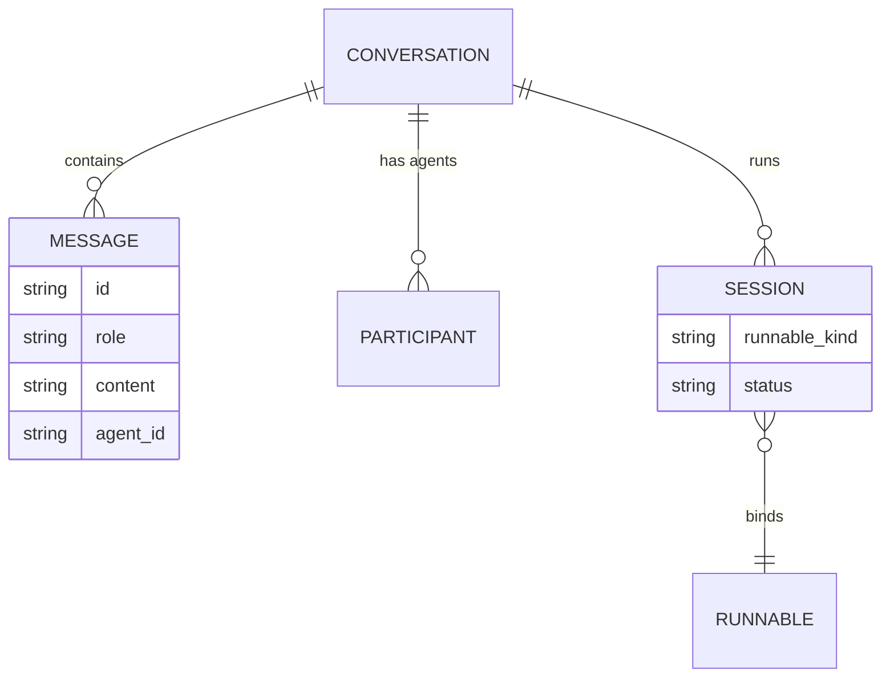

A conversation is Core's unit of chat history: an ordered list of messages plus the metadata that
drives the desktop sidebar, the runs list, and multi-agent attribution. Everything here is owned by
`ConversationStore` (`apps/core/src/server/conversations.rs`), backed by SQLite at
`db/conversations.db` in the Ryu data directory. Message bodies and titles are sealed at rest; the search index is a
separate database that never stores message text. Submitted user messages also preserve their
structured text/file parts and client display metadata, encrypted with the message body. Full and
paged history reads return those fields so attachments and the original displayed request survive
reload. Client metadata is presentation data; verified authorship and conversation access remain
server-owned. Older rows without these fields keep their saved text.

<Callout type="info">
A conversation is the same primitive a coordinator calls a "thread". The
[coordinator threads](/docs/core/coordinator-threads) page documents the agent-facing tool surface
(`create_thread`, `fork_thread`, `set_thread_pinned`, `set_thread_archived`) that wraps the store
methods described below.
</Callout>

## Data model



### ConversationSummary

The list shape returned by `GET /api/conversations` (`ConversationSummary`,
`apps/core/src/server/conversations.rs`).

| Field | Type | Meaning |
|---|---|---|
| `id` | string | Conversation id (UUID) |
| `title` | string? | Display title; sealed at rest, decrypted for the summary |
| `agent_id` | string? | The owning agent |
| `created_at`, `updated_at` | i64 | Unix milliseconds |
| `message_count` | i64 | Number of stored messages |
| `folder_path` | string? | Active working folder for the run (git-native parity) |
| `branch` | string? | Git branch active at run start |
| `worktree_path` | string? | Per-run worktree path, when a dedicated worktree was created |
| `run_status` | string? | `running`, `completed`, `failed`, or absent |
| `participants` | string[] | Every agent id that has taken a turn (multi-agent) |
| `pinned` | bool | Pinned to stay surfaced; defaults `false` |
| `archived` | bool | Hidden as a finished worker; defaults `false` |
| `linked_pull_requests` | string[] | GitHub pull request URLs linked to the chat, in link order; omitted when empty |
| `icon` | object? | Optional glyph shown before the title; omitted when unset |
| `visibility` | string | `private` (owner-only, the default), `team`, or `org` |

`participants`, `pinned`, `archived`, and `linked_pull_requests` are `#[serde(default)]`, so older
clients and older stored rows deserialize unchanged. The git fields (`folder_path`, `branch`,
`worktree_path`) are documented on [Git workspace](/docs/surfaces/desktop/user-guide/git-workspace).

### StoredMessage

Each message has an `id`, a `role` (`user` / `assistant`), the `content`, an optional `agent_id`
(absent for user messages, set to the responding agent otherwise), and a `created_at` in Unix
milliseconds. `ConversationStore::append_message` writes one message and, when the
`llamacpp-embed` sidecar is reachable, indexes its plaintext for semantic search on a spawned task
before the body is sealed. The index write is best-effort and fail-open: a down embedder never
blocks or slows the chat write. See [Search and recall](/docs/surfaces/desktop/user-guide/search-and-recall)
for the index itself.

## Conversations

| Route | Purpose |
|---|---|
| `GET /api/conversations` | List `ConversationSummary` rows |
| `GET /api/conversations/:id` | Full `ConversationDetail` with all messages and participants |
| `DELETE /api/conversations/:id` | Remove a conversation and its messages |
| `POST /api/conversations/:id/fork` | Branch a conversation (see [Fork](#fork)) |

`GET /api/conversations/:id` returns a `ConversationDetail` (id, title, agent_id, timestamps, the
ordered `messages`, and `participants`).

## Multi-agent participants

A conversation can have more than one agent. Council chat uses this to let several agents share one
thread, so `agent_id` is carried per message rather than per conversation.

| Route | Purpose |
|---|---|
| `GET /api/conversations/:id/participants` | List the agent ids in the thread |
| `POST /api/conversations/:id/participants` | Add an agent |
| `DELETE /api/conversations/:id/participants/:agent_id` | Remove an agent |

On the chat path, routing a turn to a specific agent adds it to the participant set if it is not
already present, so `participants` accumulates every agent that has actually answered.

## Sessions

A session binds a conversation to a Runnable and tracks the status of a single run. Sessions are how
Core models background and parallel work without forking history: message CRUD stays on the
conversation, and the session adds run-ownership on top.

A `Session` has an `id`, a `conversation_id`, a `runnable_id`, a `runnable_kind`, and a `status`.
`SessionStatus` is one of:

| Value | Meaning |
|---|---|
| `idle` | Created, no run started yet (the default) |
| `running` | A run is in progress |
| `completed` | The most recent run finished successfully |
| `failed` | The most recent run ended with an error |

| Route | Purpose |
|---|---|
| `POST /api/sessions` | Create a session bound to a runnable |
| `GET /api/sessions/:id` | Fetch one session |
| `POST /api/sessions/:id/status` | Update the run status |
| `GET /api/conversations/:id/sessions` | List every session (run) for a conversation |

## Runs

A run is a conversation with `run_status` set. The runs surfaces give a cross-conversation view of
background work that the per-conversation session list does not.

| Route | Purpose |
|---|---|
| `GET /api/runs` | List conversations that have a `run_status`, newest first |
| `GET /api/runs/:id/trace` | Ordered span list for a run |

The trace is documented on [Observability](/docs/core/observability).

## Parallel ACP agents

Each chat that runs on an ACP agent (Claude Code, Codex, the managed `ryu` agent on Pi, and the
rest) keeps one agent process alive between turns. Two settings in the Gateway ACP runtime section bound them: **Stop idle ACP
sessions after** (minutes, default 5) and **Maximum parallel ACP agents** (1 to 32; left unset, Core
picks a limit from the node's CPU cores and RAM).

- When the limit is reached, Core stops the agent of the chat that has been idle longest to make
  room. An agent that finished a turn moments ago is spared for a short grace (one second per
  agent slot, at most 15 seconds), because its chat usually sends the next message soon; a new
  chat that has waited twice the grace may stop any idle agent. Core does the same while the
  computer, or the container Core runs in, is low on free memory (below a tenth of its memory or
  2 GB, whichever is larger, with the 2 GB lowered to a quarter of memory on small machines),
  stopping one idle agent every 30 seconds.
- A stopped chat keeps its transcript. On its next message, a Claude Code chat or a Pi chat
  (including the `ryu` agent) reopens its own agent session in the same folder, with the full
  conversation. Other agents, or a session that can no longer be opened (for example after a node
  reset, which deletes stored agent sessions along with the rest of the data folder), start a fresh
  session seeded with the chat's recent messages.
- When every slot is busy with a turn in progress, the new turn waits until one finishes. Waiting
  turns are admitted in arrival order; a chat restarting its own agent reuses that agent's slot.
- Claude Code chats use only the MCP servers Ryu provides. Claude Code's own servers (from
  `~/.claude.json` or a project `.mcp.json`) are not started inside Ryu chats, because each chat
  would start its own copy of every one of them. To use them in Ryu, add them once with
  [Import agent setup](/docs/surfaces/desktop/user-guide/import-agent#import-agent-setup); Ryu runs
  each server once and shares it with every chat.
- Stopping a chat's agent stops its whole process tree, including the CLI and any helper processes
  the agent started. If Core itself exits unexpectedly, the next Core start cleans up any agent
  processes the previous run left behind.

## Fork

Forking copies history up to a chosen message into a new, independent conversation. Conversations
stay linear: there is no message tree, and the fork carries over the source's metadata (title, agent,
folder, branch, worktree, participants), titling the copy with a `(branch)` suffix.

```http
POST /api/conversations/:id/fork
```

The body's optional `message_id` is the cut point. With it, the fork includes messages through
that id; without it, the whole conversation is copied. A cut-point id that is not in the source
returns no fork. On the desktop, each message's hover toolbar has a branch button that forks at that
message. A saved chat's sidebar menu can fork the whole conversation into the current workspace or
a new worktree.

## Pinned and archived

`pinned` keeps a conversation surfaced; `archived` moves a finished chat into the desktop's archived
group. The desktop writes the same store fields as the coordinator's `set_thread_pinned` and
`set_thread_archived` tools through `POST /api/conversations/:id/pinned` and
`POST /api/conversations/:id/archived`. Both flags ride `ConversationSummary` as additive,
serde-default JSON.

## Linked pull requests

`linked_pull_requests` lists GitHub pull requests a chat follows in addition to the one its branch
owns (the branch's pull request is found by clients and is not stored here). Link or unlink one URL
at a time:

```http
POST /api/conversations/:id/pull-requests
{ "url": "https://github.com/owner/repo/pull/123", "linked": true }
```

`linked` defaults to `true`; pass `false` to unlink. Core stores the canonical
`https://github.com/<owner>/<repo>/pull/<number>` form, so links such as `.../pulls/123` or
`.../pull/123/files?w=1` collapse to the same entry, and linking an existing URL only moves it to
the end. A chat can link at most 20 pull requests. The response is
`{ "ok": true, "linked_pull_requests": [...] }` with the full list. A URL that is not a GitHub pull
request link, or a link over the limit, returns `400`; an unknown conversation returns `404`. The
route applies the conversation's resource-write permission before changing the list.

## Workspace project

`folder_path` groups a saved chat under a desktop project. A client can assign or clear it with:

```http
POST /api/conversations/:id/folder
{ "folder_path": "/workspace/project" }
```

Pass `null` to detach the chat from its project. Clearing the field does not delete the conversation
or touch the folder on disk. The route applies the conversation's resource-write permission before
changing the field.

## Portable Git history

In a chat attached to a committed Git project, open **Share → Portable history** to review a
redacted text copy and select **Save in Git**. Ryu stores the copy in a dedicated
`refs/ryu/checkpoints/<id>` Git ref and links the code commit through `refs/notes/ryu`. The normal
code branch and working files do not change. Saving the same preview twice is idempotent.

The preview includes the active conversation's text messages, agent attribution, timestamps, and
the code commit. Structured tool and file parts are omitted and counted in the preview. A checkpoint
has at most 5,000 messages and 8 MiB of JSON. The format is versioned as
`ryu-portable-conversation` v1. Git checkpoints are separate from the
[agent setup and transcript interchange bundle](/docs/gateway/agent-sync).

Ryu automatically replaces detected email addresses, US phone numbers, Social Security numbers,
valid payment card numbers, public IP addresses, common credentials, database URLs, and private key
blocks in the title and message text. The preview shows counts and the resulting copy. Pattern
detection can miss names, unfamiliar credentials, or confidential prose, so review the full copy
before saving or sharing. Enter additional literal terms, one per line, and select **Apply to
preview** to hide project names or unfamiliar sensitive text. Those terms are sent only to Core
for the preview and save check; the resulting checkpoint contains the replacement markers. Local
SQLite encryption does not encrypt Git objects.

**Push history to origin** transfers the checkpoint and note refs only when selected. Anyone with
access to that Git repository and its history refs may then read the redacted checkpoint. In a
project's menu, **Conversation history** can fetch those refs from origin, show a checkpoint's text,
and restore it to Core. Restoring the same source again merges stable message IDs rather than
duplicating messages. When the restored chat has edited or regenerated versions, a later
checkpoint's new messages continue the selected version. If that version already has newer local
messages after the point the checkpoint continues from, the restored messages become another
version there, and your selection does not change. Fetch and push do not transfer a code branch.

**Anyone with the link** in the Share dialog is a separate frozen public copy. The desktop uses the
reviewed redacted text and excludes tool/file parts; the sharing service redacts again on write and
on read, including for older copies. Anyone holding the link can view that copy without signing in.
Live conversation access and a public copy have separate controls.

| Route | Purpose |
|---|---|
| `GET /api/conversations/:id/history-preview` | Read-only redacted preview, protected by conversation read access |
| `POST /api/conversations/:id/history-preview` | Read-only preview with up to 32 additional literal redaction terms |
| `POST /api/conversations/:id/git-history` | Save the exact previewed checkpoint; owner or organization admin plus `agent.edit` |
| `GET /api/git/history?cwd=…` | List local checkpoint metadata; `agent.view` and the source conversation's read access when present on this node |
| `GET /api/git/history/:checkpoint_id?cwd=…` | Read one checkpoint with the same access checks |
| `POST /api/git/history/import` | Restore a checkpoint into Core; `agent.edit` |
| `POST /api/git/history/sync` | Explicitly push or fetch history refs; `agent.edit`, plus source owner or organization admin for a push when the source exists on this node |

## Related

<Cards>
  <DocCard href="/docs/core/coordinator-threads" />
  <DocCard href="/docs/surfaces/desktop/user-guide/search-and-recall" />
  <DocCard href="/docs/core/observability" />
  <DocCard href="/docs/surfaces/desktop/user-guide/git-workspace" />
</Cards>
