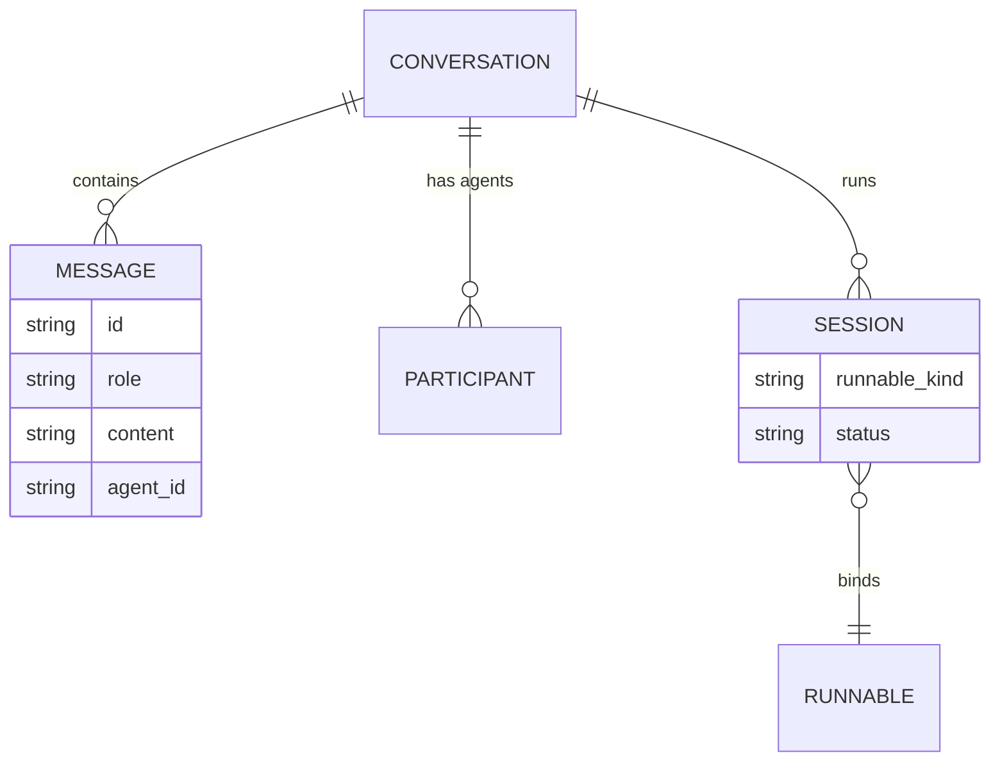
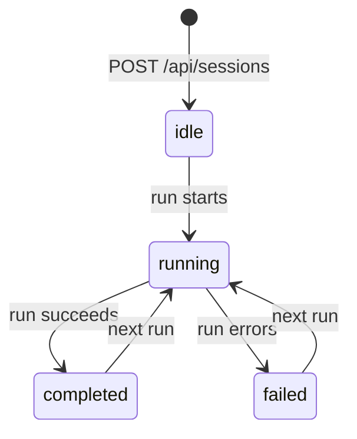
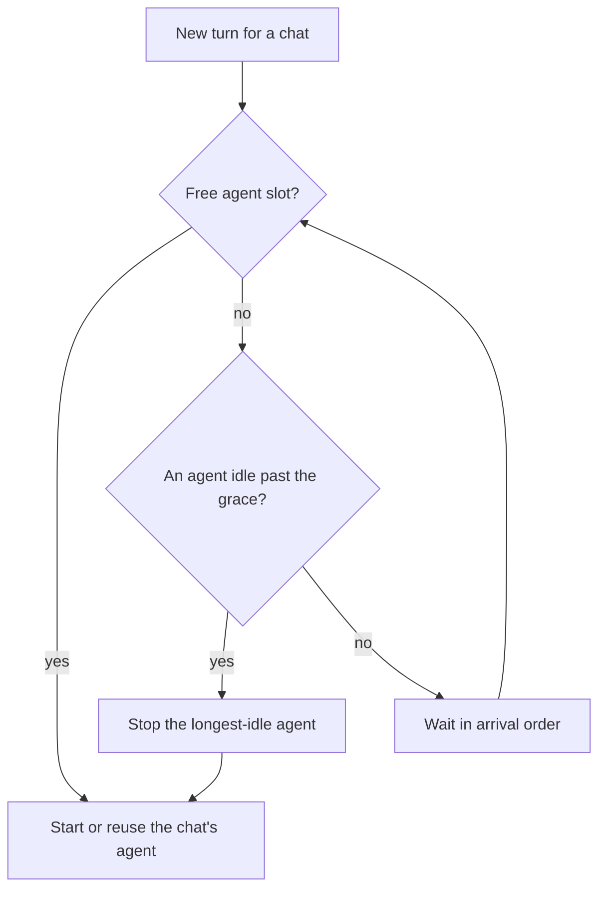
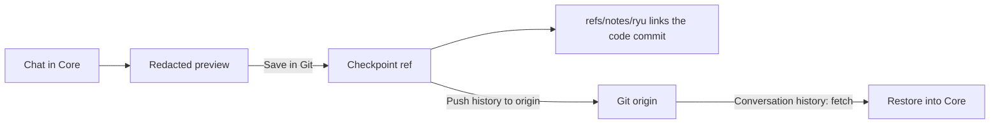

A conversation is Core's unit of chat history: an ordered list of messages plus the metadata that
drives the desktop sidebar, the runs list, and multi-agent attribution.

`ConversationStore` (`apps/core/src/server/conversations.rs`) owns everything on this page. It is
backed by SQLite at `db/conversations.db` in the Ryu data directory.

- Message bodies and titles are sealed at rest (see [Encryption at Rest](/docs/core/encryption-at-rest)).
- The search index is a separate database that never stores message text.
- Submitted user messages keep their structured text and file parts and the client display
  metadata, encrypted with the message body. Full and paged history reads return them, so
  attachments and the original request survive a reload.
- Client metadata is presentation data only. Verified authorship and conversation access stay
  server-owned. Older rows without these fields keep their saved text.

<Callout type="info">
A conversation is the same primitive a coordinator calls a "thread". The
[coordinator threads](/docs/core/coordinator-threads) page documents the agent-facing tool surface
(`create_thread`, `fork_thread`, `set_thread_pinned`, `set_thread_archived`) that wraps the store
methods described below.
</Callout>

## Data model



### ConversationSummary

The list shape returned by `GET /api/conversations` (`ConversationSummary`,
`apps/core/src/server/conversations.rs`).

| Field | Type | Meaning |
|---|---|---|
| `id` | string | Conversation id (UUID) |
| `title` | string? | Display title; sealed at rest, decrypted for the summary |
| `agent_id` | string? | The owning agent |
| `created_at`, `updated_at` | i64 | Unix milliseconds |
| `message_count` | i64 | Number of stored messages |
| `folder_path` | string? | Active working folder for the run (git-native parity) |
| `branch` | string? | Git branch active at run start |
| `worktree_path` | string? | Per-run worktree path, when a dedicated worktree was created |
| `run_status` | string? | `running`, `completed`, `failed`, `interrupted`, or absent. `interrupted` is terminal: Core writes it at boot or on a Kill Switch pause for a turn it could not finish |
| `participants` | string[] | Every agent id that has taken a turn (multi-agent) |
| `pinned` | bool | Pinned to stay surfaced; defaults `false` |
| `archived` | bool | Hidden as a finished worker; defaults `false` |
| `linked_pull_requests` | string[] | GitHub pull request URLs linked to the chat, in link order; omitted when empty |
| `icon` | object? | Optional glyph shown before the title; omitted when unset |
| `visibility` | string | `private` (owner-only, the default), `team`, or `org` |

`participants`, `pinned`, `archived`, and `linked_pull_requests` are `#[serde(default)]`, so older
clients and older stored rows deserialize unchanged. The git fields (`folder_path`, `branch`,
`worktree_path`) are documented on [Git workspace](/docs/surfaces/desktop/user-guide/git-workspace).

### StoredMessage

Each message has an `id`, a `role` (`user` / `assistant`), the `content`, an optional `agent_id`
(absent for user messages, set to the responding agent otherwise), and a `created_at` in Unix
milliseconds.

`ConversationStore::append_message` writes one message. When the `llamacpp-embed` sidecar is
reachable, it also indexes the plaintext for semantic search on a spawned task before the body is
sealed. The index write is best-effort and fail-open: a down embedder never blocks or slows the chat
write. See [Search and recall](/docs/surfaces/desktop/user-guide/search-and-recall) for the index.

## Conversations

| Route | Purpose |
|---|---|
| `GET /api/conversations` | List `ConversationSummary` rows |
| `GET /api/conversations/:id` | Full `ConversationDetail` with all messages and participants |
| `DELETE /api/conversations/:id` | Remove a conversation and its messages |
| `POST /api/conversations/:id/fork` | Branch a conversation (see [Fork](#fork)) |

`GET /api/conversations/:id` returns a `ConversationDetail` (id, title, agent_id, timestamps, the
ordered `messages`, and `participants`).

## Multi-agent participants

A conversation can have more than one agent. Council chat uses this to let several agents share one
thread, so `agent_id` is carried per message rather than per conversation.

| Route | Purpose |
|---|---|
| `GET /api/conversations/:id/participants` | List the agent ids in the thread |
| `POST /api/conversations/:id/participants` | Add an agent |
| `DELETE /api/conversations/:id/participants/:agent_id` | Remove an agent |

On the chat path, routing a turn to a specific agent adds it to the participant set if it is not
already present, so `participants` accumulates every agent that has actually answered.

## Sessions

A session binds a conversation to a Runnable and tracks the status of a single run. Sessions let
Core model background and parallel work without forking history. Message CRUD stays on the
conversation; the session adds run ownership on top.

A `Session` has an `id`, a `conversation_id`, a `runnable_id`, a `runnable_kind`, and a `status`.



`SessionStatus` is one of:

| Value | Meaning |
|---|---|
| `idle` | Created, no run started yet (the default) |
| `running` | A run is in progress |
| `completed` | The most recent run finished successfully |
| `failed` | The most recent run ended with an error |

The diagram shows the usual lifecycle. The store does not enforce transitions:
`POST /api/sessions/:id/status` writes whichever value it receives.

| Route | Purpose |
|---|---|
| `POST /api/sessions` | Create a session bound to a runnable |
| `GET /api/sessions/:id` | Fetch one session |
| `POST /api/sessions/:id/status` | Update the run status |
| `GET /api/conversations/:id/sessions` | List every session (run) for a conversation |

## Runs

A run is a conversation with `run_status` set. The runs surfaces give a cross-conversation view of
background work that the per-conversation session list does not.

| Route | Purpose |
|---|---|
| `GET /api/runs` | List conversations that have a `run_status`, newest first |
| `GET /api/runs/:id/trace` | Ordered span list for a run |

The trace is documented on [Observability](/docs/core/observability).

## Parallel ACP agents

Each chat that runs on an ACP agent (Claude Code, Codex, the managed `ryu` agent on Pi, and the
rest) keeps one agent process alive between turns. Two settings in the Gateway ACP runtime section
bound these processes:

| Setting | Range | Default |
|---|---|---|
| **Stop idle ACP sessions after** | minutes | 5 |
| **Maximum parallel ACP agents** | 1 to 32 | unset: Core picks a limit from the node's CPU cores and RAM |



### Stopping idle agents

- When the limit is reached, Core stops the agent of the chat that has been idle longest.
- An agent that finished a turn moments ago is spared for a short grace: one second per agent
  slot, at most 15 seconds. Its chat usually sends the next message soon.
- A new chat that has waited twice the grace may stop any idle agent.
- Core also stops one idle agent every 30 seconds while the computer, or the container Core runs
  in, is low on free memory. Low means below a tenth of total memory or 2 GB, whichever is larger;
  on small machines the 2 GB floor drops to a quarter of memory.
- Stopping a chat's agent stops its whole process tree, including the CLI and any helper processes
  the agent started. If Core exits unexpectedly, the next Core start cleans up agent processes the
  previous run left behind.

### Resuming and waiting

- A stopped chat keeps its transcript. On its next message, a Claude Code chat or a Pi chat
  (including the `ryu` agent) reopens its own agent session in the same folder, with the full
  conversation.
- Other agents start a fresh session seeded with the chat's recent messages. So does a session that
  can no longer be opened, for example after a node reset deletes stored agent sessions.
- When every slot is busy with a turn in progress, the new turn waits until one finishes. Waiting
  turns are admitted in arrival order. A chat restarting its own agent reuses that agent's slot.

### MCP servers in Claude Code chats

Claude Code chats use only the MCP servers Ryu provides. Claude Code's own servers (from
`~/.claude.json` or a project `.mcp.json`) are not started inside Ryu chats, because each chat would
start its own copy of every one.

To use them in Ryu, add them once with
[Import agent setup](/docs/surfaces/desktop/user-guide/import-agent#import-agent-setup). Ryu runs each
server once and shares it with every chat.

## Fork

Forking copies history up to a chosen message into a new, independent conversation with fresh
conversation and message ids.

```http
POST /api/conversations/:id/fork
```

- The body's optional `message_id` is the cut point. With it, the fork includes messages through
  that id; without it, the whole active thread is copied. A cut-point id that is not in the source
  returns no fork.
- When the source has edited or regenerated versions, the fork copies only the cut point's own
  ancestry. Alternate versions beside it are not copied.
- The fork carries over the title, agent, folder, branch, worktree, participants, and project, and
  titles the copy with a `(branch)` suffix. `run_status` and any goal are not copied.
- The person who forks owns the copy, so forking a shared chat produces a private branch.

On the desktop, each message's hover toolbar has a branch button that forks at that message. A saved
chat's sidebar menu can fork the whole conversation into the current workspace or a new worktree.

## Pinned and archived

`pinned` keeps a conversation surfaced; `archived` moves a finished chat into the desktop's archived
group. The desktop writes the same store fields as the coordinator's `set_thread_pinned` and
`set_thread_archived` tools through `POST /api/conversations/:id/pinned` and
`POST /api/conversations/:id/archived`. Both flags ride `ConversationSummary` as additive,
serde-default JSON.

## Linked pull requests

`linked_pull_requests` lists GitHub pull requests a chat follows in addition to the one its branch
owns (the branch's pull request is found by clients and is not stored here). Link or unlink one URL
at a time:

```http
POST /api/conversations/:id/pull-requests
{ "url": "https://github.com/owner/repo/pull/123", "linked": true }
```

- `linked` defaults to `true`; pass `false` to unlink.
- Core stores the canonical `https://github.com/<owner>/<repo>/pull/<number>` form, so links such as
  `.../pulls/123` or `.../pull/123/files?w=1` collapse to the same entry.
- Linking an existing URL only moves it to the end. A chat can link at most 20 pull requests.
- The response is `{ "ok": true, "linked_pull_requests": [...] }` with the full list.
- A URL that is not a GitHub pull request link, or a link over the limit, returns `400`. An unknown
  conversation returns `404`.
- The route checks the conversation's resource-write permission before changing the list.

## Workspace project

`folder_path` groups a saved chat under a desktop project. A client can assign or clear it with:

```http
POST /api/conversations/:id/folder
{ "folder_path": "/workspace/project" }
```

Pass `null` to detach the chat from its project. Clearing the field does not delete the conversation
or touch the folder on disk. The route applies the conversation's resource-write permission before
changing the field.

## Portable Git history

In a chat attached to a committed Git project, open **Share → Portable history** to review a
redacted text copy, then select **Save in Git**. Ryu stores the copy in a dedicated
`refs/ryu/checkpoints/<id>` Git ref and links the code commit through `refs/notes/ryu`. The normal
code branch and working files do not change. Saving the same preview twice is idempotent.



### What a checkpoint holds

- The active conversation's text messages, agent attribution, timestamps, and the code commit.
- Structured tool and file parts are omitted and counted in the preview.
- At most 5,000 messages and 8 MiB of JSON, in the versioned `ryu-portable-conversation` v1 format.

Git checkpoints are separate from the
[agent setup and transcript interchange bundle](/docs/gateway/agent-sync).

### Redaction

Ryu replaces these in the title and message text, and the preview shows counts and the resulting
copy:

- email addresses, US phone numbers, and Social Security numbers;
- valid payment card numbers and public IP addresses;
- common credentials, database URLs, and private key blocks.

<Callout type="warn">
Pattern detection can miss names, unfamiliar credentials, or confidential prose. Review the full copy
before saving or sharing. Local SQLite encryption does not encrypt Git objects.
</Callout>

To hide project names or other sensitive text, enter literal terms, one per line, and select
**Apply to preview**. Those terms are sent only to Core for the preview and save check. The saved
checkpoint contains the replacement markers.

### Push, fetch, and restore

**Push history to origin** transfers the checkpoint and note refs only when selected. Anyone with
access to that Git repository and its history refs can then read the redacted checkpoint. Fetch and
push never transfer a code branch.

In a project's menu, **Conversation history** fetches those refs from origin, shows a checkpoint's
text, and restores it to Core.

- Restoring the same source again merges stable message ids instead of duplicating messages.
- When the restored chat has edited or regenerated versions, a later checkpoint's new messages
  continue the selected version.
- If that version already has newer local messages after the checkpoint's continuation point, the
  restored messages become another version there. Your selection does not change.

### Public share links

**Anyone with the link** in the Share dialog is a separate, frozen public copy. The desktop uses the
reviewed redacted text and excludes tool and file parts. The sharing service redacts again on write
and on read, including for older copies.

Anyone holding the link can view that copy without signing in. Live conversation access and a public
copy have separate controls.

### Routes

| Route | Purpose |
|---|---|
| `GET /api/conversations/:id/history-preview` | Read-only redacted preview, protected by conversation read access |
| `POST /api/conversations/:id/history-preview` | Read-only preview with up to 32 additional literal redaction terms |
| `POST /api/conversations/:id/git-history` | Save the exact previewed checkpoint; owner or organization admin plus `agent.edit` |
| `GET /api/git/history?cwd=…` | List local checkpoint metadata; `agent.view` and the source conversation's read access when present on this node |
| `GET /api/git/history/:checkpoint_id?cwd=…` | Read one checkpoint with the same access checks |
| `POST /api/git/history/import` | Restore a checkpoint into Core; `agent.edit` |
| `POST /api/git/history/sync` | Explicitly push or fetch history refs; `agent.edit`, plus source owner or organization admin for a push when the source exists on this node |

## Related

<Cards>
  <DocCard href="/docs/core/coordinator-threads" />
  <DocCard href="/docs/surfaces/desktop/user-guide/search-and-recall" />
  <DocCard href="/docs/core/observability" />
  <DocCard href="/docs/surfaces/desktop/user-guide/git-workspace" />
</Cards>
