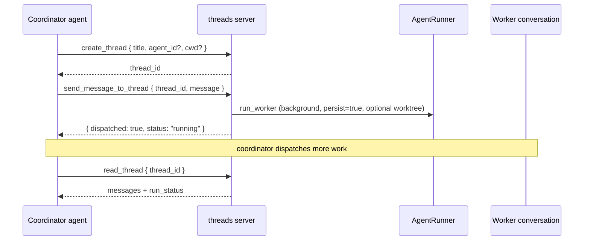

A coordinator agent can inspect active Ryu conversations, spot shared workspaces, create worker
threads, send a message that runs a worker's agent, wait for a run to finish, and pin, archive, or
title threads. Worktree isolation is off by default. Enable it for coordinator workers in
**Settings → Gateway → Worktrees → Coordinator workers**.

A thread is a [conversation](/docs/core/conversations-sessions), so workers are durable,
searchable, and resumable like any chat. The capability ships as the built-in
`threads` registry server (`apps/core/src/sidecar/mcp/threads.rs`), a reserved server like
`search_conversations` and `delegate`, so the `<server>.<tool>` id scheme, per-agent allowlist,
catalog search, and the single `call_tool` entry apply to it. It is allowlist-gated and audited on
both the ACP and OpenAI-compatible planes, so coordination is opt-in. Only an agent whose allowlist
grants `threads.*` can spawn workers.

<Callout type="warn">
This is an agent-facing capability with no desktop coordinator UI. Desktop shows the `pinned`
and `archived` flags in the chat sidebar. Live multi-worker parallel runs need a running Core plus a
git-repo `cwd`; the unit tests cover the tool surface, not a live fan-out.
</Callout>

## The nine tools

Every tool is dispatched through the shared registry, so its id is fully qualified as
`threads.<name>` and it is governed by the same allowlist and audit as any other tool. See
[Unified Tool Catalog](/docs/core/unified-tool-catalog) for how built-in servers register.

| Tool | Job | Required args |
|---|---|---|
| `threads.create_thread` | Create a new worker thread (conversation). Returns its `thread_id`. | none |
| `threads.list_threads` | List visible threads and active Runnable sessions with status, workspace, branch, and pinned/archived flags. | none |
| `threads.read_thread` | Read the most recent messages plus the thread's `run_status`. | `thread_id` |
| `threads.send_message_to_thread` | Send an instruction and run the worker's agent. | `thread_id`, `message`, optional `isolate`, `wait`, `cwd` |
| `threads.wait_for_thread` | Wait for a visible thread or Runnable session to finish, with a bounded timeout. | `thread_id` or `session_id` |
| `threads.set_thread_title` | Set a thread's title. | `thread_id`, `title` |
| `threads.set_thread_pinned` | Pin or unpin a thread to keep it surfaced. | `thread_id` |
| `threads.set_thread_archived` | Archive or unarchive a thread to hide a finished worker. | `thread_id` |
| `threads.fork_thread` | Fork a thread into a new independent thread, copying history. Returns the new `thread_id`. | `thread_id` |

`fork_thread` delegates to `ConversationStore::fork_conversation`; see
[Conversations and Sessions](/docs/core/conversations-sessions) for the fork semantics it inherits.

Pass an installed `agent_id` to `create_thread` to route a worker to that bot. The returned
`thread_id` is the address used by `send_message_to_thread`, `read_thread`, and `wait_for_thread`.

By default, worker turns use the thread's working directory. The Worktrees setting is saved on the
Core node. Set `isolate: true` or `isolate: false` on an individual `send_message_to_thread` call to
override the saved default; isolation creates or reuses that worker's git worktree.

## send_message_to_thread

`send_message_to_thread` appends the instruction to a worker conversation and runs that conversation's configured agent with
`persist = true`, so both the user instruction and the assistant reply land in the worker's
history. The coordinator reads them back later with `read_thread`.

### Arguments

| Arg | Type | Default | Behavior |
|---|---|---|---|
| `thread_id` | string | required | The worker thread to instruct. |
| `message` | string | required | The instruction to send. |
| `wait` | boolean | `false` | When `false` it runs in the background and returns immediately so you can dispatch more work. When `true` it blocks and returns the reply. |
| `isolate` | boolean | Worktrees setting (off by default) | Run in a dedicated git worktree when the working directory is a repo. This per-call value overrides the node's default. |
| `cwd` | string | thread's folder | Override the thread's working directory for this turn. |

### How a turn runs

The worker's agent and working folder are resolved from its stored conversation row
(`folder_path`), then the call routes through `AgentRunner::run_worker`
(`apps/core/src/sidecar/agent_runner.rs`) into `adapters::run_text_turn_in`. The worktree is
created lazily and reused across turns by `route_chat_stream`'s persistent-session logic, keyed on
`conversation_id`, so a worker keeps the same checkout across instructions. See
[Git Workspace](/docs/surfaces/desktop/user-guide/git-workspace) for how per-conversation worktrees work.

### Background vs blocking

By default a turn runs in the background and returns `{ ok: true, thread_id, dispatched: true,
status: "running" }` immediately, so the coordinator can fan out and then poll each worker with
`read_thread`. The chat path persists both turns and sets
the terminal `run_status`; the tool only sets `"failed"` defensively when an early error never
reached the persist path.

Pass `wait: true` to block and get the reply inline as `{ ok: true, thread_id, reply }`. When the
message runs in the background, call `wait_for_thread` to sleep until the run stops, then use
`read_thread` to inspect the result instead of polling.

Background concurrency is bounded by a process-global semaphore (`MAX_CONCURRENT_WORKERS`, 8
permits, mirroring the scheduler's `MAX_CONCURRENT_JOBS`). Excess background turns queue for a
permit rather than being rejected.

<Callout type="info">
If no agent runner is published on the node (for example a headless instance), the tool degrades
gracefully: it returns `{ ok: false, available: false }` instead of erroring, so the coordinator
can adapt.
</Callout>

## Reading and listing behavior

`list_threads` accepts `active_only: true` to show conversations with a running turn or a running
Runnable session, including sessions outside the coordinator's worker set. Rows include the agent
id, `thread_id`, workspace folder, branch, worktree path, and a `sessions` array with each active
Runnable's `session_id`, `runnable_id`, `runnable_kind`, and `status`. Use the row's `thread_id` with
`send_message_to_thread` to message that session's thread. If multiple active runs point at the same
effective workspace path, each row sets `workspace_overlap: true`. This is a path-level warning
that edits may collide; separate worktrees are reported separately. The list does not include
prompts or message bodies. `active_sessions_may_be_truncated` is true when the 100-session result
cap is reached.

`wait_for_thread` accepts exactly one of `thread_id` or `session_id`, checks visibility on every
status read, and waits for its run to leave `running`. Its default timeout is 30 seconds and its
maximum is five minutes; pass `timeout_ms: 0` to read the current status without waiting. On timeout
it returns `status: "running"` and `timed_out: true`, so the coordinator can continue other work and
wait again later. A completed status does not include the transcript; read the associated thread
with `read_thread`.

`read_thread` returns the most recent messages and the thread's `run_status`. The `limit` argument
defaults to 20 and is clamped to a maximum of 100. Each message body is truncated to 2000
characters with a trailing ellipsis, so a long worker turn does not fill the coordinator's context.

`list_threads` hides archived finished threads by default; pass `include_archived: true` to see
them. `active_only: true` still includes a running thread if it was archived. Pinned threads always
sort first, otherwise the store's most-recently-updated order is preserved. Each row surfaces
`thread_id`, `title`, `agent_id`, `run_status`, active `sessions`, `message_count`, `pinned`,
`archived`, `folder_path`, `branch`, `worktree_path`, `workspace_overlap`, and `updated_at`.

## Storage

Threads are backed by `ConversationStore`, which stores the `pinned` and `archived` columns. The `create_thread` tool mints a UUID `thread_id` and calls
`ensure_conversation`; when a `cwd` is supplied it is recorded as run metadata so `list_threads`
surfaces the working folder, while the worktree itself is created lazily on the first
`send_message_to_thread`.

## Related

<Cards>
  <DocCard href="/docs/core/conversations-sessions" />
  <DocCard href="/docs/surfaces/desktop/user-guide/git-workspace" />
  <DocCard href="/docs/core/unified-tool-catalog" />
  <DocCard href="/docs/core/agent-teams" />
</Cards>
