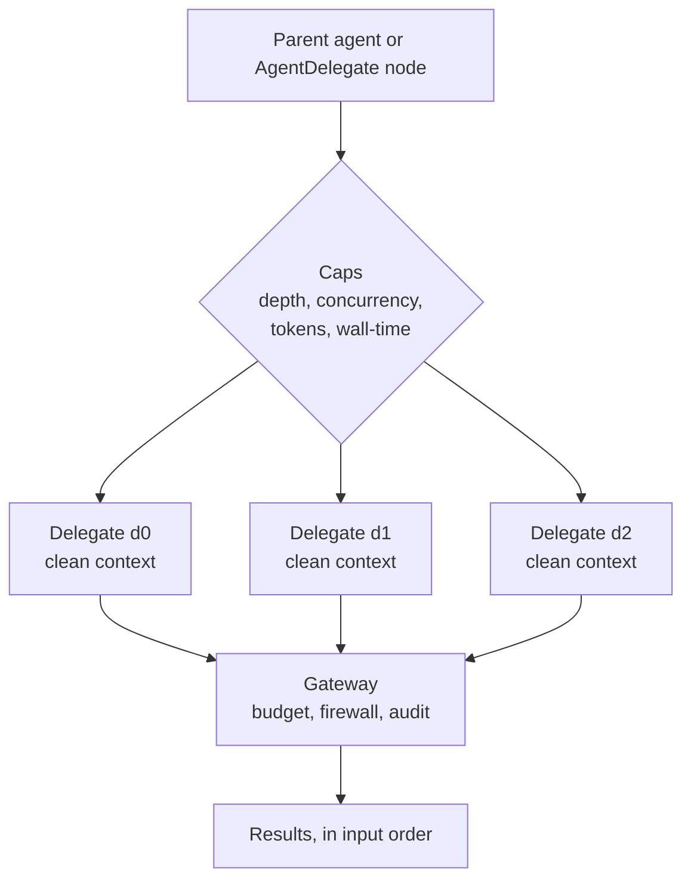

Delegation lets a parent agent or workflow node hand one or more self-contained tasks to
**sub-agents** that run in parallel, each with a clean context, and collect their results in input
order. The engine lives in `apps/core/src/workflow/delegation.rs`; it is exposed three ways: as the
built-in `delegate.fanout` tool, as the `AgentDelegate` workflow node, and as a streaming
endpoint (`POST /api/delegate/stream`).

This is **Core** logic. It decides *what runs*: which sub-agent, with what task, how deep, and how
many at once. The delegate's runtime and configuration determine its model path. Gateway budgets,
firewall, and audit apply to requests routed through its endpoint. See [Core vs Gateway](/docs/start-here/architecture/core-vs-gateway).

## As an agent tool (`delegate.fanout`)

Any agent can fan work out mid-task by calling the built-in `delegate.fanout` tool
(`apps/core/src/sidecar/mcp/delegate.rs`). It is registered as a reserved registry server
(`delegate`), so it is allowlist-gated and audited on both planes (ACP and OpenAI-compatible) like
every other built-in. New agents start with no tool grants. Grant `delegate.fanout` explicitly to the
parent agent before expecting it to delegate.

`delegate.fanout` takes a `tasks` array plus optional `max_concurrent` and `wall_time_secs`, runs
the tasks in parallel in clean contexts, and returns all results in one call as
`{ ok, results: [{ index, output, error }], count }`. Each task has these fields:

| Field | Meaning |
|---|---|
| `task` | The self-contained task prompt (required) |
| `agent_id` | The agent to name for the task. Defaults to the node's default agent (`ryu`) |
| `system_prompt` | Defines an inline sub-agent for this task. When set, `agent_id` is ignored |
| `model` | Model for an inline sub-agent; only used with `system_prompt` |
| `tools` | Tool names listed in an inline sub-agent's prompt for awareness only; it cannot execute them |

The tool does not expose `preset`, so every task uses the default `code_read` preset. A
registered agent's full tool loop runs only for a `code_write` delegate (see
[two execution paths](#two-execution-paths)), so `delegate.fanout` tasks run as single
clean-context Gateway completions.

A delegated sub-agent can itself hold the tool, so a process-global semaphore
(`MAX_CONCURRENT_FANOUTS = 4`) bounds how many fan-outs run at once across the whole process. With
the per-fan-out concurrency cap, this bounds the worst-case number of simultaneous sub-agents and
stops runaway re-entrant delegation.

For durable, long-running workers that a coordinator checks over time, use the
[coordinator threads](/docs/core/coordinator-threads) (`threads.*`) tools instead. `delegate.fanout`
is for ephemeral, parallel subtasks; `threads` is for persistent workers.

<Callout type="info">
  The desktop app has no Delegation screen. Agents use delegation through the chat tool loop. The
  `AgentDelegate` workflow node and the `POST /api/delegate/stream` endpoint serve declarative
  orchestration and headless callers.
</Callout>

## How it works

Each sub-agent receives **only its task prompt**. The parent's conversation history is excluded, so
a delegate starts from a clean slate. Same-depth delegates run concurrently behind a
semaphore, and each completed result streams back as it lands.



### Two execution paths

`call_sub_agent` picks one of two paths:

- **Registered agent.** When the delegate's preset is `code_write`, it has no `inline` definition, it
  sets `agent_id`, and a runner is published (`global_agent_runner()`), the named agent runs through
  the chat path. Its own engine binding, Gateway routing, tools, and system prompt govern the
  sub-task, with the per-delegate `max_tokens` cap. The wall-time timeout still bounds it. Read-only
  presets never take this path, so naming an agent cannot bypass their read-only promise.
- **Clean completion.** Otherwise the engine sends a single non-streaming
  `POST /v1/chat/completions` to the Gateway. The system message describes the preset (or carries
  the inline `system_prompt`), and the task is the only user turn. The model is the inline `model`
  when set, else `RYU_DEFAULT_LLM_MODEL`, else `gpt-4o-mini`.

## The endpoint

```http
POST /api/delegate/stream
```

The request body is a `DelegateBody` with these fields.

| Field | Type | Default | Meaning |
|---|---|---|---|
| `delegates` | array of `DelegateSpec` | `[]` | The sibling delegates to fan out, run concurrently |
| `caps` | `DelegationCaps` | engine defaults | Optional caps override; concurrency clamped to the hard max |
| `depth` | integer | `1` | Depth of these delegates (a top-level parent delegating is depth 1) |

The response is a Server-Sent Events stream. Each event is one JSON object on a `data:` line.

| Event | Shape | When |
|---|---|---|
| `started` | `{ event, id, preset }` | A delegate is admitted past the concurrency gate |
| `finished` | `{ event, result }` | A delegate finishes (success or failure carried in `result`) |
| `done` | `{ event, results }` | Terminal: the ordered result array for every delegate |
| `error` | `{ event, error }` | Terminal: the fan-out itself failed validation |

A delegate that fails (Gateway unreachable, wall-time exceeded, or a panic) still produces a
`DelegateResult`, so a partial fan-out always returns one result per spec rather than aborting the
whole batch.

## DelegateSpec

Each delegate names a task and, optionally, an agent and a permission preset.

| Field | Type | Default | Meaning |
|---|---|---|---|
| `id` | string | required | Stable id within the fan-out, echoed in progress events |
| `task` | string | required | The self-contained task prompt, the only context the sub-agent sees |
| `agent_id` | string | none | Route to a configured agent; only used for a `code_write` delegate (see [two execution paths](#two-execution-paths)) |
| `preset` | `PermissionPreset` | `code_read` | The intent label for the delegate's capabilities |
| `inline` | object | none | Inline sub-agent: `system_prompt`, optional `model`, and advisory `tools`. Always takes the clean completion path |

### Permission presets

Presets are a closed set of intent labels. Core attaches the preset's tool allowlist as a hint; the
Gateway enforces the matching policy. The default, `code_read`, can read but never mutate. Only
`code_write` allows mutation.

| Preset | Allowed tools | Mutates? |
|---|---|---|
| `research` | `web_search`, `web_fetch`, `read_memory` | no |
| `code_read` | `read_file`, `list_files`, `grep`, `read_memory` | no |
| `code_write` | the read set plus `write_file`, `apply_patch`, `run_command` | yes |
| `summarise` | none | no |

## Caps

`DelegationCaps` bound a fan-out so it cannot run away. The constants are defined in
`apps/core/src/workflow/delegation.rs`.

| Cap | Field | Default | Hard limit |
|---|---|---|---|
| Per-delegate token budget | `max_tokens` | `4096` (`DEFAULT_MAX_TOKENS`) | clamped to 1 to `32768` (`MAX_DELEGATION_TOKENS`) |
| Per-delegate wall-time (seconds) | `wall_time_secs` | `120` (`DEFAULT_WALL_TIME_SECS`) | - |
| Concurrent delegates | `max_concurrent` | `5` (`MAX_CONCURRENT_DELEGATES`) | clamped to 5 |
| Nesting depth | (the `depth` argument) | `1` | `3` (`MAX_DELEGATION_DEPTH`) |

`max_concurrent` is clamped to the range 1 to 5 by `effective_concurrency()`, so a request asking for
99 still runs at most 5 at a time and a request asking for 0 runs 1. A `depth` above 3 is rejected
before any delegate runs (`DelegationError::DepthExceeded`), and an empty `delegates` array is rejected
(`DelegationError::Empty`).

## The AgentDelegate workflow node

The same engine backs a workflow node. `NodeKind::AgentDelegate { delegates, caps }`
(`apps/core/src/workflow/mod.rs`) fans out concurrently and sets the node's output to the JSON array
of per-delegate results. Each delegate gets the node input appended to its `task`, so an upstream node
feeds the delegates as clean input. The executor (`executor.rs`, `run_agent_delegate`) calls
`run_fanout_with_checkpoint` so the fan-out participates in workflow durability. See
[Workflows](/docs/core/workflows) for the canvas and node model.

<Callout type="info">
  Delegation runs unrelated sub-agents in parallel from a clean slate. To assemble a standing group of
  agents that see each other and coordinate by strategy, use [Agent groups](/docs/core/agent-teams)
  instead.
</Callout>

## Durable fan-out

When `run_fanout` is given a checkpoint key (`FanoutCheckpointKey` of `run_id` plus `node_id`), each
completed delegate's result is persisted to `~/.ryu/state/fanout-checkpoints/<run_id>/<node_id>/<delegate_id>.json`.
On resume with the same key, delegates whose checkpoint file exists are skipped and their recorded
result reused, so input-order results are preserved without re-running completed work. Writes are
atomic (temp file then rename) so a mid-write crash never leaves a partial checkpoint that resume would
mistake for complete. All path segments are validated against directory traversal.

## Failure model

| Condition | Behavior |
|---|---|
| Gateway unreachable | Fail-closed: the delegate returns an error mentioning the Gateway |
| `RYU_ALLOW_GATEWAY_FALLBACK=1` | Opt-in fallback to a direct provider POST (legacy env vars) |
| Wall-time exceeded | The delegate result carries a `wall-time limit ... exceeded` error |
| Delegate task panics | Replaced with a failed `DelegateResult` so the batch still completes |

<Callout type="warn">
  Fail-closed is the default: if the Gateway cannot be reached, a delegate errors rather than calling a
  provider directly. The `RYU_ALLOW_GATEWAY_FALLBACK=1` escape hatch exists mainly for tests that point
  the Gateway at a blackhole address. In normal operation leave it unset so all delegate egress stays
  governed.
</Callout>

## Related

<Cards>
  <DocCard href="/docs/core/agent-teams" />
  <DocCard href="/docs/core/workflows" />
  <DocCard href="/docs/core/coordinator-threads" />
  <DocCard href="/docs/gateway/governance" />
</Cards>
