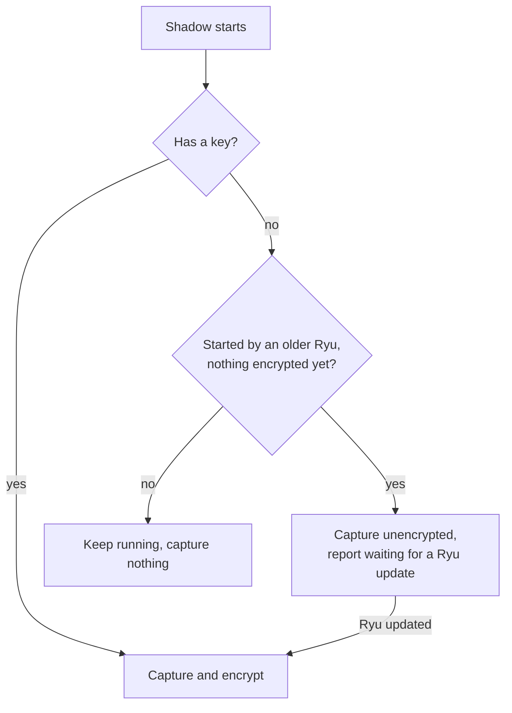

This page continues the per-store coverage from
[Sealed User Content](/docs/core/encryption-user-content), which explains the envelope formats,
search, embeddings, migration, and no-key behaviour these rows rely on.

## Clients (desktop web view, web app, browser extension, web chat history, mobile app, iOS keyboard)

Apps on your devices cannot use your data folder's key, so each one encrypts with a key it keeps on
that device.

When that key cannot be read right now (for example before you unlock your phone for the first time
after a restart), the app waits. The desktop app retries for a few seconds at startup. The app leaves
the item unread, does not create a new key, and does not delete anything.

### Where each key lives, and what a backup can open

| Client | Key location | Can a backup open the data? |
|---|---|---|
| Mobile app, iOS keyboard | On the device only | No. After restoring onto another device, the mobile app starts over with a new key and keeps the restored items aside |
| Desktop app | Like the desktop app's other keys: your OS keychain, or a key file in your data folder where no keychain exists | Yes, a backup that includes that keychain or folder |
| Web app, web chat history, browser extension | The browser's own database, next to the data | Yes, a full copy or backup of the browser profile |

Something that no longer opens is set aside, not deleted.

<Callout type="info">
Phones, browsers, and the webview store data in their own databases, which Ryu cannot scrub.
Plaintext written by earlier versions can remain in their freed space or logs until they compact
them. Clearing the app's or site's data removes it.
</Callout>

### Client stores

| Store | Sealed now? | Field(s) | Where |
|---|---|---|---|
| Desktop app: offline copies of collaborative documents | Yes | the full text of documents and database views you edit together | encrypted with a key derived from the desktop app's key in your OS keychain, kept per signed-in account. When you sign out or switch accounts, copies whose edits all reached your node are deleted; copies with edits your node never received are kept, encrypted, and you are told |
| Desktop app: Prompt Studio test suites, bot feed comments, open tabs, window layout, your name, email and picture | Yes | the stored values | encrypted with the same desktop key; never included in settings sync, and Prompt Studio suites are never cleared automatically. An older version of the app (or a web app tab left open on an older version) finds these values empty instead of overwriting them, and what it saves is added back by the next up-to-date version |
| Web app (the desktop app in a browser) | Yes, in the browser | the same values | encrypted with a key the browser keeps and cannot export. This protects a copy of the site's local storage files read outside the browser. It does not protect a full copy or backup of the browser profile, which carries the key with the data; the offline document copies sit in the same browser database as the key. It does not protect against code running on the same site |
| Web chat history | Yes, in the browser | your conversations | encrypted with a key the browser keeps and cannot export. The history is kept only in this browser: signing out, switching accounts (from any account menu or the sign-in account chooser) or signing out an account deletes it. History stored by older versions, for any account, is encrypted the next time the site loads. A tab left open on an older version of the site shows an empty history instead of overwriting the encrypted one, and conversations it saves are added to the encrypted history by the next up-to-date tab |
| Browser extension search cache | Not stored on disk | conversation titles, bookmarks | kept only in the browser's session memory and rebuilt from your node; the copy older versions stored on disk is removed each time the extension starts |
| Browser extension prompt library | Yes, in the browser | your saved prompts | encrypted with the extension's own browser key. Prompts that no longer open are kept aside and the toolbar tells you |
| Mobile app: on-device AI conversations, agent prompts and saved tasks | Yes | message text, system prompts, task titles and notes | encrypted with a key kept in the phone's secure storage, readable after the first unlock and never moved to another device. Items saved by older versions, including older conversations you no longer open, are encrypted when the app starts or returns to the foreground. Reminders scheduled for later show a generic text, because the phone's notification store is not encrypted by Ryu |
| iOS keyboard clipboard history | Yes | the text you copied | encrypted with a key in the shared keychain, readable after the first unlock. While the key cannot be read the clipboard strip stays empty and nothing is captured |

Older versions cannot read these encrypted values. On the desktop and web app they start empty
instead of overwriting them; the mobile app, the iOS keyboard and the extension's prompt library
may be overwritten. Export your data before downgrading.

## Shadow and Ghost (capture logs, indexes, side databases, media, accessibility snapshots)

These use Shadow's own key, derived from your data folder's key and handed to Shadow when Ryu
starts it.

- A Shadow you start yourself needs the same key its operator provides for other encrypted settings.
  Without a key, Shadow keeps running but captures nothing, and never writes captured data in
  plaintext.
- The exception is an older Ryu that installs this Shadow but cannot hand it a key yet. If Shadow has
  never encrypted anything in that data folder, it keeps capturing unencrypted, as before, and
  reports "waiting for a Ryu update".
- While it waits, search and recall over captured activity are unavailable. Once Ryu is updated,
  Shadow encrypts what it captured on its next start and indexes everything captured in the
  meantime.
- Ryu only connects to a Shadow it did not start when that Shadow reports that it is encrypting.
  Otherwise Ryu restarts Shadow itself.

| Store | Sealed now? | Field(s) | Where |
|---|---|---|---|
| Activity log (window titles, clipboard text, terminal commands, keystroke events) | Yes | every captured event | the current hour is written event by event in encrypted form; when the hour ends it is compressed and encrypted as one file. File names (date and hour) and sizes stay readable. Hours stored by an older version are encrypted when Shadow starts |
| Timeline and memory databases | Yes | window titles, web addresses, clicked element names, meeting summaries and participants, remembered facts, reminders and their triggers, suggestions, recorded procedures and their steps, agent patterns | timestamps, app names and counters stay readable so the timeline can still be ordered and filtered. Rows stored by an older version are encrypted after the upgrade |
| Search index | Yes (keyed tokens) | indexed window titles, web addresses, on-screen text and transcripts | the index holds keyed tokens instead of words, and the text itself is encrypted. Search matches whole words only: no phrase, partial-word or fuzzy matching, and searching only for very common words returns nothing. The tokens reveal which entries share a word. An existing index is converted in the background after the first start following the upgrade; until it finishes, older entries appear in search as they are converted |
| Screenshots and microphone audio | Yes | the file contents | screenshots are encrypted as they are written. On macOS the system capture tool writes each raw frame to a file first: that file goes to a private folder inside Ryu's data folder, is deleted as soon as it is read, and anything a crash leaves there is deleted at the next start; frames an earlier version left in the system temporary folder are deleted too. Microphone audio is never written unencrypted: the current two-minute piece is held in memory and written encrypted when it ends, so a crash or a forced quit loses up to two minutes. Without a key the microphone is not recorded |
| Screen recordings | Yes, once a segment is closed | the file contents | a segment opens only when Shadow can encrypt. The open segment is unencrypted while it is being written. It is closed and encrypted after one hour, after five minutes without a screen change, as soon as capture is paused, screen capture is switched off or an app that is not allowed comes to the front, and when capture stops (Ryu gives Shadow time to finish before it quits). A segment left by a crash is encrypted the next time Shadow starts |
| Visual similarity index | No | image fingerprints of frames, with times | contains no text |
| Clips you record and export | No (by design) | the clip video, frames, audio and context | a recording you make on purpose to share or download |
| Ghost accessibility snapshots | Yes | what was on screen in the window Ghost read | encrypted under Ghost's own key in Ghost's snapshots folder, at most ten snapshots. A snapshot expires after ten minutes; expired files are deleted within a minute while Ghost runs, or the next time Ghost starts. Without a key they stay in memory only. Unencrypted snapshots an older version left on disk are deleted when Ghost starts |

Older versions cannot read this encrypted data; export your data before downgrading.

## Apps with files or search (Mail, Meetings, CRM, Checks, Mission Control, Quests)

These apps run as separate processes and encrypt their own data with a key that only the app
receives from Ryu (derived from your node's master key). Each encrypted database also records which
key encrypted it. Started with a different key, an app refuses to change that data instead of
mixing keys, and reports it in its health status.

| Data | Encrypted? | What is encrypted | Notes |
|---|---|---|---|
| Mail messages and drafts | Yes | subjects, bodies, previews, headers, sender and recipient addresses, draft attachments, attachment file names, event payloads, saved send responses | inbox names and addresses, allow and block lists, message and thread ids, labels, read state and timestamps stay readable so lists, threads and filters work; search still finds words in decrypted messages. Mail stored by an older version is encrypted when the app starts |
| Mail attachments and raw messages | Yes | the file contents | each file is named by a fingerprint of its contents, so identical attachments are stored once; the name shows which messages share an attachment. Older files are encrypted in the background |
| Mail credentials | Yes | each inbox's inbound signing secret, each webhook's signing secret, and webhook header values | values stored by an older version are re-encrypted when Mail starts. Without a key, Mail refuses to create an inbox or webhook |
| Meetings transcripts and notes | Yes | transcript text, speaker labels, meeting titles, participants, generated notes | ids and timestamps stay readable |
| Meetings audio | Yes | the recorded meeting audio | stored as an encrypted append-only log per meeting, so a crash loses at most the last chunk; recordings from an older version are encrypted in the background. The file size shows the recording length |
| Checks projects, runs and evidence | Yes | saved projects, cases, runs, failure bundles, screenshots and page snapshots | the Checks agent tools and the `ryu-checks` command line reach encrypted data through the running Tests app; when it is not running they can use only data that was never encrypted |
| Mission Control digests | Yes | conversation titles, folders, summaries, turn and file lists, open to-dos | counts and times stay readable for the charts; the folder filter uses a keyed fingerprint, which shows which conversations share a folder |
| Quests | Yes | tasks, captures, the completion judge's evidence and reasoning, the scratchpad | ids, timestamps and item kinds stay readable |
| CRM records (Harbor) | Yes | record names and field values, timeline notes and change history, list entry values, import files, previews and results | object and field definitions, record links, timestamps, task assignees and due dates stay readable so views, boards and reminders work. Search uses keyed fingerprints of words instead of the words, which shows which records share a word; it matches whole words only, with no partial-word or phrase search. An applied import's file is deleted. Records stored by an older version are encrypted when the app starts |

### Key handoff and downgrades

These rules apply to every app that encrypts its own data, here and on
[Sealed App Records and Cloud Data](/docs/core/encryption-app-records):

- **App updated before Ryu.** An app whose data was never encrypted keeps working unencrypted until
  Ryu delivers its key, and its health status says it is waiting for a Ryu update. An app whose data
  is already encrypted refuses changes until the key is back.
- **Run without Ryu.** An app uses the key you provide, or creates its own key file in its data
  folder. Keep that file with the data.
- **Downgrades.** Older versions cannot read the encrypted data. Export before downgrading.

Per-app record stores, TypeScript and Python apps, and Ryu Cloud are on
[Sealed App Records and Cloud Data](/docs/core/encryption-app-records).

## Related

<Cards>
  <DocCard href="/docs/core/encryption-at-rest" />
  <DocCard href="/docs/core/encryption-what-is-sealed" />
  <DocCard href="/docs/core/encryption-credential-files" />
  <DocCard href="/docs/core/encryption-user-content" />
  <DocCard href="/docs/core/encryption-files-and-gateway" />
  <DocCard href="/docs/core/encryption-app-records" />
</Cards>
