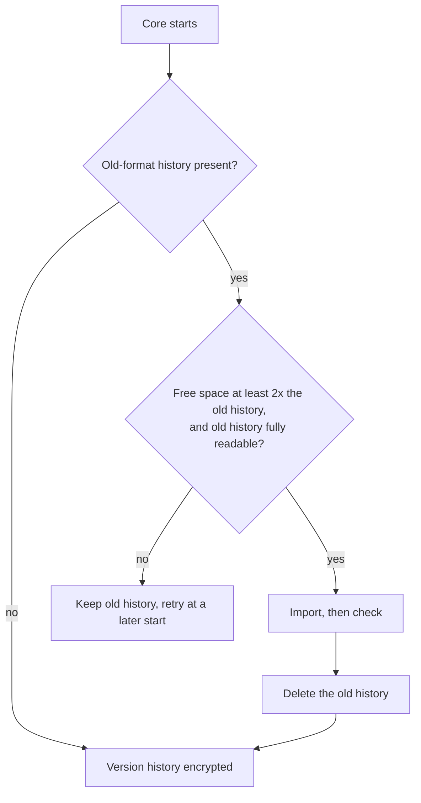

This page continues the per-store coverage from
[Sealed User Content](/docs/core/encryption-user-content), which explains the envelope formats,
search, embeddings, migration, and no-key behaviour these rows rely on.

## Core files, history, and runtime residue

Core's own files outside its databases: media, version history, chat checkpoints, logs, agent
transcripts, exports, and CLI history.

### Media, version history, and skills

| Store | Sealed now? | Field(s) | Where |
|---|---|---|---|
| Media you upload or generate (images, audio, video in chats and documents) | Yes | the file contents | each file is encrypted when it is stored and bound to its id; videos still stream and seek, because only the part being played is decrypted. File names (random ids) and sizes stay plaintext, and the storage quota counts the original sizes. Files stored by an older version are encrypted the first time they are opened and by a background pass after the upgrade, one at a time and only when there is enough free disk space |
| Version history of agents, workflows, skills and Space pages | Yes | every saved version and its label | an encrypted database. Each path keeps its newest 200 versions, and versions older than a year are removed except the newest 20. Older plain histories are imported as described under [Version history import](/docs/core/encryption-files-and-gateway#version-history-import) |
| Skills (the SKILL.md files in `~/.claude/skills`) | No (shared with other coding tools) | each skill's current instructions | the skills folder is the one Claude Code and other agent tools read, so Ryu writes skills there as plain files. Earlier versions of a skill are kept in the encrypted version history above. Agent system prompts are stored in Ryu's encrypted agent database |
| Pre-app canvas boards | Moved into encrypted Spaces | board names and node text | each old board file is deleted once it is copied into the Canvas app's encrypted Space; copies earlier versions kept beside it are deleted at startup |

#### Version history import

Versions move from a plain Git folder into the encrypted database. Existing version ids keep
working.

- The old Git history is imported once, checked, and only then deleted.
- Skill versions saved by builds older than the Git history (plain files, one per version) are moved
  into the same encrypted database at startup and then deleted.
- If an old-format history comes back later (for example a backup from an older version restored
  over the folder), it is imported again before it is removed.
- When there is not enough free disk space (twice the size of the old history), or the old history
  cannot be read completely, the import waits for a later start and the old history is kept.

Until the import completes and the old plain files are gone, Settings shows version history as not
encrypted, with the reason.

### Chat checkpoints, logs, and agent transcripts

| Store | Sealed now? | Field(s) | Where |
|---|---|---|---|
| Chat rewind checkpoints | No; credential files are left out | copies of project files from each turn | stored as plain Git objects so a rewind can restore them. Deleting a conversation, or clearing chats in Settings > Data, deletes its checkpoints and the file contents only they kept, and checkpoints older than 30 days are removed (the conversation rewind still works; restoring files from such a turn reports that the snapshot is gone). `.env` and `.env.*`, `*.pem`, `*.key`, `*.p12`, `*.pfx`, SSH private keys (`id_rsa*`, `id_ed25519*`, …), `.npmrc`, `.netrc`, `.pgpass`, and `credentials.json` are never copied, even when your repository tracks them. Copies an older build made stay until they age out |
| Core logs | No; redacted | log lines | logs are not encrypted, but tokens, API keys, bearer credentials and JWTs are masked before a line is written, log files are readable only by your user, and agent protocol traffic is logged without its content (method, id and size only) |
| Pi agent transcripts | No (the Pi agent writes them in its own format) | Pi's own copy of a conversation | kept in folders only your user can open, deleted when you delete the conversation (or clear chats in Settings > Data) or remove the Pi account it ran under, and deleted after 30 days. Ryu keeps its own encrypted copy of every conversation |
| Codex transcripts | No (the Codex agent writes them in its own format) | Codex's own copy of a session | kept in folders only your user can open; Codex's prompt history is turned off and removed; deleted when you delete the conversation (or clear chats in Settings > Data) and after 30 days. Ryu keeps its own encrypted copy of the conversation |

### Exports, imports, and CLI history

| Store | Sealed now? | Field(s) | Where |
|---|---|---|---|
| Agent sync export | No (by design) | agents, skills and, only if you tick it, conversation transcripts | a plain-text bundle written to a folder you choose so other tools can read it. Conversation transcripts are off by default and the export screen warns before you include them |
| Data-folder export | Yes (with your passphrase) | the encryption key | the export now always carries the data folder's key (OS keychain or key file) and earlier keys inside the encrypted archive, and a restore adopts that key while keeping the restored folder's previous key, so a backup restores onto a fresh install. Restoring into a folder other than the one in use keeps the key in that folder's key file and leaves the OS keychain alone |
| Imported ChatGPT and Claude project folders | No (by design) | project instructions, project memory, knowledge files | an ordinary folder in `~/Documents/Ryu` that you and your agents open directly. Imported chats and memories are encrypted |
| CLI prompt history | Yes | the prompts you typed in the terminal client | encrypted by the Ryu node on the same machine; without a reachable local node, history is kept in memory only, and a history file the node cannot open is left untouched. Pasted blocks and slash-command arguments are not recorded |
| Workspace handoffs between nodes | Yes | the patch and commit bundle a handoff carries | see the handoff row on [Sealed Gateway, Node, and Client Credentials](/docs/core/encryption-credential-files#backups-and-handoffs) |

Older builds cannot read the encrypted media, version history or CLI history; export your data
before downgrading.

## Gateway personal data

Phone lines, budget spend subjects, channel pairing, and the call journal use the Gateway's own key,
derived from your data folder's key. A standalone Gateway needs the same key its operator provides
for its other encrypted settings.

| Store | Sealed now? | Field(s) | Where |
|---|---|---|---|
| Phone assistant lines in the Gateway settings | Yes | the callers allowed on a line and the number calls are handed off to | encrypted inside the settings file and shown to you as normal in the Gateway settings. The line's own numbers, labels and greetings stay readable. Firewall patterns also stay readable because you edit them as text, so do not put personal data in them. The channel allowlists (the sender ids, group ids and phone numbers you admit without pairing) also stay readable in the settings file |
| Budget spend counters | Yes (keyed tokens) | the ids of the users, agents, organizations, teams, keys and service accounts that spend is counted for | each id is replaced by a keyed token and stored encrypted; amounts and time windows stay readable. The tokens reveal which counters belong to the same subject. See [Spend counters without the right key](/docs/core/encryption-files-and-gateway#spend-counters-without-the-right-key) |
| Channel pairing (Telegram, WhatsApp, Slack, Discord, iMessage senders) | Yes | sender ids and phone numbers of paired senders, pending pairing codes, reply links and delivery records | the whole file is encrypted. A file that cannot be opened is set aside, encrypted, and senders pair again. Pairing codes and sender ids are no longer written to the Gateway log |
| Phone call requests | Yes | the purpose of each outbound call you asked for, and the hand-off number | the whole file is encrypted and now lives in the data folder. A file that cannot be opened is set aside, encrypted, instead of stopping the Gateway; at worst a call you retry within a day is placed twice. An older copy left beside the settings file is encrypted and moved into the data folder |

### Spend counters without the right key

- If the counters were written under a different key, they are kept as they are. Requests with a
  budget or organization limit are refused until the right key is back, instead of starting the
  count again from zero.
- A Gateway started without a sealing key (for example a container without `RYU_MASTER_KEY`) keeps
  counting a store that was never encrypted by plain id, and keeps serving.
- The first start with a key encrypts the store. After that, a keyless start refuses budgeted
  requests.

Older Gateway versions cannot read these encrypted values; export your data before downgrading.

## Related

<Cards>
  <DocCard href="/docs/core/encryption-at-rest" />
  <DocCard href="/docs/core/encryption-what-is-sealed" />
  <DocCard href="/docs/core/encryption-credential-files" />
  <DocCard href="/docs/core/encryption-user-content" />
  <DocCard href="/docs/core/encryption-app-data" />
  <DocCard href="/docs/core/encryption-app-records" />
</Cards>
