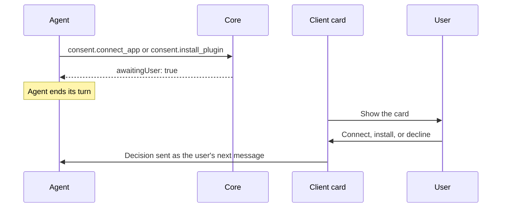

These built-in tools return cards that the client renders in the thread. Their server names and
allowlist ids are listed in [Built-in Tools](/docs/core/built-in-tools#reserved-built-in-servers).

## Generative UI formats

`ui.render` accepts two formats:

| `format` | Input | Behavior |
|---|---|---|
| `json-render` (default) | A flat `{ root, elements }` tree from the closed component catalog | Ryu's native format |
| `a2ui` | An A2UI v0.9/v0.9.1 envelope, message array, `{ "messages": [...] }`, or newline-delimited JSON (JSONL) | Supported A2UI basic-catalog components map to the same native components. Data-model bindings and server actions are preserved |

A2UI limits:

- Unsupported A2UI components appear as inert notices.
- A2UI `functionCall` expressions and local actions are not executed.
- One `ui.render` card represents one A2UI surface.

While the call is still streaming, the client shows a pending "Rendering UI" row. The spec (native
or A2UI) renders once the call completes, and its buttons and submissions become active then.

## Charts, metrics, and live calculators

The native catalog includes `Chart` (bar, line, area, or pie, colored from the app theme) and
`Stat` (a KPI tile with an optional delta). Chart data can be literal rows or read from state with
`{ "$state": "/path" }`.

### Computed values

Props can derive values from state with `{ "$computed": "<function>", "args": { ... } }`. No agent
code runs. The functions are a fixed set of pure helpers:

`add`, `subtract`, `multiply`, `divide`, `percent`, `sum`, `average`, `min`, `max`, `count`,
`round`, `clamp`, `payment`, `format`

- Arguments can be literals, state reads, or other `$computed` expressions.
- A missing or non-numeric input returns an empty value instead of an error, so a calculator stays
  usable while the user is still filling it in.
- `$template` string interpolation and element-level `visible` conditions are also supported.
- Buttons change state with `setState`, `pushState`, and `removeState`. Each takes a `statePath`.

### Saved widget state

Widget state is saved with the conversation. Checkbox ticks, typed values, slider positions, and
changes made by state actions are restored when the conversation is reopened. A widget that was
submitted stays submitted.

- **Size limit.** A widget's saved state is limited to about 64 KB of JSON. Past that, further
  changes stay on screen but are not saved.
- **Temporary chats and Island.** Temporary chats keep widget state only while they are open.
  Island screens are not saved.
- **Collaborators.** Everyone with write access to the conversation shares one saved copy of each
  widget. The app loads it when the conversation is opened, so a collaborator's changes appear the
  next time you open the chat, not live. If two people change the same widget, the last save wins.
- **Branches.** A branch that includes the whole conversation copies the widget state. A branch
  from an earlier message starts its widgets from their initial state, because the saved state may
  include later changes.

### Reading state from the agent

`ui.get_state` lets the agent read the saved state for the conversation it is running in, so it can
answer questions such as "what's left on my list?" from what you actually ticked. It never reads
another conversation.

It returns, most recent first, each widget's tool call id, kind, title, state, submitted flag, and
last update time.

## HTML artifacts in the thread

`artifact.render` with `kind: "html"` is for answers the component catalog can't express, such as
custom visualizations, interactive explainers, small games, or mocks of a product screen. Pages,
SVGs, and Mermaid diagrams render at full width and at their natural height, up to about 960px.
Taller content scrolls inside the card, and **Open** shows the full view.

### Sandbox and theme

The page runs in a sandboxed frame with no network access and no access to the app, so CSS,
scripts, and data must be inline. `localStorage` and cookies are not available inside the sandbox.

The app's theme is available inside the frame as CSS variables that follow light and dark mode.
An HTML fragment gets a themed body. A full HTML document keeps its own styles and can use the same
variables.

| Group | Variables |
|---|---|
| Surfaces and text | `--background`, `--foreground`, `--card`, `--muted`, `--muted-foreground`, `--border` |
| Accents | `--primary`, `--primary-foreground`, `--accent`, `--destructive` |
| Charts | `--chart-1` to `--chart-5` |
| Shape and type | `--radius`, `--font-sans`, `--font-mono` |

### Page state

A page can keep its own state across reloads:

- `window.ryu.state.set(obj)` saves a plain JSON object. The object can be up to 63 KB once encoded
  as UTF-8 JSON and nested up to 31 levels deep. `set()` throws a `RangeError` for anything larger,
  so the page knows the state was not kept.
- `window.ryu.state.get()` reads it back, and returns `null` the first time.

The state is saved with the conversation for the page's card in the chat, including after the card
moves to the end of the turn. `ui.get_state` returns it under the `artifact.render` call's id with
`kind: "artifact"`. **Open** and **Open in tab** show a fresh copy of the page whose changes are
not saved.

### Other UI protocols

- AG-UI is an agent-to-frontend event transport, not a component format. It belongs at the
  agent/event integration boundary.
- MCP Apps and `ui://` resources are sandboxed app widgets. They remain a separate rich-app surface
  and are not converted into native Agent UI components.

## Builders and self-build

These built-ins let an approved agent inspect and create durable Ryu definitions.

| Server | Tools | What it does |
|---|---|---|
| `ryu_self_build` | `scaffold_runnable`, `install_app`, `write_ryu_json`, `write_tool`, `verify_tool`, `install_tool` | Create, validate, and install a runnable, app, or tool package. Writes remain subject to the active approval policy |
| `agent_builder` | `get_agent`, `configure_agent`, `create_agent`, `create_agent_team` | Inspect and author agent definitions and teams |
| `workflow_builder` | `get_workflow`, `create_workflow`, `configure_workflow` | Inspect and author workflow definitions |
| `dashboard_builder` | `get_dashboard`, `create_dashboard`, `configure_dashboard` | Inspect and author dashboard definitions |

Builder tools may be absent in a restricted client or test context even though their Core contract
exists. Check the live tool catalog before calling them, and treat generated definitions as
untrusted input until validation and approval complete.

## Consent requests

Consent tools ask the user to act before the agent continues. Core validates the request and the
client renders the card.



### Connect an account

`consent.connect_app` asks the user to connect an account. Pass `app` (a Composio toolkit slug
such as `gmail` or `github`) and a one-sentence `reason`. For an MCP server that signs in with
OAuth, set `"provider": "mcp"`, `pluginId` to the installed plugin, and `app` to its server name.
The card opens the provider's sign-in page in the browser and waits for the connection.

```json
{ "app": "gmail", "reason": "To summarize today's unread email." }
```

### Install a plugin

`consent.install_plugin` asks the user to install a plugin. Pass a `query` describing the
capability, or up to five `pluginIds`, plus a `reason`.

```json
{ "query": "linear issues", "reason": "To file the bugs we found as Linear issues." }
```

The client searches the catalog and shows at most three plugins: official first, then verified
publishers, then community plugins. Each group is ordered by ratings and installs. Community
listings link to their source instead of installing.

### The user's reply

Both tools return `awaitingUser: true` straight away, and the agent should end its turn. The card
sends the user's decision as their next message, for example:

- `I connected "gmail". Please continue.`
- `I couldn't connect "gmail" here: app connections aren't set up on this node yet.`
- `Not now. I don't want to install a plugin for this.`

These messages carry only fixed wording and plain identifiers, never catalog names or descriptions.
Trust tiers and stats come from the catalog the user can browse, never from the tool arguments.

## Suggested next task

`tasks.suggest` lets an agent hand the user a follow-up it found outside what it was asked to
do, such as a bug it noticed in passing or a fix it deliberately left out of scope. Most turns
should not call it, and it is never for the work already in progress.

| Field | Limit | Notes |
|---|---|---|
| `title` | 80 characters | A short label |
| `description` | 400 characters | One to three sentences |
| `prompt` | 4,000 characters | Starts a new chat that does not see the current conversation, so it must stand on its own |

```json
{
  "title": "Answer step-up email cooldown with 429, not 500",
  "description": "A sign-in followed by a protected action within a minute hits the email cooldown, and the error escapes as a 500.",
  "prompt": "In the step-up confirmation route, map the per-recipient email cooldown error to a 429 response that includes the wait time, and add a test."
}
```

The tool returns straight away and starts nothing. When the turn finishes, the desktop shows a
**Suggested task** card above the composer with the title, description, and the full prompt
under **Show prompt**. The user can:

- **Start**: open a new chat in its own tab, in the same project with the same agent, and send
  the prompt as soon as the chat is ready. The conversation you started from is not changed.
  - If that conversation is connected to another computer with
    [per-tab computers](/docs/surfaces/desktop/user-guide/chat-sidebar-controls), the new chat runs
    on that computer too.
  - The tab carries the task's title until the first message is sent, then it is named like any
    other chat.
  - In a project chat, the menu next to Start also offers **Start in a worktree**.
- **Save to Drafts**: keep the prompt in the [Drafts](/docs/apps/drafts) outbox for later. This
  button appears only when the Drafts app is enabled and the chat is not temporary.
- **Dismiss** the card.

Only the newest turn's suggestion is shown. It disappears as soon as the conversation moves on,
and the transcript keeps a compact **Suggested task** row as a record. Ryu Bot does not show the
card.

## End-of-turn result cards

`ui.render` and `artifact.render` place their result inline by default. Set
`"placement": "turn-end"` when the result should remain as a completed card at the end of the
assistant turn, after tool work has finished. This is useful for a release summary, a decision,
or a link the user is expected to open later.

JSON UI cards can use the catalog's `Card`,
`LinkPreview`, `Link`, and `Button` components. Artifact cards keep their normal **Open** and
**Open in tab** actions.

The card is reconstructed from the saved tool part when the conversation is reopened. Keep
untrusted URLs in the built-in link or artifact fields so the client can apply its normal safe-URL
handling.

## Related

<Cards>
  <DocCard href="/docs/core/built-in-tools" />
  <DocCard href="/docs/surfaces/desktop/user-guide/chat-messages" />
  <DocCard href="/docs/extend/develop/extensions/interfaces" />
</Cards>
